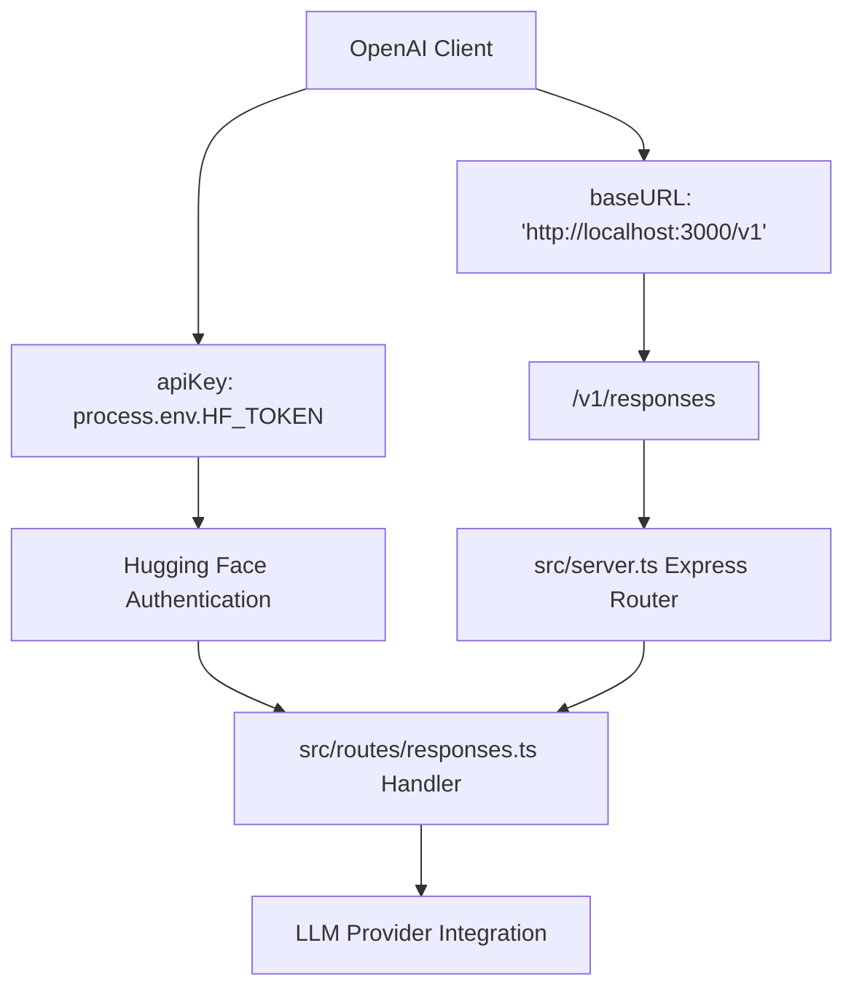
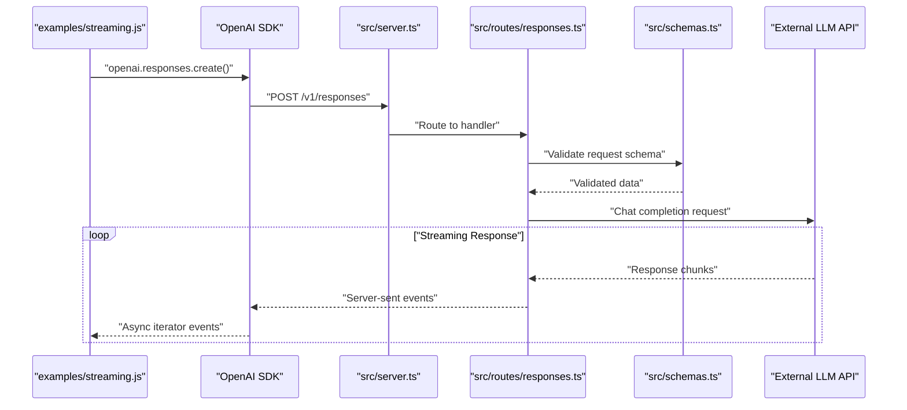
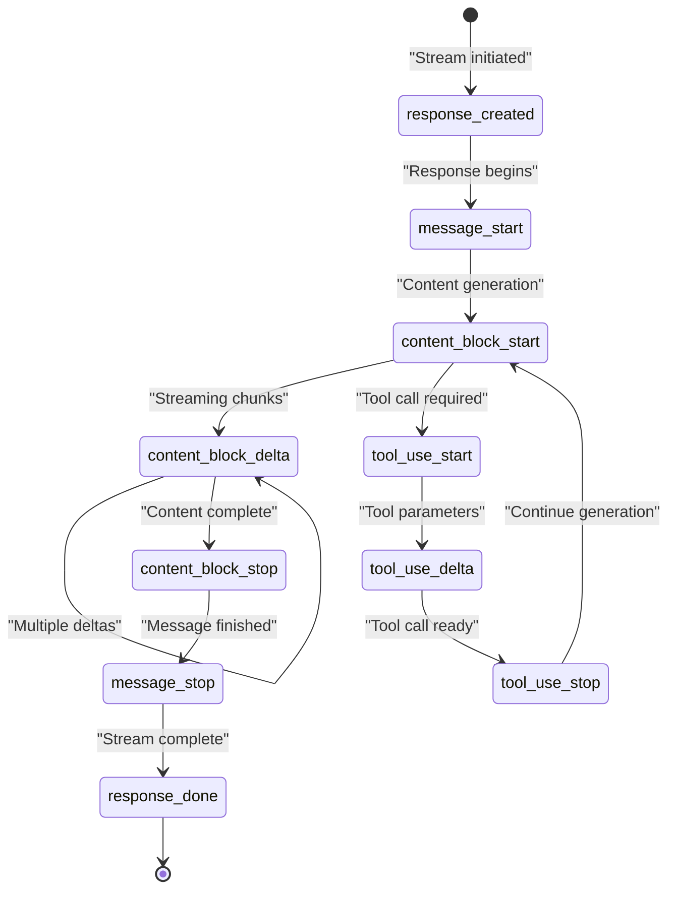
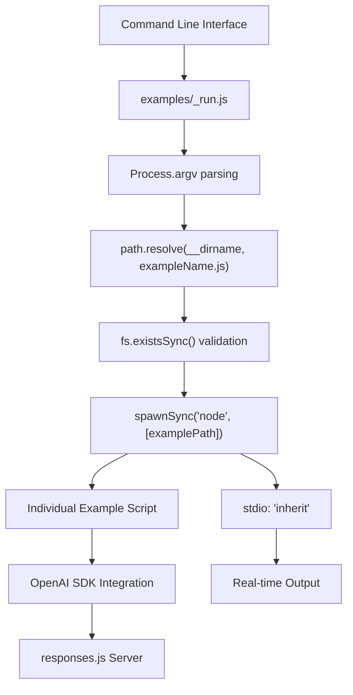

<!-- source: DeepWiki mcp.deepwiki.com · repo huggingface/responses.js · page 6 Examples and Usage Patterns · fetched 2026-10-26 -->

# Examples and Usage Patterns

<details>
<summary>Relevant source files</summary>

The following files were used as context for generating this wiki page:

- [examples/_run.js](examples/_run.js)
- [examples/streaming.js](examples/streaming.js)

</details>


This document provides practical examples and common usage patterns for responses.js, demonstrating how to integrate and utilize the system's key features. The examples cover basic API usage, streaming responses, tool integration, and advanced scenarios for production deployment.

For specific implementation details of the API endpoints, see [API Reference](#4). For detailed tool integration patterns, see [Tool Integration](#5). For basic setup and configuration, see [Getting Started](#2).

## Overview

The responses.js system supports multiple usage patterns depending on your integration needs. All examples use the OpenAI Node.js SDK configured to point to your responses.js server instance.

### Example Categories

| Category | Purpose | Key Features |
|----------|---------|--------------|
| Basic Usage | Simple text generation and streaming | OpenAI SDK, streaming responses |
| Structured Output | Schema-based data extraction | Zod validation, type safety |
| Tool Integration | External tool execution and MCP | Function calling, approval workflows |
| Production Patterns | Multi-turn conversations, error handling | State management, resilience |

## Common Usage Patterns

### Client Configuration Pattern

All examples follow a consistent client configuration pattern using the OpenAI SDK:

**Title: OpenAI SDK Configuration for responses.js**


Sources: [examples/streaming.js:1-3]()

### Request Processing Flow

**Title: Example Request Processing Through System Components**


Sources: [examples/streaming.js:4-17]()

## Basic Streaming Example

The fundamental usage pattern demonstrates real-time streaming responses:

```javascript
// Configuration pointing to responses.js server
const openai = new OpenAI({ 
  baseURL: "http://localhost:3000/v1", 
  apiKey: process.env.HF_TOKEN 
});

// Create streaming response
const stream = await openai.responses.create({
  model: "Qwen/Qwen2.5-VL-7B-Instruct:hyperbolic",
  input: [{ role: "user", content: "What's the capital of France?" }],
  stream: true,
});

// Process streaming events
for await (const event of stream) {
  console.log(event);
}
```

Sources: [examples/streaming.js:1-17]()

### Event Types in Streaming

**Title: Streaming Event Flow and Types**


Sources: [examples/streaming.js:15-17]()

## Example Execution Framework

The codebase includes a utility for running examples systematically:

### Example Runner Pattern

**Title: Example Execution System Architecture**


Sources: [examples/_run.js:15-30]()

The runner script provides a consistent execution environment:

- **Path Resolution**: [examples/_run.js:21]() resolves example scripts dynamically
- **Validation**: [examples/_run.js:22-25]() ensures script exists before execution
- **Process Management**: [examples/_run.js:29]() spawns child process with inherited stdio
- **Exit Handling**: [examples/_run.js:30]() propagates exit codes appropriately

## Integration Patterns

### Model Configuration Patterns

Examples demonstrate various model provider integrations:

| Pattern | Model Format | Provider | Use Case |
|---------|-------------|----------|----------|
| Hyperbolic | `"Qwen/Qwen2.5-VL-7B-Instruct:hyperbolic"` | Hyperbolic AI | Multi-modal processing |
| OpenAI Format | `"gpt-4o"` | OpenAI Compatible | Standard text generation |
| Hugging Face | `"microsoft/DialoGPT-medium"` | HF Inference | Open-source models |

Sources: [examples/streaming.js:5]()

### Environment Configuration

All examples rely on consistent environment setup:

- **Authentication**: `process.env.HF_TOKEN` for Hugging Face API access
- **Base URL**: Configurable server endpoint (default: `http://localhost:3000/v1`)
- **Model Selection**: Provider-specific model naming conventions

Sources: [examples/streaming.js:2]()

## Development Workflow Integration

### Testing Examples

The example system integrates with the development workflow:

1. **Local Development**: Examples run against local server instance
2. **CI Integration**: Examples serve as integration tests
3. **Documentation**: Examples provide executable documentation
4. **Debugging**: Real-time output helps troubleshoot issues

Sources: [examples/_run.js:1-31]()

### Error Handling Patterns

Examples demonstrate robust error handling:

- **File Validation**: [examples/_run.js:22-25]() checks example existence
- **Process Exit Codes**: [examples/_run.js:30]() propagates failure states
- **Console Feedback**: [examples/_run.js:17,23,27]() provides user guidance

For detailed information about specific example categories, see:
- [Basic Examples](#6.1) for simple use cases and streaming patterns
- [Structured Output](#6.2) for schema-based data extraction examples  
- [Advanced Integration](#6.3) for complex production scenarios

Sources: [examples/streaming.js:1-18](), [examples/_run.js:1-31]()

---

