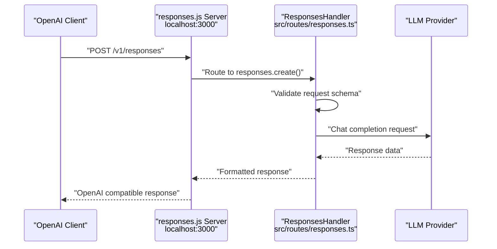
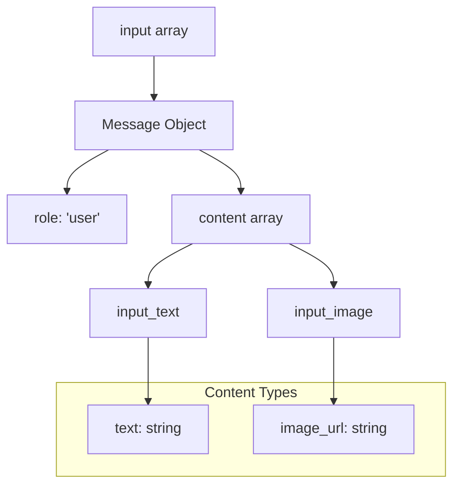
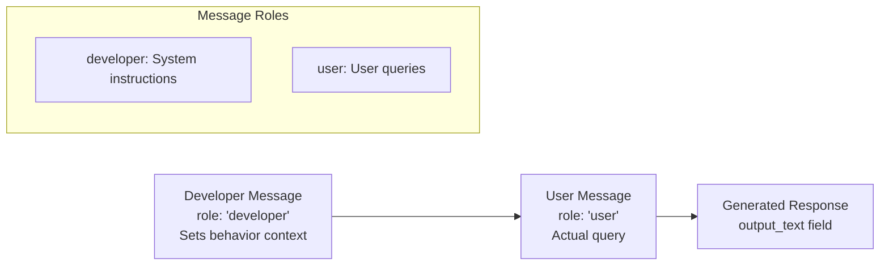
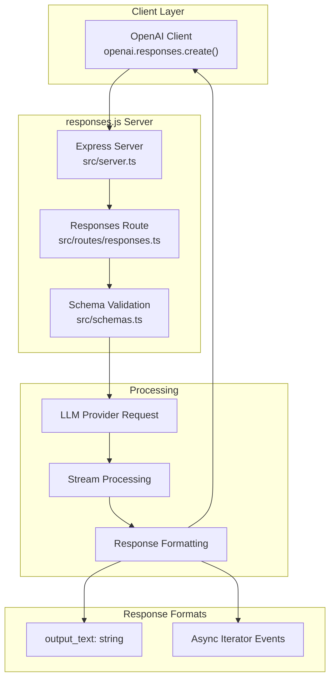

<!-- source: DeepWiki mcp.deepwiki.com · repo huggingface/responses.js · page 6.1 Basic Examples · fetched 2026-10-26 -->

# Basic Examples

<details>
<summary>Relevant source files</summary>

The following files were used as context for generating this wiki page:

- [.editorconfig](.editorconfig)
- [.gitignore](.gitignore)
- [LICENSE](LICENSE)
- [examples/image.js](examples/image.js)
- [examples/multi_turn.js](examples/multi_turn.js)
- [examples/streaming.js](examples/streaming.js)

</details>


This page demonstrates simple use cases for responses.js, including text generation, streaming responses, multi-modal input, and multi-turn conversations. These examples show the fundamental patterns for integrating with the responses.js server using the OpenAI Node SDK.

For structured data extraction and schema validation, see [Structured Output](#6.2). For complex scenarios involving tool chaining and production patterns, see [Advanced Integration](#6.3). For complete API specifications, see [Request and Response Format](#4.1).

## Client Setup Pattern

All basic examples follow the same client initialization pattern using the OpenAI Node SDK configured to connect to the responses.js server:

```javascript
import OpenAI from "openai";

const openai = new OpenAI({ 
  baseURL: "http://localhost:3000/v1", 
  apiKey: process.env.HF_TOKEN 
});
```

The client connects to the local responses.js server running on port 3000, which acts as a translation layer between the OpenAI Responses API format and various Chat Completion APIs.

**Client Connection Flow**



Sources: [examples/streaming.js:2](), [examples/image.js:3](), [examples/multi_turn.js:3]()

## Text Generation

The simplest use case involves sending a text prompt and receiving a generated response. This pattern uses the `openai.responses.create()` method with a basic input structure.

```javascript
const response = await openai.responses.create({
  model: "meta-llama/Llama-4-Scout-17B-16E-Instruct:groq",
  input: [
    {
      role: "user",
      content: "What's the capital of France?"
    }
  ]
});

console.log(response.output_text);
```

The response object contains the generated text in the `output_text` field. The `model` parameter specifies which LLM provider and model to use for generation.

Sources: [examples/image.js:5-20](), [examples/multi_turn.js:5-17]()

## Streaming Responses

For real-time response generation, enable streaming by setting `stream: true`. This returns an async iterator that yields events as the response is generated:

The streaming example demonstrates real-time response processing using server-sent events. When `stream: true` is enabled, the response becomes an async iterator yielding events as they occur.

```javascript
const stream = await openai.responses.create({
  model: "Qwen/Qwen2.5-VL-7B-Instruct:hyperbolic",
  input: [
    {
      role: "user",
      content: "What's the capital of France?"
    }
  ],
  stream: true
});

for await (const event of stream) {
  console.log(event);
}
```

Each event in the stream contains incremental response data, allowing for real-time display of generated content. For detailed information about streaming event types, see [Streaming Protocol](#4.3).

Sources: [examples/streaming.js:4-17]()

## Multi-modal Input

The responses.js server supports multi-modal input combining text and images. Content can include multiple types within a single message:

```javascript
const response = await openai.responses.create({
  model: "meta-llama/Llama-4-Scout-17B-16E-Instruct:groq",
  input: [
    {
      role: "user",
      content: [
        { type: "input_text", text: "what is in this image?" },
        {
          type: "input_image",
          image_url: "https://upload.wikimedia.org/wikipedia/commons/thumb/d/dd/Gfp-wisconsin-madison-the-nature-boardwalk.jpg/2560px-Gfp-wisconsin-madison-the-nature-boardwalk.jpg"
        }
      ]
    }
  ]
});
```

The `content` array supports both `input_text` and `input_image` types, enabling vision-language model capabilities for image analysis and description.

**Multi-modal Content Structure**



Sources: [examples/image.js:8-19]()

## Multi-turn Conversations

Multi-turn conversations involve multiple messages with different roles to establish context and maintain conversation flow:

```javascript
const response = await openai.responses.create({
  model: "Qwen/Qwen2.5-VL-7B-Instruct",
  input: [
    {
      role: "developer",
      content: "Talk like a pirate."
    },
    {
      role: "user", 
      content: "Are semicolons optional in JavaScript?"
    }
  ]
});
```

The conversation includes a `developer` role message to set system behavior, followed by a `user` role message with the actual query. This pattern enables context-aware responses and personality customization.

**Conversation Flow Pattern**



Sources: [examples/multi_turn.js:8-16]()

## Request Processing Overview

All basic examples follow the same core processing pattern through the responses.js system:

**Basic Request Flow**



Sources: [examples/streaming.js:1-18](), [examples/image.js:1-24](), [examples/multi_turn.js:1-21]()

---

