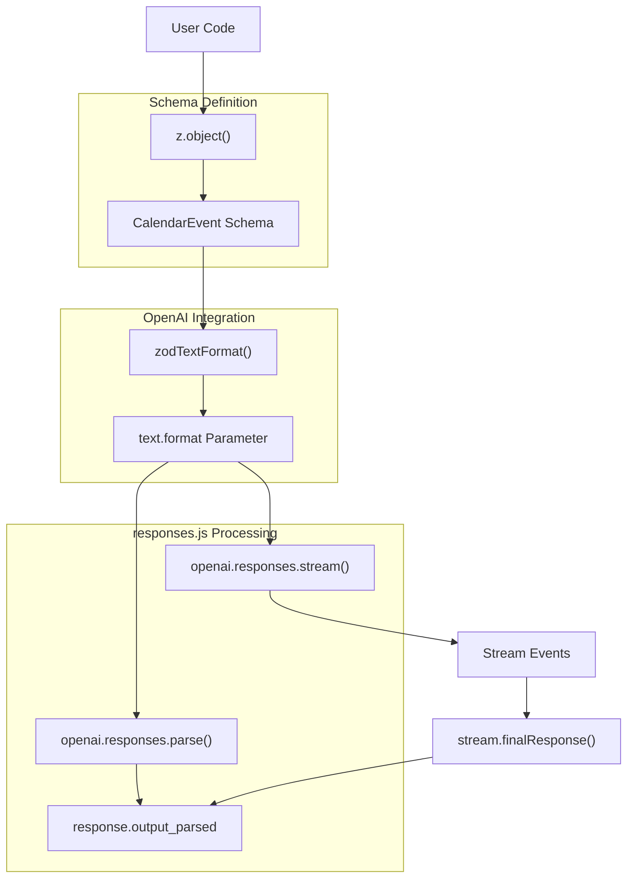
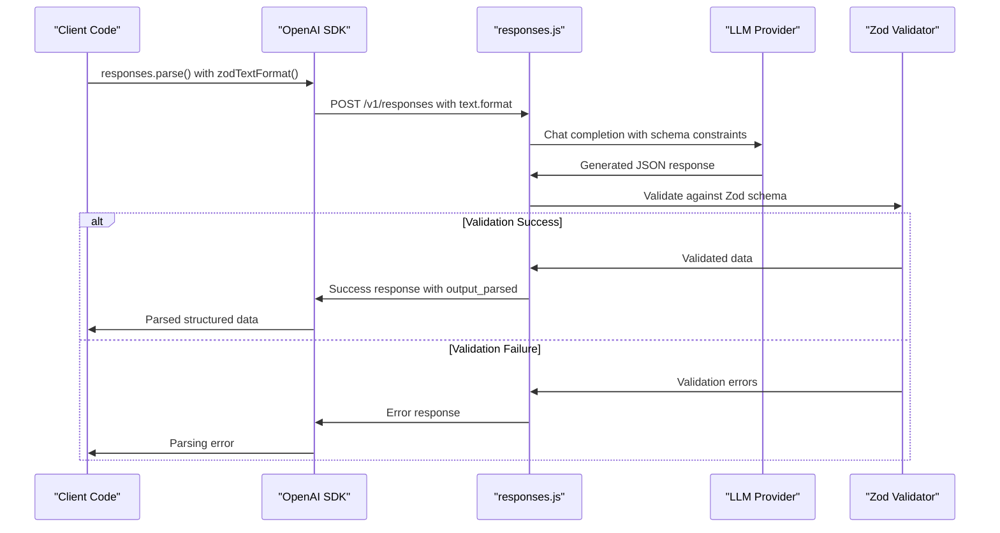

<!-- source: DeepWiki mcp.deepwiki.com · repo huggingface/responses.js · page 6.2 Structured Output · fetched 2026-10-26 -->

# Structured Output

<details>
<summary>Relevant source files</summary>

The following files were used as context for generating this wiki page:

- [examples/structured_output.js](examples/structured_output.js)
- [examples/structured_output_streaming.js](examples/structured_output_streaming.js)

</details>


This document covers how to use Zod schemas to enforce structured JSON output from LLM responses in responses.js. Structured output ensures that responses conform to predefined data structures, enabling reliable parsing and integration with downstream systems.

For information about basic text generation and streaming, see [Basic Examples](#6.1). For advanced tool integration patterns, see [Advanced Integration](#6.3).

## Overview

Structured output in responses.js leverages Zod schemas to constrain LLM responses to specific JSON formats. This capability is essential for applications that need predictable data structures for further processing, such as extracting calendar events, parsing user intents, or generating configuration files.

The system supports both streaming and non-streaming modes, allowing developers to choose the appropriate method based on their application requirements.

## Schema Definition Flow



**Sources:** [examples/structured_output.js:5-11](), [examples/structured_output_streaming.js:5-9]()

## Zod Schema Definition

Structured output begins with defining a Zod schema that describes the expected response format. The schema serves as both a type definition and runtime validator.

```typescript
const CalendarEvent = z.object({
    name: z.string(),
    date: z.string(), 
    participants: z.array(z.string()),
});
```

The schema defines the structure that the LLM response must conform to, including field names, types, and validation rules. Zod provides extensive validation capabilities including string patterns, number ranges, optional fields, and nested objects.

**Sources:** [examples/structured_output.js:7-11](), [examples/structured_output_streaming.js:5-9]()

## Non-Streaming Structured Output

For applications that can wait for the complete response, the `parse()` method provides structured output with full validation:

```javascript
const response = await openai.responses.parse({
    model: "meta-llama/Meta-Llama-3-70B-Instruct:novita",
    instructions: "Extract the event information.",
    input: "Alice and Bob are going to a science fair on Friday.",
    text: {
        format: zodTextFormat(CalendarEvent, "calendar_event"),
    },
});
```

The `zodTextFormat()` helper converts the Zod schema into the format expected by the OpenAI SDK. The second parameter provides a name for the schema that appears in the LLM's context.

The parsed result is available in `response.output_parsed`, containing the validated data structure.

**Sources:** [examples/structured_output.js:13-22]()

## Streaming Structured Output

For real-time applications, structured output can be combined with streaming to provide progressive updates while maintaining format validation:

```javascript
const stream = openai.responses.stream({
    model: "Qwen/Qwen2.5-VL-72B-Instruct:nebius", 
    instructions: "Extract the event information.",
    input: "Alice and Bob are going to a science fair on Friday.",
    text: {
        format: zodTextFormat(CalendarEvent, "calendar_event"),
    },
});

for await (const event of stream) {
    console.log(event);
}

const result = await stream.finalResponse();
```

Stream events provide incremental updates during generation, while `finalResponse()` returns the complete validated structure in `output_parsed`.

**Sources:** [examples/structured_output_streaming.js:12-26]()

## Processing Pipeline



**Sources:** [examples/structured_output.js:13-22](), [examples/structured_output_streaming.js:12-26]()

## Integration with responses.js API

Structured output integrates seamlessly with the responses.js API endpoints and schema system. The `text.format` parameter in requests triggers structured output processing within the response handler.

| Component | Role | File Reference |
|-----------|------|----------------|
| `zodTextFormat()` | Schema conversion helper | OpenAI SDK |
| `text.format` | Request parameter for output format | API Request Schema |
| `output_parsed` | Validated response data | API Response Schema |
| Response Handler | Processes structured output requests | [src/routes/responses.ts]() |

The system validates both the request format and the LLM's response against the provided schema, ensuring type safety throughout the processing pipeline.

**Sources:** [examples/structured_output.js:17-18](), [examples/structured_output_streaming.js:16-18]()

## Common Use Cases

Structured output is particularly valuable for:

- **Data extraction**: Converting unstructured text into database-ready formats
- **API responses**: Ensuring consistent response formats for client applications  
- **Configuration generation**: Creating valid configuration files from natural language descriptions
- **Form processing**: Extracting structured information from user inputs
- **Event parsing**: Converting natural language into calendar or scheduling data

The examples demonstrate event extraction, but the same patterns apply to any scenario requiring predictable JSON output from LLM responses.

**Sources:** [examples/structured_output.js:14-15](), [examples/structured_output_streaming.js:14-15]()

---

