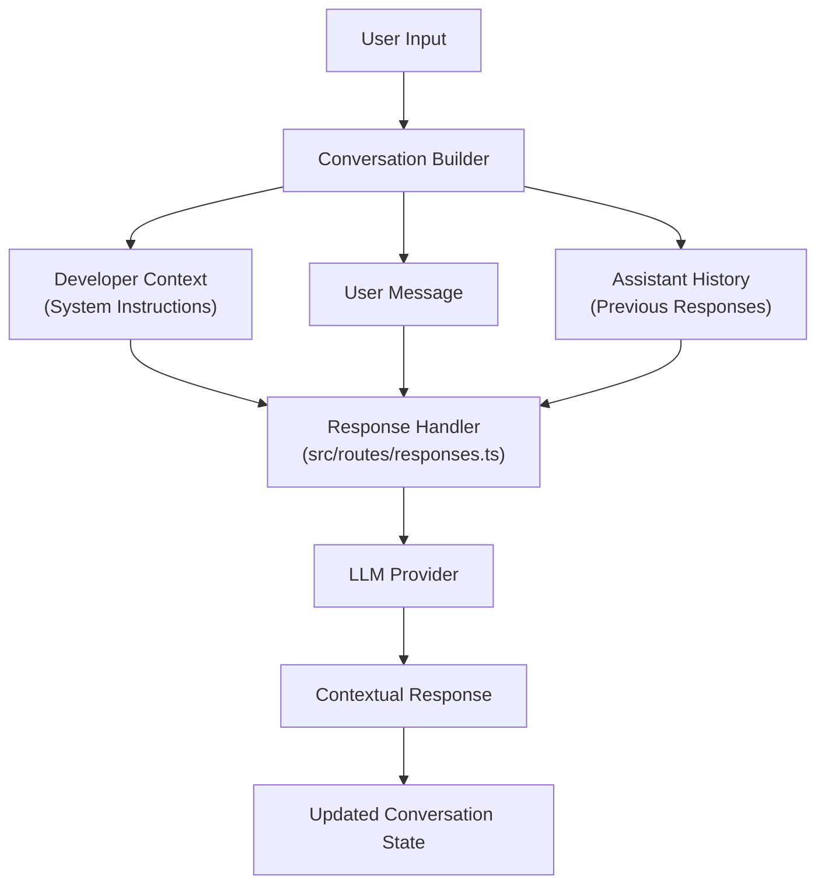
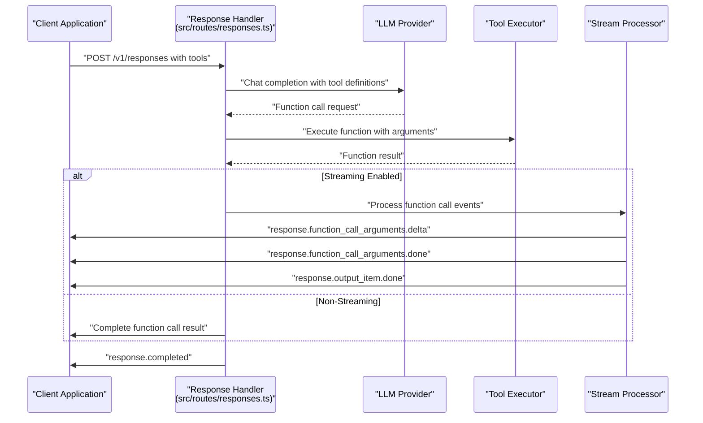
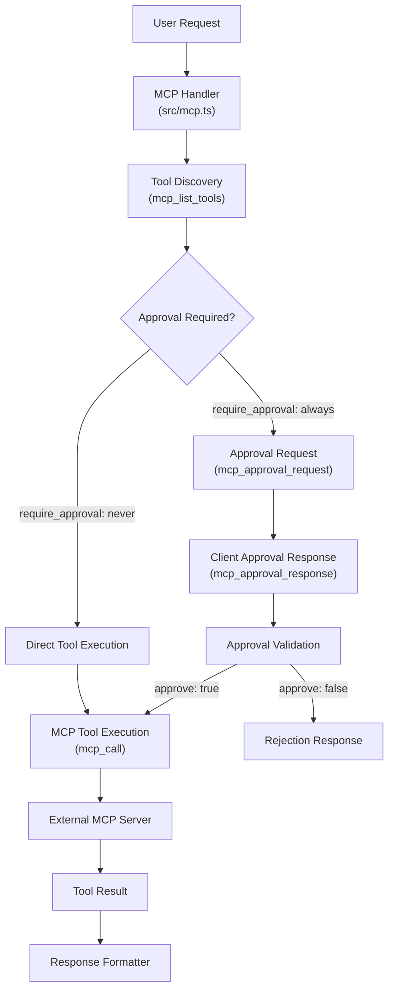
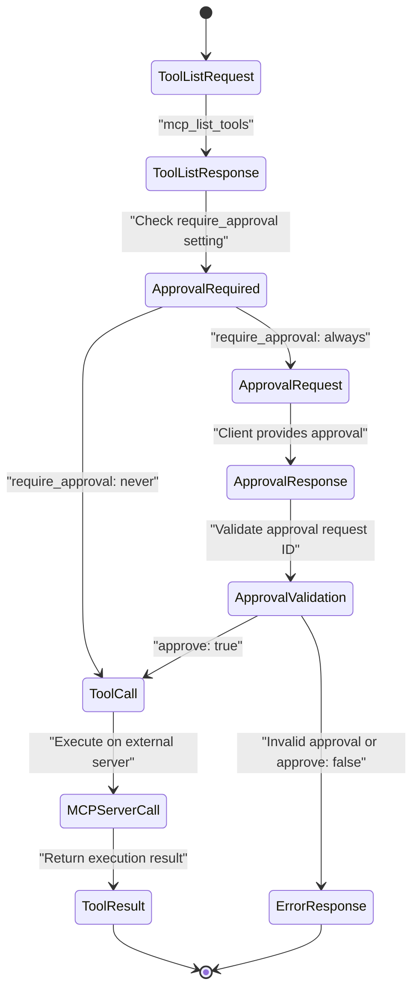
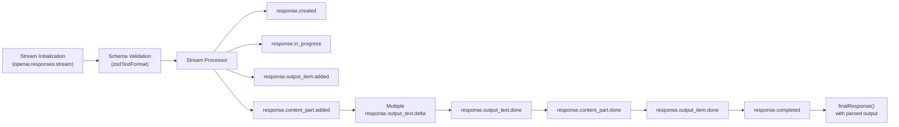
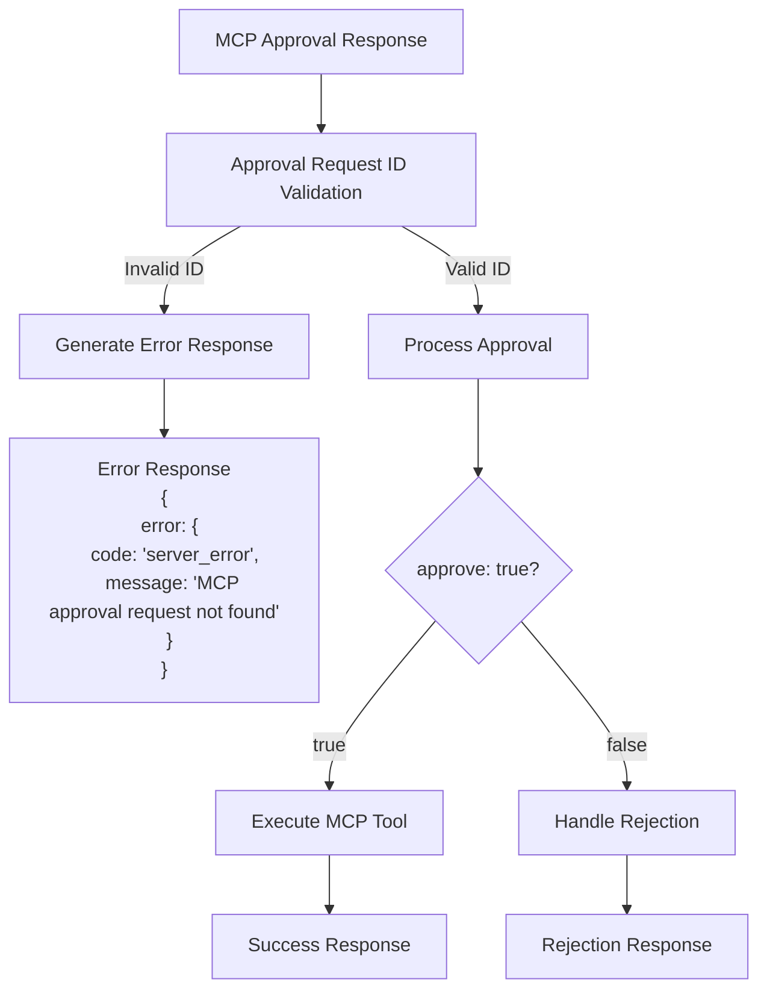

<!-- source: DeepWiki mcp.deepwiki.com · repo huggingface/responses.js · page 6.3 Advanced Integration · fetched 2026-10-26 -->

# Advanced Integration

<details>
<summary>Relevant source files</summary>

The following files were used as context for generating this wiki page:

- [.editorconfig](.editorconfig)
- [.gitignore](.gitignore)
- [LICENSE](LICENSE)
- [examples/multi_turn.js](examples/multi_turn.js)
- [tests/responses.test.js](tests/responses.test.js)

</details>


This document covers complex integration scenarios and production patterns for responses.js, including multi-turn conversations, tool chaining, MCP server integration with approval workflows, and advanced streaming patterns. For basic usage examples, see [Basic Examples](#6.1). For structured data extraction patterns, see [Structured Output](#6.2).

## Multi-Turn Conversation Patterns

Multi-turn conversations enable context-aware interactions by maintaining conversation history across multiple exchanges. The system supports various message roles including `developer`, `user`, and `assistant` messages.

### Conversation Context Management



**Sources:** [tests/responses.test.js:58-74](), [examples/multi_turn.js:5-17]()

### Role-Based Message Structure

The conversation input structure supports multiple message types:

| Role | Purpose | Usage Pattern |
|------|---------|----------------|
| `developer` | System-level instructions | Sets behavior, personality, constraints |
| `user` | User queries and input | Primary interaction content |
| `assistant` | Previous AI responses | Maintains conversation continuity |

**Sources:** [tests/responses.test.js:61-70](), [examples/multi_turn.js:8-15]()

## Tool Chaining and Function Execution

Advanced tool integration enables chaining multiple function calls and handling complex tool execution workflows with proper error handling and result processing.

### Function Call Execution Flow



**Sources:** [tests/responses.test.js:76-108](), [tests/responses.test.js:241-342]()

### Function Call Streaming Events

Function call streaming provides real-time feedback during tool execution:

| Event Type | Purpose | Data Structure |
|------------|---------|----------------|
| `response.function_call_arguments.delta` | Incremental argument building | `{ delta: string, item_id: string }` |
| `response.function_call_arguments.done` | Complete arguments | `{ arguments: string, item_id: string }` |
| `response.output_item.done` | Function execution complete | `{ item: { type: "function_call", status: "completed" } }` |

**Sources:** [tests/responses.test.js:311-325](), [tests/responses.test.js:317-321]()

## MCP Integration with Approval Workflows

Model Context Protocol (MCP) integration enables secure external tool execution with configurable approval mechanisms and server communication patterns.

### MCP Approval Workflow Architecture



**Sources:** [tests/responses.test.js:465-524](), [tests/responses.test.js:558-601](), [tests/responses.test.js:603-649]()

### MCP Configuration Patterns

MCP servers support flexible configuration for different security and automation requirements:

```javascript
// Always require approval
{
  type: "mcp",
  server_label: "gitmcp",
  server_url: "https://gitmcp.io/openai/tiktoken",
  allowed_tools: ["search_tiktoken_documentation", "fetch_tiktoken_documentation"],
  require_approval: "always"
}

// Auto-approve all tool calls
{
  type: "mcp",
  server_label: "gitmcp", 
  server_url: "https://gitmcp.io/openai/tiktoken",
  allowed_tools: ["search_tiktoken_documentation", "fetch_tiktoken_documentation"],
  require_approval: "never"
}
```

**Sources:** [tests/responses.test.js:488-496](), [tests/responses.test.js:607-615]()

### MCP Tool Discovery and Execution



**Sources:** [tests/responses.test.js:503-513](), [tests/responses.test.js:589-601](), [tests/responses.test.js:526-556]()

## Production Streaming Patterns

Advanced streaming implementations handle complex scenarios including structured output streaming, function call streaming, and error recovery patterns.

### Structured Output Streaming

Structured output with streaming combines real-time response generation with schema validation:



**Sources:** [tests/responses.test.js:344-463](), [tests/responses.test.js:454-462]()

### Event Sequence Validation

Production implementations should validate event sequences and sequence numbers:

| Event Sequence Position | Event Type | Validation Requirements |
|------------------------|------------|------------------------|
| Initial | `response.created` | Contains response object |
| Early | `response.in_progress` | Contains response object |
| Stream Start | `response.output_item.added` | Item type validation |
| Content Start | `response.content_part.added` | Part type validation |
| Stream Body | `response.output_text.delta` | Delta content validation |
| Stream End | `response.output_text.done` | Complete text validation |
| Completion | `response.completed` | Usage statistics validation |

**Sources:** [tests/responses.test.js:147-153](), [tests/responses.test.js:156-189](), [tests/responses.test.js:192-239]()

## Error Handling and Edge Cases

Production integrations must handle various error conditions and edge cases that can occur during complex workflows.

### MCP Approval Error Handling



**Sources:** [tests/responses.test.js:526-556]()

### Input Validation and Error Recovery

The system handles various input validation scenarios:

- Missing or invalid approval request IDs
- Malformed tool arguments 
- Server connectivity issues
- Schema validation failures for structured output

**Sources:** [tests/responses.test.js:552-555](), [tests/responses.test.js:536-540]()

### Pre-provided Tool Context

Advanced scenarios can include pre-provided tool contexts to optimize performance:

```javascript
// Pre-provided MCP tool list in input
{
  input: [
    {
      id: "mcp_list_tools_...",
      type: "mcp_list_tools", 
      server_label: "gitmcp",
      tools: [/* tool definitions */]
    },
    {
      type: "message",
      role: "user", 
      content: "User query"
    }
  ]
}
```

This pattern skips the initial tool discovery phase and proceeds directly to tool execution or approval workflows.

**Sources:** [tests/responses.test.js:651-719](), [tests/responses.test.js:656-686]()

---

