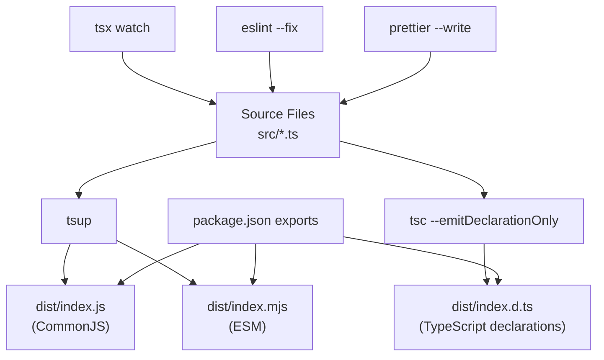
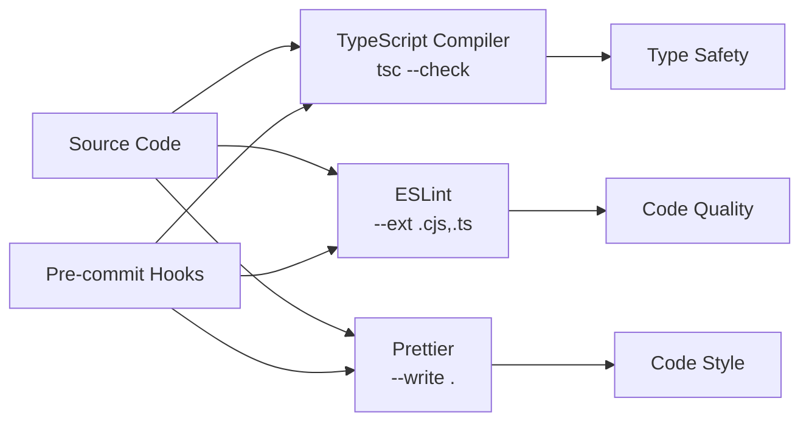
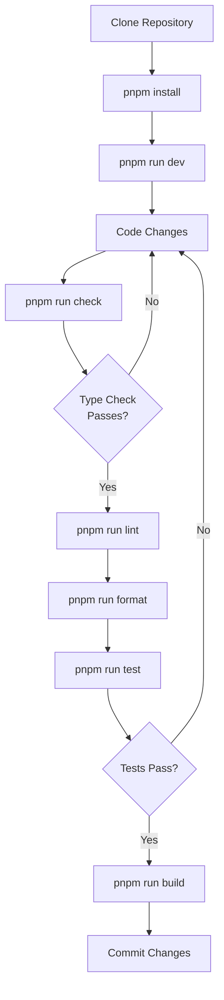
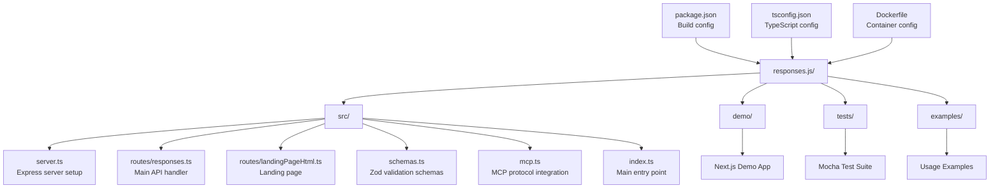
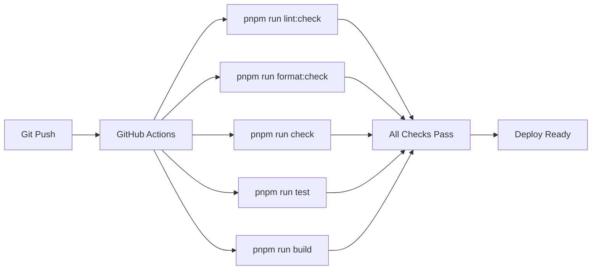
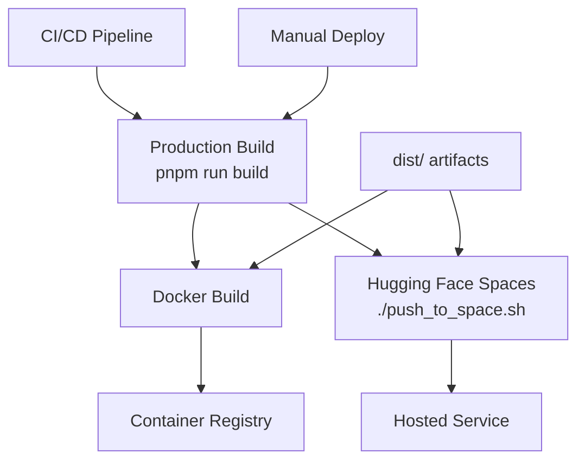

<!-- source: DeepWiki mcp.deepwiki.com · repo huggingface/responses.js · page 7 Development Guide · fetched 2026-10-26 -->

# Development Guide

<details>
<summary>Relevant source files</summary>

The following files were used as context for generating this wiki page:

- [demo/package.json](demo/package.json)
- [package.json](package.json)
- [pnpm-lock.yaml](pnpm-lock.yaml)

</details>


This document provides guidance for developers who want to contribute to or extend the responses.js codebase. It covers the development environment setup, build system, code quality standards, testing procedures, and deployment processes.

For information about using the responses.js API, see [Getting Started](#2). For details about the core system architecture, see [Core Architecture](#3). For testing the system, see [Testing](#7.1).

## Development Environment Setup

The responses.js project requires Node.js 18+ and uses `pnpm` as the package manager. The development environment is configured with TypeScript, ESLint, and Prettier for code quality.

### Prerequisites and Installation

The project specifies Node.js version 18+ in the `engines` field and uses `pnpm@10.10.0` as the package manager. After cloning the repository, install dependencies with:

```bash
pnpm install
```

The main development dependencies include TypeScript (`typescript@5.8.3`), ESLint (`eslint@9.30.1`), Prettier (`prettier@3.6.2`), and the build tool `tsup@8.5.0`.

**Sources:** [package.json:21-23](), [package.json:66-79]()

## Build System and Toolchain

The project uses a modern TypeScript build system with multiple output formats and comprehensive tooling for development and production builds.

### Build Configuration

The build system uses `tsup` to generate CommonJS, ESM, and TypeScript declaration files. The build process is configured in the `build` script:

```bash
tsup src/*.ts --format cjs,esm --clean && tsc --emitDeclarationOnly --declaration
```

This produces multiple output formats in the `/dist` directory:
- `index.js` (CommonJS)
- `index.mjs` (ESM) 
- `index.d.ts` (TypeScript declarations)

### Development Build Toolchain



The development server uses `tsx watch src/index.ts` for hot reloading during development, while the production build generates optimized bundles for distribution.

**Sources:** [package.json:26](), [package.json:28](), [package.json:14-19]()

## Code Quality and Standards  

The project maintains high code quality through automated linting, formatting, and type checking with TypeScript-first development practices.

### Linting and Formatting Configuration

ESLint is configured with TypeScript support using `@typescript-eslint/parser` and `@typescript-eslint/eslint-plugin`. The configuration includes:

- TypeScript-specific rules for type safety
- Prettier integration via `eslint-plugin-prettier`
- Automatic fixing with `eslint --quiet --fix --ext .cjs,.ts .`

Prettier handles code formatting with the `format` and `format:check` scripts for consistent code style across the project.

### Development Quality Tools



The `check` script runs TypeScript compilation without emitting files to validate type correctness, while `lint:check` and `format:check` provide CI-friendly validation without modifications.

**Sources:** [package.json:27](), [package.json:29-32](), [package.json:69-78]()

## Development Workflow

The development workflow is streamlined with npm scripts that handle common development tasks and provide clear commands for different environments.

### Core Development Scripts

The project provides several key scripts for development workflow:

| Script | Command | Purpose |
|--------|---------|---------|
| `dev` | `tsx watch src/index.ts` | Development server with hot reload |
| `build` | `tsup + tsc` | Production build |
| `start` | `node dist/index.js` | Production server |
| `test` | `mocha --timeout 20000` | Run test suite |
| `lint` | `eslint --fix` | Fix linting issues |
| `format` | `prettier --write` | Format code |

### Development Process Flow



The demo application has its own development workflow with separate scripts prefixed with `demo:` for building, running, and maintaining the Next.js frontend.

**Sources:** [package.json:25-44]()

## Project Structure for Developers

The codebase follows a clear modular structure that separates concerns and makes it easy for developers to locate and modify specific functionality.

### Core Development Structure



### Key Development Files

The main development entry points and their purposes:

- `src/index.ts` - Main application entry point
- `src/server.ts` - Express server configuration and middleware
- `src/routes/responses.ts` - Core responses API implementation  
- `src/schemas.ts` - Request/response validation schemas
- `src/mcp.ts` - Model Context Protocol integration
- `tests/**/*.test.js` - Mocha test suite
- `demo/` - Next.js demonstration application
- `examples/` - Usage example scripts

**Sources:** [package.json:24](), [package.json:46-49]()

## Testing and Quality Assurance

The project uses Mocha for testing with a focus on API integration tests and proper timeout configuration for async operations.

### Test Configuration

Tests are run using Mocha with a 20-second timeout to accommodate network requests and async operations:

```bash
mocha --timeout 20000 "tests/**/*.test.js"
```

The test suite is located in the `tests/` directory and focuses on integration testing of the API endpoints and core functionality.

### CI/CD Integration

The project includes automated quality checks that run on every commit:



**Sources:** [package.json:44]()

## Deployment Process

The deployment process supports both Docker containerization and Hugging Face Spaces deployment with automated build and deployment scripts.

### Docker Deployment

The project includes a `Dockerfile` for containerized deployment. The Docker build process uses the production build output and runs the server using `node dist/index.js`.

### Hugging Face Spaces Deployment

A dedicated deployment script `deploy:spaces` uses `./push_to_space.sh` to deploy to Hugging Face Spaces, providing a hosted environment for the responses.js service.

### Deployment Workflow



The deployment process ensures that the built artifacts from the `dist/` directory are properly packaged and deployed to the target environment.

**Sources:** [package.json:43](), [package.json:35]()

---

