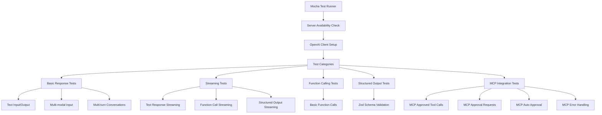
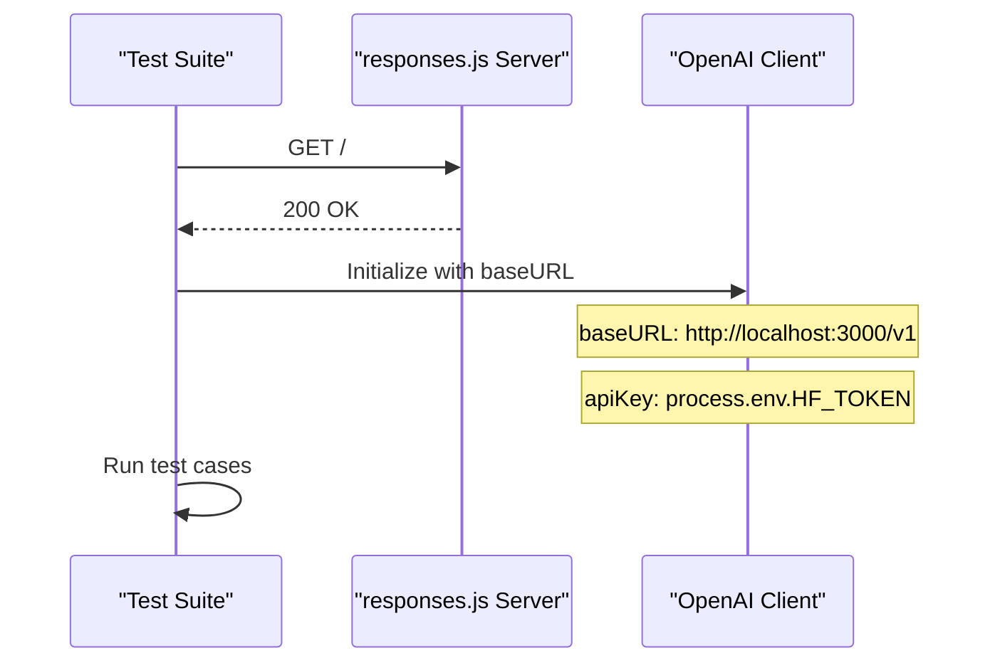
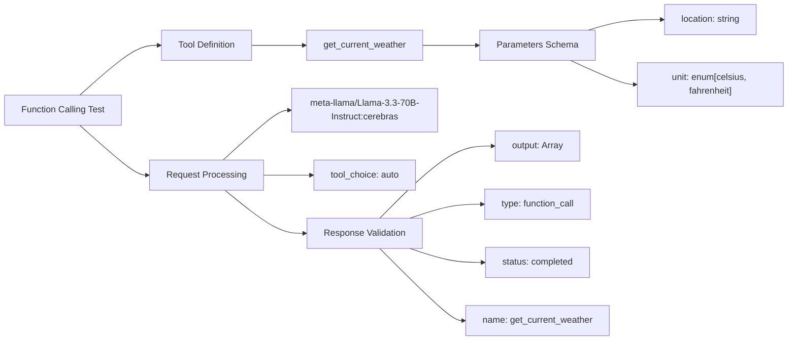
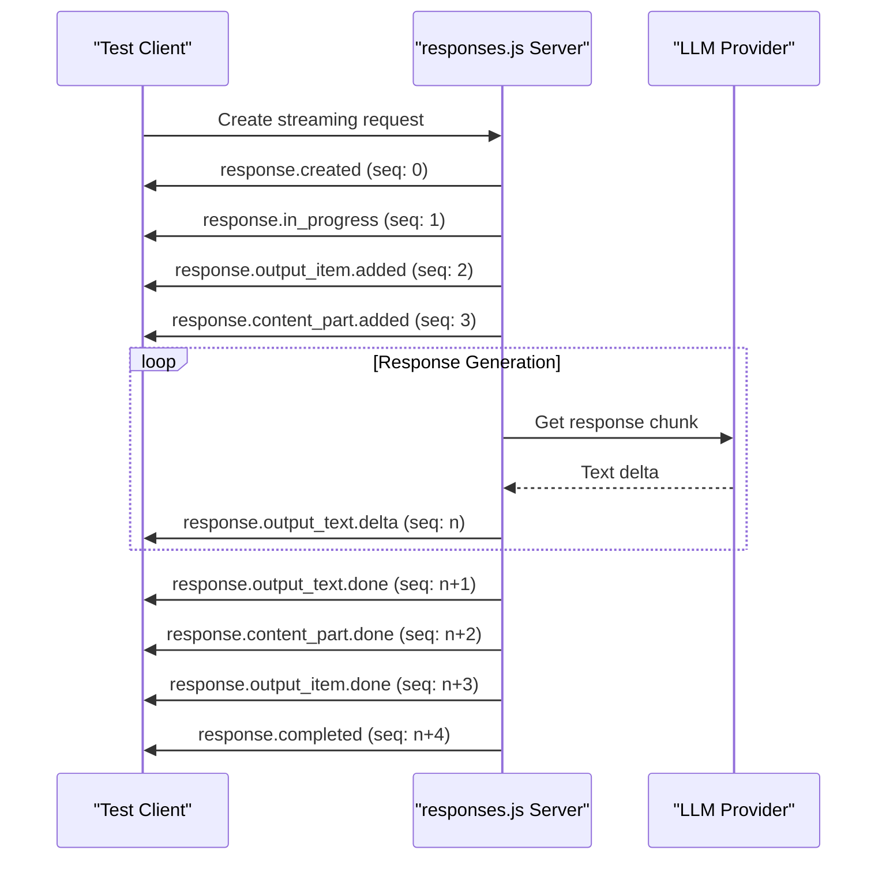
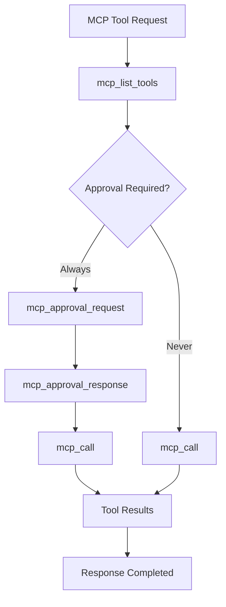
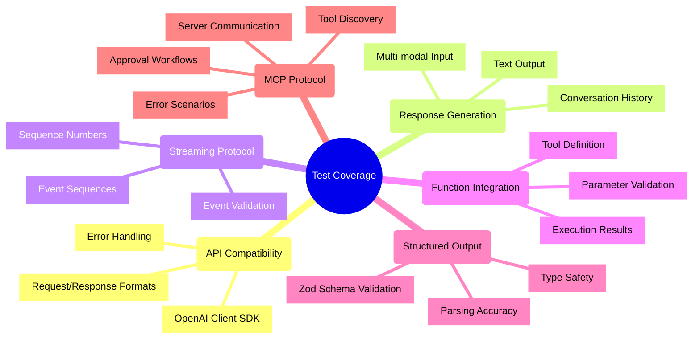

<!-- source: DeepWiki mcp.deepwiki.com · repo huggingface/responses.js · page 7.1 Testing · fetched 2026-10-26 -->

# Testing

<details>
<summary>Relevant source files</summary>

The following files were used as context for generating this wiki page:

- [tests/responses.test.js](tests/responses.test.js)

</details>


This document describes the comprehensive test suite for responses.js, including test structure, coverage areas, and how to run and extend the tests. The test suite validates all major system functionality including basic text generation, streaming responses, function calling, structured output, and MCP tool integration.

For information about the core API functionality being tested, see [API Reference](#4). For details about MCP tool integration being validated, see [MCP Integration](#3.3).

## Test Suite Overview

The responses.js test suite is implemented using Mocha and provides comprehensive coverage of the system's capabilities. All tests use the OpenAI client library to interact with the responses.js server, ensuring compatibility with the OpenAI API interface.

### Test Architecture



Sources: [tests/responses.test.js:6-25]()

### Test Environment Setup

The test suite requires a running responses.js server and performs several setup steps:



Sources: [tests/responses.test.js:10-25]()

## Core Functionality Tests

### Basic Response Generation

The test suite validates fundamental response generation capabilities across different input types and conversation patterns.

| Test Case | Purpose | Key Validations |
|-----------|---------|----------------|
| `text input, text output` | Basic text generation | Response contains string content |
| `text+image input, text output` | Multi-modal processing | Handles image URLs with text queries |
| `multi-turn conversation, text output` | Conversation continuity | Processes developer and user roles |

Sources: [tests/responses.test.js:27-74]()

### Function Calling Tests

Function calling tests validate the system's ability to execute external functions and return structured results:



Sources: [tests/responses.test.js:76-108]()

### Structured Output Validation

Structured output tests use Zod schemas to validate JSON parsing and type safety:

```javascript
const CalendarEvent = z.object({
  name: z.string(),
  date: z.string(),
  participants: z.array(z.string()),
});
```

The test validates both the raw output and parsed object structure, ensuring type safety through `zodTextFormat` integration.

Sources: [tests/responses.test.js:110-130]()

## Streaming Response Tests

### Text Streaming Event Sequence

Streaming tests validate the exact sequence and structure of server-sent events:



Sources: [tests/responses.test.js:132-239]()

### Function Streaming Validation

Function streaming tests validate the specific event sequence for function calls:

```javascript
const expectedSequence = [
  "response.created",
  "response.in_progress", 
  "response.output_item.added",
  "response.function_call_arguments.delta",
  "response.function_call_arguments.done",
  "response.output_item.done",
  "response.completed"
];
```

Sources: [tests/responses.test.js:241-342]()

### Structured Output Streaming

Structured output streaming combines streaming capabilities with schema validation, testing both the event flow and final parsed result through the `finalResponse()` method.

Sources: [tests/responses.test.js:344-463]()

## MCP Integration Tests

### MCP Tool Lifecycle Testing

MCP tests validate the complete tool integration workflow including discovery, approval, and execution:



Sources: [tests/responses.test.js:465-649]()

### MCP Test Scenarios

| Test Case | Approval Setting | Expected Behavior |
|-----------|------------------|-------------------|
| `MCP approved tool call` | `always` | Requires explicit approval before execution |
| `MCP approval request` | `always` | Generates approval request without execution |
| `MCP auto approval` | `never` | Executes tools without approval |
| `MCP approval error handling` | `always` | Validates error responses for invalid approvals |
| `MCP tools provided in input` | `always` | Uses pre-provided tool definitions |

### MCP Server Configuration

MCP tests use a standardized server configuration:

```javascript
{
  type: "mcp",
  server_label: "gitmcp", 
  server_url: "https://gitmcp.io/openai/tiktoken",
  allowed_tools: ["search_tiktoken_documentation", "fetch_tiktoken_documentation"],
  require_approval: "always" // or "never"
}
```

Sources: [tests/responses.test.js:488-496]()

## Running Tests

### Prerequisites

1. Start the responses.js server: `pnpm dev`
2. Set environment variable: `HF_TOKEN=your_hugging_face_token`
3. Ensure server is accessible at `http://localhost:3000`

### Test Execution

The test suite performs server availability checks before running:

```javascript
before(async function () {
  try {
    const response = await fetch("http://localhost:3000/");
    if (response.status !== 200) {
      throw new Error(`Server returned status ${response.status}`);
    }
  } catch (error) {
    console.error("❌ Server is not running. Please start the server with 'pnpm dev' before running the tests.");
    throw error;
  }
});
```

Sources: [tests/responses.test.js:10-19]()

### Test Coverage Areas

The test suite provides comprehensive coverage across all major system components:



Sources: [tests/responses.test.js:1-721]()

---

