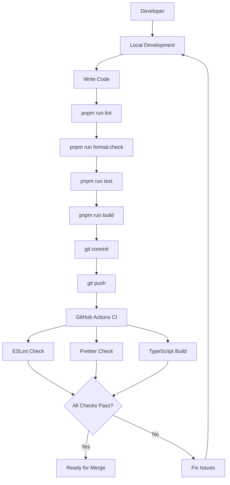
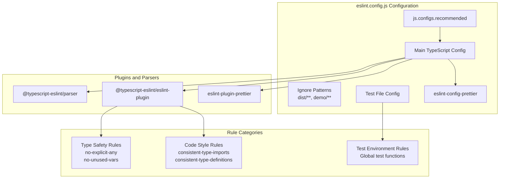
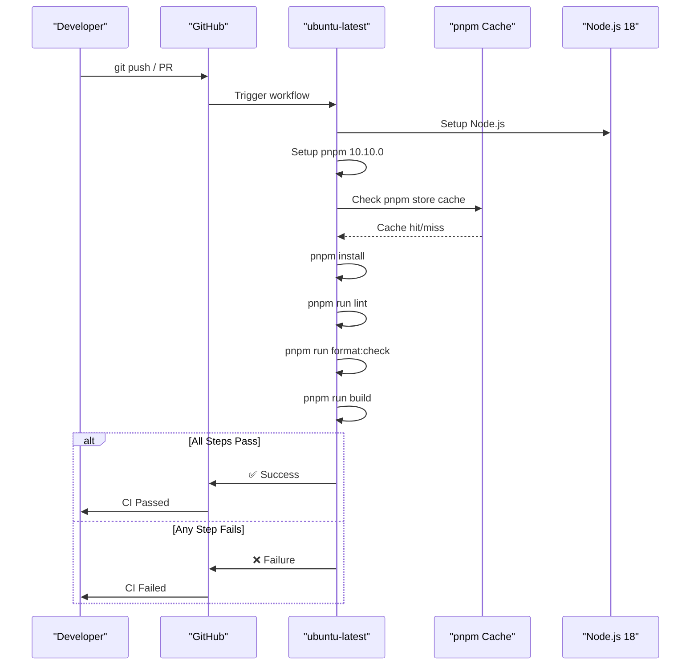
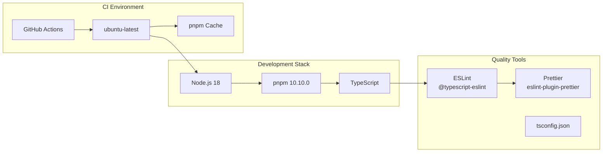

<!-- source: DeepWiki mcp.deepwiki.com · repo huggingface/responses.js · page 7.2 Development Workflow · fetched 2026-10-26 -->

# Development Workflow

<details>
<summary>Relevant source files</summary>

The following files were used as context for generating this wiki page:

- [.github/workflows/lint.yml](.github/workflows/lint.yml)
- [eslint.config.js](eslint.config.js)
- [src/middleware/logging.ts](src/middleware/logging.ts)

</details>


This document covers the development workflow for responses.js, including code quality standards, linting configuration, continuous integration pipeline, and contribution guidelines. It provides technical details about the development toolchain and processes used to maintain code consistency and quality.

For information about testing procedures and test suite organization, see [Testing](#7.1). For deployment processes and production considerations, see [Deployment](#7.3).

## Code Quality Standards

The responses.js project enforces strict code quality standards through TypeScript configuration, ESLint rules, and automated formatting. The codebase follows modern TypeScript best practices with explicit type definitions and consistent coding patterns.

### TypeScript Configuration

The project uses TypeScript with strict type checking enabled. All functions must have explicit return type annotations, and the use of `any` types is prohibited. The configuration emphasizes type safety and maintainability:

| Rule | Enforcement | Purpose |
|------|-------------|---------|
| `explicit-module-boundary-types` | Error | Requires explicit return types for all exported functions |
| `no-explicit-any` | Error | Prevents use of `any` type |
| `no-unused-vars` | Error | Removes unused variable declarations |
| `consistent-type-imports` | Error | Enforces consistent import syntax for types |
| `consistent-type-definitions` | Interface preferred | Standardizes on interface declarations |

### Code Style Enforcement

The project integrates Prettier with ESLint for consistent code formatting. The configuration excludes built artifacts and demo applications from linting while maintaining strict standards for core source code.

**Development Workflow Process**


Sources: [eslint.config.js:1-67](), [.github/workflows/lint.yml:1-51]()

## Linting and Formatting Configuration

### ESLint Configuration Structure

The ESLint configuration uses the modern flat config format with separate rule sets for different file types. The configuration extends recommended JavaScript rules and adds TypeScript-specific linting.

**ESLint Configuration Architecture**


### File-Specific Configurations

The linting system applies different rule sets based on file patterns:

- **Source files** (`**/*.{js,ts}`): Full TypeScript and style rules
- **Test files** (`**/*.test.{js,ts}`): Additional test framework globals
- **Ignored paths**: `dist/**` and `demo/**` directories excluded

The parser configuration supports ES2020 features with module syntax and provides global definitions for Node.js and browser environments.

Sources: [eslint.config.js:8-66]()

## CI/CD Pipeline

### GitHub Actions Workflow

The continuous integration pipeline runs on every pull request and push to the main branch. The workflow executes linting, formatting checks, and builds to ensure code quality before integration.

**CI/CD Pipeline Flow**


### Pipeline Steps

The CI pipeline executes the following sequence:

1. **Environment Setup**: Node.js 18 with pnpm 10.10.0
2. **Dependency Caching**: Optimized pnpm store caching based on lockfile hash
3. **Dependency Installation**: `pnpm install` with lockfile validation
4. **Code Quality Checks**: `pnpm run lint` for ESLint validation
5. **Format Verification**: `pnpm run format:check` for Prettier compliance
6. **Build Verification**: `pnpm run build` for TypeScript compilation

The pipeline uses sophisticated caching strategies to minimize build times, with cache keys based on the pnpm lockfile hash.

Sources: [.github/workflows/lint.yml:1-51]()

## Development Environment Setup

### Required Tools

The development environment requires specific tool versions for consistency:

| Tool | Version | Purpose |
|------|---------|---------|
| Node.js | 18 | Runtime environment |
| pnpm | 10.10.0 | Package management |
| TypeScript | Latest | Type checking and compilation |
| ESLint | Latest | Code linting |
| Prettier | Latest | Code formatting |

### Local Development Commands

Common development commands available through package.json scripts:

```bash
pnpm install          # Install dependencies
pnpm run lint         # Run ESLint checks
pnpm run format:check # Verify Prettier formatting
pnpm run format       # Apply Prettier formatting
pnpm run build        # Compile TypeScript
pnpm run test         # Run test suite
pnpm run dev          # Start development server
```

**Development Environment Dependencies**


Sources: [.github/workflows/lint.yml:18-26](), [eslint.config.js:14-26]()

## Contribution Workflow

### Code Review Process

All contributions must pass the automated CI pipeline before review. The workflow enforces:

- ESLint compliance with zero warnings
- Prettier formatting consistency
- Successful TypeScript compilation
- All existing tests passing

### Pull Request Requirements

Contributors must ensure their changes meet quality standards:

1. **Linting**: No ESLint errors or warnings
2. **Formatting**: Code formatted with Prettier
3. **Type Safety**: Explicit type annotations for all exports
4. **Build Success**: TypeScript compilation without errors
5. **Test Coverage**: Relevant tests updated or added

The CI system provides immediate feedback on these requirements, preventing integration of non-compliant code.

### Development Best Practices

The codebase follows established patterns visible in the middleware implementation:

- **Interface Definitions**: Well-defined TypeScript interfaces like `LogContext`
- **Function Documentation**: JSDoc comments explaining purpose and usage
- **Error Handling**: Comprehensive error management with appropriate status codes
- **Logging**: Structured logging with contextual information using `formatLogMessage`

Sources: [src/middleware/logging.ts:8-14](), [src/middleware/logging.ts:16-32](), [src/middleware/logging.ts:37-68]()

---

