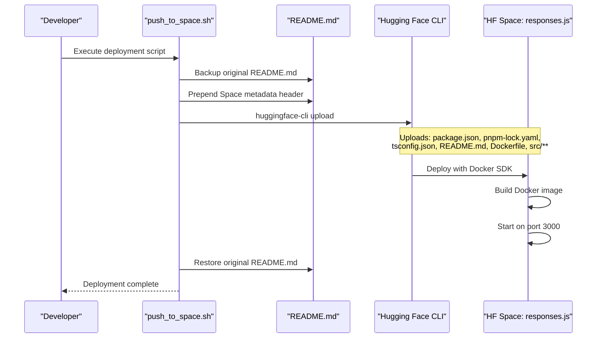
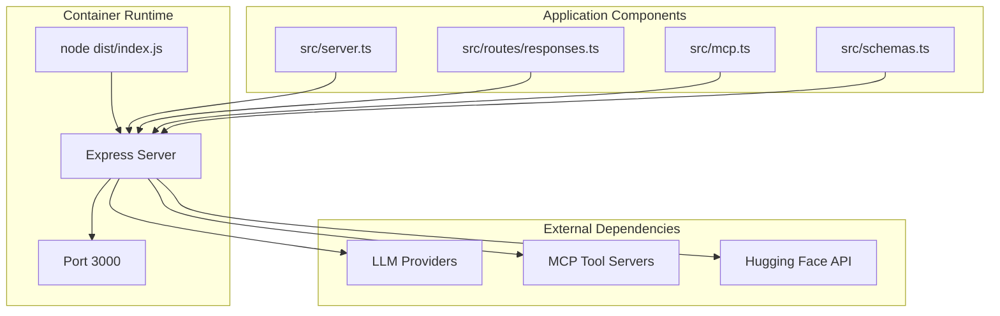

<!-- source: DeepWiki mcp.deepwiki.com · repo huggingface/responses.js · page 7.3 Deployment · fetched 2026-10-26 -->

# Deployment

Relevant source files

The following files were used as context for generating this wiki page:

- [.dockerignore](.dockerignore)
- [Dockerfile](Dockerfile)
- [push_to_space.sh](push_to_space.sh)

This document covers the deployment strategies and containerization options for responses.js, including Docker containerization and Hugging Face Spaces deployment. It explains the build pipeline, production configurations, and deployment workflows.

For information about the server configuration and Express setup, see [Server Configuration](#3.4). For development workflows and CI/CD processes, see [Development Workflow](#7.2).

## Docker Containerization

The responses.js application uses a multi-stage Docker build process optimized for production deployment. The containerization strategy separates the build environment from the runtime environment to minimize the final image size and improve security.

### Build Pipeline Architecture

```mermaid
flowchart TD
    subgraph "Build Stage"
        BuildImage["node:18-alpine AS builder"]
        PnpmInstall["pnpm install --frozen-lockfile"]
        TypeScriptBuild["pnpm run build"]
        BuildArtifacts["dist/ directory"]
    end
    
    subgraph "Production Stage"
        RuntimeImage["node:18-alpine AS runner"]
        CopyArtifacts["Copy dist/, package.json, node_modules"]
        ExposePort["EXPOSE 3000"]
        StartCommand["CMD node dist/index.js"]
    end
    
    subgraph "Source Files"
        PackageJson["package.json"]
        PnpmLock["pnpm-lock.yaml"]
        TSConfig["tsconfig.json"]
        SrcDir["src/ directory"]
    end
    
    PackageJson --> PnpmInstall
    PnpmLock --> PnpmInstall
    TSConfig --> TypeScriptBuild  
    SrcDir --> TypeScriptBuild
    
    PnpmInstall --> TypeScriptBuild
    TypeScriptBuild --> BuildArtifacts
    BuildArtifacts --> CopyArtifacts
    CopyArtifacts --> StartCommand
    
    StartCommand --> ExposePort
```

**Docker Build Process**

Sources: [Dockerfile:1-41]()

The build stage [Dockerfile:1-20]() installs dependencies and compiles TypeScript:
- Uses `node:18-alpine` as the base image for minimal footprint
- Enables `pnpm@10.10.0` via corepack for package management
- Runs as non-root `node` user for security
- Installs dependencies with `--frozen-lockfile` for reproducible builds
- Compiles TypeScript sources from `src/` to `dist/`

The production stage [Dockerfile:21-41]() creates the minimal runtime image:
- Copies only essential files: compiled `dist/`, `package.json`, and `node_modules`
- Exposes port `3000` for the Express server
- Starts the application with `node dist/index.js`

### Docker Ignore Configuration

The build context excludes development files through `.dockerignore`:

| Excluded Pattern | Purpose |
|-----------------|---------|
| `node_modules` | Rebuilt during Docker build |
| `dist` | Generated during build stage |
| `demo` | Client-side demo application |
| `examples` | Development examples |
| `*.md` | Documentation files |

Sources: [.dockerignore:1-10]()

## Hugging Face Spaces Deployment

The application supports automated deployment to Hugging Face Spaces through the `push_to_space.sh` script, which configures the Space metadata and uploads the necessary files.

### Deployment Workflow

**Space Configuration**

Sources: [push_to_space.sh:1-28]()

The deployment script [push_to_space.sh:4-17]() prepends metadata to `README.md`:
- `sdk: docker` - Specifies Docker-based deployment
- `app_port: 3000` - Configures the application port
- `title: Responses.js` - Sets the Space display name
- `license: mit` - Specifies the MIT license

The upload command [push_to_space.sh:24]() includes essential files:
- Build configuration: `package.json`, `pnpm-lock.yaml`, `tsconfig.json`
- Docker setup: `Dockerfile`
- Source code: `src/**` directory
- Documentation: modified `README.md` with Space metadata

## Production Runtime Environment

The containerized application runs with the following production characteristics:

### Runtime Architecture

**Security Configuration**

Sources: [Dockerfile:25-40]()

The production container implements security best practices:
- Runs as non-root `node` user [Dockerfile:25]()
- Uses minimal Alpine Linux base image
- Exposes only necessary port `3000` [Dockerfile:38]()
- Contains only runtime dependencies and compiled artifacts

**Resource Requirements**

The containerized application requires:
- Node.js 18 runtime environment
- Compiled JavaScript in `dist/` directory
- Production `node_modules` dependencies
- Network access for LLM provider APIs and MCP servers

## Environment Configuration

Production deployments require specific environment variables for proper operation:

| Variable Category | Purpose | Examples |
|------------------|---------|----------|
| LLM Provider APIs | Authentication tokens | `OPENAI_API_KEY`, `ANTHROPIC_API_KEY` |
| Hugging Face Integration | API access | `HF_TOKEN` |
| MCP Configuration | Tool server connections | MCP server URLs |
| Server Configuration | Port and host settings | `PORT=3000` |

The application defaults to port `3000` but can be configured through environment variables for different deployment scenarios.

Sources: [Dockerfile:38](), [push_to_space.sh:13]()

---

