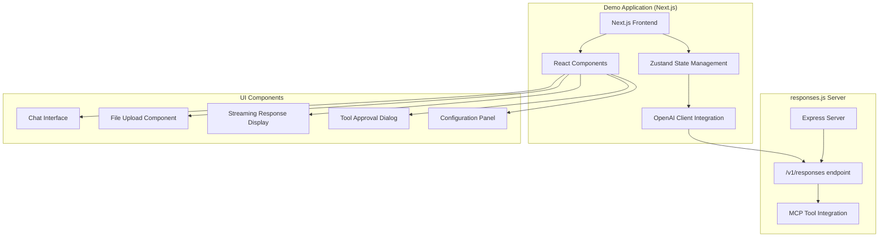
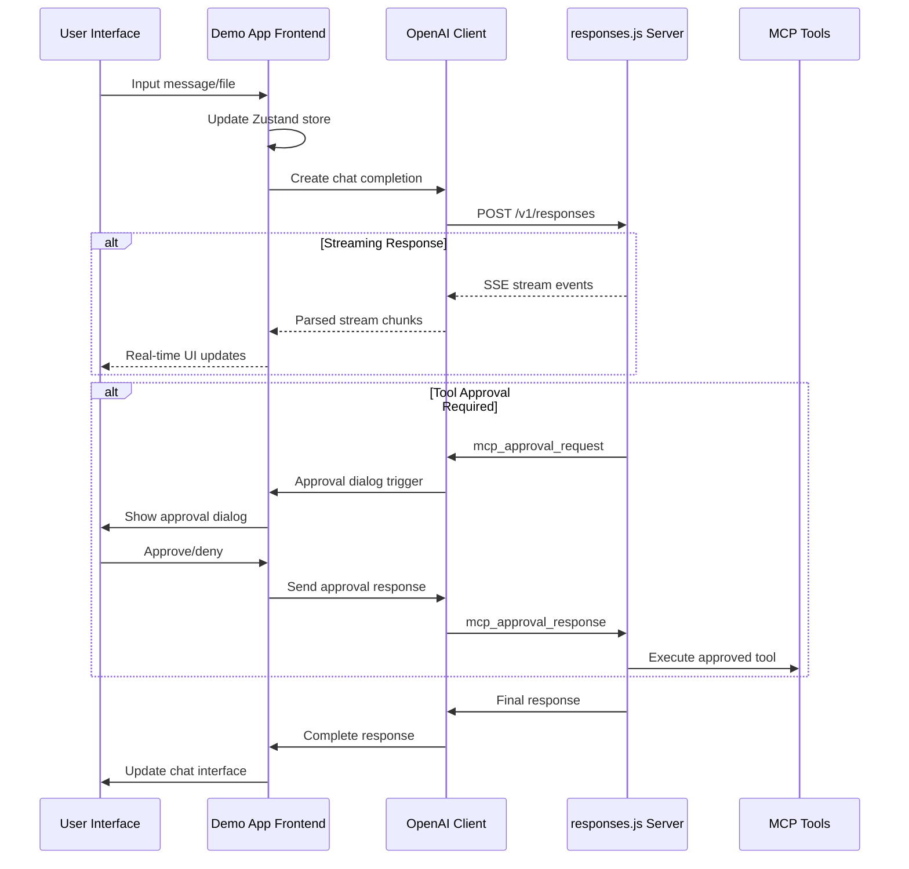
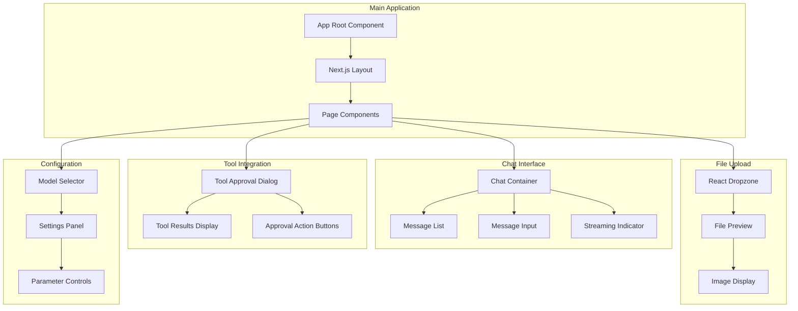

<!-- source: DeepWiki mcp.deepwiki.com · repo huggingface/responses.js · page 8 Demo Application · fetched 2026-10-26 -->

# Demo Application

<details>
<summary>Relevant source files</summary>

The following files were used as context for generating this wiki page:

- [demo/.env.example](demo/.env.example)
- [demo/package.json](demo/package.json)
- [package.json](package.json)

</details>


This document covers the Next.js-based demo application that provides an interactive user interface for testing and demonstrating the responses.js system. The demo application serves as a reference implementation showing how to integrate with the responses.js API and provides a visual interface for exploring features like streaming responses, tool calling, and multi-modal input.

For information about the core API endpoints that the demo application consumes, see [API Reference](#4). For examples of programmatic usage patterns, see [Examples and Usage Patterns](#6).

## Purpose and Architecture

The demo application is a standalone Next.js web application located in the `demo/` directory that acts as a client to the responses.js server. It demonstrates real-time streaming, tool integration, approval workflows, and multi-modal capabilities through an interactive web interface.

### Demo Application Architecture



Sources: [demo/package.json:1-53](), [package.json:37-42]()

### Integration Flow



Sources: [demo/.env.example:1-3](), [demo/package.json:28]()

## Configuration and Setup

The demo application connects to the responses.js server through environment configuration. Key configuration parameters are defined in the `.env.example` file.

### Environment Configuration

| Variable | Purpose | Example Value |
|----------|---------|---------------|
| `MODEL` | Default model to use for responses | `"CohereLabs/c4ai-command-a-03-2025"` |
| `OPENAI_BASE_URL` | Base URL for responses.js server | `http://localhost:3000/v1` |
| `OPENAI_API_KEY` | Authentication token (Hugging Face token) | `<your-hf-token>` |

The demo application uses the OpenAI Node.js SDK to communicate with the responses.js server, treating it as an OpenAI-compatible endpoint. This demonstrates the API compatibility layer that responses.js provides.

Sources: [demo/.env.example:1-3]()

### Development Commands

The main package.json provides several npm scripts for managing the demo application:

| Command | Purpose |
|---------|---------|
| `demo:install` | Install demo dependencies |
| `demo:dev` | Start development server |
| `demo:build` | Build production version |
| `demo:start` | Start production server |
| `demo:lint` | Run linting checks |
| `demo:format` | Format code |

Sources: [package.json:37-42]()

## Technology Stack

The demo application leverages modern React ecosystem tools and libraries to provide a rich interactive experience.

### Core Dependencies

```mermaid
graph LR
    subgraph "Frontend Framework"
        NextJS[Next.js 15.2.3]
        React[React 18]
        TypeScript[TypeScript 5.6.2]
    end
    
    subgraph "UI Components"
        RadixUI[@radix-ui components]
        TailwindCSS[Tailwind CSS]
        LucideReact[Lucide React Icons]
        ReactMarkdown[React Markdown]
    end
    
    subgraph "State Management"
        Zustand[Zustand 5.0.2]
        OpenAISDK[OpenAI SDK 4.87.3]
    end
    
    subgraph "Specialized Features"
        ReactDropzone[File Upload]
        SyntaxHighlighter[Code Highlighting]
        PartialJSON[Streaming JSON Parser]
        XYFlow[Flow Diagrams]
    end
    
    NextJS --> React
    NextJS --> TypeScript
    React --> RadixUI
    React --> TailwindCSS
    React --> LucideReact
    React --> ReactMarkdown
    
    Zustand --> OpenAISDK
    React --> ReactDropzone
    React --> SyntaxHighlighter
    React --> PartialJSON
    React --> XYFlow
```

Sources: [demo/package.json:12-41]()

### Key Dependencies Analysis

| Category | Dependencies | Purpose |
|----------|-------------|---------|
| **UI Framework** | `next`, `react`, `react-dom` | Core Next.js application framework |
| **UI Components** | `@radix-ui/*`, `lucide-react`, `vaul` | Accessible, unstyled UI primitives |
| **Styling** | `tailwindcss`, `class-variance-authority`, `clsx` | Utility-first CSS framework |
| **AI Integration** | `openai`, `partial-json` | OpenAI SDK and streaming JSON parsing |
| **State Management** | `zustand` | Lightweight state management |
| **Content Rendering** | `react-markdown`, `react-syntax-highlighter`, `katex` | Rich content display |
| **File Handling** | `react-dropzone` | Drag-and-drop file upload |
| **Visualization** | `@xyflow/react`, `recharts` | Interactive diagrams and charts |

Sources: [demo/package.json:12-41]()

## User Interface Components

The demo application provides a comprehensive interface for testing all responses.js features through interactive React components.

### Component Architecture



Sources: [demo/package.json:14-20](), [demo/package.json:32-33]()

### Feature Demonstrations

The demo application showcases the following responses.js capabilities:

| Feature | UI Component | Purpose |
|---------|-------------|---------|
| **Text Generation** | Chat interface with markdown rendering | Basic text response generation |
| **Streaming Responses** | Real-time message updates | Server-sent events streaming |
| **Multi-modal Input** | File upload with image preview | Image + text input processing |
| **Tool Calling** | Approval dialogs and result display | MCP tool integration |
| **Structured Output** | JSON schema validation display | Zod schema-based output |
| **Multi-turn Conversations** | Message history management | Conversation state handling |

The interface uses `react-markdown` for rendering AI responses, `react-syntax-highlighter` for code blocks, and `katex` for mathematical expressions, providing a rich content display experience.

Sources: [demo/package.json:24](), [demo/package.json:25](), [demo/package.json:33-34]()

## Integration Patterns

The demo application demonstrates several integration patterns that developers can use when building applications with responses.js.

### OpenAI SDK Integration

The demo uses the standard OpenAI Node.js SDK to communicate with responses.js, demonstrating the compatibility layer. This allows developers to use familiar OpenAI patterns while leveraging responses.js features.

```typescript
// Example integration pattern shown in demo
const client = new OpenAI({
  baseURL: process.env.OPENAI_BASE_URL, // Points to responses.js server
  apiKey: process.env.OPENAI_API_KEY,   // Hugging Face token
});
```

### State Management with Zustand

The application uses Zustand for managing conversation state, streaming updates, and tool approval workflows. This demonstrates how to handle complex stateful interactions with the responses.js streaming API.

### Streaming Response Handling

The demo shows how to process server-sent events from responses.js, including handling different event types like `response.created`, streaming chunks, tool approval requests, and completion events.

Sources: [demo/package.json:28](), [demo/package.json:40](), [demo/package.json:29]()