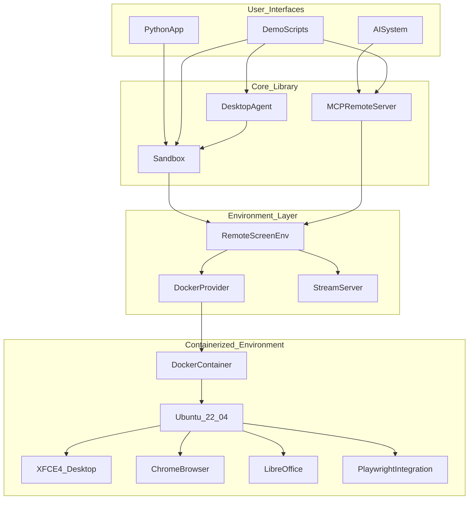
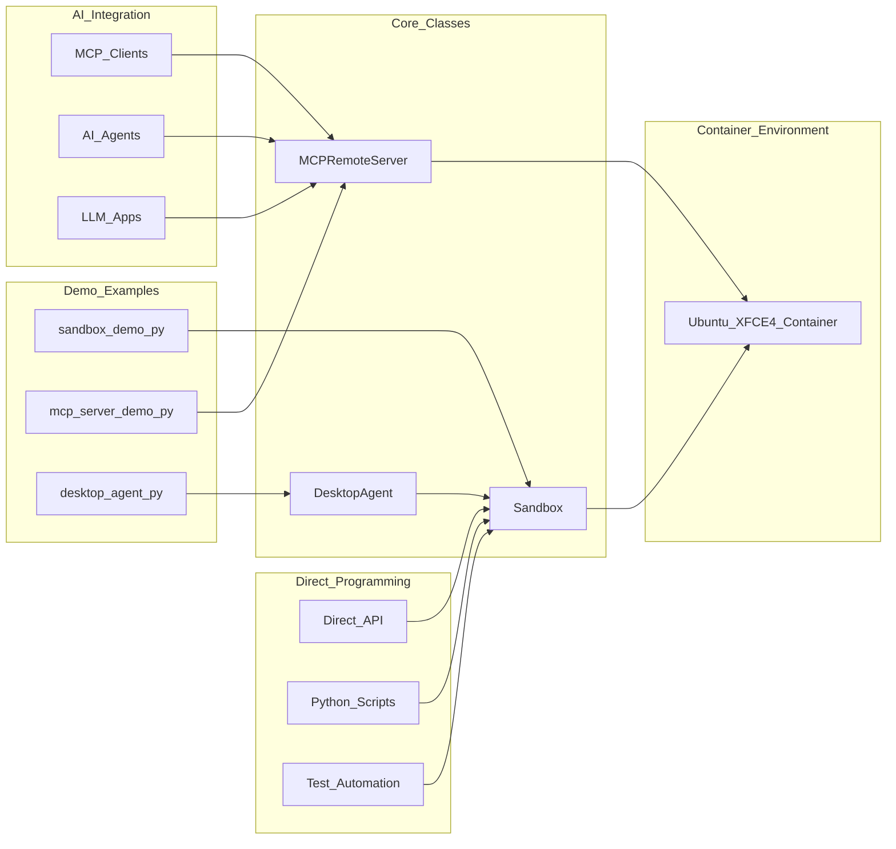

<!-- source: DeepWiki mcp.deepwiki.com · repo huggingface/screenenv · page 1 Overview · fetched 2026-10-26 -->

# Overview

Relevant source files

The following files were used as context for generating this wiki page:

- [README.md](README.md)

## Purpose and Scope

ScreenEnv is a Python library for creating and managing isolated desktop environments using Docker containers. It provides programmatic control over containerized Ubuntu desktop environments with XFCE4, enabling desktop automation, GUI testing, and AI agent integration. The library offers two primary access patterns: direct programming through the `Sandbox` class and AI integration through the Model Context Protocol (MCP).

For specific implementation details about the core components, see [Core Components](#2.1). For usage examples and practical applications, see [Examples and Demos](#5). For complete API documentation, see [API Reference](#6).

## System Architecture

The following diagram shows the main system components and their relationships in the codebase:

**ScreenEnv Core Architecture**

Sources: [README.md:1-426]()

## Access Patterns

ScreenEnv supports three main access patterns, each implemented through specific classes:

**Access Pattern Implementation**

Sources: [README.md:47-71](), [README.md:91-147](), [README.md:391-407]()

## Core Components

ScreenEnv consists of several key components that work together to provide desktop automation capabilities:

| Component | Purpose | Key Methods |
|-----------|---------|-------------|
| `Sandbox` | Direct desktop control interface | `launch()`, `write()`, `press()`, `screenshot()`, `click()` |
| `MCPRemoteServer` | AI integration through MCP protocol | `server_url`, `mcp_server_json`, `close()` |
| `RemoteScreenEnv` | Environment orchestration | Container lifecycle management |
| `DockerProvider` | Container management | Docker container provisioning and control |
| `StreamServer` | VNC/noVNC access | Remote desktop streaming |

Sources: [README.md:49-71](), [README.md:91-99](), [README.md:208-232]()

## Key Features

### Desktop Automation Capabilities

ScreenEnv provides comprehensive desktop automation through the `Sandbox` class:

- **Mouse Control**: `left_click()`, `right_click()`, `double_click()`, `move_mouse()`, `drag()`, `scroll()`
- **Keyboard Input**: `write()`, `press()` for text input and key combinations
- **Application Management**: `launch()`, `open()`, `get_application_windows()`, `activate_window()`, `close_window()`
- **Screen Capture**: `screenshot()`, `desktop_screenshot()`, `start_recording()`, `end_recording()`
- **File Operations**: `upload_file_to_remote()`, `download_file_from_remote()`, `download_url_file_to_remote()`
- **Terminal Access**: `execute_command()`, `execute_python_command()`, `get_terminal_output()`

Sources: [README.md:237-331]()

### MCP Integration

The `MCPRemoteServer` provides 30+ automation tools accessible through the Model Context Protocol:

- **System Operations**: `execute_command`, `get_platform`, `get_screen_size`, `get_desktop_path`
- **Application Management**: `launch`, `activate_window`, `close_window`, `get_application_windows`
- **GUI Automation**: `screenshot`, `left_click`, `right_click`, `write`, `press`, `drag`
- **File Operations**: `get_file`, `download_file`, `get_directory_tree`
- **Recording**: `start_recording`, `end_recording`

Sources: [README.md:149-188]()

### Containerized Environment

The system uses a custom Ubuntu 22.04 Docker image with pre-installed software:

- **Desktop Environment**: XFCE4 with VNC server
- **Web Browser**: Google Chrome/Chromium with Playwright integration
- **Office Suite**: LibreOffice for document automation
- **Development Tools**: Python development environment
- **Automation Support**: MCP server and desktop automation tools

Sources: [README.md:417-426]()

## System Requirements

- **Docker**: Must be installed and running
- **Python**: 3.10 or higher
- **Playwright**: For web automation features
- **Memory**: At least 4GB RAM recommended for container operation

Sources: [README.md:410-416]()

---

