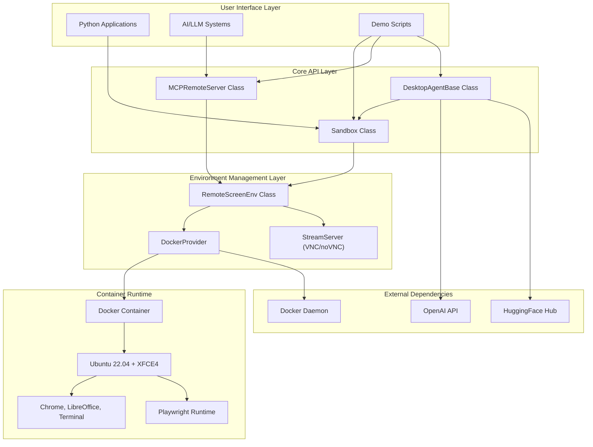
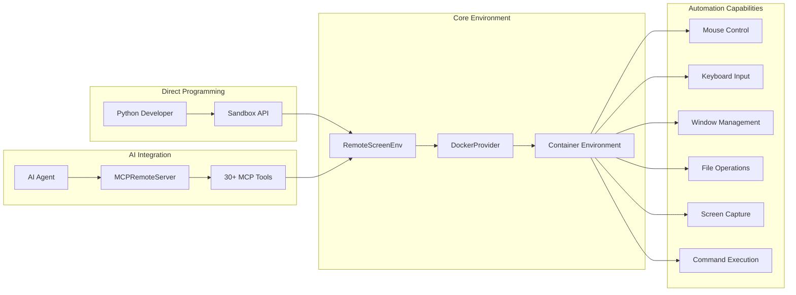
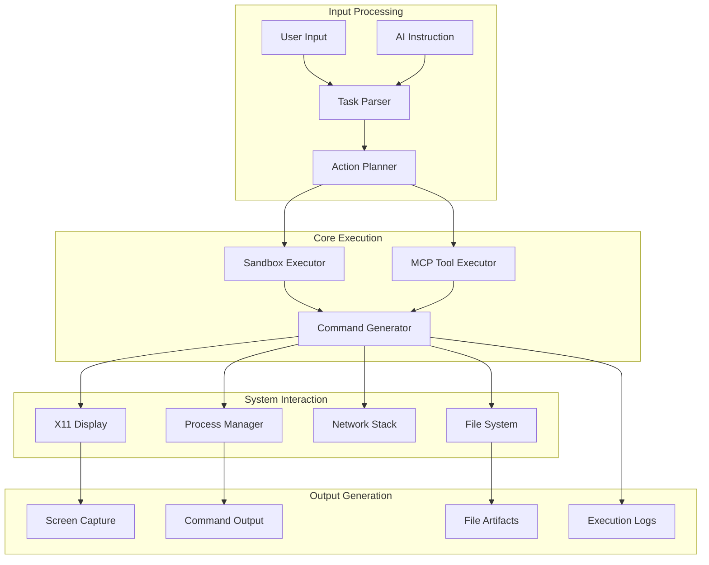
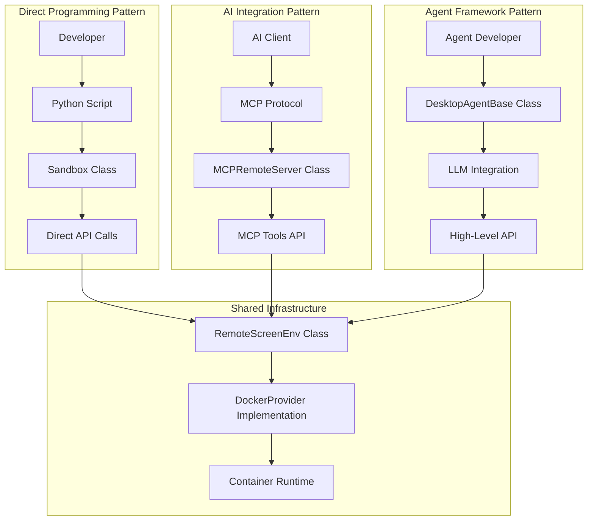
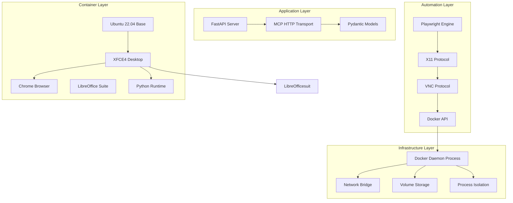
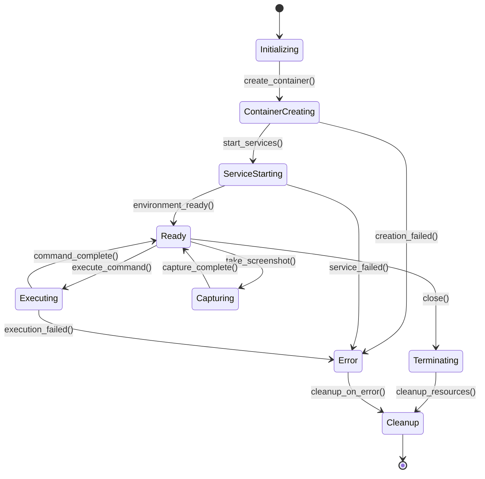

<!-- source: DeepWiki mcp.deepwiki.com · repo huggingface/screenenv · page 2 Architecture · fetched 2026-10-26 -->

# Architecture

Relevant source files

The following files were used as context for generating this wiki page:

- [README.md](README.md)
- [src/screenenv/__init__.py](src/screenenv/__init__.py)

This document describes the high-level architecture of ScreenEnv, explaining how the core components work together to provide desktop automation capabilities. It covers the system's layered design, component relationships, and the different access patterns available to users.

For implementation details of specific components, see [Core Components](#2.1) and [Remote Environment Providers](#2.2). For practical usage guidance, see [User Guides](#4).

## System Overview

ScreenEnv follows a layered architecture that separates concerns between user interfaces, core automation logic, remote environment management, and the containerized desktop environment. The system provides multiple access patterns to accommodate different use cases, from direct Python programming to AI-driven automation through the Model Context Protocol (MCP).

### High-Level Architecture

Sources: [README.md:1-426](), [src/screenenv/__init__.py:1-16]()

## Core Component Relationships

The system is built around three primary components that provide different levels of abstraction and access patterns for desktop automation.

### Component Interaction Flow

Sources: [README.md:47-71](), [README.md:91-147](), [src/screenenv/__init__.py:1-16]()

### Component Responsibilities

| Component | Primary Responsibility | Key Methods/Features |
|-----------|----------------------|---------------------|
| `Sandbox` | Direct programmatic control | `left_click()`, `write()`, `launch()`, `screenshot()` |
| `MCPRemoteServer` | AI agent integration via MCP protocol | 30+ MCP tools, HTTP transport, tool calling |
| `DesktopAgentBase` | High-level AI automation framework | Agent orchestration, LLM integration |
| `RemoteScreenEnv` | Environment lifecycle management | Container orchestration, resource management |
| `DockerProvider` | Container backend implementation | Docker container management, networking |

Sources: [README.md:234-331](), [README.md:149-188]()

## Data Flow Architecture

The system processes automation requests through a structured flow from high-level commands to low-level system interactions.

### Request Processing Flow

Sources: [README.md:234-331](), [README.md:149-188]()

## Access Patterns

ScreenEnv supports three primary access patterns, each optimized for different use cases and user types.

### Access Pattern Comparison

Sources: [README.md:47-71](), [README.md:91-147](), [src/screenenv/__init__.py:1-16]()

## Technology Stack Integration

The system integrates multiple technologies to provide comprehensive desktop automation capabilities.

### Technology Dependencies

Sources: [README.md:410-426]()

## Environment Lifecycle Management

The system manages the complete lifecycle of desktop environments, from creation to cleanup, with automatic resource management and error handling.

### Environment State Management

Sources: [README.md:208-232](), [README.md:47-71]()

---

