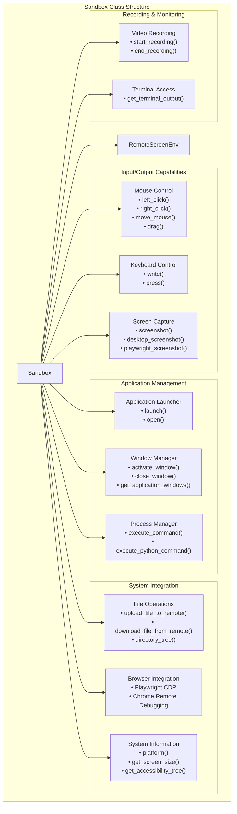
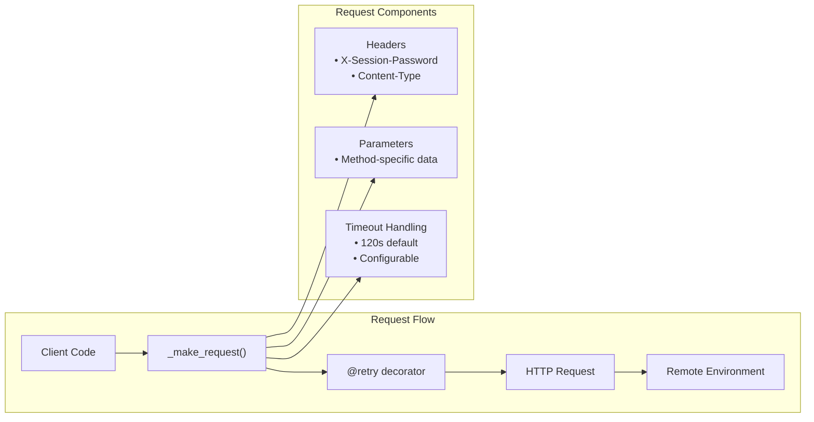
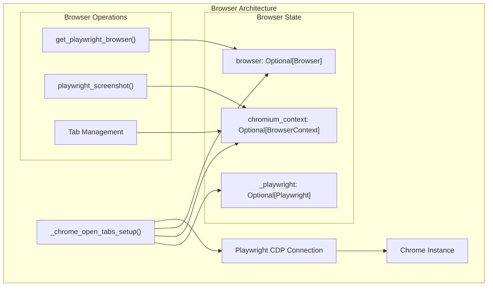
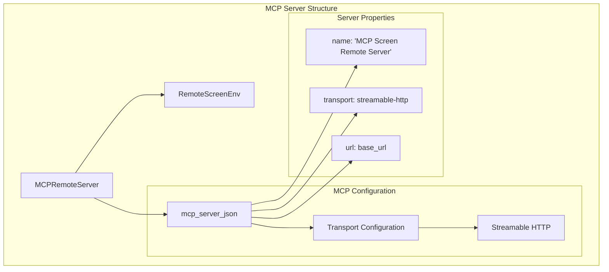
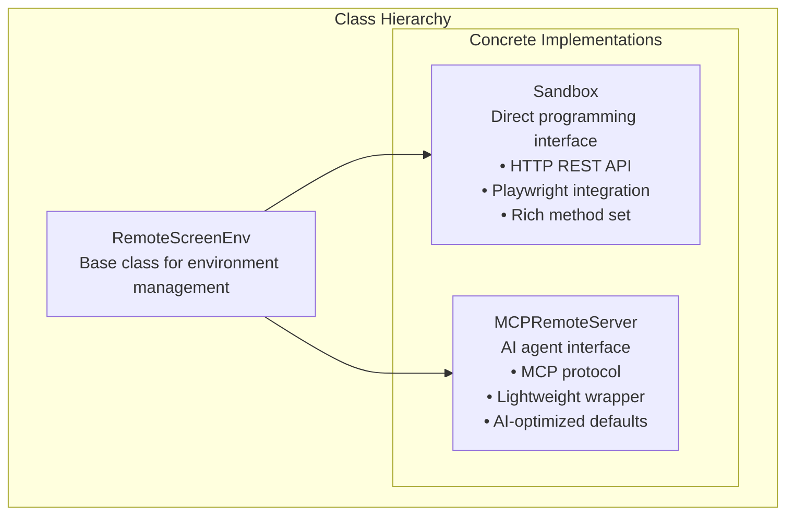
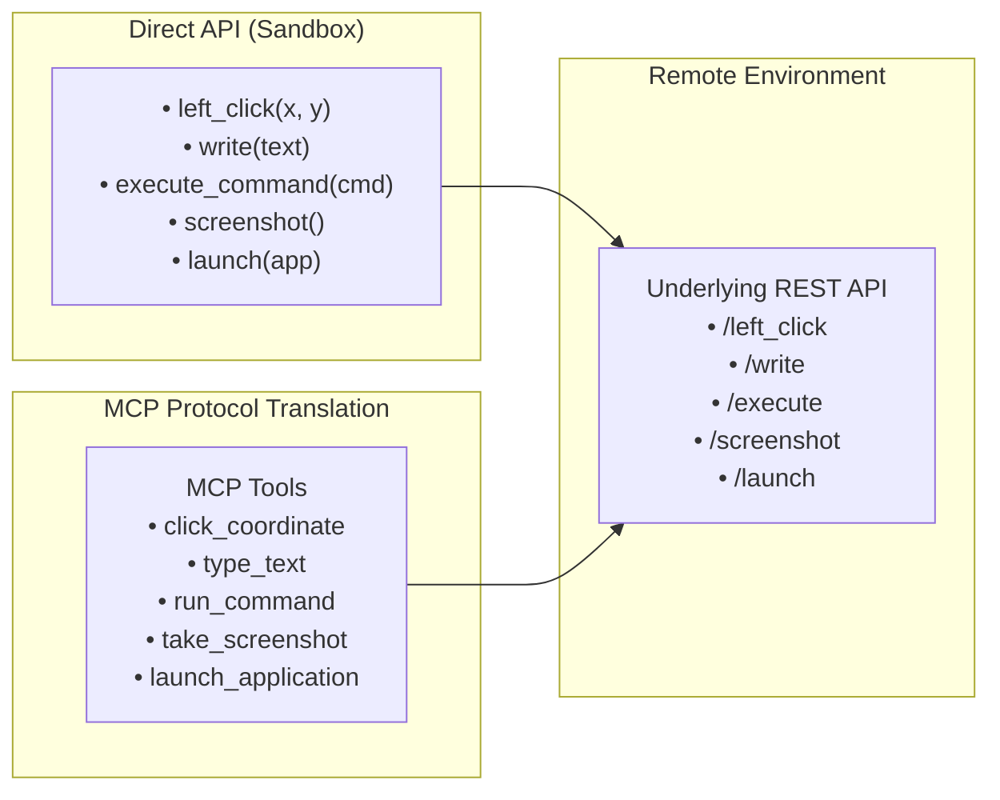

<!-- source: DeepWiki mcp.deepwiki.com · repo huggingface/screenenv · page 2.1 Core Components · fetched 2026-10-26 -->

# Core Components

Relevant source files

The following files were used as context for generating this wiki page:

- [src/screenenv/mcp_remote_server.py](src/screenenv/mcp_remote_server.py)
- [src/screenenv/sandbox.py](src/screenenv/sandbox.py)

This document covers the two primary interfaces for interacting with ScreenEnv's desktop automation capabilities: the `Sandbox` class for direct programming access and the `MCPRemoteServer` class for AI agent integration. For information about the underlying remote environment providers and Docker orchestration, see [Remote Environment Providers](#2.2).

## Overview

ScreenEnv provides two main entry points for desktop automation, each designed for different use cases:

| Component | Purpose | Target Users | Protocol |
|-----------|---------|--------------|----------|
| `Sandbox` | Direct programming interface | Python developers, automation scripts | HTTP REST API |
| `MCPRemoteServer` | AI agent integration | AI systems, LLM applications | Model Context Protocol (MCP) |

Both components inherit from `RemoteScreenEnv` and provide access to the same underlying containerized desktop environment, but through different interfaces optimized for their respective use cases.

## Sandbox Class

The `Sandbox` class serves as the primary interface for direct programming access to the desktop environment. It provides comprehensive control over mouse actions, keyboard input, application management, and system operations.

### Core Architecture

Sources: [src/screenenv/sandbox.py:42-654]()

### HTTP Request Infrastructure

The `Sandbox` class communicates with the remote environment through HTTP requests with built-in retry logic and session management:

Sources: [src/screenenv/sandbox.py:115-153]()

### Browser Integration

The `Sandbox` class provides sophisticated browser automation through Playwright's Chrome DevTools Protocol (CDP) integration:

Sources: [src/screenenv/sandbox.py:98-217]()

## MCPRemoteServer Class

The `MCPRemoteServer` class provides a lightweight wrapper around `RemoteScreenEnv` specifically designed for AI agent integration through the Model Context Protocol.

### MCP Integration Architecture

Sources: [src/screenenv/mcp_remote_server.py:9-52]()

### Configuration Parameters

The `MCPRemoteServer` class accepts the same initialization parameters as `RemoteScreenEnv` but sets specific defaults optimized for AI agent usage:

| Parameter | Default Value | Purpose |
|-----------|---------------|---------|
| `session_password` | `True` | Enable session security by default |
| `server_type` | `"mcp"` | Set server type to MCP protocol |
| `headless` | `True` | Run in headless mode for AI agents |
| `stream_server` | `True` | Enable VNC streaming for monitoring |

Sources: [src/screenenv/mcp_remote_server.py:10-44]()

## Component Comparison

### Inheritance Hierarchy

Sources: [src/screenenv/sandbox.py:42-43](), [src/screenenv/mcp_remote_server.py:9-10]()

### Interface Capabilities

| Capability | Sandbox | MCPRemoteServer |
|------------|---------|-----------------|
| Mouse Control | ✓ Direct methods | ✓ Via MCP tools |
| Keyboard Input | ✓ Direct methods | ✓ Via MCP tools |
| Application Management | ✓ Direct methods | ✓ Via MCP tools |
| File Operations | ✓ Direct methods | ✓ Via MCP tools |
| Screenshot Capture | ✓ Multiple methods | ✓ Via MCP tools |
| Browser Automation | ✓ Playwright CDP | ✓ Via MCP tools |
| Video Recording | ✓ Direct methods | ✓ Via MCP tools |
| Protocol | HTTP REST | MCP over HTTP |
| Target Users | Python developers | AI agents/LLMs |

### Method Mapping

Sources: [src/screenenv/sandbox.py:537-634](), [src/screenenv/mcp_remote_server.py:45-51]()

---

