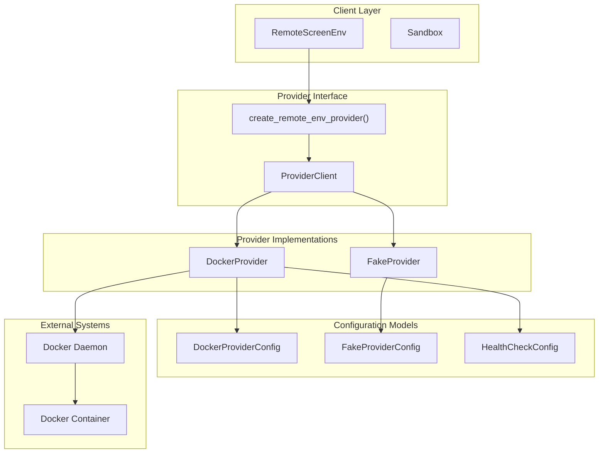
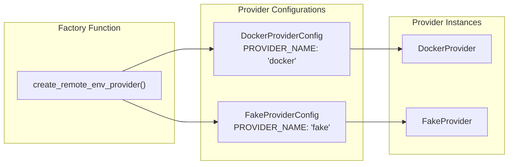
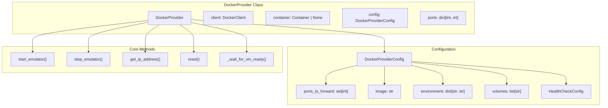
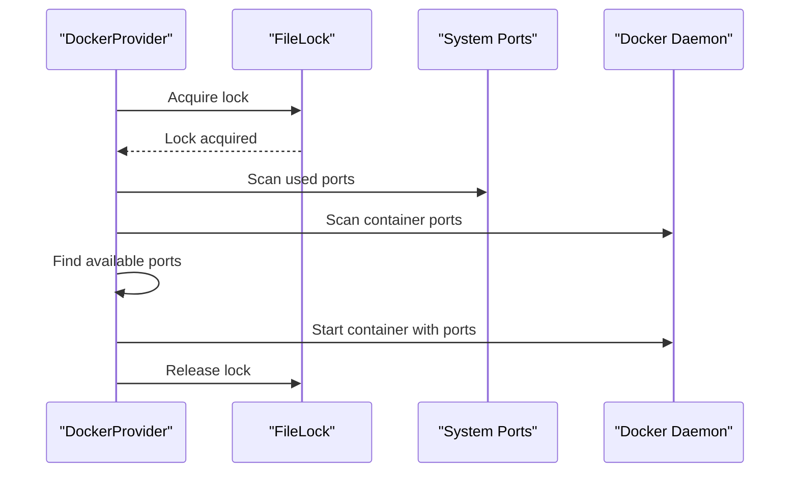
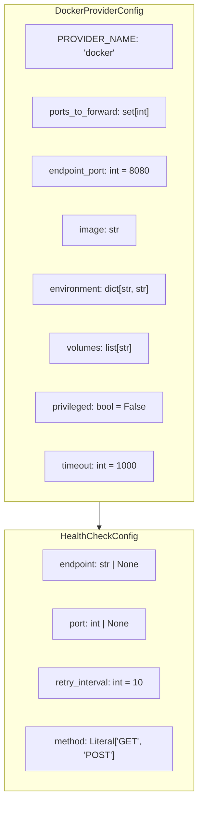
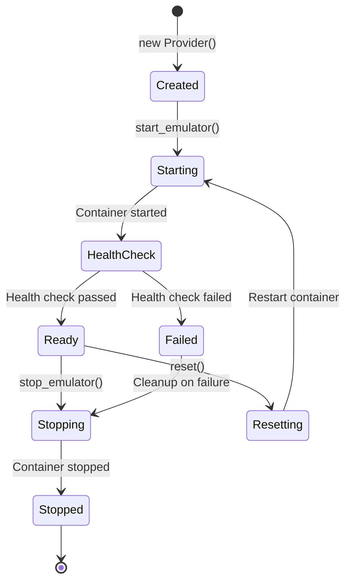
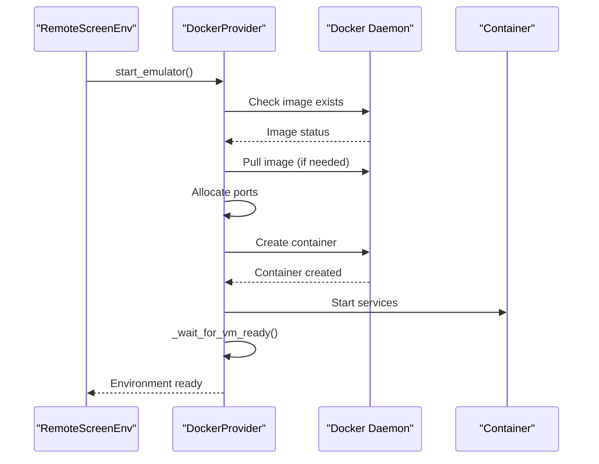
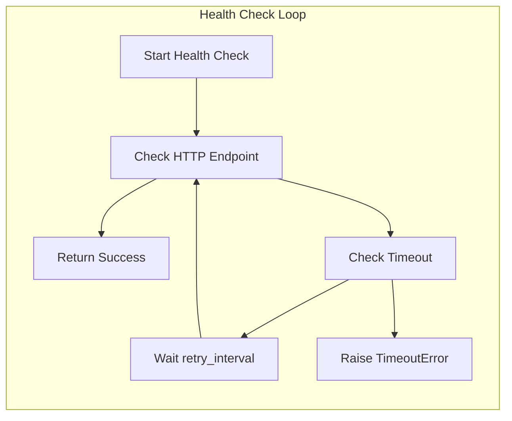
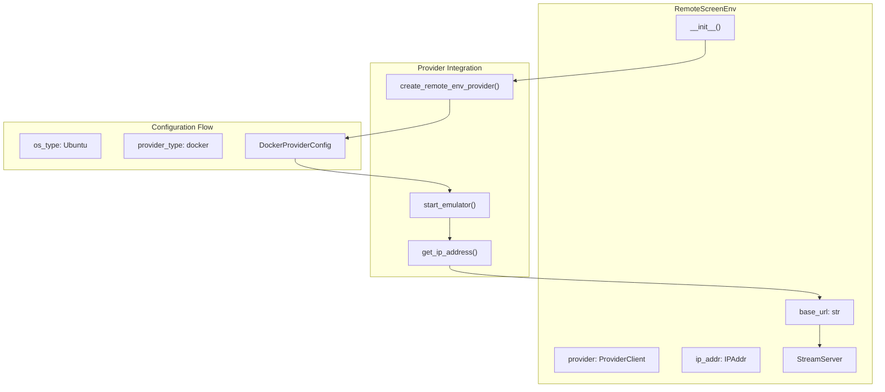

<!-- source: DeepWiki mcp.deepwiki.com · repo huggingface/screenenv · page 2.2 Remote Environment Providers · fetched 2026-10-26 -->

# Remote Environment Providers

Relevant source files

The following files were used as context for generating this wiki page:

- [src/screenenv/remote_provider/__init__.py](src/screenenv/remote_provider/__init__.py)
- [src/screenenv/remote_provider/docker/provider.py](src/screenenv/remote_provider/docker/provider.py)
- [src/screenenv/remote_screen_env.py](src/screenenv/remote_screen_env.py)

This document covers the provider system that manages remote environments in ScreenEnv. The provider system abstracts different backend implementations (Docker, cloud services, etc.) behind a common interface, with the Docker provider being the primary implementation. For information about the overall architecture, see [Architecture](#2). For details about the core components that use providers, see [Core Components](#2.1).

## Provider System Architecture

The provider system follows an abstract factory pattern where different provider implementations can be plugged in through a common interface. The system supports multiple backend types while maintaining consistent behavior for environment lifecycle management.

Sources: [src/screenenv/remote_provider/__init__.py:1-19](), [src/screenenv/remote_screen_env.py:235-242]()

## Provider Interface and Factory

The provider system uses a factory function to create provider instances based on configuration. The `ProviderClient` type represents the common interface that all providers must implement.

The factory function dispatches to appropriate provider classes based on the `PROVIDER_NAME` field in the configuration.

Sources: [src/screenenv/remote_provider/__init__.py:1-5]()

## Docker Provider Implementation

The `DockerProvider` class is the primary implementation that manages Docker containers as remote environments. It handles container lifecycle, port allocation, and health checking.

### Core Docker Provider Components

Sources: [src/screenenv/remote_provider/docker/provider.py:65-78]()

### Port Allocation System

The Docker provider implements a sophisticated port allocation system to avoid conflicts between multiple instances and system services.

| Method | Purpose | Line Reference |
|--------|---------|----------------|
| `_get_used_ports()` | Scans system and Docker ports to find conflicts | [src/screenenv/remote_provider/docker/provider.py:85-101]() |
| `_get_available_port()` | Finds next available port starting from a base port | [src/screenenv/remote_provider/docker/provider.py:103-113]() |
| Port allocation with FileLock | Ensures atomic port allocation across processes | [src/screenenv/remote_provider/docker/provider.py:166-182]() |

The port allocation process uses a file lock to ensure that multiple instances don't allocate the same ports simultaneously:

Sources: [src/screenenv/remote_provider/docker/provider.py:164-241]()

## Provider Configuration Models

The provider system uses Pydantic models for configuration validation and type safety.

### DockerProviderConfig

Key configuration fields:

| Field | Type | Default | Purpose |
|-------|------|---------|---------|
| `ports_to_forward` | `set[int]` | Required | Ports to expose from container |
| `endpoint_port` | `int` | 8080 | Main API endpoint port |
| `image` | `str` | Required | Docker image to run |
| `environment` | `dict[str, str]` | `{"DISK_SIZE": "32G", ...}` | Environment variables |
| `timeout` | `int` | 1000 | Health check timeout in seconds |

Sources: [src/screenenv/remote_provider/docker/provider.py:37-63]()

## Provider Lifecycle Management

The provider lifecycle follows a standard pattern across all implementations:

### Start Emulator Process

The `start_emulator()` method orchestrates the complete startup process:

1. **Image Management**: Pull Docker image if not present
2. **Port Allocation**: Allocate required ports with conflict detection
3. **Container Creation**: Start container with configured parameters
4. **Health Check**: Wait for services to be ready

Sources: [src/screenenv/remote_provider/docker/provider.py:164-241]()

### Health Check System

The health check system ensures that the remote environment is fully operational before returning control to the client:

The health check configuration allows customization of the endpoint, retry interval, and HTTP method used for validation.

Sources: [src/screenenv/remote_provider/docker/provider.py:115-162]()

## Integration with RemoteScreenEnv

The `RemoteScreenEnv` class serves as the primary orchestrator that uses providers to manage remote environments:

The integration process:
1. `RemoteScreenEnv` creates provider configuration based on parameters
2. Factory function instantiates appropriate provider
3. Provider starts the remote environment
4. `RemoteScreenEnv` configures URLs and services based on provider's IP address

Sources: [src/screenenv/remote_screen_env.py:234-268]()

---

