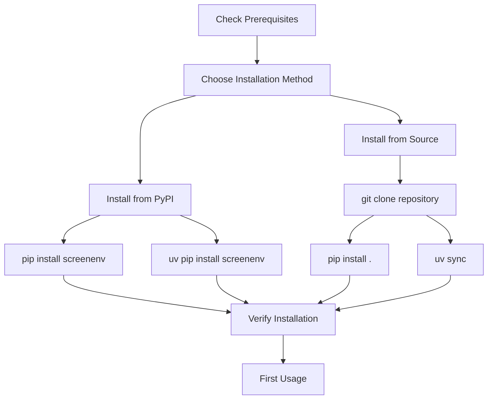
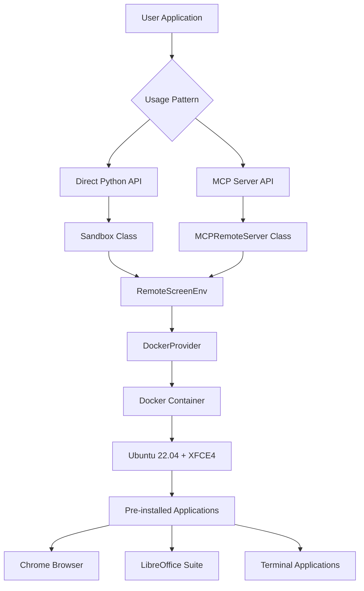
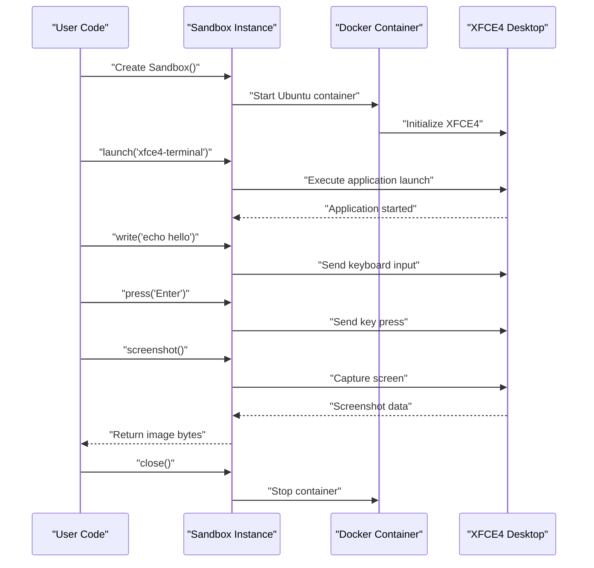

<!-- source: DeepWiki mcp.deepwiki.com · repo huggingface/screenenv · page 3 Getting Started · fetched 2026-10-26 -->

# Getting Started

<details>
<summary>Relevant source files</summary>

The following files were used as context for generating this wiki page:

- [README.md](README.md)
- [pyproject.toml](pyproject.toml)
- [setup.py](setup.py)

</details>


This page provides installation instructions, basic setup, and simple usage examples to get users up and running quickly with ScreenEnv. It covers the essential steps needed to create your first isolated desktop environment and perform basic automation tasks.

For comprehensive programming guides, see [Direct Programming Interface](#4.1) and [AI Agent Integration](#4.2). For detailed API documentation, see [Sandbox API](#6.1) and [MCP Server API](#6.2).

## Prerequisites

Before installing ScreenEnv, ensure your system meets the following requirements:

| Component | Requirement | Notes |
|-----------|-------------|-------|
| **Docker** | Must be installed and running | Core dependency for container management |
| **Python** | 3.10 or higher | Required for the ScreenEnv library |
| **Memory** | At least 4GB RAM | Recommended for smooth operation |
| **Storage** | 2GB+ free space | For Docker images and containers |

### Docker Setup

ScreenEnv relies on Docker to provide isolated desktop environments. Ensure Docker is properly installed and your user has permission to run Docker commands:

```bash
# Test Docker installation
docker --version

# Test Docker permissions (should not require sudo)
docker run hello-world
```

If you need to run Docker commands with `sudo`, you may need to add your user to the `docker` group or use `sudo -E` when running ScreenEnv commands.

**Sources:** [README.md:410-425](), [README.md:394-407]()

## Installation

### Installation Flow



**Sources:** [README.md:22-44]()

### Option 1: Install from PyPI (Recommended)

Install the latest stable release using pip or uv:

```bash
pip install screenenv
```

Or using uv (faster):

```bash
uv pip install screenenv
```

### Option 2: Install from Source

For development or to get the latest features:

```bash
# Clone the repository
git clone https://github.com/huggingface/screenenv
cd screenenv

# Install with pip
pip install .

# Or install with uv (recommended for development)
uv sync
```

**Sources:** [README.md:30-44]()

## Basic Setup

### Core Components Overview



**Sources:** [README.md:49-71](), [README.md:91-99]()

### Import and Basic Configuration

ScreenEnv provides two main entry points:

1. **`Sandbox`** - Direct Python API for programmatic control
2. **`MCPRemoteServer`** - MCP server for AI/LLM integration

```python
# For direct programming
from screenenv import Sandbox

# For AI/LLM integration via MCP
from screenenv import MCPRemoteServer
```

**Sources:** [README.md:50](), [README.md:92]()

## Simple Usage Examples

### Example 1: Basic Sandbox Usage

This example demonstrates the fundamental pattern for using ScreenEnv's `Sandbox` class:

```python
from screenenv import Sandbox

# Create a sandbox environment
sandbox = Sandbox()

try:
    # Launch a terminal
    sandbox.launch("xfce4-terminal")

    # Type some text
    sandbox.write("echo 'Hello from ScreenEnv!'")
    sandbox.press("Enter")

    # Take a screenshot
    screenshot = sandbox.screenshot()
    with open("screenshot.png", "wb") as f:
        f.write(screenshot)

finally:
    # Clean up
    sandbox.close()
```

**Sources:** [README.md:49-71]()

### Example 2: MCP Server Setup

For AI/LLM integration, start an MCP server:

```python
from screenenv import MCPRemoteServer

# Start MCP server
server = MCPRemoteServer()

print(f"MCP Server URL: {server.server_url}")
print(f"Server Configuration: {server.mcp_server_json}")
```

**Sources:** [README.md:91-99]()

### Typical Automation Workflow



**Sources:** [README.md:55-61]()

## Configuration Options

### Sandbox Configuration

The `Sandbox` class accepts various configuration parameters:

```python
sandbox = Sandbox(
    os_type="Ubuntu",           # Currently only Ubuntu is supported
    provider_type="docker",     # Currently only Docker is supported
    headless=True,              # Run without VNC viewer
    resolution=(1920, 1080),    # Screen resolution
    disk_size="32G",            # Container disk size
    ram_size="4G",              # Container RAM allocation
    cpu_cores="4",              # Number of CPU cores
    session_password="your_password",  # VNC session password
    stream_server=True,         # Enable streaming server
    dpi=96,                     # Screen DPI
    timeout=1000                # Operation timeout in seconds
)
```

**Sources:** [README.md:219-232]()

### MCP Server Configuration

Similar configuration options are available for the MCP server:

```python
server = MCPRemoteServer(
    os_type="Ubuntu",
    provider_type="docker",
    headless=True,
    resolution=(1920, 1080),
    disk_size="32G",
    ram_size="4G",
    cpu_cores="4",
    session_password="your_password",
    stream_server=True,
    dpi=96,
    timeout=1000
)
```

**Sources:** [README.md:192-206]()

## Verification

### Test Your Installation

Create a simple test script to verify ScreenEnv is working correctly:

```python
from screenenv import Sandbox
import time

def test_installation():
    print("Testing ScreenEnv installation...")
    
    try:
        # Create sandbox
        sandbox = Sandbox(headless=True)
        print("✓ Sandbox created successfully")
        
        # Test basic functionality
        sandbox.launch("xfce4-terminal")
        print("✓ Terminal launched successfully")
        
        # Test screenshot
        screenshot = sandbox.screenshot()
        print(f"✓ Screenshot captured ({len(screenshot)} bytes)")
        
        # Clean up
        sandbox.close()
        print("✓ Sandbox closed successfully")
        
        print("\nScreenEnv installation verified!")
        
    except Exception as e:
        print(f"✗ Installation test failed: {e}")
        return False
    
    return True

if __name__ == "__main__":
    test_installation()
```

**Sources:** [README.md:340-366]()

## Next Steps

Once you have ScreenEnv installed and verified, you can:

1. **Explore Direct Programming**: See [Direct Programming Interface](#4.1) for comprehensive programming guides using the `Sandbox` class
2. **Try AI Integration**: See [AI Agent Integration](#4.2) for using ScreenEnv with AI agents via MCP
3. **Run Examples**: See [Examples and Demos](#5) for practical use cases and demonstrations
4. **Learn the API**: See [API Reference](#6) for detailed documentation of all available methods

### Running Demo Scripts

ScreenEnv includes several demo scripts you can run immediately:

```bash
# Run the sandbox demo
python -m examples.sandbox_demo

# Run the MCP server demo  
python -m examples.mcp_server_demo

# Run the desktop agent demo
python -m examples.desktop_agent
```

*Note: Add `sudo -E` before the commands if you're not in the Docker group.*

**Sources:** [README.md:391-407]()

---

