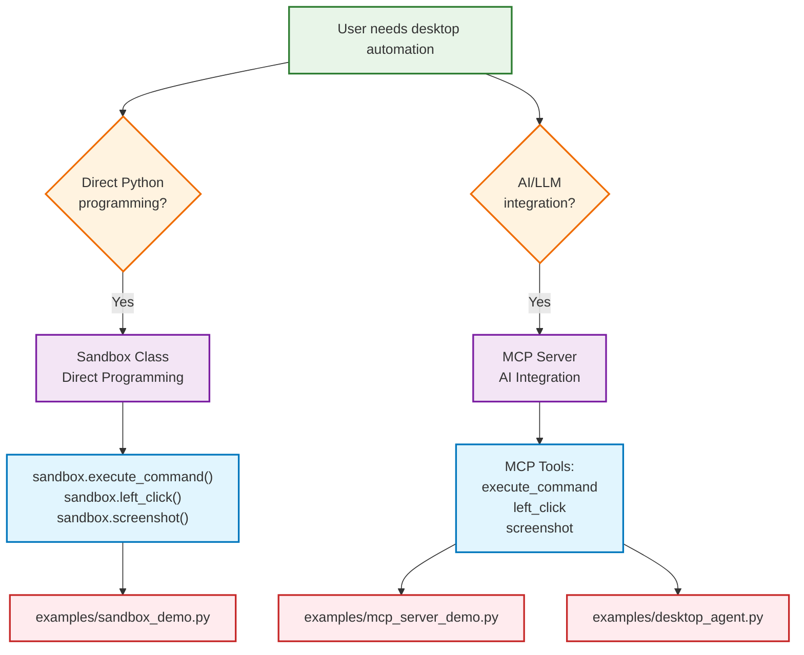
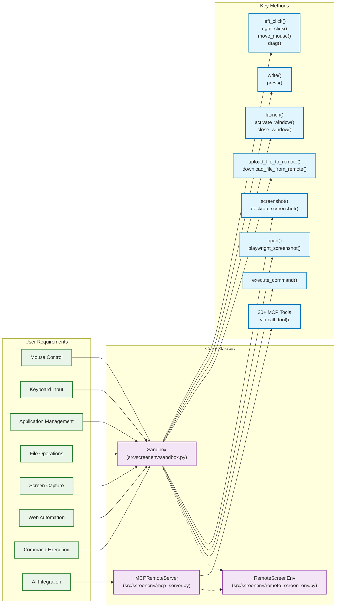

<!-- source: DeepWiki mcp.deepwiki.com · repo huggingface/screenenv · page 4 User Guides · fetched 2026-10-26 -->

# User Guides

<details>
<summary>Relevant source files</summary>

The following files were used as context for generating this wiki page:

- [README.md](README.md)
- [src/screenenv/sandbox.py](src/screenenv/sandbox.py)

</details>


This page provides comprehensive guides for using ScreenEnv in different scenarios, covering both direct programming interfaces and AI agent integration patterns. ScreenEnv offers two primary access methods: direct control through the `Sandbox` class for programmatic automation, and standardized AI integration through the Model Context Protocol (MCP) server.

For detailed installation and basic setup instructions, see [Getting Started](#3). For complete API documentation, see [API Reference](#6).

## Usage Patterns Overview

ScreenEnv supports multiple usage patterns depending on your automation needs and integration requirements:

**Usage Pattern Decision Flow**



Sources: [README.md:47-147](), [examples/sandbox_demo.py:1-50](), [examples/mcp_server_demo.py:1-50]()

## Core Classes and Entry Points

The following diagram maps user automation needs to specific ScreenEnv classes and their key methods:

**Code Entity Mapping**



Sources: [src/screenenv/sandbox.py:42-654](), [src/screenenv/mcp_server.py:1-50](), [README.md:149-187]()

## Workflow Comparison

| Aspect | Direct Programming | AI Integration |
|--------|-------------------|----------------|
| **Entry Point** | `Sandbox()` class | `MCPRemoteServer()` class |
| **Access Pattern** | Direct method calls | MCP protocol tools |
| **Best For** | Custom automation scripts | AI-driven automation |
| **Code Location** | [src/screenenv/sandbox.py:42-654]() | [src/screenenv/mcp_server.py:1-50]() |
| **Example Usage** | `sandbox.left_click(100, 200)` | `call_tool("left_click", {"x": 100, "y": 200})` |
| **Integration** | Python applications | AI agents, LLMs |
| **Available Operations** | All `Sandbox` methods | 30+ standardized MCP tools |

## Quick Start Reference

### Direct Programming Pattern

```python
from screenenv import Sandbox

# Initialize sandbox
sandbox = Sandbox(headless=True)

# Basic operations
sandbox.launch("xfce4-terminal")
sandbox.write("echo 'Hello World'")
sandbox.press("Enter")
screenshot = sandbox.screenshot()

# Cleanup
sandbox.close()
```

### AI Integration Pattern

```python
from screenenv import MCPRemoteServer

# Start MCP server
server = MCPRemoteServer()
print(f"MCP Server URL: {server.server_url}")

# Use with MCP clients
# (See detailed examples in AI Agent Integration guide)
```

Sources: [README.md:49-71](), [README.md:91-99]()

## Configuration Options

Both `Sandbox` and `MCPRemoteServer` support identical configuration parameters:

| Parameter | Type | Default | Description |
|-----------|------|---------|-------------|
| `headless` | bool | `True` | Run without VNC viewer |
| `resolution` | tuple | `(1920, 1080)` | Screen resolution |
| `ram_size` | str | `"4G"` | Container RAM allocation |
| `cpu_cores` | str | `"4"` | Container CPU cores |
| `timeout` | int | `1000` | Operation timeout in seconds |

Sources: [src/screenenv/sandbox.py:55-90](), [README.md:192-206]()

## Navigation to Detailed Guides

- **For step-by-step direct programming instructions**: See [Direct Programming Interface](#4.1)
- **For AI agent integration and MCP usage**: See [AI Agent Integration](#4.2)
- **For practical examples and demonstrations**: See [Examples and Demos](#5)

Each sub-guide provides comprehensive coverage of its respective usage pattern, including detailed code examples, best practices, and troubleshooting information.

Sources: [README.md:1-426](), [src/screenenv/sandbox.py:1-730]()

---

