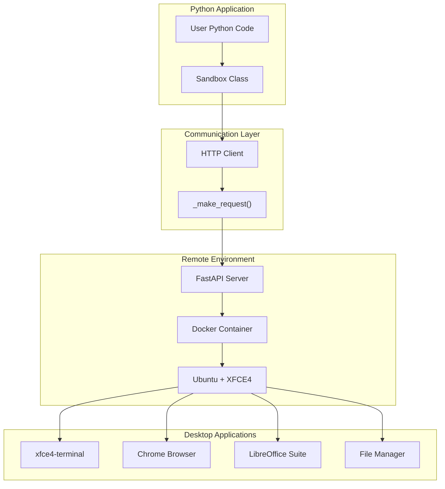
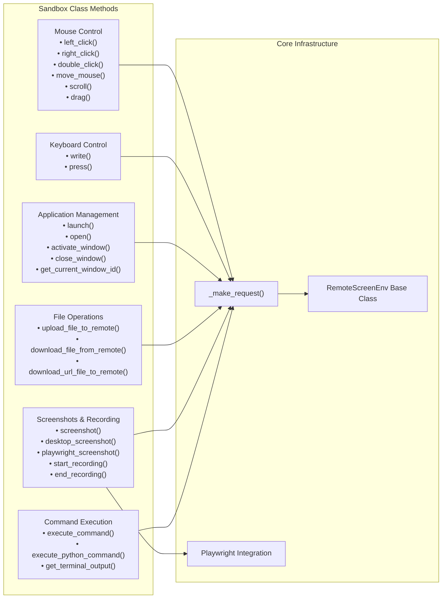
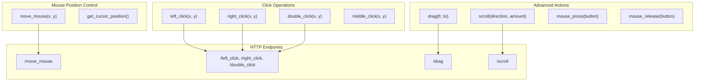
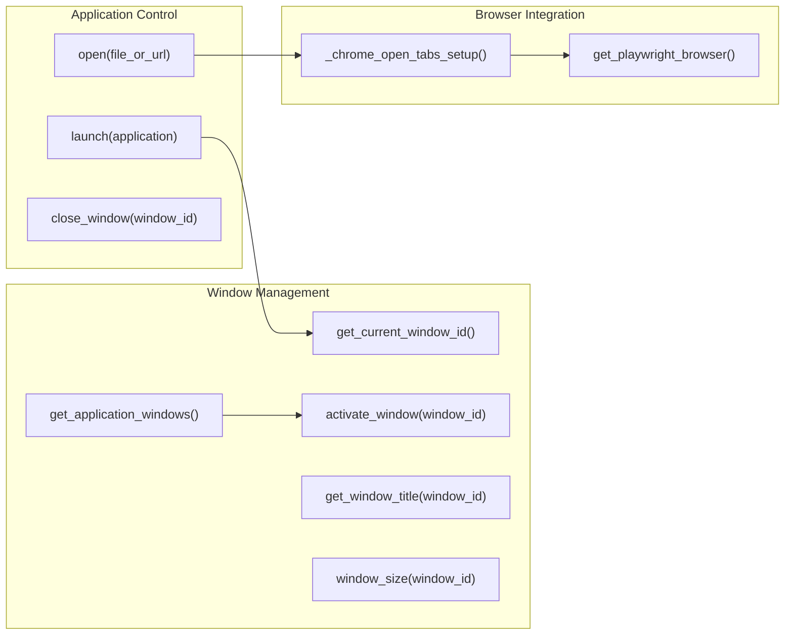
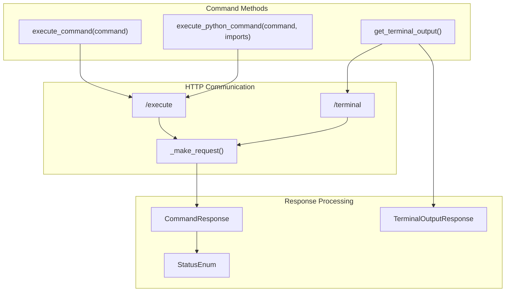
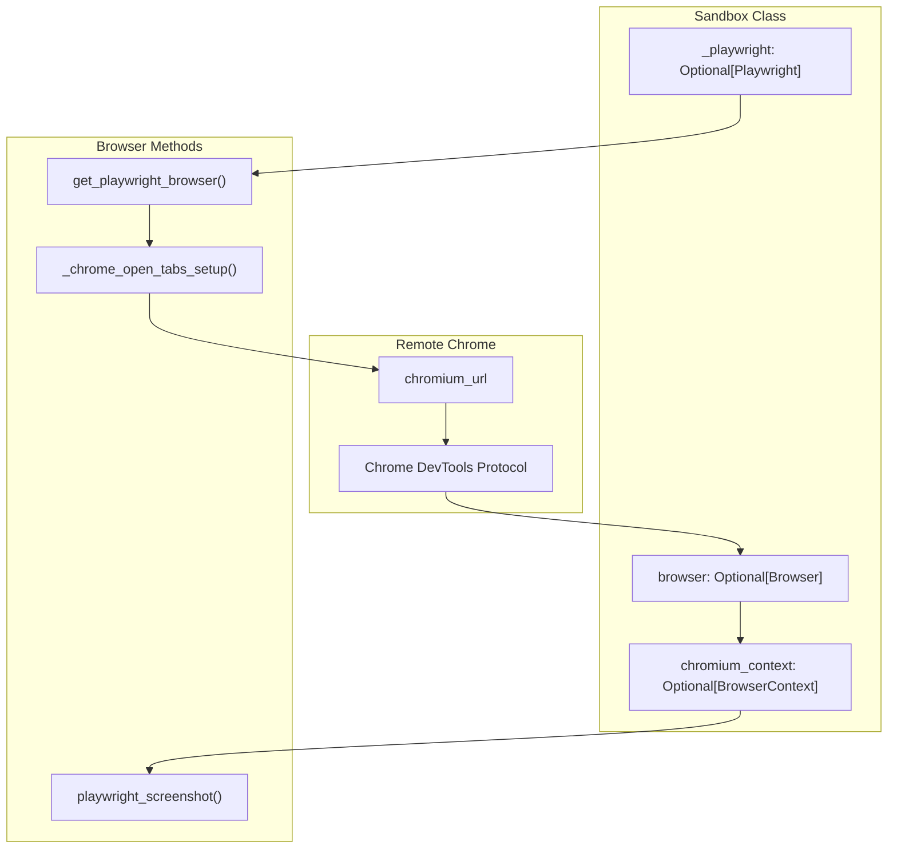

<!-- source: DeepWiki mcp.deepwiki.com · repo huggingface/screenenv · page 4.1 Direct Programming Interface · fetched 2026-10-26 -->

# Direct Programming Interface

Relevant source files

The following files were used as context for generating this wiki page:

- [README.md](README.md)
- [src/screenenv/sandbox.py](src/screenenv/sandbox.py)

This page covers the direct programming interface for ScreenEnv, which allows developers to programmatically control desktop environments using the `Sandbox` class. This interface provides immediate, synchronous access to desktop automation capabilities without requiring AI agent integration.

For AI agent integration using the Model Context Protocol, see [AI Agent Integration](#4.2). For examples of complete automation workflows, see [Examples and Demos](#5).

## Overview

The `Sandbox` class serves as the primary entry point for direct desktop automation. It provides a Python API that wraps HTTP communication with a containerized Ubuntu desktop environment, enabling programmatic control of mouse, keyboard, applications, and file operations.

**Core Architecture**

Sources: [src/screenenv/sandbox.py:42-154](), [src/screenenv/sandbox.py:115-153]()

## Sandbox Class Structure

The `Sandbox` class extends `RemoteScreenEnv` and provides categorized methods for different automation tasks:

**API Method Categories**

Sources: [src/screenenv/sandbox.py:42-654](), [src/screenenv/sandbox.py:527-646]()

## Basic Usage Pattern

The fundamental pattern for using the Sandbox involves instantiation, automation tasks, and cleanup:

| Phase | Methods | Purpose |
|-------|---------|---------|
| **Initialization** | `Sandbox()` | Create and configure environment |
| **Automation** | Mouse, keyboard, app methods | Perform desktop tasks |
| **Capture** | `screenshot()`, `start_recording()` | Document activities |
| **Cleanup** | `close()` | Terminate environment |

**Initialization Parameters**

The `Sandbox` constructor accepts configuration parameters that control the containerized environment:

| Parameter | Type | Default | Description |
|-----------|------|---------|-------------|
| `os_type` | `Literal["Ubuntu", "Windows", "MacOS"]` | `"Ubuntu"` | Operating system type |
| `provider_type` | `Literal["docker", "aws", "hf"]` | `"docker"` | Infrastructure provider |
| `headless` | `bool` | `True` | Run without VNC viewer |
| `resolution` | `tuple[int, int]` | `(1920, 1080)` | Screen resolution |
| `disk_size` | `str` | `"32G"` | Container disk allocation |
| `ram_size` | `str` | `"4G"` | Container RAM allocation |
| `cpu_cores` | `str` | `"4"` | Container CPU cores |
| `session_password` | `str \| bool` | `False` | VNC session password |
| `stream_server` | `bool` | `True` | Enable streaming server |
| `timeout` | `int` | `1000` | Request timeout in seconds |

Sources: [src/screenenv/sandbox.py:55-90]()

## Mouse Control Operations

The mouse control API provides precise cursor manipulation and clicking operations:

**Mouse Action Methods**

Sources: [src/screenenv/sandbox.py:537-646](), [src/screenenv/sandbox.py:571-587]()

## Keyboard Input Operations

Keyboard control enables text input and key combination execution:

**Text Input Methods**

| Method | Parameters | Purpose |
|--------|------------|---------|
| `write()` | `text: str, delay_in_ms: int` | Type text with configurable delay |
| `press()` | `key: str \| list[str]` | Press single keys or combinations |

**Key Combination Examples**

The `press()` method accepts both single keys and key combinations:
- Single keys: `"Enter"`, `"Escape"`, `"Tab"`
- Combinations: `["Ctrl", "C"]`, `["Alt", "Tab"]`, `["Shift", "F10"]`

Sources: [src/screenenv/sandbox.py:615-634]()

## Application Management

The application management API controls desktop applications and windows:

**Application Lifecycle Methods**

Sources: [src/screenenv/sandbox.py:445-525](), [src/screenenv/sandbox.py:156-217]()

## File Operations

File operations enable data transfer between local and remote environments:

**File Transfer Methods**

| Method | Direction | Parameters | Purpose |
|--------|-----------|------------|---------|
| `upload_file_to_remote()` | Local → Remote | `local_path, remote_path` | Upload files to sandbox |
| `download_file_from_remote()` | Remote → Local | `remote_path, local_dest` | Download files from sandbox |
| `download_url_file_to_remote()` | URL → Remote | `url, remote_path` | Download URL content to sandbox |

**Directory Operations**

| Method | Purpose | Return Type |
|--------|---------|-------------|
| `desktop_path()` | Get desktop directory path | `DesktopPathResponse` |
| `directory_tree()` | List directory contents | `DirectoryTreeResponse` |

Sources: [src/screenenv/sandbox.py:317-360](), [src/screenenv/sandbox.py:301-315]()

## Command Execution

Command execution provides terminal access and Python code execution:

**Command Execution Flow**

Sources: [src/screenenv/sandbox.py:268-294](), [src/screenenv/sandbox.py:248-266](), [src/screenenv/sandbox.py:522-525]()

## Screenshot and Recording

Visual capture capabilities enable documentation and monitoring of automation activities:

**Screenshot Methods**

| Method | Purpose | Return Type |
|--------|---------|-------------|
| `screenshot()` | General screenshot with cursor | `bytes` |
| `desktop_screenshot()` | Desktop environment screenshot | `bytes` |
| `playwright_screenshot()` | Browser content screenshot | `bytes \| None` |

**Recording Methods**

| Method | Purpose | Return Type |
|--------|---------|-------------|
| `start_recording()` | Begin screen recording | `RecordingResponse` |
| `end_recording(dest)` | Stop recording and save to file | `RecordingResponse` |

Sources: [src/screenenv/sandbox.py:361-421](), [src/screenenv/sandbox.py:531-535]()

## Integration with Playwright

The Sandbox integrates with Playwright for advanced browser automation:

**Playwright Integration Architecture**

Sources: [src/screenenv/sandbox.py:102-114](), [src/screenenv/sandbox.py:156-217](), [src/screenenv/sandbox.py:367-384]()

## Error Handling and Retry Logic

The Sandbox implements robust error handling and retry mechanisms:

**Request Retry Pattern**

The `_make_request()` method includes retry logic with exponential backoff:
- Retry decorator: `@retry(retry_times=10, retry_interval=5.0)`
- HTTP status code validation
- Session password authentication
- Detailed error reporting with request/response information

Sources: [src/screenenv/sandbox.py:115-153]()

## Resource Management

Proper resource cleanup is essential for containerized environments:

**Cleanup Operations**

The `close()` method handles cleanup of:
- Playwright instances (`_playwright.stop()`)
- Browser contexts and connections
- Docker container termination (via `super().close()`)

Sources: [src/screenenv/sandbox.py:647-653]()

---

