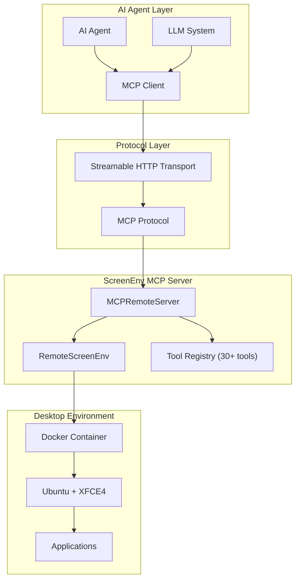
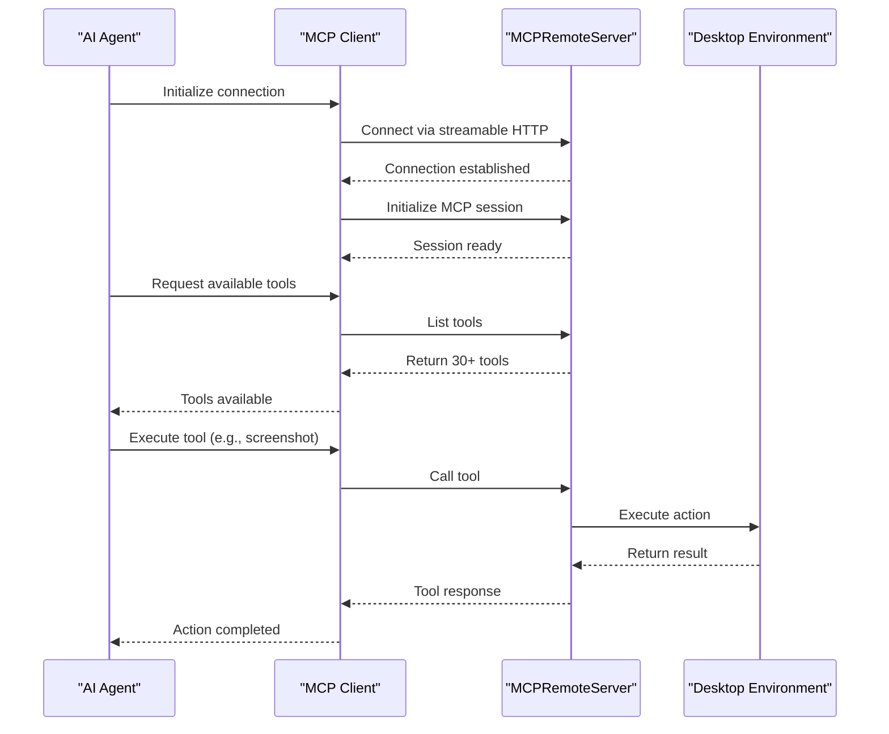
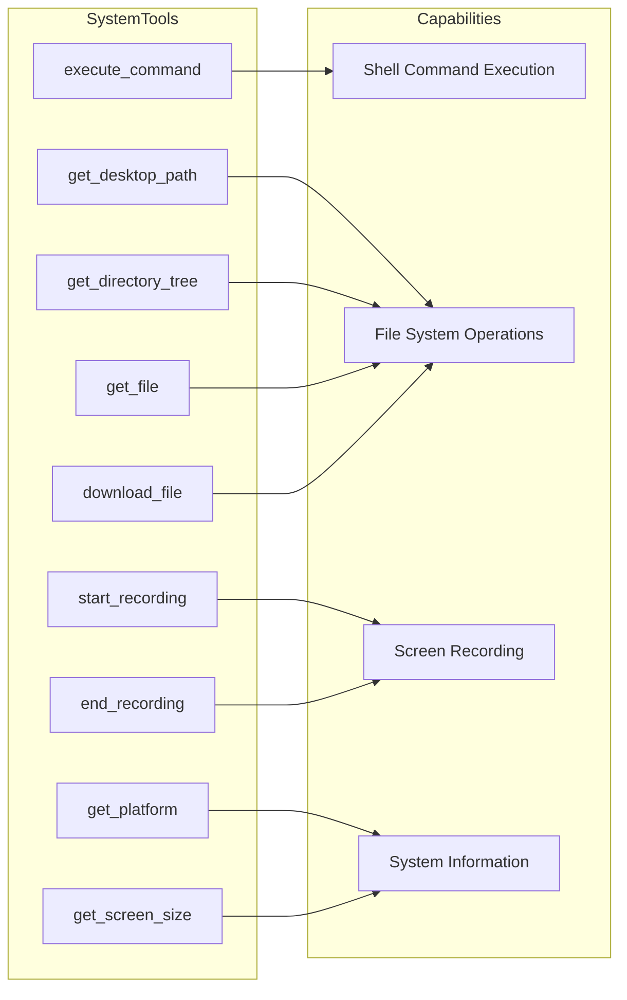
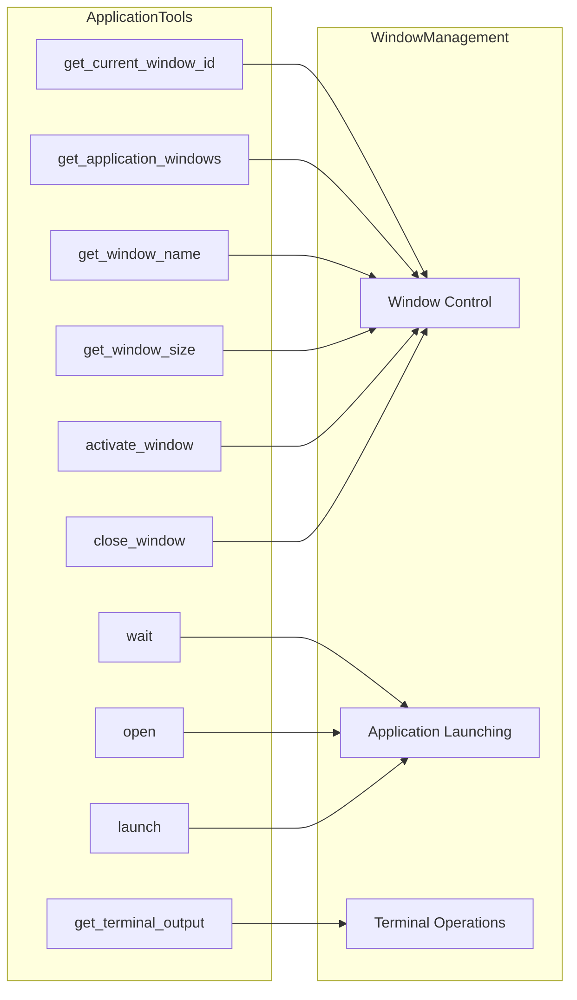
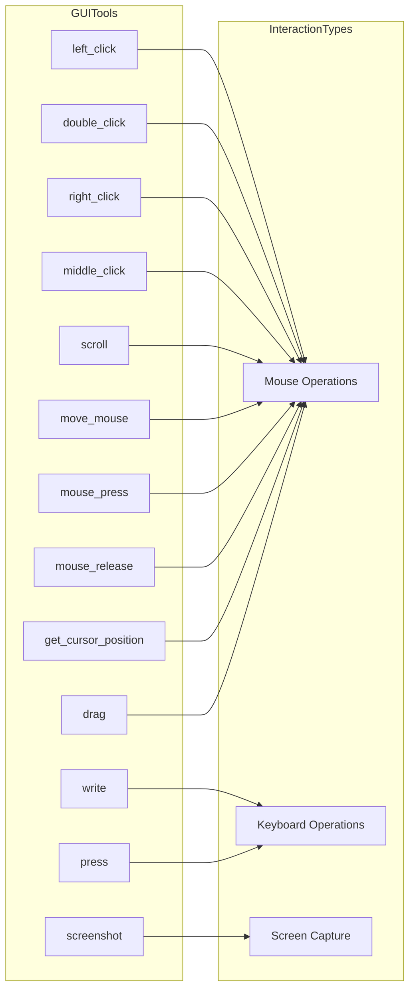

<!-- source: DeepWiki mcp.deepwiki.com · repo huggingface/screenenv · page 4.2 AI Agent Integration · fetched 2026-10-26 -->

# AI Agent Integration

<details>
<summary>Relevant source files</summary>

The following files were used as context for generating this wiki page:

- [README.md](README.md)
- [src/screenenv/mcp_remote_server.py](src/screenenv/mcp_remote_server.py)

</details>


This document covers how to integrate AI agents with ScreenEnv through the Model Context Protocol (MCP) server. This enables AI systems to perform automated desktop tasks using standardized protocols and tools.

For direct programming access to ScreenEnv without AI integration, see [Direct Programming Interface](#4.1). For complete API reference of MCP tools, see [MCP Server API](#6.2).

## Overview

ScreenEnv provides a comprehensive MCP server implementation that exposes desktop automation capabilities to AI agents. The `MCPRemoteServer` class extends the base `RemoteScreenEnv` functionality to provide a standardized interface for AI systems to interact with desktop environments.

### MCP Architecture



Sources: [README.md:76-147](), [src/screenenv/mcp_remote_server.py:1-52]()

## MCP Server Setup

### Basic Server Configuration

The `MCPRemoteServer` class provides the MCP server functionality with sensible defaults:

```python
from screenenv import MCPRemoteServer

# Basic server setup
server = MCPRemoteServer()
print(f"MCP Server URL: {server.server_url}")
print(f"Server Configuration: {server.mcp_server_json}")
```

### Advanced Configuration

```python
server = MCPRemoteServer(
    os_type="Ubuntu",
    provider_type="docker",
    headless=True,
    resolution=(1920, 1080),
    disk_size="32G",
    ram_size="4G",
    cpu_cores="4",
    session_password="your_password",
    stream_server=True,
    dpi=96,
    timeout=1000
)
```

### Server Configuration Properties

| Parameter | Type | Default | Description |
|-----------|------|---------|-------------|
| `os_type` | `Literal["Ubuntu", "Windows", "MacOS"]` | `"Ubuntu"` | Operating system type |
| `provider_type` | `Literal["docker", "aws", "hf"]` | `"docker"` | Environment provider |
| `headless` | `bool` | `True` | Run without VNC viewer |
| `resolution` | `tuple[int, int]` | `(1920, 1080)` | Screen resolution |
| `stream_server` | `bool` | `True` | Enable streaming server |
| `timeout` | `int` | `1000` | Connection timeout |

Sources: [src/screenenv/mcp_remote_server.py:10-44](), [README.md:191-206]()

## AI Agent Connection Patterns

### MCP Client Connection Flow



### Connection Implementation

```python
import asyncio
from mcp import ClientSession
from mcp.client.streamable_http import streamablehttp_client
from screenenv import MCPRemoteServer

async def connect_ai_agent():
    server = MCPRemoteServer(headless=False)
    
    try:
        async with streamablehttp_client(server.server_url) as (
            read_stream, write_stream, _
        ):
            async with ClientSession(read_stream, write_stream) as session:
                await session.initialize()
                
                # AI agent can now use the session
                return session
    finally:
        server.close()
```

Sources: [README.md:103-147]()

## Available Automation Tools

The MCP server exposes over 30 tools categorized by functionality:

### System Operations Tools



### Application Management Tools



### GUI Automation Tools



Sources: [README.md:149-188]()

## Practical AI Agent Workflows

### Basic Automation Workflow

```python
async def ai_desktop_automation():
    server = MCPRemoteServer(headless=False)
    
    try:
        async with streamablehttp_client(server.server_url) as (
            read_stream, write_stream, _
        ):
            async with ClientSession(read_stream, write_stream) as session:
                await session.initialize()
                
                # Launch terminal application
                await session.call_tool("launch", {
                    "application": "xfce4-terminal",
                    "wait_for_window": True
                })
                
                # Type commands
                await session.call_tool("write", {"text": "echo 'Hello MCP!'"})
                await session.call_tool("press", {"key": ["Enter"]})
                
                # Take screenshot for verification
                response = await session.call_tool("screenshot", {})
                screenshot_base64 = response.content[0].data
                
                # Process screenshot data
                screenshot_bytes = base64.b64decode(screenshot_base64)
                # AI agent can now analyze the screenshot
                
    finally:
        server.close()
```

### Multi-Application Workflow

```mermaid
graph TB
    subgraph "AIAgentWorkflow"
        Start["AI Agent Starts"]
        InitMCP["Initialize MCP Connection"]
        LaunchBrowser["Launch Browser"]
        NavigateWeb["Navigate to Website"]
        TakeScreenshot["Take Screenshot"]
        AnalyzeContent["Analyze Content"]
        LaunchEditor["Launch Text Editor"]
        WriteDocument["Write Document"]
        SaveFile["Save File"]
        End["Complete Task"]
    end
    
    Start --> InitMCP
    InitMCP --> LaunchBrowser
    LaunchBrowser --> NavigateWeb
    NavigateWeb --> TakeScreenshot
    TakeScreenshot --> AnalyzeContent
    AnalyzeContent --> LaunchEditor
    LaunchEditor --> WriteDocument
    WriteDocument --> SaveFile
    SaveFile --> End
```



Sources: [README.md:109-147]()

## Advanced Integration Patterns

### Tool Chaining for Complex Tasks

AI agents can chain multiple MCP tools to perform complex desktop automation:

1. **Information Gathering**: Use `screenshot`, `get_directory_tree`, `get_file`
2. **Application Control**: Use `launch`, `activate_window`, `get_application_windows`
3. **User Interface Interaction**: Use `left_click`, `write`, `press`, `drag`
4. **Data Processing**: Use `execute_command`, `download_file`, `get_terminal_output`
5. **Result Capture**: Use `screenshot`, `start_recording`, `end_recording`

### Error Handling and Recovery

```python
async def robust_ai_automation(session):
    try:
        # Attempt primary workflow
        await session.call_tool("launch", {"application": "application"})
        
        # Wait for application to start
        await session.call_tool("wait", {"milliseconds": 2000})
        
        # Verify application launched
        windows = await session.call_tool("get_application_windows", {
            "application": "application"
        })
        
        if not windows.content:
            # Recovery: try alternative approach
            await session.call_tool("execute_command", {
                "command": "application &"
            })
            
    except Exception as e:
        # Fallback to screenshot for debugging
        await session.call_tool("screenshot", {})
        raise
```

### State Management

MCP tools provide state inspection capabilities for AI agents:

| Tool | Purpose | AI Agent Use Case |
|------|---------|-------------------|
| `get_current_window_id` | Get active window | Verify focus state |
| `get_cursor_position` | Get mouse position | Track interaction state |
| `get_terminal_output` | Get terminal text | Parse command results |
| `get_window_size` | Get window dimensions | Plan coordinate-based actions |
| `screenshot` | Capture visual state | Verify UI changes |

Sources: [README.md:149-188]()

## Performance and Scaling Considerations

### Connection Management

The `MCPRemoteServer` manages the underlying `RemoteScreenEnv` connection efficiently:

- **Session Persistence**: Single server instance supports multiple MCP sessions
- **Resource Cleanup**: Automatic cleanup when server is closed
- **Timeout Configuration**: Configurable timeout for long-running operations

### Tool Execution Optimization

For AI agents performing frequent operations:

- **Batch Screenshots**: Take screenshots only when needed for decision-making
- **Window State Caching**: Cache window IDs and sizes to reduce API calls
- **Command Grouping**: Group related keyboard/mouse operations

Sources: [src/screenenv/mcp_remote_server.py:25-44]()

---

