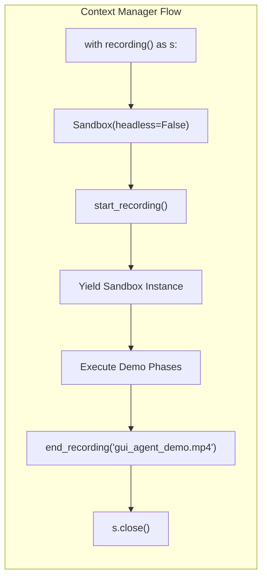
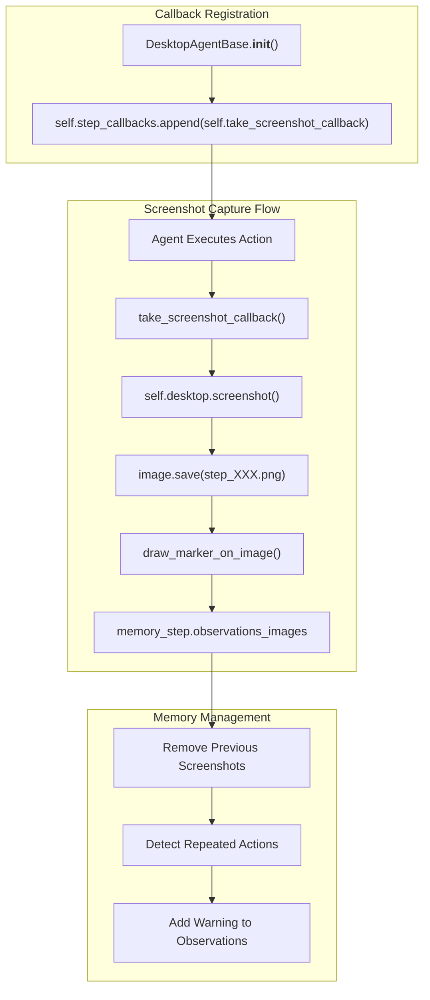
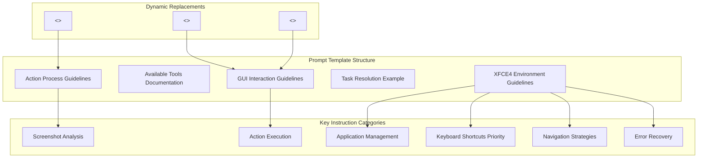

<!-- source: DeepWiki mcp.deepwiki.com · repo huggingface/screenenv · page 5 Examples and Demos · fetched 2026-10-26 -->

# Examples and Demos

<details>
<summary>Relevant source files</summary>

The following files were used as context for generating this wiki page:

- [examples/desktop_agent.py](examples/desktop_agent.py)
- [examples/sandbox_demo.py](examples/sandbox_demo.py)
- [examples/utils.py](examples/utils.py)
- [src/screenenv/desktop_agent/desktop_agent_base.py](src/screenenv/desktop_agent/desktop_agent_base.py)

</details>


This document provides a comprehensive overview of the practical examples and demonstrations available in the ScreenEnv codebase. The examples showcase different usage patterns, from direct programming interfaces to AI-powered desktop automation, demonstrating real-world applications of the core ScreenEnv components.

For detailed API documentation of the underlying classes and methods used in these examples, see [API Reference](#6). For step-by-step usage guides, see [User Guides](#4).

## Demo Categories and Access Patterns

ScreenEnv provides three primary demonstration categories, each targeting different use cases and technical approaches:

```mermaid
graph TB
    subgraph "Demo Categories"
        DirectDemo["`sandbox_demo.py`<br/>Direct Programming Demo"]
        AgentDemo["`desktop_agent.py`<br/>AI Agent Demo"]
        MCPDemo["MCP Server Demo<br/>(Via MCPRemoteServer)"]
    end
    
    subgraph "Core Classes"
        Sandbox["Sandbox<br/>Direct Control API"]
        DesktopAgentBase["DesktopAgentBase<br/>AI Agent Framework"]
        MCPRemoteServer["MCPRemoteServer<br/>MCP Protocol Interface"]
    end
    
    subgraph "Target Audiences"
        Developers["Python Developers<br/>Direct Integration"]
        AIEngineers["AI Engineers<br/>Agent Development"]
        AIClients["AI Clients<br/>Remote Access"]
    end
    
    DirectDemo --> Sandbox
    AgentDemo --> DesktopAgentBase
    MCPDemo --> MCPRemoteServer
    
    Sandbox --> Developers
    DesktopAgentBase --> AIEngineers
    MCPRemoteServer --> AIClients
    
    DesktopAgentBase --> Sandbox
    MCPRemoteServer --> Sandbox
```

**Sources:** [examples/sandbox_demo.py:1-331](), [examples/desktop_agent.py:1-312](), [src/screenenv/desktop_agent/desktop_agent_base.py:1-373]()

## Demo Execution Architecture

The demonstration system follows a consistent execution pattern across all examples, with specific initialization, execution, and cleanup phases:

```mermaid
graph TD
    subgraph "Demo Initialization"
        CreateSandbox["`Sandbox(headless=False)`"]
        StartRecording["`start_recording()`"]
        ConfigureAgent["`CustomDesktopAgent()`"]
    end
    
    subgraph "Core Execution Loop"
        TakeScreenshot["`screenshot()`"]
        AnalyzeState["Analyze Current State"]
        ExecuteAction["`click()` / `write()` / `press()`"]
        WaitForResponse["`sleep()` / `wait()`"]
    end
    
    subgraph "Demo Cleanup"
        EndRecording["`end_recording()`"]
        CloseWindows["`close_window()`"]
        KillSandbox["`kill()`"]
    end
    
    CreateSandbox --> StartRecording
    StartRecording --> TakeScreenshot
    TakeScreenshot --> AnalyzeState
    AnalyzeState --> ExecuteAction
    ExecuteAction --> WaitForResponse
    WaitForResponse --> TakeScreenshot
    
    ExecuteAction --> EndRecording
    EndRecording --> CloseWindows
    CloseWindows --> KillSandbox
```

**Sources:** [examples/sandbox_demo.py:14-26](), [examples/desktop_agent.py:287-312](), [src/screenenv/desktop_agent/desktop_agent_base.py:295-366]()

## Complex GUI Automation Demo Implementation

The `demo_complex_gui_automation()` function in `sandbox_demo.py` demonstrates a comprehensive multi-application workflow that showcases the full capabilities of the `Sandbox` class:

| Phase | Applications | Key Methods | Purpose |
|-------|-------------|-------------|---------|
| Terminal Operations | `xfce4-terminal` | `launch()`, `write()`, `press()` | System analysis and command execution |
| Web Research | `chromium`/`google-chrome` | `open()`, `move_mouse()`, `scroll()` | Browser automation and navigation |
| Document Creation | `libreoffice --writer` | `launch()`, `write()`, `press()` | Professional document generation |
| Data Analysis | `libreoffice --calc` | `launch()`, `write()`, `press()` | Spreadsheet manipulation |
| File Management | `xfce4-terminal` | `execute_command()`, `write()` | Workspace organization |

The demo uses the `recording()` context manager to capture the entire workflow as a video file:



**Sources:** [examples/sandbox_demo.py:13-26](), [examples/sandbox_demo.py:28-331]()

## AI Desktop Agent Architecture

The `CustomDesktopAgent` class demonstrates how to extend `DesktopAgentBase` to create AI-powered desktop automation agents. The implementation follows the SmolaAgents framework integration pattern:

```mermaid
graph TD
    subgraph "Agent Inheritance Chain"
        CodeAgent["smolagents.CodeAgent"]
        DesktopAgentBase["DesktopAgentBase"]
        CustomDesktopAgent["CustomDesktopAgent"]
    end
    
    subgraph "Tool Registration System"
        SetupTools["`_setup_desktop_tools()`"]
        ToolDecorator["`@tool` decorator"]
        ToolRegistration["`self.tools['tool_name'] = tool`"]
    end
    
    subgraph "Available Tools"
        MouseTools["`click()` / `right_click()` / `double_click()`"]
        KeyboardTools["`write()` / `press()`"]
        NavigationTools["`scroll()` / `drag()` / `move_mouse()`"]
        AppTools["`launch_app()` / `open()` / `execute()`"]
        BrowserTools["`refresh()` / `go_back()`"]
        UtilityTools["`wait()`"]
    end
    
    CodeAgent --> DesktopAgentBase
    DesktopAgentBase --> CustomDesktopAgent
    CustomDesktopAgent --> SetupTools
    SetupTools --> ToolDecorator
    ToolDecorator --> ToolRegistration
    ToolRegistration --> MouseTools
    ToolRegistration --> KeyboardTools
    ToolRegistration --> NavigationTools
    ToolRegistration --> AppTools
    ToolRegistration --> BrowserTools
    ToolRegistration --> UtilityTools
```

**Sources:** [examples/desktop_agent.py:16-41](), [examples/desktop_agent.py:49-247](), [src/screenenv/desktop_agent/desktop_agent_base.py:223-276]()

## Tool Registration Pattern

The agent framework uses a consistent pattern for registering desktop interaction tools. Each tool is decorated with `@tool` and registered in the `tools` dictionary:

```mermaid
graph LR
    subgraph "Tool Definition Pattern"
        DefineFunction["`@tool`<br/>`def tool_name(args):`"]
        ImplementAction["Call `self.desktop.method()`"]
        LogAction["`self.logger.log()`"]
        ReturnMessage["Return status message"]
        RegisterTool["`self.tools['tool_name'] = tool_name`"]
    end
    
    DefineFunction --> ImplementAction
    ImplementAction --> LogAction
    LogAction --> ReturnMessage
    ReturnMessage --> RegisterTool
```

**Sources:** [examples/desktop_agent.py:52-63](), [examples/desktop_agent.py:232-247]()

## Screenshot Callback System

The `DesktopAgentBase` implements a sophisticated screenshot callback system that captures the desktop state after each action and integrates it into the agent's memory:



**Sources:** [src/screenenv/desktop_agent/desktop_agent_base.py:271-272](), [src/screenenv/desktop_agent/desktop_agent_base.py:295-366]()

## Interactive Input System

The `utils.py` module provides an advanced interactive input system using `prompt_toolkit` for better user experience when working with the desktop agent:

```mermaid
graph LR
    subgraph "Input Components"
        PromptSession["`PromptSession`"]
        FileHistory["`FileHistory`"]
        WordCompleter["`WordCompleter`"]
        AutoSuggest["`AutoSuggestFromHistory`"]
        KeyBindings["`KeyBindings`"]
        Style["`Style`"]
    end
    
    subgraph "User Commands"
        TaskInput["Task Description"]
        HelpCommand["`help` command"]
        HistoryCommand["`history` command"]
        QuitCommand["`quit` / `exit`"]
        ClearCommand["`clear` command"]
    end
    
    subgraph "Key Bindings"
        F1Help["`F1` - Show Help"]
        CtrlLClear["`Ctrl+L` - Clear Screen"]
        TabComplete["`Tab` - Auto-complete"]
        ArrowHistory["`Arrow Keys` - History"]
    end
    
    PromptSession --> TaskInput
    FileHistory --> ArrowHistory
    WordCompleter --> TabComplete
    KeyBindings --> F1Help
    KeyBindings --> CtrlLClear
    TaskInput --> HelpCommand
    TaskInput --> HistoryCommand
    TaskInput --> QuitCommand
    TaskInput --> ClearCommand
```

**Sources:** [examples/utils.py:13-170](), [examples/utils.py:71-81](), [examples/utils.py:34-62]()

## Model Integration Patterns

The desktop agent examples demonstrate integration with various AI model providers through the SmolaAgents framework:

| Provider | Class | Configuration | Usage Pattern |
|----------|--------|---------------|---------------|
| OpenAI | `OpenAIServerModel` | `model_id`, `api_key` | Direct API integration |
| Hugging Face | `HfApiModel` | `model_id`, `token`, `provider` | Inference Endpoints |
| Transformers | `TransformersModel` | `model_id`, `device_map`, `torch_dtype` | Local model execution |
| LiteLLM | `LiteLLMModel` | `model_id` | Multi-provider support |

**Sources:** [examples/desktop_agent.py:254-281]()

## System Prompt Template

The `DESKTOP_SYSTEM_PROMPT_TEMPLATE` in `desktop_agent_base.py` provides comprehensive instructions for AI agents operating in the XFCE4 Ubuntu environment:



**Sources:** [src/screenenv/desktop_agent/desktop_agent_base.py:19-199](), [src/screenenv/desktop_agent/desktop_agent_base.py:260-262]()

---

