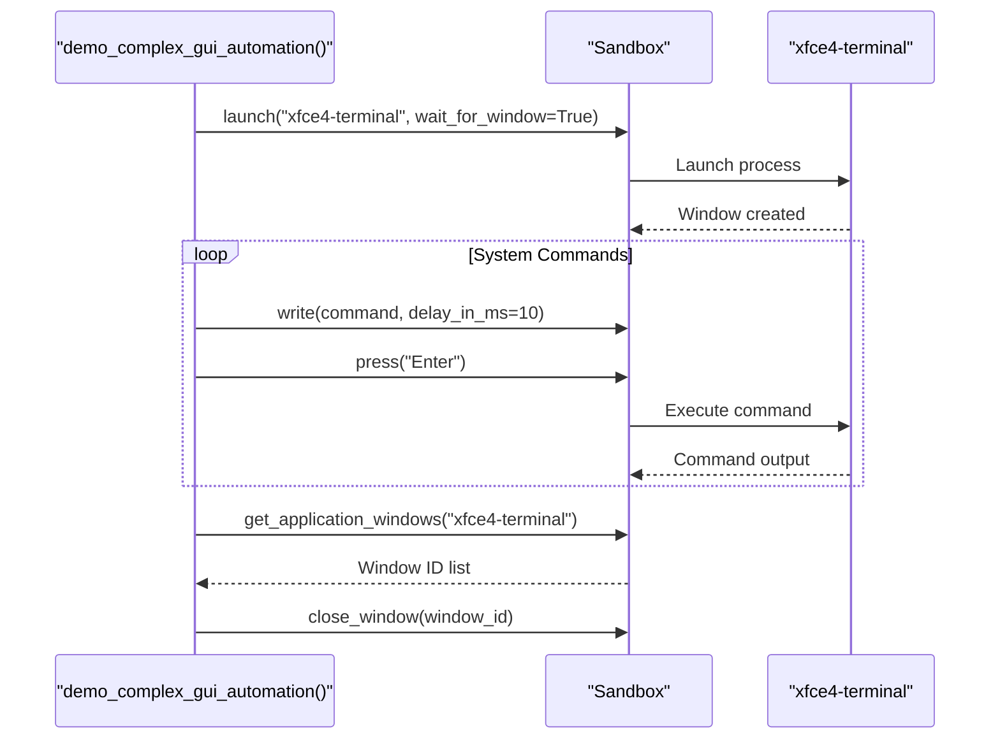
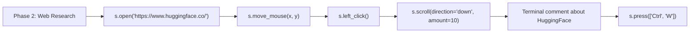
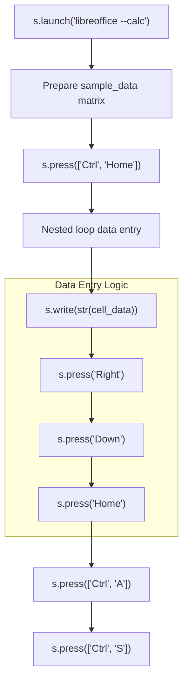
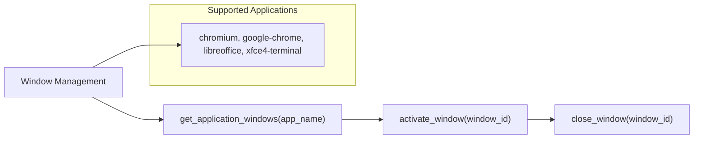

<!-- source: DeepWiki mcp.deepwiki.com · repo huggingface/screenenv · page 5.1 Complex GUI Automation Demo · fetched 2026-10-26 -->

# Complex GUI Automation Demo

<details>
<summary>Relevant source files</summary>

The following files were used as context for generating this wiki page:

- [examples/sandbox_demo.py](examples/sandbox_demo.py)

</details>


## Purpose and Scope

This document covers the comprehensive GUI automation demonstration implemented in ScreenEnv, which showcases multi-application workflow automation using the `Sandbox` class. The demo illustrates how to programmatically control desktop applications including terminals, web browsers, office suites, and file managers to perform complex, real-world automation tasks.

This demo serves as a practical example of ScreenEnv's capabilities for building sophisticated desktop automation workflows. For AI-driven automation approaches, see [AI Desktop Agent](#5.2). For MCP protocol integration examples, see [MCP Server Demo](#5.3).

## Demo Architecture

The complex GUI automation demo is structured as a multi-phase workflow that demonstrates various automation capabilities across different application types.

### Demo Execution Flow

```mermaid
flowchart TD
    Start["`demo_complex_gui_automation()`"] --> Recording["`recording()` context manager"]
    Recording --> Phase1["Phase 1: Terminal Intelligence Gathering"]
    Recording --> Phase2["Phase 2: Web Research & Data Collection"]
    Recording --> Phase3["Phase 3: Document Creation & Writing"]
    Recording --> Phase4["Phase 4: Data Analysis & Spreadsheets"]
    Recording --> Phase5["Phase 5: File Management & Organization"]
    Recording --> Phase6["Phase 6: Final Demonstration & Cleanup"]
    
    Phase1 --> Terminal["`xfce4-terminal`"]
    Phase2 --> Browser["`chromium/google-chrome`"]
    Phase3 --> Writer["`libreoffice --writer`"]
    Phase4 --> Calc["`libreoffice --calc`"]
    Phase5 --> FileSystem["File system operations"]
    Phase6 --> Cleanup["Application cleanup"]
    
    Terminal --> SystemAnalysis["System analysis commands"]
    Browser --> WebInteraction["Web page interactions"]
    Writer --> DocumentCreation["Report generation"]
    Calc --> DataEntry["Spreadsheet data entry"]
    FileSystem --> WorkspaceOrg["Workspace organization"]
    Cleanup --> VideoOutput["`gui_agent_demo.mp4`"]
```

Sources: [examples/sandbox_demo.py:28-330]()

### Core Automation Components

```mermaid
graph TB
    subgraph "Sandbox Control Layer"
        SandboxInstance["`Sandbox(headless=False)`"]
        Recording["`start_recording()`"]
        VideoOutput["`end_recording()`"]
    end
    
    subgraph "Application Management"
        Launch["`launch()`"]
        Windows["`get_application_windows()`"]
        Activate["`activate_window()`"]
        Close["`close_window()`"]
    end
    
    subgraph "Input Control"
        MouseControl["`move_mouse()`, `left_click()`"]
        KeyboardControl["`write()`, `press()`"]
        KeyCombos["`press(['Ctrl', 'A'])`"]
        ScrollControl["`scroll()`"]
    end
    
    subgraph "Target Applications"
        Terminal["`xfce4-terminal`"]
        Browser["`open(url)`"]
        LibreOffice["`libreoffice --writer/--calc`"]
    end
    
    SandboxInstance --> Launch
    SandboxInstance --> Recording
    Launch --> Windows
    Windows --> Activate
    Activate --> Close
    
    SandboxInstance --> MouseControl
    SandboxInstance --> KeyboardControl
    KeyboardControl --> KeyCombos
    SandboxInstance --> ScrollControl
    
    Launch --> Terminal
    Launch --> Browser
    Launch --> LibreOffice
```

Sources: [examples/sandbox_demo.py:14-26](), [examples/sandbox_demo.py:52-84]()

## Phase-by-Phase Implementation

### Phase 1: Terminal Intelligence Gathering

The demo begins with comprehensive system analysis using terminal commands. This phase demonstrates programmatic terminal control and command execution.

| Operation | Implementation | Purpose |
|-----------|----------------|---------|
| Terminal Launch | `s.launch("xfce4-terminal", wait_for_window=True)` | Open terminal application |
| Command Execution | `s.write(cmd, delay_in_ms=10)` + `s.press("Enter")` | Execute system commands |
| Window Management | `s.get_application_windows("xfce4-terminal")` | Get terminal window handles |
| Analysis Commands | System info, disk usage, memory, processes | Gather system intelligence |



Sources: [examples/sandbox_demo.py:47-88](), [examples/sandbox_demo.py:57-76]()

### Phase 2: Web Research & Data Collection

This phase demonstrates web browser automation including page navigation, mouse interactions, and multi-tab management.

The implementation uses the `open()` method to launch web pages and combines mouse control with scrolling for page interaction:



Sources: [examples/sandbox_demo.py:89-131](), [examples/sandbox_demo.py:95-128]()

### Phase 3: Document Creation & Writing

Professional document generation using LibreOffice Writer demonstrates office suite automation capabilities.

| Document Operation | Implementation | Result |
|-------------------|----------------|---------|
| Launch Writer | `s.launch("libreoffice --writer", wait_for_window=True)` | Writer application |
| Content Entry | `s.write(line, delay_in_ms=1)` + `s.press("Enter")` | Report content |
| Formatting | `s.press(["Ctrl", "A"])` | Select all text |
| Save Document | `s.press(["Ctrl", "S"])` + filename | Save as `.odt` file |

The demo creates a structured report with predefined content including executive summary, key findings, technical details, and conclusions.

Sources: [examples/sandbox_demo.py:132-191](), [examples/sandbox_demo.py:144-171]()

### Phase 4: Data Analysis & Spreadsheets

Spreadsheet automation demonstrates data entry and analysis workflows using LibreOffice Calc.



The data entry implementation uses an optimized approach with nested loops to populate spreadsheet cells efficiently, moving through rows and columns systematically.

Sources: [examples/sandbox_demo.py:192-249](), [examples/sandbox_demo.py:203-235]()

### Phase 5: File Management & Organization

File system operations demonstrate terminal-based workspace organization and file management automation.

| File Operation | Command | Purpose |
|----------------|---------|---------|
| Directory Creation | `mkdir -p ~/ai_agent_workspace/reports` | Create organized structure |
| File Movement | `mv ~/Documents/ai_agent_report.odt ~/ai_agent_workspace/reports/` | Organize created files |
| Directory Listing | `ls -R ~/ai_agent_workspace` | Verify organization |
| README Creation | `echo 'Workspace created by AI Agent' > README.txt` | Document workspace |

Sources: [examples/sandbox_demo.py:250-286](), [examples/sandbox_demo.py:255-283]()

## Recording and Context Management

The demo uses a context manager pattern to handle recording lifecycle and resource cleanup:

```mermaid
graph TB
    ContextManager["`recording()` context manager"] --> SandboxInit["`Sandbox(headless=False, session_password=True)`"]
    SandboxInit --> StartRec["`s.start_recording()`"]
    StartRec --> YieldSandbox["Yield sandbox instance"]
    YieldSandbox --> DemoExecution["Execute demo phases"]
    DemoExecution --> EndRec["`s.end_recording('gui_agent_demo.mp4')`"]
    EndRec --> SandboxClose["`s.close()`"]
    
    subgraph "Exception Handling"
        Finally["finally block"]
        Finally --> SandboxClose
    end
```

The `recording()` context manager ensures proper resource cleanup and video file generation regardless of demo execution success or failure.

Sources: [examples/sandbox_demo.py:13-26]()

## Application Window Management

The demo implements sophisticated window management for handling multiple applications:



The cleanup phase iterates through multiple application types to ensure proper window closure and resource management.

Sources: [examples/sandbox_demo.py:287-327](), [examples/sandbox_demo.py:295-306]()

## Key Technical Features

### Input Control Mechanisms

The demo showcases various input control methods:

- **Keyboard Control**: `write()` with configurable delays, `press()` for key combinations
- **Mouse Control**: `move_mouse()`, `left_click()`, `scroll()` operations  
- **Application Control**: `launch()`, `open()`, window management functions
- **File Operations**: Terminal commands for file system manipulation

### Timing and Synchronization

The demo uses the `sleep()` function strategically to ensure visual feedback and application responsiveness:

- Phase transitions: 4-second delays for visibility
- Application launches: 1-2 second waits
- Command execution: 0.5-second intervals
- User input simulation: Variable delays based on operation type

Sources: [examples/sandbox_demo.py:8-11]()

### Error Handling and Robustness

The implementation includes error handling for application-specific operations, particularly in the cleanup phase where different browsers may or may not be available depending on the system architecture.

Sources: [examples/sandbox_demo.py:298-306]()

This comprehensive demo demonstrates ScreenEnv's capability to orchestrate complex, multi-application workflows that mirror real-world desktop automation scenarios, making it suitable for both educational purposes and practical automation development.

---

