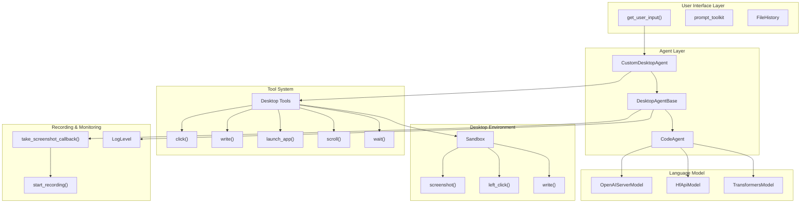
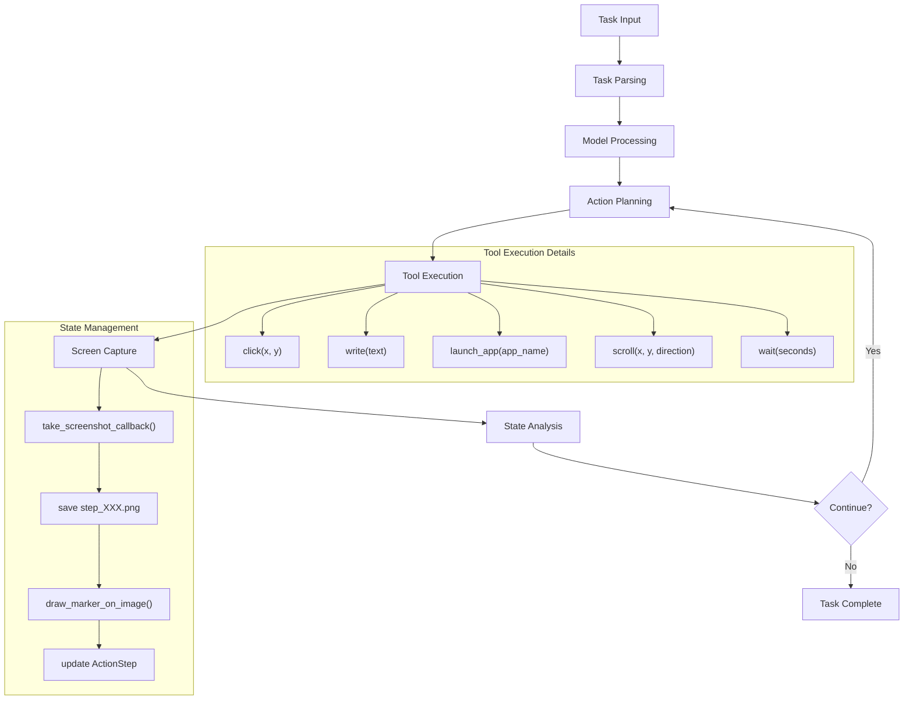
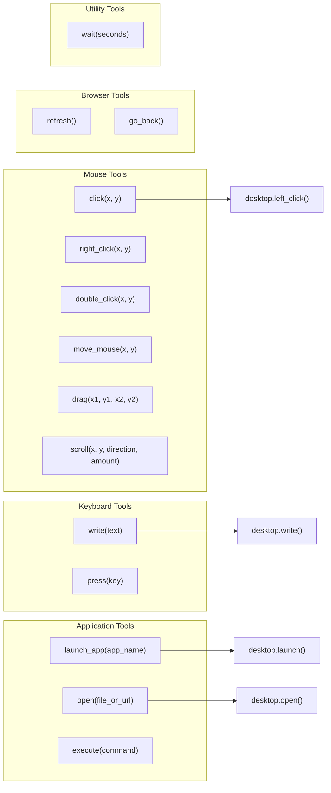
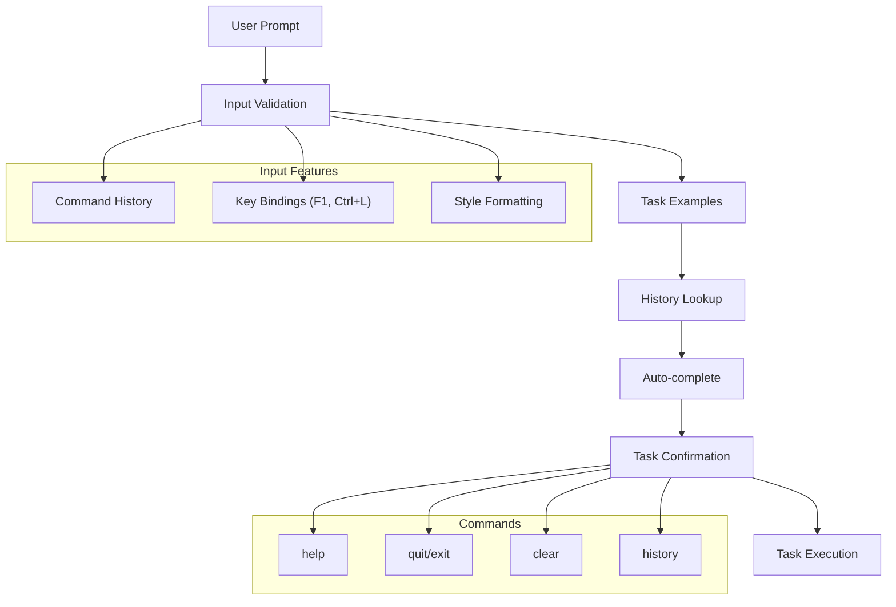
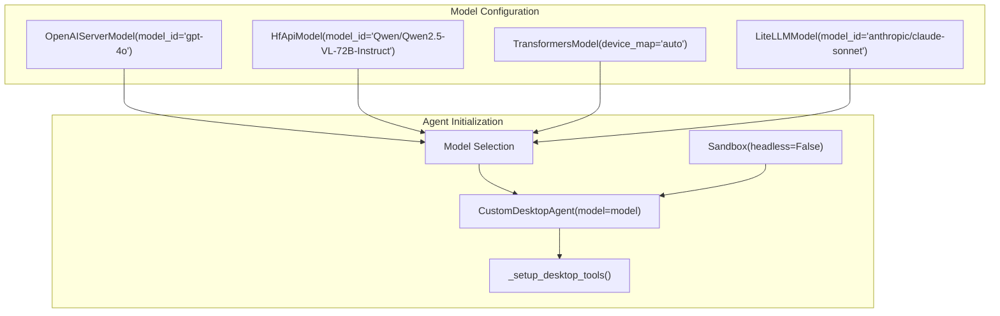

<!-- source: DeepWiki mcp.deepwiki.com · repo huggingface/screenenv · page 5.2 AI Desktop Agent · fetched 2026-10-26 -->

# AI Desktop Agent

<details>
<summary>Relevant source files</summary>

The following files were used as context for generating this wiki page:

- [examples/desktop_agent.py](examples/desktop_agent.py)
- [examples/utils.py](examples/utils.py)
- [src/screenenv/desktop_agent/desktop_agent_base.py](src/screenenv/desktop_agent/desktop_agent_base.py)

</details>


## Purpose and Scope

This document covers the AI Desktop Agent system in ScreenEnv, which enables the creation of autonomous AI agents that can perform complex desktop automation tasks through natural language instructions. The system combines large language models with desktop control capabilities to create agents that can operate applications, browse the web, and manipulate files in a containerized Ubuntu environment.

For direct programming control of the desktop without AI integration, see [Direct Programming Interface](#4.1). For the underlying Model Context Protocol server implementation, see [MCP Server Demo](#5.3).

## Architecture Overview

The AI Desktop Agent system is built on a layered architecture that transforms natural language instructions into precise desktop actions through an intelligent agent framework.

### System Components



**Sources:** [examples/desktop_agent.py:1-311](), [src/screenenv/desktop_agent/desktop_agent_base.py:1-373](), [examples/utils.py:1-170]()

### Agent Execution Flow



**Sources:** [src/screenenv/desktop_agent/desktop_agent_base.py:295-366](), [examples/desktop_agent.py:49-247]()

## Core Components

### CustomDesktopAgent Class

The `CustomDesktopAgent` class extends `DesktopAgentBase` and implements the complete desktop automation tool set. It serves as the main interface for creating AI-powered desktop agents.

| Component | Description | Code Location |
|-----------|-------------|---------------|
| **Constructor** | Initializes agent with model, desktop, and configuration | [examples/desktop_agent.py:19-41]() |
| **Tool Setup** | Registers all desktop interaction tools | [examples/desktop_agent.py:49-247]() |
| **Model Integration** | Supports multiple LLM providers (OpenAI, HuggingFace, Transformers) | [examples/desktop_agent.py:254-281]() |

### DesktopAgentBase Class

The base class provides the core agent functionality, including the system prompt, screenshot management, and execution callbacks.

| Feature | Method | Purpose |
|---------|---------|---------|
| **System Prompt** | `DESKTOP_SYSTEM_PROMPT_TEMPLATE` | Defines agent behavior and guidelines |
| **Screenshot Callback** | `take_screenshot_callback()` | Captures state after each action |
| **Screen Management** | `get_screen_size()` | Manages display resolution |
| **Resource Cleanup** | `close()` | Terminates sandbox and resources |

**Sources:** [src/screenenv/desktop_agent/desktop_agent_base.py:19-199](), [src/screenenv/desktop_agent/desktop_agent_base.py:295-372]()

### Desktop Tools System

The agent includes a comprehensive set of tools for desktop interaction:



**Sources:** [examples/desktop_agent.py:52-246]()

## User Interaction System

### Interactive Input Interface

The system provides an advanced interactive interface for task input using `prompt_toolkit`:

| Feature | Implementation | Purpose |
|---------|----------------|---------|
| **Command History** | `FileHistory` | Stores previous tasks for reuse |
| **Auto-completion** | `WordCompleter` | Suggests common tasks and commands |
| **Key Bindings** | `KeyBindings` | Custom shortcuts (F1 for help, Ctrl+L for clear) |
| **Styled Prompts** | `Style.from_dict()` | Enhanced visual interface |



**Sources:** [examples/utils.py:13-170]()

## Agent Execution Process

### Task Processing Pipeline

The agent processes tasks through a structured pipeline that combines language model reasoning with desktop action execution:

1. **Task Input**: Natural language task description
2. **Model Processing**: LLM analyzes task and current screen state
3. **Action Planning**: Determines next action based on screenshot analysis
4. **Tool Execution**: Executes specific desktop tools
5. **State Capture**: Takes screenshot and updates memory
6. **Iteration**: Continues until task completion

### Screenshot Management

The system maintains visual state through automated screenshot capture:

| Method | Purpose | Timing |
|--------|---------|--------|
| `take_screenshot_callback()` | Captures screen state after each action | Post-action |
| `draw_marker_on_image()` | Adds visual markers to show click locations | During screenshot processing |
| `AgentImage()` | Stores screenshot for model analysis | Each step |

**Sources:** [src/screenenv/desktop_agent/desktop_agent_base.py:295-366]()

### System Prompt and Guidelines

The agent operates using a comprehensive system prompt that defines:

- **Action Process**: Step-by-step execution format
- **Tool Descriptions**: Available desktop tools and their usage
- **GUI Guidelines**: Screen coordinate handling and precision requirements
- **Environment Specifics**: XFCE4 Ubuntu desktop behaviors
- **Error Recovery**: Handling failed actions and alternative approaches

**Sources:** [src/screenenv/desktop_agent/desktop_agent_base.py:19-199]()

## Integration with Language Models

### Supported Model Providers

The system supports multiple language model providers through the SmolaAgents framework:

| Provider | Model Class | Configuration |
|----------|-------------|---------------|
| **OpenAI** | `OpenAIServerModel` | API key authentication |
| **HuggingFace** | `HfApiModel` | Token-based authentication |
| **Transformers** | `TransformersModel` | Local model loading |
| **LiteLLM** | `LiteLLMModel` | Multi-provider support |



**Sources:** [examples/desktop_agent.py:254-281]()

## Recording and Monitoring

### Screen Recording

The system provides comprehensive recording capabilities for task execution:

| Feature | Method | Purpose |
|---------|---------|---------|
| **Recording Start** | `start_recording()` | Begins video capture |
| **Recording End** | `end_recording()` | Saves video file |
| **Step Screenshots** | `step_XXX.png` | Individual action screenshots |
| **Visual Markers** | `draw_marker_on_image()` | Shows click locations |

### Execution Monitoring

The agent includes built-in monitoring and logging:

- **Log Levels**: Configurable verbosity through `LogLevel`
- **Step Callbacks**: Automated screenshot capture after each action
- **Memory Management**: Removes old screenshots to optimize performance
- **Action Validation**: Warns about repeated actions

**Sources:** [src/screenenv/desktop_agent/desktop_agent_base.py:295-366](), [examples/desktop_agent.py:294-311]()

## Usage Example

### Complete Agent Setup

```python
# Model configuration
model = OpenAIServerModel(
    model_id="gpt-4o",
    api_key=os.getenv("OPENAI_API_KEY"),
)

# Sandbox setup
sandbox = Sandbox(headless=False, resolution=(1280, 700))
sandbox.start_recording()

# Agent initialization
agent = CustomDesktopAgent(
    model=model, 
    data_dir="data", 
    desktop=sandbox
)

# Task execution
result = agent.run("Open LibreOffice and write a report")
```

### Interactive Task Loop

The main execution loop handles user input, agent execution, and cleanup:

```python
while True:
    task = get_user_input()
    if task is None:
        exit()
    
    # Execute task with recording
    result = agent.run(task)
    
    # Save recording and cleanup
    sandbox.end_recording("recording.mp4")
    agent.close()
```

**Sources:** [examples/desktop_agent.py:287-311]()

---

