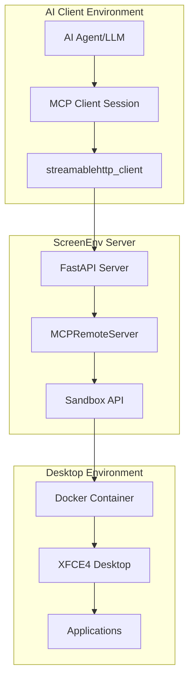
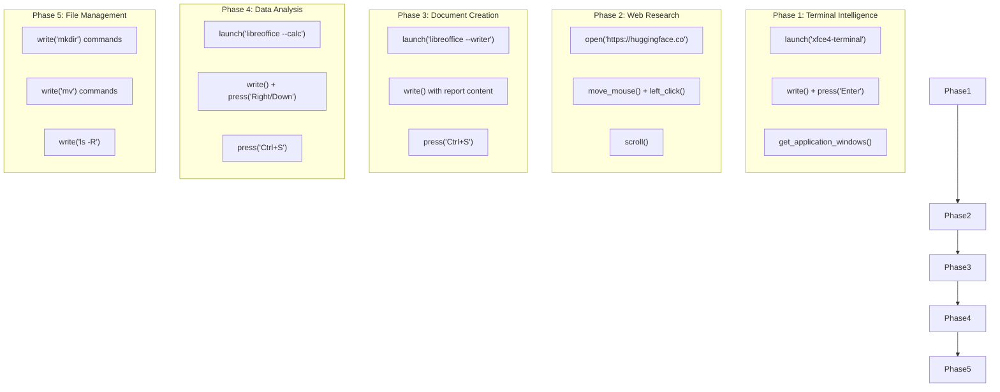
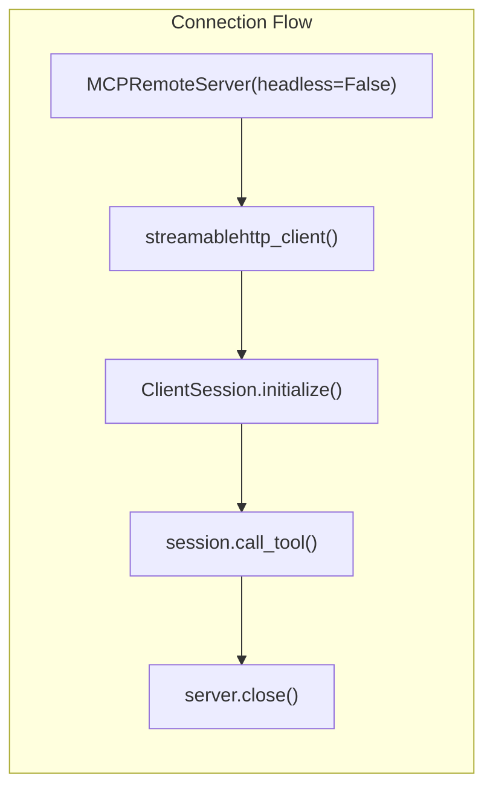
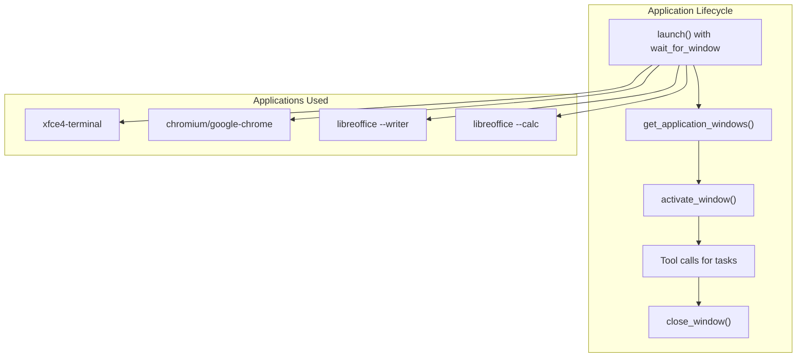
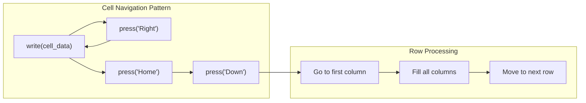
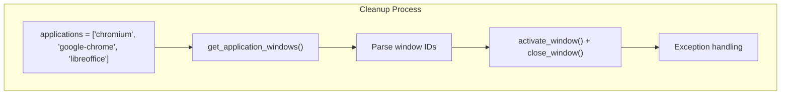
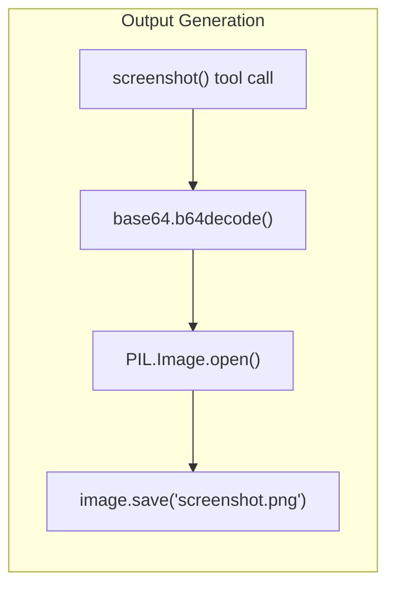

<!-- source: DeepWiki mcp.deepwiki.com · repo huggingface/screenenv · page 5.3 MCP Server Demo · fetched 2026-10-26 -->

# MCP Server Demo

Relevant source files

The following files were used as context for generating this wiki page:

- [examples/mcp_server_demo.py](examples/mcp_server_demo.py)

This document demonstrates how to use ScreenEnv through the Model Context Protocol (MCP) server interface for AI-driven desktop automation. The MCP server provides a standardized protocol for AI agents to interact with desktop environments through a well-defined set of tools and commands.

For direct programming interface usage, see [Direct Programming Interface](#4.1). For building AI agents with language models, see [AI Desktop Agent](#5.2).

## Purpose and Scope

The MCP Server Demo showcases a comprehensive multi-application workflow automation using ScreenEnv's MCP server implementation. This approach enables AI agents to perform complex desktop tasks through standardized tool calls rather than direct API usage, making it ideal for integration with language models and AI frameworks.

## MCP Server Architecture

The MCP server implementation provides a remote interface to ScreenEnv capabilities through HTTP-based communication. The architecture separates the AI client from the desktop environment, enabling distributed automation scenarios.

**Sources:** [examples/mcp_server_demo.py:20-43]()

## Demo Workflow Overview

The demonstration implements a seven-phase automation workflow that showcases various desktop automation capabilities through MCP tool calls.

**Sources:** [examples/mcp_server_demo.py:45-402]()

## Key MCP Tools and Their Usage

The demo utilizes various MCP tools provided by ScreenEnv's server implementation. Each tool corresponds to specific desktop automation capabilities.

| MCP Tool | Purpose | Usage Pattern |
|----------|---------|---------------|
| `launch` | Application launching | `session.call_tool("launch", {"application": "app_name"})` |
| `write` | Text input | `session.call_tool("write", {"text": "content"})` |
| `press` | Key combinations | `session.call_tool("press", {"key": ["Ctrl", "S"]})` |
| `move_mouse` | Mouse positioning | `session.call_tool("move_mouse", {"x": 100, "y": 200})` |
| `left_click` | Mouse clicking | `session.call_tool("left_click", {})` |
| `scroll` | Scrolling actions | `session.call_tool("scroll", {"direction": "down"})` |
| `screenshot` | Screen capture | `session.call_tool("screenshot", {})` |
| `open` | File/URL opening | `session.call_tool("open", {"file_or_url": "path"})` |
| `get_application_windows` | Window enumeration | `session.call_tool("get_application_windows", {"application": "app"})` |
| `activate_window` | Window activation | `session.call_tool("activate_window", {"window_id": "id"})` |
| `close_window` | Window closing | `session.call_tool("close_window", {"window_id": "id"})` |

**Sources:** [examples/mcp_server_demo.py:69-409]()

## Implementation Details

### Server Connection Management

The demo uses an async context manager pattern to handle MCP server lifecycle and client session management:

The `mcp_server()` context manager handles server instantiation and cleanup automatically, ensuring proper resource management throughout the demo execution.

**Sources:** [examples/mcp_server_demo.py:20-43]()

### Multi-Application Coordination

The demo demonstrates sophisticated application coordination through window management and inter-application workflows:

**Sources:** [examples/mcp_server_demo.py:69-104](), [examples/mcp_server_demo.py:174-178](), [examples/mcp_server_demo.py:239-243]()

### Data Entry Optimization

The spreadsheet data entry implementation demonstrates efficient cell navigation using keyboard shortcuts:

The optimized approach minimizes mouse usage by leveraging keyboard navigation for efficient spreadsheet manipulation.

**Sources:** [examples/mcp_server_demo.py:256-284]()

### Error Handling and Cleanup

The demo implements comprehensive cleanup procedures that handle multiple application types and window states:

The cleanup process ensures all opened applications are properly closed, with graceful error handling for different system architectures and application states.

**Sources:** [examples/mcp_server_demo.py:348-371]()

## Screenshot and Recording Capabilities

The demo concludes with screenshot capture and file output generation, demonstrating the MCP server's ability to provide visual feedback and documentation:

**Sources:** [examples/mcp_server_demo.py:404-408]()

---

