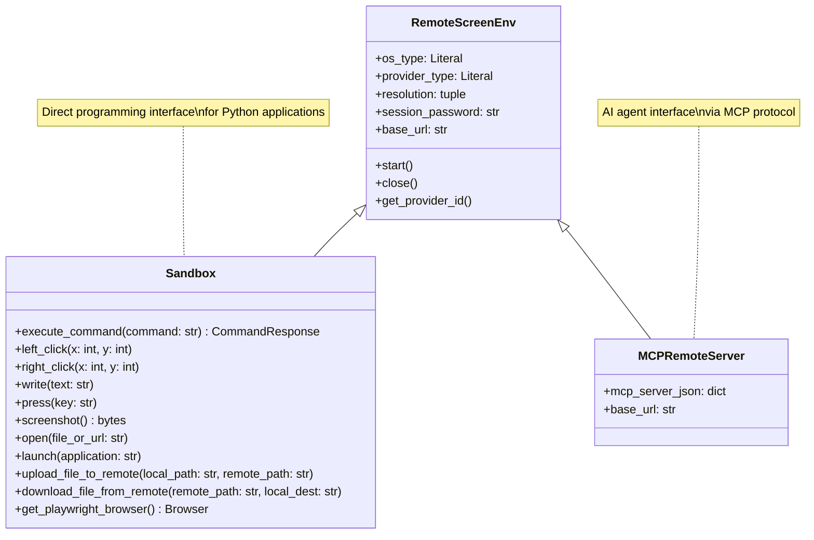
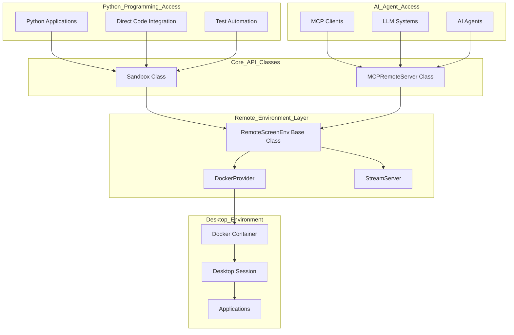
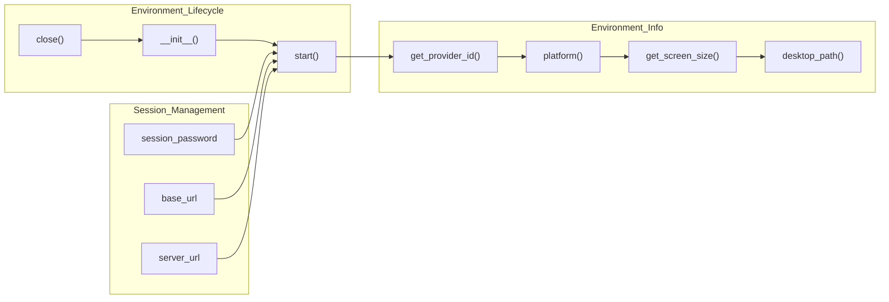
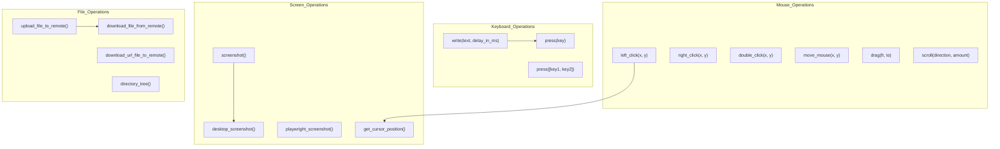
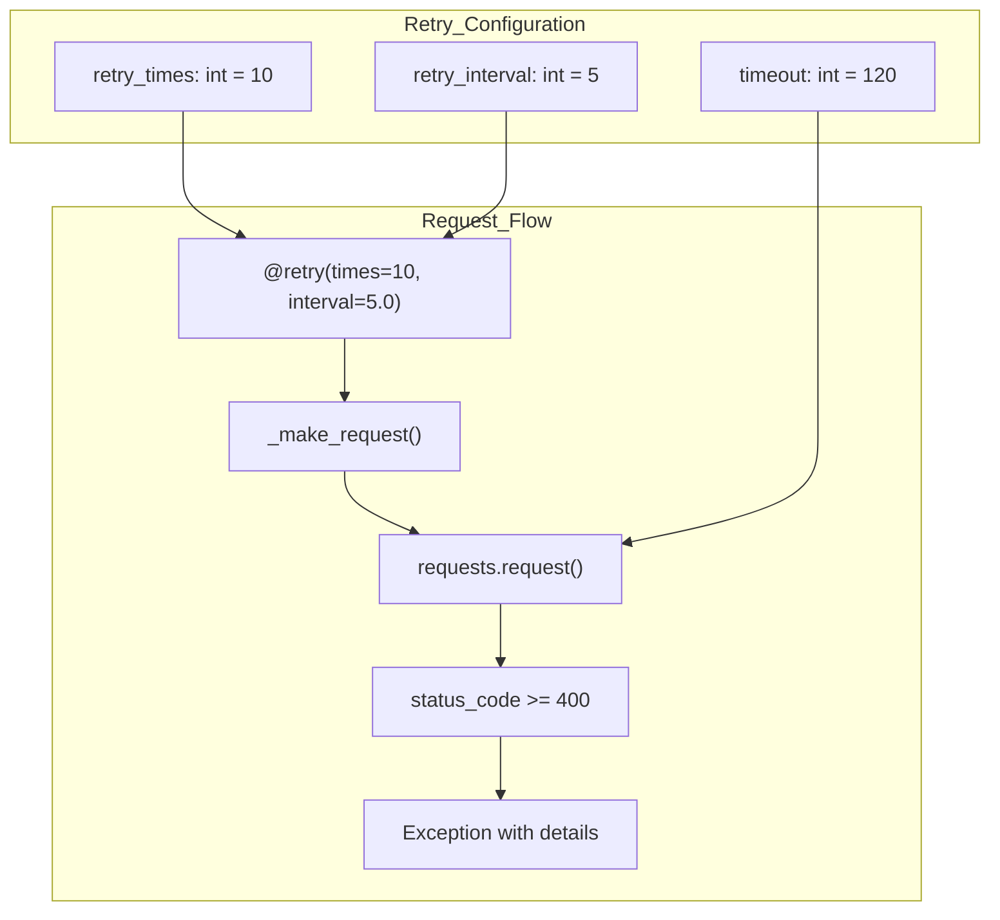

<!-- source: DeepWiki mcp.deepwiki.com · repo huggingface/screenenv · page 6 API Reference · fetched 2026-10-26 -->

# API Reference

Relevant source files

The following files were used as context for generating this wiki page:

- [src/screenenv/mcp_remote_server.py](src/screenenv/mcp_remote_server.py)
- [src/screenenv/sandbox.py](src/screenenv/sandbox.py)

This document provides a comprehensive technical reference for all ScreenEnv APIs, classes, and methods. It covers the complete public interface for interacting with desktop environments programmatically and through AI agents.

For practical usage examples and step-by-step guides, see [User Guides](#4). For implementation details about the underlying architecture, see [Architecture](#2).

## API Architecture Overview

ScreenEnv provides multiple API layers designed for different access patterns and use cases. The system is built around a common base class with specialized implementations for different interaction modes.

### Core API Classes

**Sources:** [src/screenenv/sandbox.py:42-654](), [src/screenenv/mcp_remote_server.py:9-52]()

### API Access Patterns

**Sources:** [src/screenenv/sandbox.py:42-90](), [src/screenenv/mcp_remote_server.py:9-44]()

## Primary API Classes

### Sandbox Class

The `Sandbox` class provides direct programmatic access to desktop environments with comprehensive mouse, keyboard, and application control capabilities.

| Category | Key Methods | Description |
|----------|-------------|-------------|
| **Mouse Control** | `left_click()`, `right_click()`, `double_click()`, `move_mouse()`, `drag()` | Complete mouse interaction capabilities |
| **Keyboard Control** | `write()`, `press()`, `key_combinations` | Text input and keyboard shortcuts |
| **Application Management** | `launch()`, `open()`, `get_application_windows()`, `activate_window()` | Launch and manage desktop applications |
| **File Operations** | `upload_file_to_remote()`, `download_file_from_remote()`, `directory_tree()` | File system operations |
| **Screen Capture** | `screenshot()`, `desktop_screenshot()`, `playwright_screenshot()` | Screenshot capabilities |
| **Command Execution** | `execute_command()`, `execute_python_command()` | Terminal and Python command execution |
| **Browser Integration** | `get_playwright_browser()`, `_chrome_open_tabs_setup()` | Web browser automation |

**Sources:** [src/screenenv/sandbox.py:42-654]()

### MCPRemoteServer Class

The `MCPRemoteServer` class provides AI-compatible access through the Model Context Protocol, enabling seamless integration with AI agents and language models.

| Feature | Implementation | Description |
|---------|----------------|-------------|
| **MCP Protocol** | `mcp_server_json` configuration | Standardized AI agent interface |
| **Transport** | `streamable-http` | HTTP-based communication protocol |
| **Base URL** | `base_url` property | Server endpoint for MCP clients |
| **Environment Management** | Inherited from `RemoteScreenEnv` | Same environment capabilities as Sandbox |

**Sources:** [src/screenenv/mcp_remote_server.py:9-52]()

## API Method Categories

### Environment Management

**Sources:** [src/screenenv/sandbox.py:55-90](), [src/screenenv/mcp_remote_server.py:10-44]()

### Input/Output Operations

**Sources:** [src/screenenv/sandbox.py:537-646]()

## Response Models and Data Types

The API uses strongly-typed response models for all operations:

| Response Type | Purpose | Key Fields |
|---------------|---------|------------|
| `CommandResponse` | Terminal command results | `status`, `output`, `error`, `returncode` |
| `ScreenSizeResponse` | Screen dimensions | `width`, `height` |
| `WindowInfoResponse` | Window information | `window_id`, `window_name` |
| `RecordingResponse` | Video recording metadata | `path`, `size`, `format` |
| `AccessibilityTreeResponse` | UI element tree | `tree_data` |
| `DirectoryTreeResponse` | File system structure | `tree_structure` |

**Sources:** [src/screenenv/sandbox.py:21-35]()

## Error Handling and Retry Logic

The API implements comprehensive error handling with automatic retry mechanisms:

**Sources:** [src/screenenv/sandbox.py:115-153]()

## Detailed API References

For comprehensive method documentation and examples:

- **[Sandbox API](#6.1)** - Complete reference for direct programming interface
- **[MCP Server API](#6.2)** - Model Context Protocol integration reference  
- **[Provider System API](#6.3)** - Remote environment provider interface reference

Each sub-section provides detailed parameter specifications, return types, usage examples, and implementation notes for their respective API components.

---

