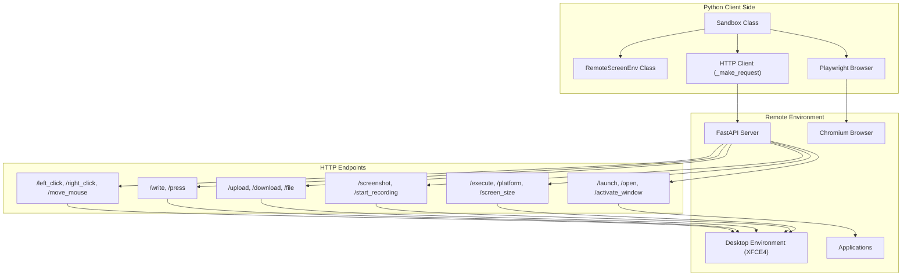
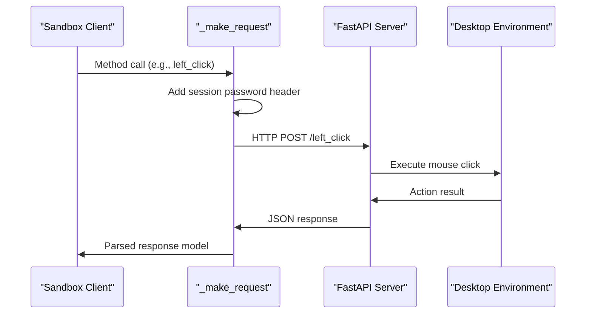
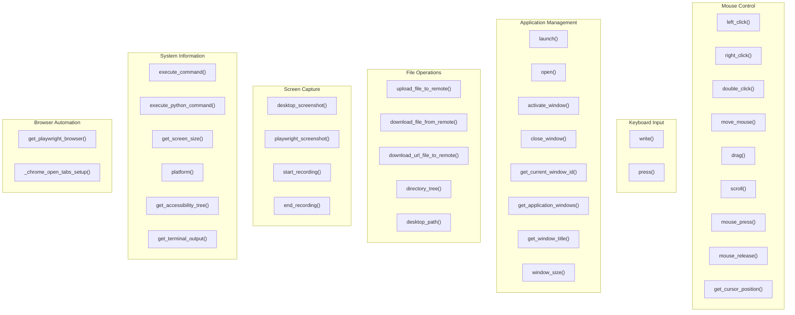

<!-- source: DeepWiki mcp.deepwiki.com · repo huggingface/screenenv · page 6.1 Sandbox API · fetched 2026-10-26 -->

# Sandbox API

<details>
<summary>Relevant source files</summary>

The following files were used as context for generating this wiki page:

- [src/screenenv/sandbox.py](src/screenenv/sandbox.py)
- [src/screenenv/test_sandbox.py](src/screenenv/test_sandbox.py)

</details>


This document provides a comprehensive technical reference for the `Sandbox` class, which serves as the primary direct programming interface for desktop automation in ScreenEnv. The Sandbox API enables programmatic control of mouse/keyboard input, application management, file operations, and screen capture within containerized desktop environments.

For AI agent integration using standardized protocols, see [MCP Server API](#6.2). For information about the underlying provider system that manages remote environments, see [Provider System API](#6.3).

## Architecture Overview

The `Sandbox` class extends `RemoteScreenEnv` and acts as a client that communicates with a FastAPI server running inside a containerized desktop environment. It provides both direct desktop control and Playwright-based browser automation capabilities.

### Class Hierarchy and Communication Flow



Sources: [src/screenenv/sandbox.py:42-101]()

### Request-Response Pattern



Sources: [src/screenenv/sandbox.py:115-153]()

## Core Functionality Categories

The Sandbox API organizes its methods into several functional categories, each addressing specific automation needs:

### Functionality Overview



Sources: [src/screenenv/sandbox.py:537-654]()

## Method Reference by Category

### Mouse Control Methods

| Method | Parameters | Description | Return Type |
|--------|------------|-------------|-------------|
| `left_click()` | `x: int`, `y: int` (optional) | Clicks left mouse button at coordinates | `None` |
| `right_click()` | `x: int`, `y: int` (optional) | Clicks right mouse button at coordinates | `None` |
| `middle_click()` | `x: int`, `y: int` (optional) | Clicks middle mouse button at coordinates | `None` |
| `double_click()` | `x: int`, `y: int` (optional) | Double-clicks at coordinates | `None` |
| `move_mouse()` | `x: int`, `y: int` | Moves mouse to coordinates | `None` |
| `mouse_press()` | `button: Literal["left", "right", "middle"]` | Presses mouse button | `None` |
| `mouse_release()` | `button: Literal["left", "right", "middle"]` | Releases mouse button | `None` |
| `drag()` | `fr: tuple[int, int]`, `to: tuple[int, int]` | Drags from start to end position | `None` |
| `scroll()` | `direction: Literal["up", "down"]`, `amount: int` | Scrolls mouse wheel | `None` |
| `get_cursor_position()` | None | Gets current cursor position | `tuple[int, int]` |

Sources: [src/screenenv/sandbox.py:537-601]()

### Keyboard Input Methods

| Method | Parameters | Description | Return Type |
|--------|------------|-------------|-------------|
| `write()` | `text: str`, `delay_in_ms: int` | Types text with delay between characters | `None` |
| `press()` | `key: str \| list[str]` | Presses keyboard key(s) or key combinations | `None` |

The `press()` method supports both single keys (e.g., `"Enter"`) and key combinations (e.g., `["Ctrl", "C"]`).

Sources: [src/screenenv/sandbox.py:615-635]()

### Application Management Methods

| Method | Parameters | Description | Return Type |
|--------|------------|-------------|-------------|
| `launch()` | `application: str`, `wait_for_window: bool` | Launches application | `CommandResponse` |
| `open()` | `file_or_url: str` | Opens file or URL in default application | `CommandResponse` |
| `activate_window()` | `window_id: str` | Brings window to foreground | `WindowInfoResponse` |
| `close_window()` | `window_id: str` | Closes specified window | `WindowInfoResponse` |
| `get_current_window_id()` | None | Gets ID of currently active window | `str` |
| `get_application_windows()` | `application: str` | Gets all windows for application | `list[str]` |
| `get_window_title()` | `window_id: str` | Gets window title | `str` |
| `window_size()` | `window_id: str` | Gets window dimensions | `WindowSizeResponse` |

Sources: [src/screenenv/sandbox.py:445-521]()

### File Operations Methods

| Method | Parameters | Description | Return Type |
|--------|------------|-------------|-------------|
| `upload_file_to_remote()` | `local_path: str`, `remote_path: str` | Uploads local file to remote environment | `None` |
| `download_file_from_remote()` | `remote_path: str`, `local_dest: str` | Downloads remote file to local machine | `None` |
| `download_url_file_to_remote()` | `url: str`, `remote_path: str` | Downloads URL content to remote path | `None` |
| `directory_tree()` | `path: str` | Lists directory contents | `DirectoryTreeResponse` |
| `desktop_path()` | None | Gets desktop directory path | `DesktopPathResponse` |

Sources: [src/screenenv/sandbox.py:301-359]()

### Screen Capture Methods

| Method | Parameters | Description | Return Type |
|--------|------------|-------------|-------------|
| `desktop_screenshot()` | None | Captures desktop screenshot | `bytes` |
| `playwright_screenshot()` | `full_page: bool` | Captures browser page screenshot | `bytes \| None` |
| `screenshot()` | None | Alias for `desktop_screenshot()` | `bytes` |
| `start_recording()` | None | Starts screen recording | `RecordingResponse` |
| `end_recording()` | `dest: str` | Stops recording and saves to file | `RecordingResponse` |

Sources: [src/screenenv/sandbox.py:361-422](), [src/screenenv/sandbox.py:531-535]()

### System Information Methods

| Method | Parameters | Description | Return Type |
|--------|------------|-------------|-------------|
| `execute_command()` | `command: str`, `background: bool`, `timeout: int` | Executes shell command | `CommandResponse` |
| `execute_python_command()` | `command: str`, `import_prefix: list[str]` | Executes Python command with imports | `CommandResponse` |
| `get_screen_size()` | None | Gets screen resolution | `tuple[int, int]` |
| `platform()` | None | Gets platform information | `PlatformResponse` |
| `get_accessibility_tree()` | None | Gets accessibility tree | `AccessibilityTreeResponse` |
| `get_terminal_output()` | None | Gets terminal output | `TerminalOutputResponse` |
| `wait()` | `ms: int` | Waits specified milliseconds | `None` |

Sources: [src/screenenv/sandbox.py:248-299](), [src/screenenv/sandbox.py:386-428](), [src/screenenv/sandbox.py:602-613]()

## Browser Automation Integration

The Sandbox class integrates Playwright for browser automation, establishing a connection to a remote Chromium instance running in the desktop environment.

### Browser Connection Flow

```mermaid
graph TB
    subgraph "Browser Setup Process"
        open_method["open(url)"]
        url_check["URL validation"]
        chrome_setup["_chrome_open_tabs_setup()"]
        playwright_start["sync_playwright().start()"]
        cdp_connect["chromium.connect_over_cdp()"]
        context_setup["Browser context setup"]
        page_creation["New page creation"]
        browser_storage["Store browser/context"]
    end
    
    open_method --> url_check
    url_check --> chrome_setup
    chrome_setup --> playwright_start
    playwright_start --> cdp_connect
    cdp_connect --> context_setup
    context_setup --> page_creation
    page_creation --> browser_storage
```



The browser connection uses Chrome DevTools Protocol (CDP) to connect to the remote Chromium instance at `self.chromium_url`.

Sources: [src/screenenv/sandbox.py:156-217](), [src/screenenv/sandbox.py:429-443]()

## Response Models

All Sandbox methods return structured response objects based on Pydantic models:

| Response Type | Used By | Key Fields |
|---------------|---------|------------|
| `CommandResponse` | `execute_command()`, `launch()`, `open()` | `status`, `output`, `error`, `returncode` |
| `WindowInfoResponse` | `get_current_window_id()`, `get_window_title()` | `window_id`, `window_name` |
| `WindowSizeResponse` | `window_size()` | `width`, `height` |
| `RecordingResponse` | `start_recording()`, `end_recording()` | `path`, `size`, `format` |
| `ScreenSizeResponse` | `get_screen_size()` | `width`, `height` |
| `PlatformResponse` | `platform()` | Platform-specific information |

Sources: [src/screenenv/sandbox.py:21-35]()

## Error Handling and Retry Logic

The Sandbox class implements robust error handling through the `_make_request()` method with built-in retry logic:

- **Retry Configuration**: 10 attempts with 5-second intervals
- **Session Authentication**: Automatic session password header injection
- **Detailed Error Reporting**: Comprehensive error context including request/response details
- **HTTP Status Validation**: Raises exceptions for 4xx/5xx responses

Sources: [src/screenenv/sandbox.py:115-153]()

## Initialization and Lifecycle

The Sandbox class inherits initialization parameters from `RemoteScreenEnv` and adds browser-specific attributes:

```python
# Key initialization parameters
os_type: Literal["Ubuntu", "Windows", "MacOS"] = "Ubuntu"
provider_type: Literal["docker", "aws", "hf"] = "docker"
resolution: StandardScreenSize | tuple[int, int] = (1920, 1080)
headless: bool = True
```

The `close()` method properly cleans up both Playwright resources and the underlying Docker environment.

Sources: [src/screenenv/sandbox.py:55-91](), [src/screenenv/sandbox.py:647-653]()

---

