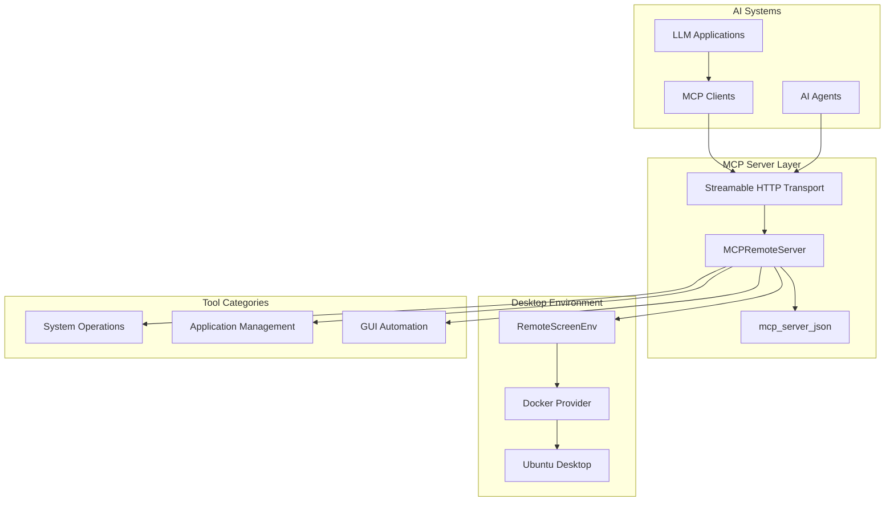
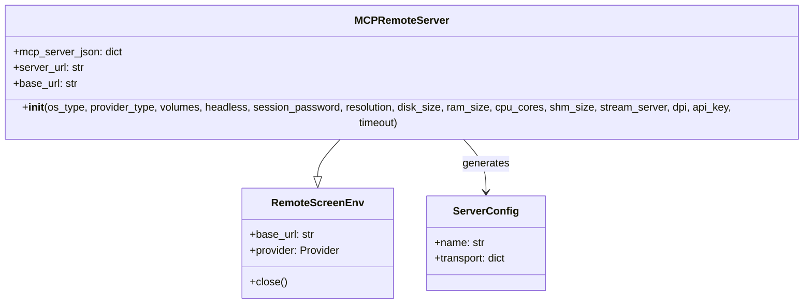
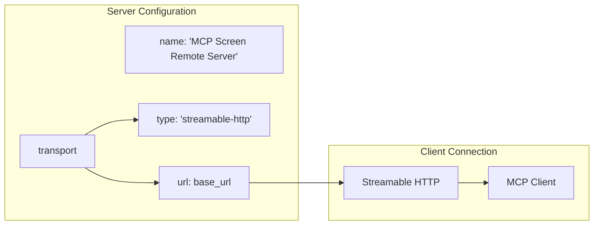
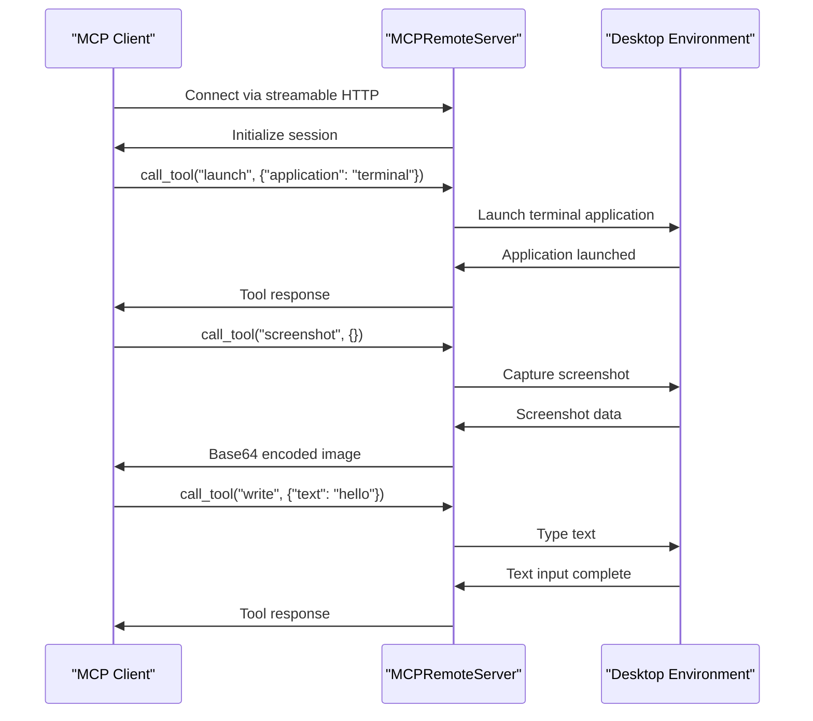
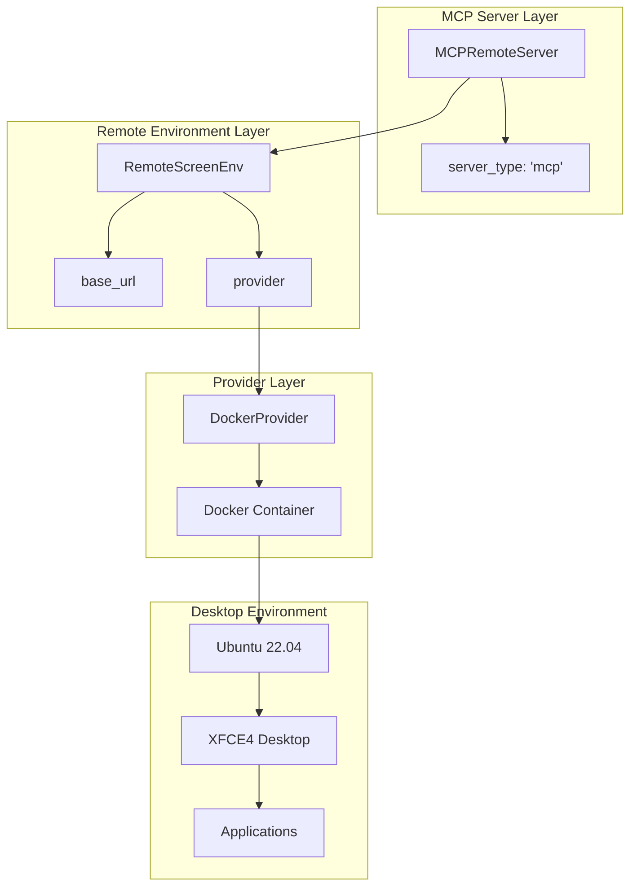

<!-- source: DeepWiki mcp.deepwiki.com · repo huggingface/screenenv · page 6.2 MCP Server API · fetched 2026-10-26 -->

# MCP Server API

<details>
<summary>Relevant source files</summary>

The following files were used as context for generating this wiki page:

- [README.md](README.md)
- [src/screenenv/mcp_remote_server.py](src/screenenv/mcp_remote_server.py)

</details>


This document provides a comprehensive reference for the MCP (Model Context Protocol) server implementation in ScreenEnv. The MCP server exposes desktop automation capabilities through a standardized protocol that AI agents and LLM systems can use to interact with isolated desktop environments.

For direct programming interface usage, see [Sandbox API](#6.1). For information about the underlying environment management system, see [Provider System API](#6.3).

## Overview

The MCP server provides a standardized interface for AI systems to perform desktop automation tasks through the Model Context Protocol. It acts as a bridge between AI agents and the underlying desktop environment, exposing over 30 automation tools through a streamable HTTP transport mechanism.



Sources: [README.md:76-149](), [src/screenenv/mcp_remote_server.py:1-52]()

## Server Configuration

The `MCPRemoteServer` class extends `RemoteScreenEnv` to provide MCP-specific functionality. It automatically configures the server transport and generates the necessary connection information for MCP clients.

### Server Initialization



### Configuration Parameters

| Parameter | Type | Default | Description |
|-----------|------|---------|-------------|
| `os_type` | `Literal["Ubuntu", "Windows", "MacOS"]` | `"Ubuntu"` | Operating system type |
| `provider_type` | `Literal["docker", "aws", "hf"]` | `"docker"` | Environment provider |
| `headless` | `bool` | `True` | Run without VNC viewer |
| `resolution` | `StandardScreenSize \| tuple[int, int]` | `(1920, 1080)` | Screen resolution |
| `disk_size` | `str` | `"32G"` | Disk allocation |
| `ram_size` | `str` | `"4G"` | RAM allocation |
| `cpu_cores` | `str` | `"4"` | CPU core count |
| `stream_server` | `bool` | `True` | Enable stream server |
| `timeout` | `int` | `1000` | Operation timeout |

Sources: [src/screenenv/mcp_remote_server.py:10-44]()

## MCP Server JSON Configuration

The server automatically generates a JSON configuration that clients use to connect:



Sources: [src/screenenv/mcp_remote_server.py:45-51]()

## Available MCP Tools

The MCP server exposes desktop automation capabilities through three main categories of tools:

### System Operations

Tools for system-level interactions and information retrieval:

| Tool | Description | Parameters |
|------|-------------|------------|
| `execute_command` | Execute shell commands | `command: str` |
| `get_platform` | Get system platform information | None |
| `get_screen_size` | Get screen dimensions | None |
| `get_desktop_path` | Get desktop directory path | None |
| `get_directory_tree` | List directory contents | `path: str` |
| `get_file` | Get file contents | `path: str` |
| `download_file` | Download file from URL | `url: str, path: str` |
| `start_recording` | Start screen recording | None |
| `end_recording` | End screen recording | `filename: str` |

### Application Management

Tools for managing desktop applications and windows:

| Tool | Description | Parameters |
|------|-------------|------------|
| `wait` | Wait for specified milliseconds | `ms: int` |
| `open` | Open file or URL | `target: str` |
| `launch` | Launch application | `application: str, wait_for_window: bool` |
| `get_current_window_id` | Get current window ID | None |
| `get_application_windows` | Get windows for application | `application: str` |
| `get_window_name` | Get window name/title | `window_id: str` |
| `get_window_size` | Get window size | `window_id: str` |
| `activate_window` | Activate window | `window_id: str` |
| `close_window` | Close window | `window_id: str` |
| `get_terminal_output` | Get terminal output | None |

### GUI Automation

Tools for mouse and keyboard interaction:

| Tool | Description | Parameters |
|------|-------------|------------|
| `screenshot` | Take screenshot | None |
| `left_click` | Left click at coordinates | `x: int, y: int` |
| `double_click` | Double click at coordinates | `x: int, y: int` |
| `right_click` | Right click at coordinates | `x: int, y: int` |
| `middle_click` | Middle click at coordinates | `x: int, y: int` |
| `scroll` | Scroll mouse wheel | `direction: str, amount: int` |
| `move_mouse` | Move mouse to coordinates | `x: int, y: int` |
| `mouse_press` | Press mouse button | `button: str` |
| `mouse_release` | Release mouse button | `button: str` |
| `get_cursor_position` | Get cursor position | None |
| `write` | Type text | `text: str` |
| `press` | Press keys | `key: str \| list[str]` |
| `drag` | Drag mouse from one position to another | `fr: tuple[int, int], to: tuple[int, int]` |

Sources: [README.md:149-188]()

## Transport Protocol

The MCP server uses streamable HTTP transport for efficient communication with clients. This enables real-time interaction and reduces latency for desktop automation tasks.



Sources: [README.md:104-147]()

## Integration with Remote Environment

The MCP server integrates with the remote environment system to provide isolated desktop automation capabilities:



Sources: [src/screenenv/mcp_remote_server.py:27-44]()

## Usage Examples

### Basic Server Setup

```python
from screenenv import MCPRemoteServer

# Start MCP server with default configuration
server = MCPRemoteServer()
print(f"Server URL: {server.server_url}")
print(f"Configuration: {server.mcp_server_json}")
```

### Advanced Configuration

```python
# Custom MCP server configuration
server = MCPRemoteServer(
    os_type="Ubuntu",
    provider_type="docker",
    headless=True,
    resolution=(1920, 1080),
    disk_size="32G",
    ram_size="4G",
    cpu_cores="4",
    session_password="secure_password",
    stream_server=True,
    dpi=96,
    timeout=1000
)
```

### Client Connection

```python
import asyncio
from mcp import ClientSession
from mcp.client.streamable_http import streamablehttp_client

async def connect_to_mcp():
    server = MCPRemoteServer(headless=False)
    
    async with streamablehttp_client(server.server_url) as (
        read_stream, write_stream, _
    ):
        async with ClientSession(read_stream, write_stream) as session:
            await session.initialize()
            
            # Use MCP tools
            await session.call_tool("launch", {
                "application": "xfce4-terminal",
                "wait_for_window": True
            })
            
            await session.call_tool("write", {"text": "echo 'Hello MCP!'"})
            await session.call_tool("press", {"key": ["Enter"]})
```

Sources: [README.md:91-147]()

---

