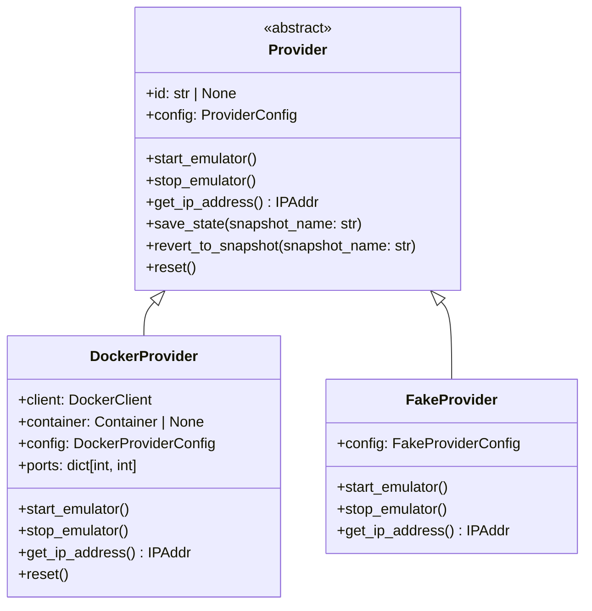
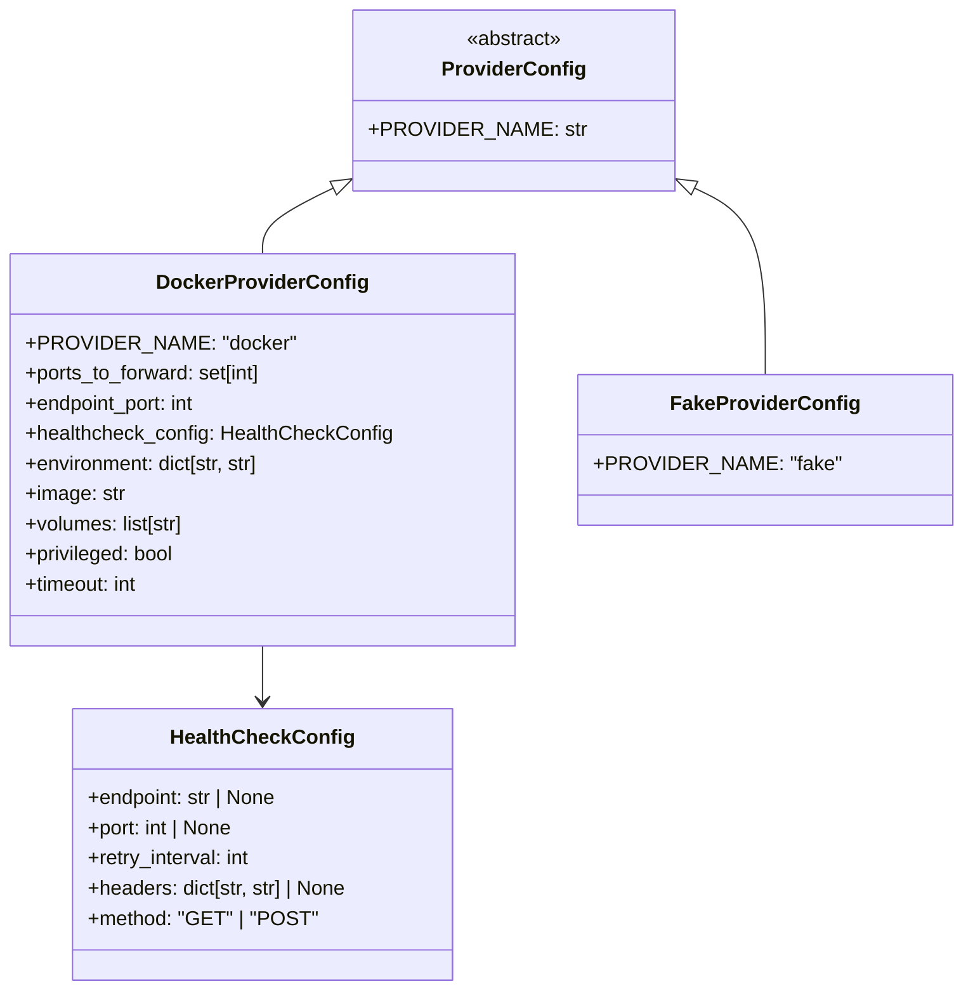
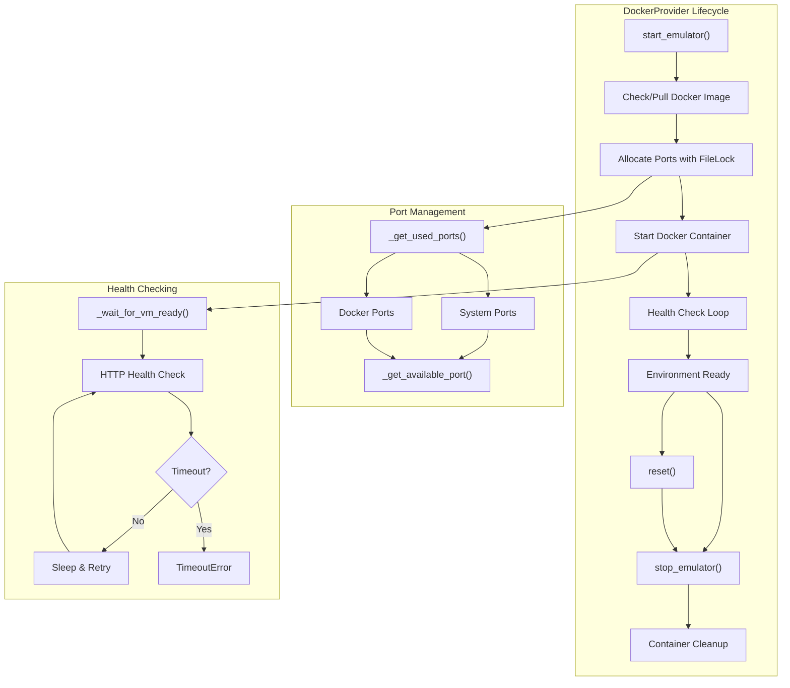
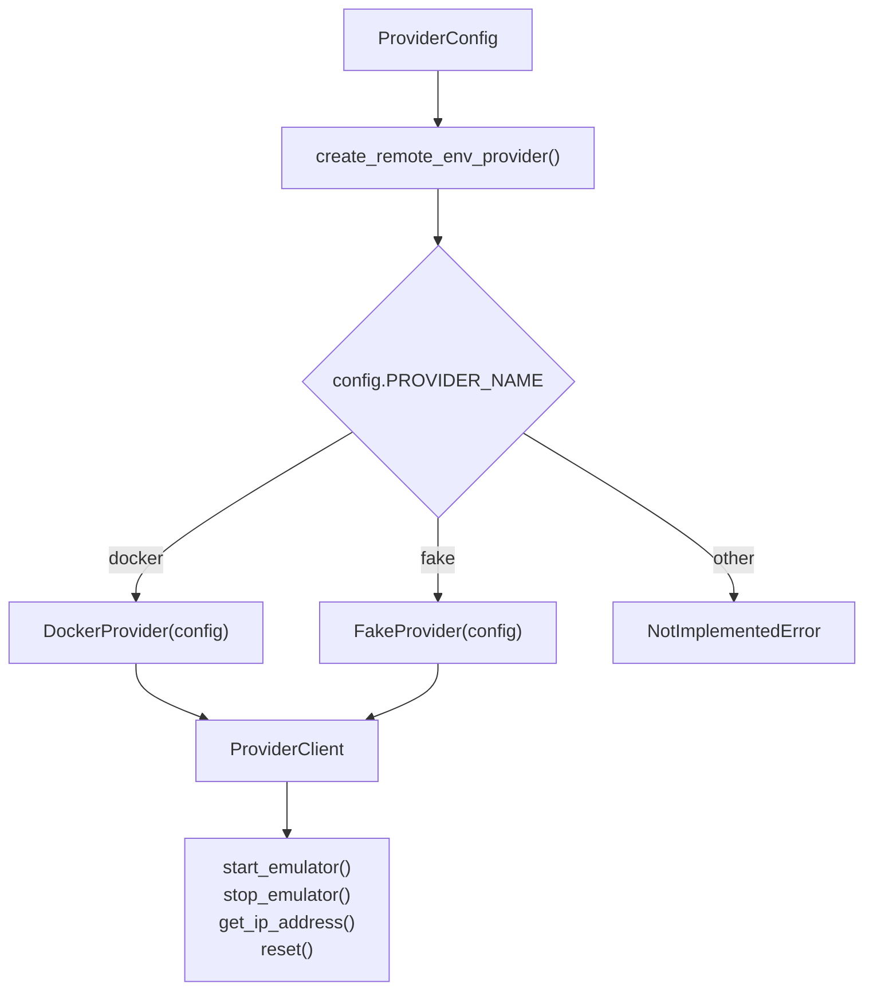
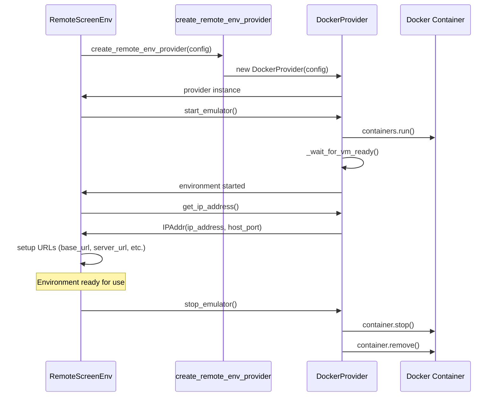
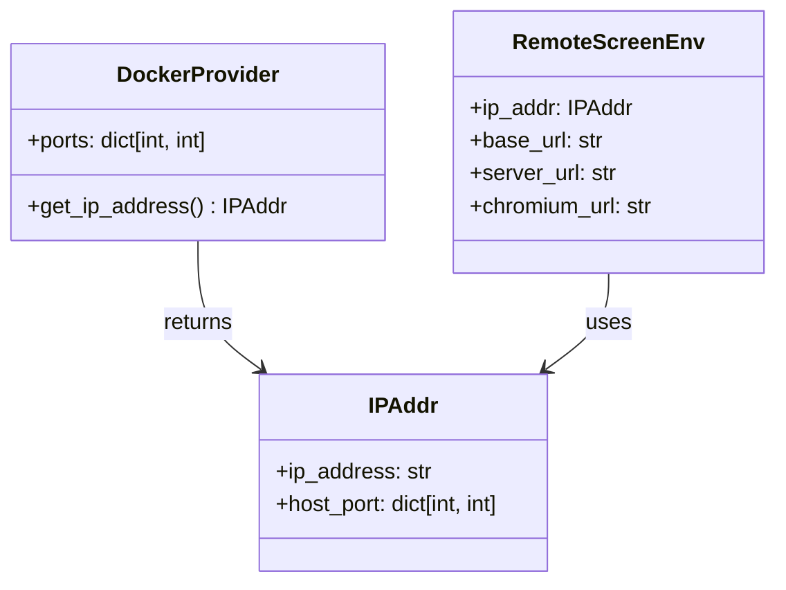
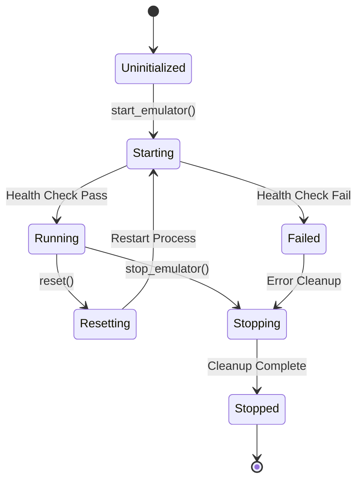

<!-- source: DeepWiki mcp.deepwiki.com · repo huggingface/screenenv · page 6.3 Provider System API · fetched 2026-10-26 -->

# Provider System API

Relevant source files

The following files were used as context for generating this wiki page:

- [src/screenenv/remote_provider/__init__.py](src/screenenv/remote_provider/__init__.py)
- [src/screenenv/remote_provider/docker/provider.py](src/screenenv/remote_provider/docker/provider.py)
- [src/screenenv/remote_screen_env.py](src/screenenv/remote_screen_env.py)

## Purpose and Scope

The Provider System API defines the interface and implementations for managing different remote environment backends in ScreenEnv. This system abstracts the complexity of starting, configuring, and managing virtualized environments across different platforms like Docker containers, cloud services, and testing environments.

The provider system handles environment lifecycle management, port allocation, health checking, and network configuration. For information about the high-level remote environment management, see [Architecture](#2.2). For details about the main user-facing API that uses providers, see [Sandbox API](#6.1).

## Provider Interface Overview

The provider system follows an abstract base class pattern where all providers implement the core `Provider` interface defined in [src/screenenv/remote_provider/provider.py:16]().

### Core Provider Interface

**Sources:** [src/screenenv/remote_provider/provider.py:16](), [src/screenenv/remote_provider/docker/provider.py:65](), [src/screenenv/remote_provider/__init__.py:7]()

### Provider Configuration System

Each provider type has its own configuration class that inherits from a base configuration pattern:

**Sources:** [src/screenenv/remote_provider/docker/provider.py:37-63](), [src/screenenv/remote_provider/docker/provider.py:28-35]()

## Docker Provider Implementation

The `DockerProvider` is the primary implementation, handling Docker container-based environments with comprehensive port management and health checking.

### Docker Provider Architecture

**Sources:** [src/screenenv/remote_provider/docker/provider.py:164-241](), [src/screenenv/remote_provider/docker/provider.py:85-113](), [src/screenenv/remote_provider/docker/provider.py:115-162]()

### Key Docker Provider Features

| Feature | Implementation | Configuration |
|---------|---------------|---------------|
| Port Allocation | Thread-safe with `FileLock` | `ports_to_forward: set[int]` |
| Image Management | Auto-pull missing images | `image: str` |
| Health Checking | Configurable HTTP endpoints | `HealthCheckConfig` |
| Environment Variables | Pass-through to container | `environment: dict[str, str]` |
| Volume Mounting | Host path mounting | `volumes: list[str]` |
| Privileged Mode | Optional elevated permissions | `privileged: bool` |
| Container Capabilities | Linux capabilities | `cap_add: list[str]` |

**Sources:** [src/screenenv/remote_provider/docker/provider.py:37-63](), [src/screenenv/remote_provider/docker/provider.py:166-184]()

## Provider Factory System

The provider system uses a factory pattern through the `create_remote_env_provider` function to instantiate the appropriate provider based on configuration.

### Provider Creation Flow

**Sources:** [src/screenenv/remote_provider/create_remote_env.py](), [src/screenenv/remote_provider/__init__.py:1-5]()

## Integration with RemoteScreenEnv

The provider system integrates with `RemoteScreenEnv` to provide a unified interface for environment management.

### RemoteScreenEnv Provider Integration

**Sources:** [src/screenenv/remote_screen_env.py:235-241](), [src/screenenv/remote_screen_env.py:243-253](), [src/screenenv/remote_screen_env.py:303-310]()

## Network Configuration and IP Address Management

The provider system handles network configuration through the `IPAddr` class and port mapping system.

### IPAddr Structure

The `IPAddr` class maps container ports to host ports, enabling external access to services running inside the provider environment.

**Sources:** [src/screenenv/remote_provider/docker/provider.py:242-248](), [src/screenenv/remote_screen_env.py:244-253]()

## Error Handling and Lifecycle Management

The provider system includes comprehensive error handling and cleanup mechanisms.

### Error Handling Patterns

| Error Type | Handling Strategy | Implementation |
|------------|------------------|----------------|
| `PortAllocationError` | Retry with next available port | [src/screenenv/remote_provider/docker/provider.py:24-25]() |
| `TimeoutError` | Configurable timeout with cleanup | [src/screenenv/remote_provider/docker/provider.py:162]() |
| Container Start Failure | Automatic cleanup on exception | [src/screenenv/remote_provider/docker/provider.py:232-241]() |
| Provider Stop Failure | Graceful degradation with logging | [src/screenenv/remote_provider/docker/provider.py:262-273]() |

### Lifecycle Management

**Sources:** [src/screenenv/remote_provider/docker/provider.py:256-273](), [src/screenenv/remote_provider/docker/provider.py:232-241]()

---

