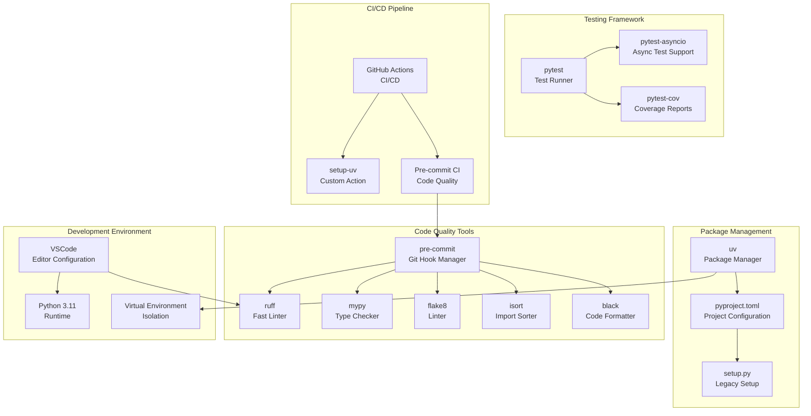
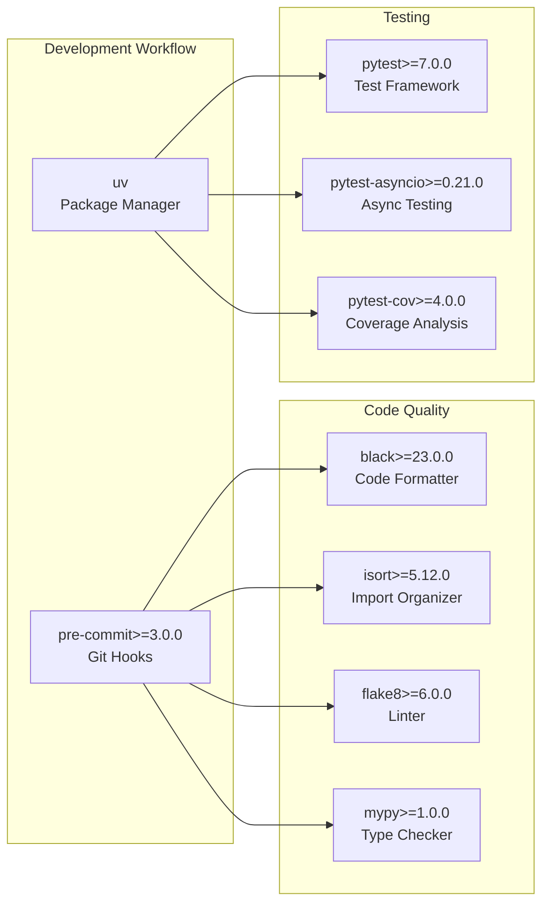
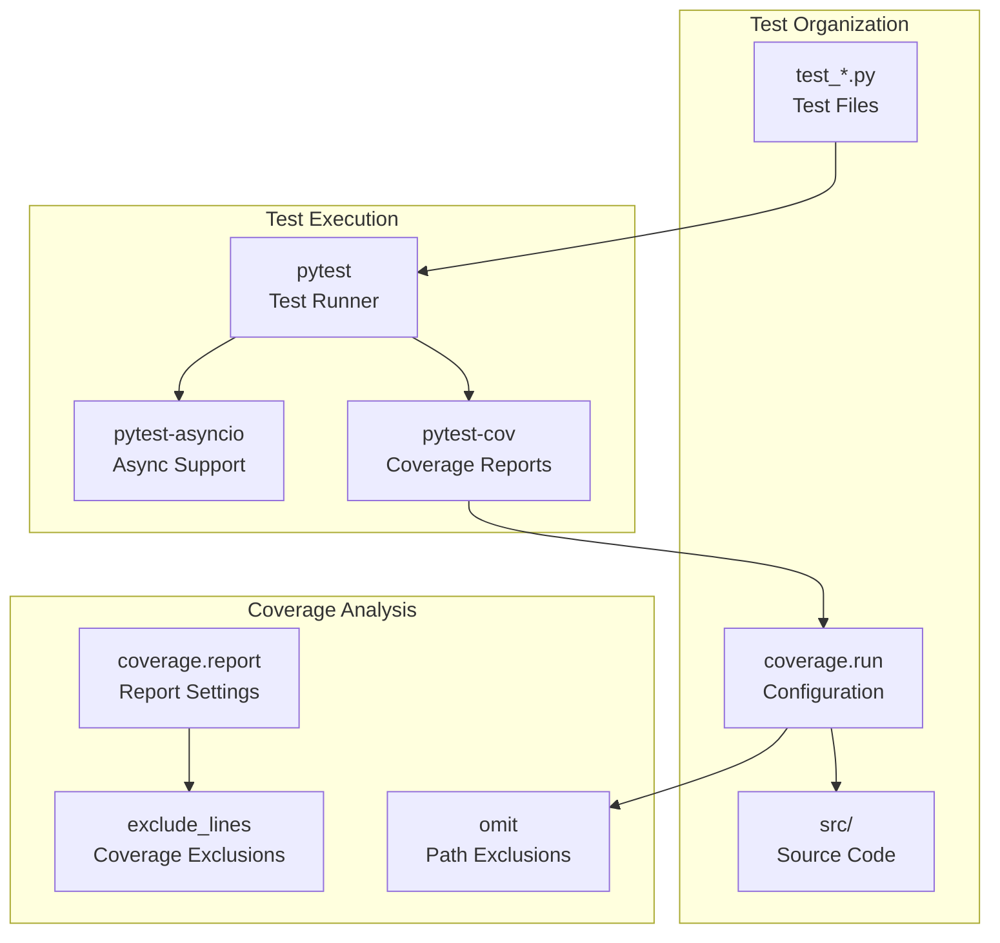
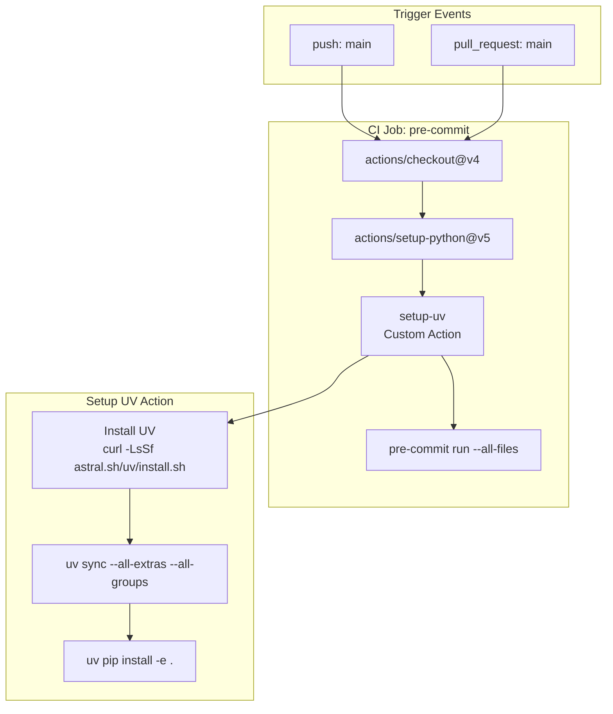

<!-- source: DeepWiki mcp.deepwiki.com · repo huggingface/screenenv · page 7 Development Guide · fetched 2026-10-26 -->

# Development Guide

<details>
<summary>Relevant source files</summary>

The following files were used as context for generating this wiki page:

- [.github/actions/setup-uv/action.yml](.github/actions/setup-uv/action.yml)
- [.github/workflows/pre-commit.yml](.github/workflows/pre-commit.yml)
- [.vscode/settings.json](.vscode/settings.json)
- [pyproject.toml](pyproject.toml)
- [setup.py](setup.py)
- [src/screenenv/remote_provider/create_remote_env.py](src/screenenv/remote_provider/create_remote_env.py)

</details>


This document provides comprehensive guidance for developers who want to contribute to the ScreenEnv project. It covers the development environment setup, build system, code quality standards, testing framework, and continuous integration pipeline.

For information about setting up ScreenEnv for end-user development, see [Project Setup](#7.1). For details about the testing framework and running tests, see [Testing](#7.2). For code standards and development best practices, see [Development Environment](#7.3).

## Development Workflow Overview

The ScreenEnv project follows a modern Python development workflow with automated tooling for code quality, testing, and packaging. The development process is designed to maintain high code quality standards while enabling efficient collaboration.

### Development Toolchain Architecture



Sources: [pyproject.toml:1-96](), [setup.py:1-66](), [.vscode/settings.json:1-17](), [.github/workflows/pre-commit.yml:1-27](), [.github/actions/setup-uv/action.yml:1-22]()

## Build System and Dependencies

ScreenEnv uses a modern Python packaging approach with dual build system configuration supporting both `pyproject.toml` and `setup.py` for maximum compatibility.

### Package Configuration

| Configuration File | Purpose | Build Backend |
|-------------------|---------|---------------|
| `pyproject.toml` | Modern Python packaging standard | hatchling |
| `setup.py` | Legacy compatibility | setuptools |

The project supports Python 3.10+ with the following key dependencies:

### Core Dependencies

| Package | Version | Purpose |
|---------|---------|---------|
| `pydantic` | >=2.11.7 | Data validation and settings |
| `docker` | >=7.1.0 | Container management |
| `playwright` | >=1.52.0 | Browser automation |
| `fastapi` | >=0.115.13 | API server framework |
| `mcp` | >=1.9.4 | Model Context Protocol |
| `smolagents` | ==1.15.0 | AI agent framework |

### Development Dependencies

The project includes comprehensive development tooling configured in the `dev` extra:



Sources: [pyproject.toml:26-53](), [setup.py:28-59]()

## Code Quality Standards

The project enforces consistent code quality through automated tooling and pre-commit hooks.

### Formatter Configuration

The codebase uses `black` as the primary code formatter with `isort` for import organization. The VSCode configuration automatically applies formatting on save:

- **Black**: Code formatting with default settings
- **Isort**: Import sorting with `--profile black` for compatibility
- **Ruff**: Fast linting with automatic fixes enabled

### Editor Integration

VSCode is configured with the following quality assurance features:

| Setting | Value | Purpose |
|---------|-------|---------|
| `editor.formatOnSave` | `true` | Automatic formatting |
| `editor.defaultFormatter` | `charliermarsh.ruff` | Use Ruff for Python |
| `source.organizeImports` | `always` | Auto-organize imports |
| `source.fixAll.ruff` | `always` | Auto-fix linting issues |

### Coverage Configuration

Test coverage is tracked using `pytest-cov` with configuration in `pyproject.toml`:

- **Source**: `src/` directory
- **Omit**: Test files, cache directories, migrations
- **Exclusions**: Debug code, abstract methods, main blocks

Sources: [.vscode/settings.json:1-17](), [pyproject.toml:74-95]()

## Testing Framework

The project uses `pytest` as the primary testing framework with support for asynchronous testing and coverage reporting.

### Test Configuration Dependencies



### Coverage Exclusions

The coverage configuration excludes common patterns that don't require testing:

- Debug and development code (`if self.debug:`, `if settings.DEBUG`)
- Abstract methods (`@abstractmethod`)
- Exception handling (`raise NotImplementedError`)
- Main execution blocks (`if __name__ == "__main__"`)
- Protocol definitions (`class .*\bProtocol\):`)

Sources: [pyproject.toml:74-95](), [pyproject.toml:44-58]()

## CI/CD Pipeline

The project uses GitHub Actions for continuous integration with automated code quality checks.

### GitHub Actions Workflow



### CI Configuration Details

The CI pipeline is configured with:

- **Runtime**: Ubuntu Latest
- **Python Version**: 3.11
- **Package Manager**: UV for fast dependency resolution
- **Quality Checks**: Pre-commit hooks run on all files
- **Submodules**: Automatically checked out with code

The custom `setup-uv` action provides a reusable workflow for:
1. Installing UV package manager
2. Syncing all dependencies and extras
3. Installing the package in editable mode

Sources: [.github/workflows/pre-commit.yml:1-27](), [.github/actions/setup-uv/action.yml:1-22]()

## Development Environment Setup

### Prerequisites

Before contributing to ScreenEnv, ensure you have:

- Python 3.10 or higher
- Docker (for running containerized environments)
- Git (for version control)
- UV package manager (recommended) or pip

### Quick Setup

1. **Clone the repository and install dependencies**:
   ```bash
   git clone https://github.com/huggingface/screenenv.git
   cd screenenv
   uv sync --all-extras --all-groups
   ```

2. **Install pre-commit hooks**:
   ```bash
   uv run pre-commit install
   ```

3. **Install the package in editable mode**:
   ```bash
   uv pip install -e .
   ```

### Project Structure

The project follows standard Python packaging conventions:

- `src/screenenv/`: Main package source code
- `tests/`: Test files (if present)
- `pyproject.toml`: Modern Python project configuration
- `setup.py`: Legacy setup for compatibility

Sources: [pyproject.toml:64-72](), [.github/actions/setup-uv/action.yml:18-21]()

---

