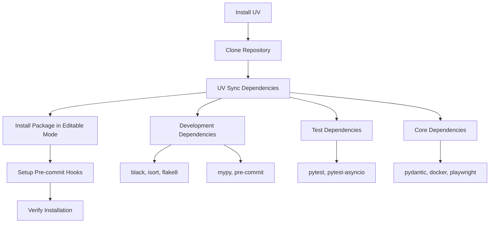
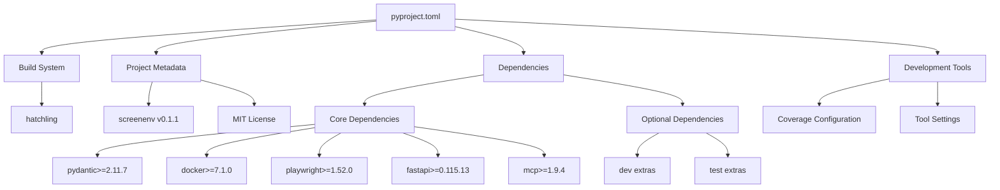
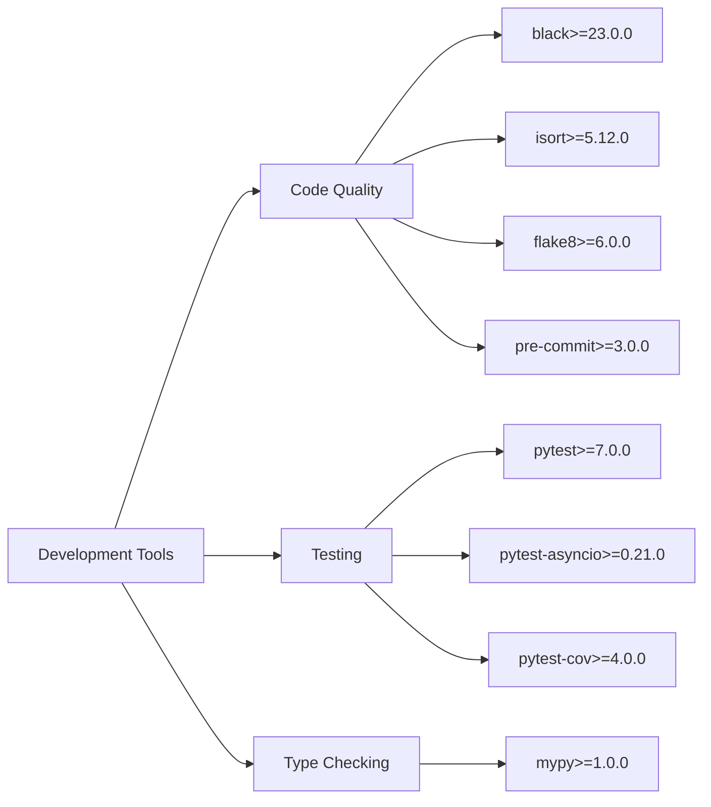
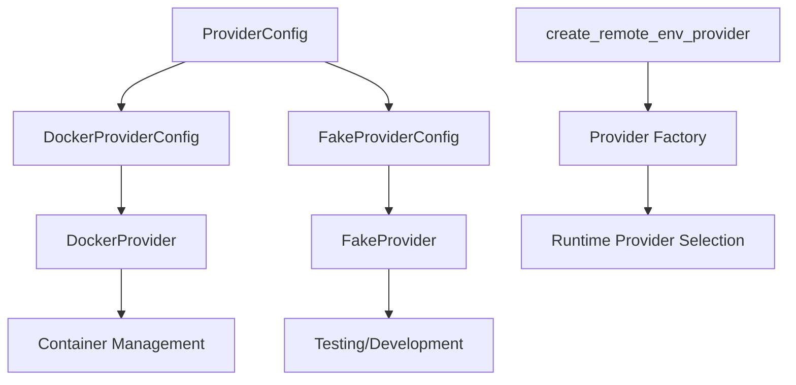

<!-- source: DeepWiki mcp.deepwiki.com · repo huggingface/screenenv · page 7.1 Project Setup · fetched 2026-10-26 -->

# Project Setup

<details>
<summary>Relevant source files</summary>

The following files were used as context for generating this wiki page:

- [.github/actions/setup-uv/action.yml](.github/actions/setup-uv/action.yml)
- [.github/workflows/pre-commit.yml](.github/workflows/pre-commit.yml)
- [.vscode/settings.json](.vscode/settings.json)
- [pyproject.toml](pyproject.toml)
- [setup.py](setup.py)
- [src/screenenv/remote_provider/create_remote_env.py](src/screenenv/remote_provider/create_remote_env.py)

</details>


This document provides a comprehensive guide for setting up the ScreenEnv development environment. It covers the installation of dependencies, configuration of development tools, and project structure setup required for contributing to the ScreenEnv codebase.

For information about running tests after setup, see [Testing](#7.2). For details about code standards and development practices, see [Development Environment](#7.3).

## Prerequisites

ScreenEnv requires Python 3.10 or later and uses modern Python packaging standards. The project utilizes UV for fast dependency management and supports multiple Python versions.

### System Requirements

| Component | Version | Purpose |
|-----------|---------|---------|
| Python | ≥3.10 | Core runtime environment |
| Docker | Latest | Container management for remote environments |
| Git | Latest | Version control |
| UV | Latest | Package management (recommended) |

### Supported Python Versions

The project supports Python 3.10, 3.11, and 3.12 as specified in [pyproject.toml:19-21]().

Sources: [pyproject.toml:26](), [setup.py:27]()

## Development Environment Setup

### UV-Based Setup (Recommended)

The project uses UV for fast dependency management and virtual environment handling. This is the recommended approach used in CI/CD pipelines.



**Development Environment Setup Process**

1. **Install UV**:
   ```bash
   curl -LsSf https://astral.sh/uv/install.sh | sh
   ```

2. **Clone and setup**:
   ```bash
   git clone https://github.com/huggingface/screenenv.git
   cd screenenv
   uv sync --all-extras --all-groups
   uv pip install -e .
   ```

3. **Setup pre-commit hooks**:
   ```bash
   uv run pre-commit install
   ```

Sources: [.github/actions/setup-uv/action.yml:8-21](), [.github/workflows/pre-commit.yml:24-26]()

### Traditional Setup

For environments where UV is not available, use standard pip-based installation:

```bash
git clone https://github.com/huggingface/screenenv.git
cd screenenv
pip install -e .[dev]
```

Sources: [pyproject.toml:43-53](), [setup.py:43-53]()

## Project Structure and Build Configuration

### Package Configuration

The project uses modern Python packaging with Hatchling as the build backend:



**Project Package Structure**

### Core Dependencies

The project has several categories of dependencies as defined in [pyproject.toml:27-41]():

| Category | Key Dependencies | Purpose |
|----------|------------------|---------|
| **Core Runtime** | `pydantic>=2.11.7`, `psutil>=7.0.0` | Data validation and system monitoring |
| **Container Management** | `docker>=7.1.0`, `filelock>=3.18.0` | Docker integration and file locking |
| **Web Automation** | `playwright>=1.52.0`, `fastapi>=0.115.13` | Browser automation and API server |
| **AI Integration** | `mcp>=1.9.4`, `smolagents[openai]==1.15.0` | Model Context Protocol and AI agents |
| **External Services** | `openai==1.91.0`, `huggingface_hub==0.33.1` | AI model providers |

### Development Dependencies

Development tools are organized into `dev` and `test` extras:



**Development Tools Configuration**

Sources: [pyproject.toml:44-53](), [setup.py:44-53]()

## IDE Configuration

### VSCode Configuration

The project includes VSCode settings for consistent development experience:

```json
{
    "editor.formatOnSave": true,
    "editor.defaultFormatter": "charliermarsh.ruff",
    "python.analysis.typeCheckingMode": "basic"
}
```

Key VSCode settings from [.vscode/settings.json:2-16]():

- **Format on Save**: Automatically formats code using Ruff
- **Import Organization**: Uses isort with black profile
- **Type Checking**: Basic type checking enabled
- **Auto-fix**: Runs Ruff fixes on save

Sources: [.vscode/settings.json:1-16]()

## Provider System Setup

### Remote Environment Providers

The project uses a provider system for managing different remote environment backends:



**Provider System Architecture**

The provider system supports different backends through a factory pattern implemented in [src/screenenv/remote_provider/create_remote_env.py:15-24]().

Sources: [src/screenenv/remote_provider/create_remote_env.py:1-25]()

## Coverage and Testing Configuration

### Coverage Settings

Test coverage is configured to focus on source code while excluding test files and generated content:

- **Source Directory**: `src/` [pyproject.toml:75]()
- **Excluded Patterns**: Tests, cache, migrations [pyproject.toml:76-81]()
- **Coverage Exclusions**: Debug code, abstract methods [pyproject.toml:84-95]()

### Build Targets

The project uses Hatchling with specific build target configurations:

- **Wheel Packages**: `src/screenenv` [pyproject.toml:65]()
- **Source Distribution**: Includes `/src`, `/README.md`, `/LICENSE` [pyproject.toml:67-72]()

Sources: [pyproject.toml:64-96]()

## Verification Steps

After completing the setup, verify the installation:

1. **Check Python version**:
   ```bash
   python --version  # Should be >=3.10
   ```

2. **Import ScreenEnv**:
   ```bash
   python -c "import screenenv; print('ScreenEnv imported successfully')"
   ```

3. **Run development tools**:
   ```bash
   uv run black --check .
   uv run isort --check-only .
   uv run flake8 .
   uv run mypy src/
   ```

4. **Test Docker integration**:
   ```bash
   docker --version
   docker info
   ```

The setup is complete when all verification steps pass without errors.

Sources: [.github/workflows/pre-commit.yml:18-26](), [pyproject.toml:26]()

---

