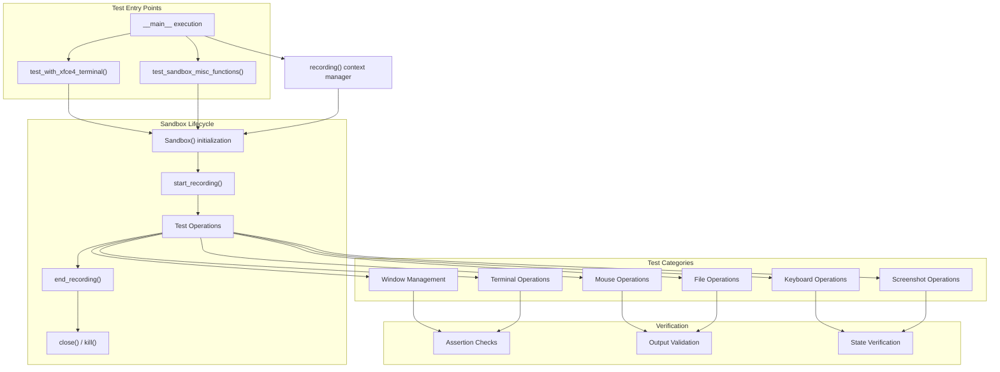
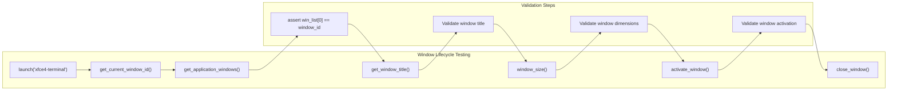

<!-- source: DeepWiki mcp.deepwiki.com · repo huggingface/screenenv · page 7.2 Testing · fetched 2026-10-26 -->

# Testing

<details>
<summary>Relevant source files</summary>

The following files were used as context for generating this wiki page:

- [src/screenenv/test_sandbox.py](src/screenenv/test_sandbox.py)

</details>


This document covers the testing framework and infrastructure for ScreenEnv, including how to run tests, understand test structure, and contribute new tests. The testing system focuses on integration testing of the core `Sandbox` class functionality through automated desktop environment interactions.

For information about setting up the development environment, see [Project Setup](#7.1). For code standards and development practices, see [Development Environment](#7.3).

## Test Structure Overview

ScreenEnv uses a pragmatic testing approach focused on integration testing of the `Sandbox` class. The test suite validates real desktop automation functionality by executing commands within the containerized environment and verifying the results.

### Test File Organization

The primary test file is located at [src/screenenv/test_sandbox.py:1-299]() and contains comprehensive integration tests for the `Sandbox` API. The tests are organized into logical groupings that cover different aspects of desktop automation:

| Test Function | Purpose | Key Areas Tested |
|---------------|---------|------------------|
| `test_with_xfce4_terminal()` | Terminal application workflow | Window management, terminal I/O, application lifecycle |
| `test_sandbox_misc_functions()` | Comprehensive API coverage | Mouse/keyboard actions, file operations, screenshots, recording |

### Test Execution Flow



*Sources: [src/screenenv/test_sandbox.py:1-299]()*

## Test Categories

### Window Management Tests

The window management tests validate the `Sandbox` class's ability to launch, control, and monitor desktop applications. These tests use `xfce4-terminal` as the primary test application.

**Core Functions Tested:**
- `launch()` - Application launching
- `get_current_window_id()` - Window identification
- `get_application_windows()` - Application window enumeration
- `get_window_title()` - Window title retrieval
- `window_size()` - Window size information
- `activate_window()` - Window activation
- `close_window()` - Window closure



*Sources: [src/screenenv/test_sandbox.py:28-97]()*

### Mouse and Keyboard Operations Tests

The input operation tests validate precise mouse and keyboard control functionality essential for desktop automation.

**Mouse Operations Tested:**
- `left_click()`, `right_click()`, `middle_click()` - Mouse clicking
- `double_click()` - Double-click operations
- `scroll()` - Scrolling with direction and amount
- `move_mouse()` - Mouse positioning
- `mouse_press()`, `mouse_release()` - Low-level mouse control
- `get_cursor_position()` - Cursor position retrieval
- `drag()` - Drag operations between coordinates

**Keyboard Operations Tested:**
- `write()` - Text input
- `press()` - Key press operations

*Sources: [src/screenenv/test_sandbox.py:198-255]()*

### File Operations Tests

File operation tests validate the `Sandbox` class's ability to handle file transfers and manipulation between the local environment and the remote desktop.

**File Operations Tested:**
- `upload_file_to_remote()` - Local to remote file transfer
- `download_file_from_remote()` - Remote to local file transfer
- `download_url_file_to_remote()` - URL to remote file download
- `directory_tree()` - Directory structure enumeration
- `desktop_path()` - Desktop path retrieval

*Sources: [src/screenenv/test_sandbox.py:127-153]()*

### Screenshot and Recording Tests

Visual capture tests validate the various screenshot and recording capabilities of the `Sandbox` class.

**Screenshot Operations Tested:**
- `screenshot()` - General screenshot capture
- `desktop_screenshot()` - Desktop-specific screenshot
- `playwright_screenshot()` - Playwright-based screenshot
- `start_recording()`, `end_recording()` - Screen recording functionality

*Sources: [src/screenenv/test_sandbox.py:17-25], [src/screenenv/test_sandbox.py:162-179], [src/screenenv/test_sandbox.py:190-196]()*

## Running Tests

### Manual Test Execution

The test suite is designed to be run manually for comprehensive integration testing:

```bash
# Run all tests
python src/screenenv/test_sandbox.py

# Run specific test functions (modify the __main__ section)
# Uncomment specific test functions in the main execution block
```

### Test Execution Context

The tests use a `recording()` context manager that provides automatic cleanup and recording functionality:

```python
@contextmanager
def recording() -> Generator[Sandbox, None, None]:
    try:
        s = Sandbox(headless=False)
        resp = s.start_recording()
        print(resp)
        yield s
        resp = s.end_recording("test.mp4")
        print(resp)
        sleep()
    finally:
        pass
        # s.close()
```

*Sources: [src/screenenv/test_sandbox.py:13-26]()*

### Test Artifacts

The test suite generates various artifacts during execution:

| Artifact Type | Example Files | Purpose |
|---------------|---------------|---------|
| Screenshots | `desktop_screenshot.png`, `playwright_screenshot.png` | Visual validation |
| Screen Recordings | `test0.mp4`, `test1.mp4` | Workflow documentation |
| Downloaded Files | `dummy_README.md`, `dummy_example.html` | File operation validation |

All test artifacts are automatically cleaned up after test completion.

*Sources: [src/screenenv/test_sandbox.py:293-298]()*

## Test Coverage

### API Coverage Map

```mermaid
graph TB
    subgraph "Sandbox API Methods"
        subgraph "Application Control"
            LaunchMethod["launch()"]
            OpenMethod["open()"]
            CloseMethod["close()"]
            KillMethod["kill()"]
        end
        
        subgraph "Window Management"
            GetCurrentWindowID["get_current_window_id()"]
            GetAppWindows["get_application_windows()"]
            GetWindowTitle["get_window_title()"]
            WindowSizeMethod["window_size()"]
            ActivateWindow["activate_window()"]
            CloseWindow["close_window()"]
        end
        
        subgraph "Input Operations"
            MouseClicks["left_click(), right_click(), middle_click()"]
            DoubleClick["double_click()"]
            ScrollMethod["scroll()"]
            MoveMouse["move_mouse()"]
            MousePress["mouse_press(), mouse_release()"]
            GetCursorPos["get_cursor_position()"]
            DragMethod["drag()"]
            WriteMethod["write()"]
            PressMethod["press()"]
        end
        
        subgraph "System Operations"
            ExecuteCommand["execute_command()"]
            ExecutePython["execute_python_command()"]
            GetAccessibilityTree["get_accessibility_tree()"]
            GetScreenSize["get_screen_size()"]
            PlatformMethod["platform()"]
            WaitMethod["wait()"]
        end
        
        subgraph "File Operations"
            UploadFile["upload_file_to_remote()"]
            DownloadFile["download_file_from_remote()"]
            DownloadURL["download_url_file_to_remote()"]
            DesktopPath["desktop_path()"]
            DirectoryTree["directory_tree()"]
        end
        
        subgraph "Visual Capture"
            ScreenshotMethod["screenshot()"]
            DesktopScreenshot["desktop_screenshot()"]
            PlaywrightScreenshot["playwright_screenshot()"]
            StartRecording["start_recording()"]
            EndRecording["end_recording()"]
        end
        
        subgraph "Terminal Operations"
            GetTerminalOutput["get_terminal_output()"]
        end
    end
    
    subgraph "Test Functions"
        TestTerminal["test_with_xfce4_terminal()"]
        TestMisc["test_sandbox_misc_functions()"]
        RecordingContext["recording() context"]
    end
    
    TestTerminal --> LaunchMethod
    TestTerminal --> GetCurrentWindowID
    TestTerminal --> GetAppWindows
    TestTerminal --> GetWindowTitle
    TestTerminal --> WindowSizeMethod
    TestTerminal --> ActivateWindow
    TestTerminal --> CloseWindow
    TestTerminal --> WriteMethod
    TestTerminal --> PressMethod
    TestTerminal --> GetTerminalOutput
    TestTerminal --> GetScreenSize
    TestTerminal --> StartRecording
    TestTerminal --> EndRecording
    
    TestMisc --> ExecuteCommand
    TestMisc --> ExecutePython
    TestMisc --> GetAccessibilityTree
    TestMisc --> DesktopPath
    TestMisc --> DirectoryTree
    TestMisc --> UploadFile
    TestMisc --> DownloadFile
    TestMisc --> DownloadURL
    TestMisc --> OpenMethod
    TestMisc --> DesktopScreenshot
    TestMisc --> PlaywrightScreenshot
    TestMisc --> PlatformMethod
    TestMisc --> WaitMethod
    TestMisc --> ScreenshotMethod
    TestMisc --> MouseClicks
    TestMisc --> DoubleClick
    TestMisc --> ScrollMethod
    TestMisc --> MoveMouse
    TestMisc --> MousePress
    TestMisc --> GetCursorPos
    TestMisc --> DragMethod
    TestMisc --> CloseMethod
    TestMisc --> KillMethod
    
    RecordingContext --> StartRecording
    RecordingContext --> EndRecording
    RecordingContext --> OpenMethod
```



*Sources: [src/screenenv/test_sandbox.py:1-299]()*

The current test suite provides comprehensive coverage of the `Sandbox` class API, focusing on integration testing rather than unit testing. This approach validates the complete desktop automation workflow from application launch to cleanup, ensuring that all components work together correctly in the containerized environment.

---

