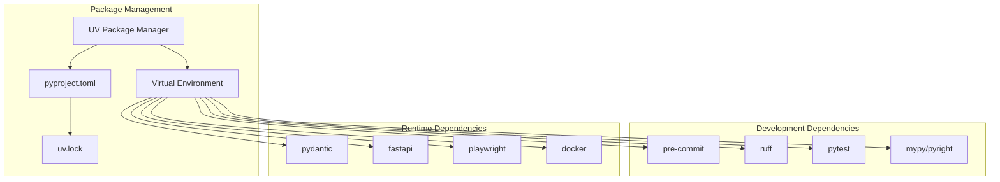
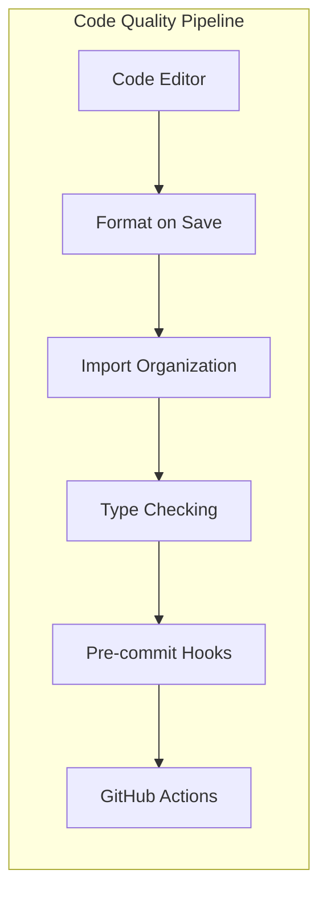
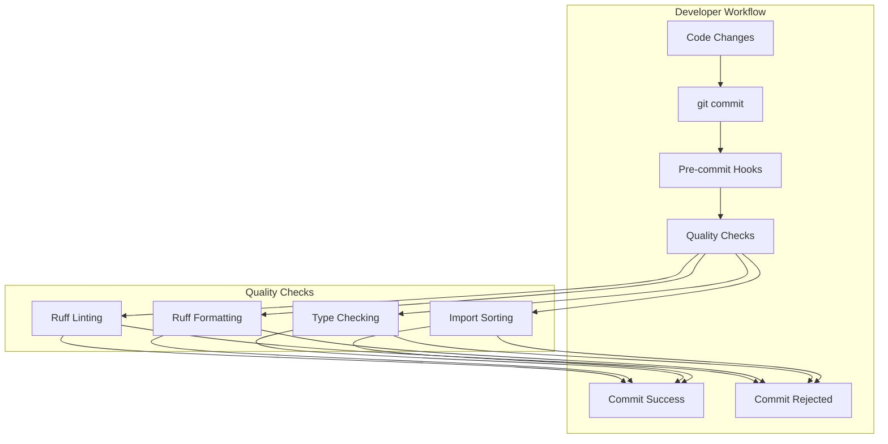
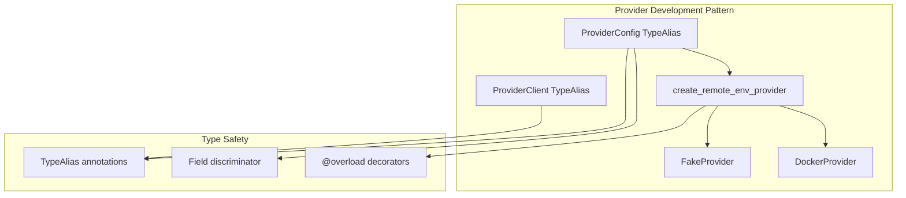

<!-- source: DeepWiki mcp.deepwiki.com · repo huggingface/screenenv · page 7.3 Development Environment · fetched 2026-10-26 -->

# Development Environment

<details>
<summary>Relevant source files</summary>

The following files were used as context for generating this wiki page:

- [.github/actions/setup-uv/action.yml](.github/actions/setup-uv/action.yml)
- [.github/workflows/pre-commit.yml](.github/workflows/pre-commit.yml)
- [.gitignore](.gitignore)
- [.vscode/settings.json](.vscode/settings.json)
- [src/screenenv/remote_provider/create_remote_env.py](src/screenenv/remote_provider/create_remote_env.py)

</details>


This document covers the development environment setup, code standards, and tooling used in the ScreenEnv project. It provides guidance for contributors on the coding practices, automated quality checks, and development workflow.

For information about initial project setup and installation, see [Project Setup](#7.1). For testing procedures and test framework details, see [Testing](#7.2).

## Development Tooling

ScreenEnv uses modern Python development tools to ensure code quality and consistency across the project.

### Package Management

The project uses UV as its primary package manager for fast and reliable dependency management. UV provides reproducible builds and efficient virtual environment handling.



*Sources: [.github/actions/setup-uv/action.yml:1-22]()*

### Code Formatting and Linting

The project enforces consistent code style through automated formatting and linting tools.

| Tool | Purpose | Configuration |
|------|---------|---------------|
| Ruff | Linting and formatting | Replaces black, isort, flake8 |
| Pre-commit | Git hooks | Runs quality checks before commits |
| Type checking | Static analysis | Basic type checking enabled |

The development environment automatically formats code on save and organizes imports using the black profile.

*Sources: [.vscode/settings.json:1-16]()*

## Code Standards

### Python Code Style

The project follows these coding standards:

- **Formatting**: Automatic formatting using Ruff with black-compatible settings
- **Import organization**: Imports are automatically sorted using isort with black profile
- **Type hints**: Modern Python type annotations are used throughout the codebase
- **Pydantic models**: Data validation and serialization uses Pydantic models



*Sources: [.vscode/settings.json:2-15](), [src/screenenv/remote_provider/create_remote_env.py:1-24]()*

### File Organization

The project maintains a clean file structure with proper `.gitignore` patterns:

- **Python artifacts**: `__pycache__`, `*.pyc`, `*.egg-info` directories are ignored
- **Development environments**: `.venv`, `venv`, `.env` files are excluded
- **IDE configurations**: Editor-specific files are managed appropriately
- **Build artifacts**: `dist/`, `build/`, `target/` directories are ignored
- **Cache directories**: `.ruff_cache/`, `.pytest_cache/`, `.mypy_cache/` are excluded

*Sources: [.gitignore:1-202]()*

## Development Workflow

### Pre-commit Hooks

The project uses pre-commit hooks to enforce code quality before commits are made to the repository.



*Sources: [.github/workflows/pre-commit.yml:1-27]()*

### Continuous Integration

The project uses GitHub Actions for continuous integration, automatically running quality checks on all pull requests and pushes to the main branch.

#### CI Pipeline Components

The CI pipeline includes:

- **Python 3.11**: Standard Python version for development
- **UV setup**: Fast dependency installation using UV
- **Pre-commit execution**: All quality checks run in CI environment
- **Editable installation**: Package is installed in development mode for testing

*Sources: [.github/workflows/pre-commit.yml:13-27](), [.github/actions/setup-uv/action.yml:1-22]()*

## Development Environment Configuration

### VS Code Integration

The project provides optimized VS Code settings for development:

```json
{
    "editor.formatOnSave": true,
    "editor.codeActionsOnSave": {
        "source.organizeImports": "always",
        "source.fixAll.ruff": "always"
    },
    "[python]": {
        "editor.defaultFormatter": "charliermarsh.ruff"
    },
    "python.analysis.typeCheckingMode": "basic"
}
```

Key features:
- **Automatic formatting**: Code is formatted on every save
- **Import management**: Imports are automatically organized
- **Ruff integration**: All linting and formatting uses Ruff
- **Type checking**: Basic type analysis is enabled

*Sources: [.vscode/settings.json:1-16]()*

### Provider System Architecture

The development environment supports the extensible provider system used throughout ScreenEnv:



This demonstrates the project's commitment to type safety and extensible architecture patterns.

*Sources: [src/screenenv/remote_provider/create_remote_env.py:1-24]()*

## Best Practices for Contributors

### Code Quality Standards

1. **Type annotations**: All public methods and functions must include type hints
2. **Pydantic models**: Use Pydantic for data validation and serialization
3. **Documentation**: Code should be self-documenting with clear variable names
4. **Error handling**: Implement proper error handling with descriptive messages

### Development Process

1. **Local development**: Use the provided VS Code settings for consistent formatting
2. **Pre-commit checks**: Ensure all pre-commit hooks pass before pushing
3. **Type checking**: Run type checking locally before submitting PRs
4. **Testing**: Write tests for new functionality (see [Testing](#7.2))

The development environment ensures that all code meets the project's quality standards through automated tooling and consistent configuration across development environments.

*Sources: [.vscode/settings.json:1-16](), [.github/workflows/pre-commit.yml:1-27](), [.gitignore:183-194]()*