# Page: Overview

# Overview

<details>
<summary>Relevant source files</summary>

The following files were used as context for generating this wiki page:

- [README.md](README.md)

</details>


## Purpose and Scope

ScreenEnv is a Python library for creating and managing isolated desktop environments using Docker containers. It provides programmatic control over containerized Ubuntu desktop environments with XFCE4, enabling desktop automation, GUI testing, and AI agent integration. The library offers two primary access patterns: direct programming through the `Sandbox` class and AI integration through the Model Context Protocol (MCP).

For specific implementation details about the core components, see [Core Components](#2.1). For usage examples and practical applications, see [Examples and Demos](#5). For complete API documentation, see [API Reference](#6).

## System Architecture

The following diagram shows the main system components and their relationships in the codebase:

**ScreenEnv Core Architecture**

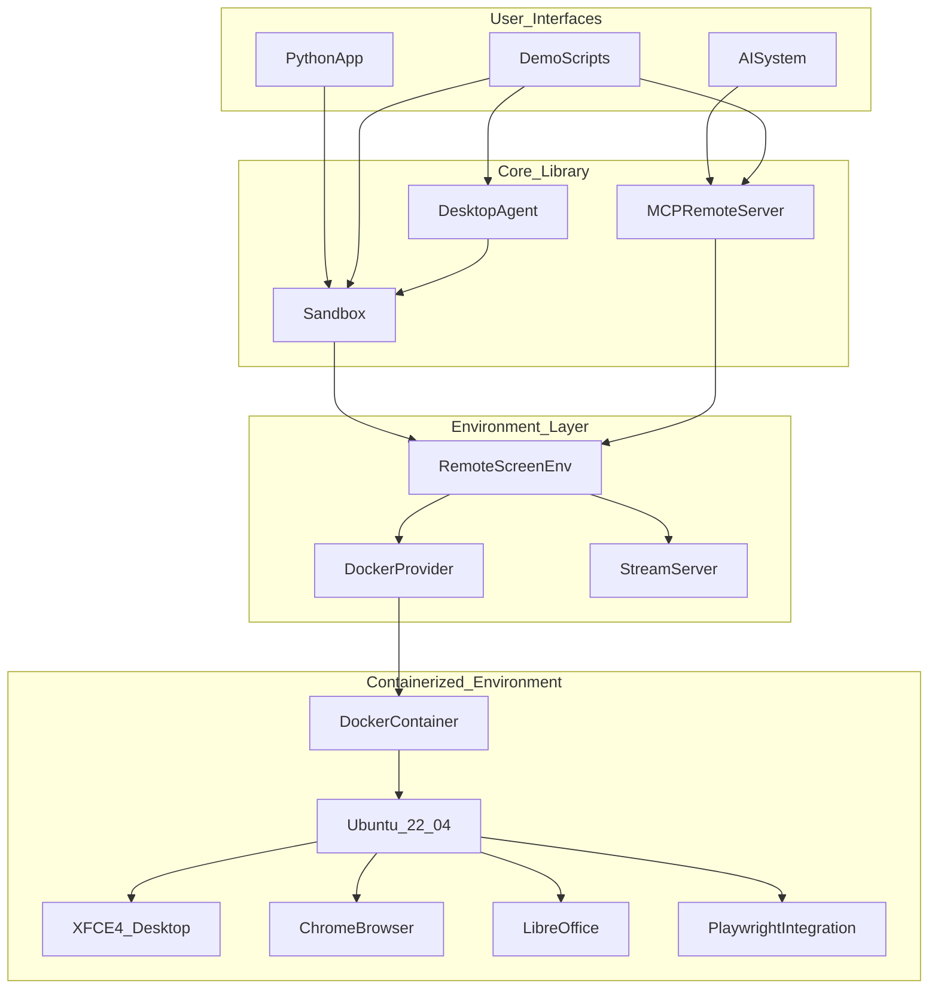

Sources: [README.md:1-426]()

## Access Patterns

ScreenEnv supports three main access patterns, each implemented through specific classes:

**Access Pattern Implementation**

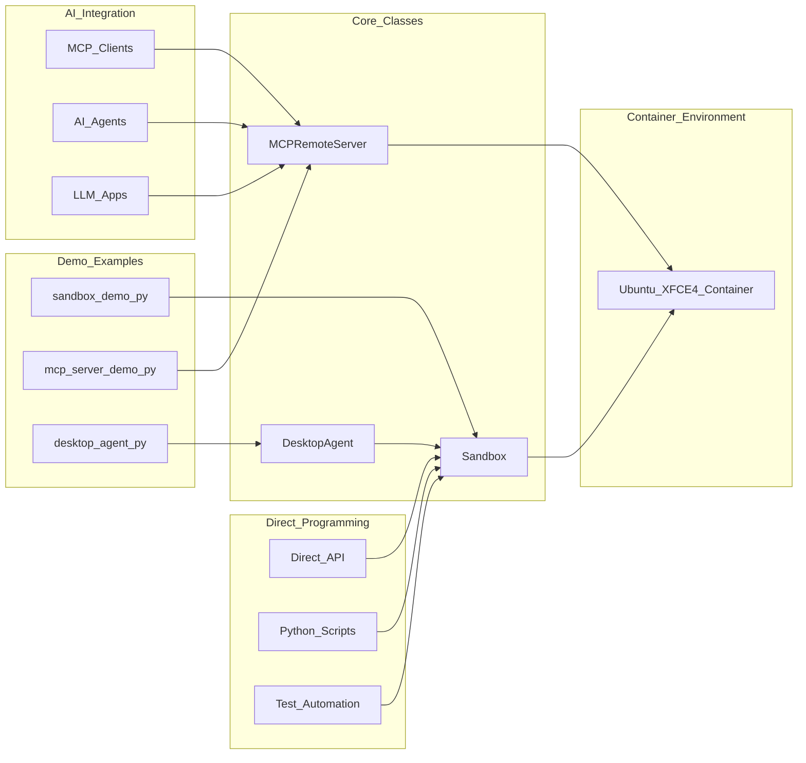

Sources: [README.md:47-71](), [README.md:91-147](), [README.md:391-407]()

## Core Components

ScreenEnv consists of several key components that work together to provide desktop automation capabilities:

| Component | Purpose | Key Methods |
|-----------|---------|-------------|
| `Sandbox` | Direct desktop control interface | `launch()`, `write()`, `press()`, `screenshot()`, `click()` |
| `MCPRemoteServer` | AI integration through MCP protocol | `server_url`, `mcp_server_json`, `close()` |
| `RemoteScreenEnv` | Environment orchestration | Container lifecycle management |
| `DockerProvider` | Container management | Docker container provisioning and control |
| `StreamServer` | VNC/noVNC access | Remote desktop streaming |

Sources: [README.md:49-71](), [README.md:91-99](), [README.md:208-232]()

## Key Features

### Desktop Automation Capabilities

ScreenEnv provides comprehensive desktop automation through the `Sandbox` class:

- **Mouse Control**: `left_click()`, `right_click()`, `double_click()`, `move_mouse()`, `drag()`, `scroll()`
- **Keyboard Input**: `write()`, `press()` for text input and key combinations
- **Application Management**: `launch()`, `open()`, `get_application_windows()`, `activate_window()`, `close_window()`
- **Screen Capture**: `screenshot()`, `desktop_screenshot()`, `start_recording()`, `end_recording()`
- **File Operations**: `upload_file_to_remote()`, `download_file_from_remote()`, `download_url_file_to_remote()`
- **Terminal Access**: `execute_command()`, `execute_python_command()`, `get_terminal_output()`

Sources: [README.md:237-331]()

### MCP Integration

The `MCPRemoteServer` provides 30+ automation tools accessible through the Model Context Protocol:

- **System Operations**: `execute_command`, `get_platform`, `get_screen_size`, `get_desktop_path`
- **Application Management**: `launch`, `activate_window`, `close_window`, `get_application_windows`
- **GUI Automation**: `screenshot`, `left_click`, `right_click`, `write`, `press`, `drag`
- **File Operations**: `get_file`, `download_file`, `get_directory_tree`
- **Recording**: `start_recording`, `end_recording`

Sources: [README.md:149-188]()

### Containerized Environment

The system uses a custom Ubuntu 22.04 Docker image with pre-installed software:

- **Desktop Environment**: XFCE4 with VNC server
- **Web Browser**: Google Chrome/Chromium with Playwright integration
- **Office Suite**: LibreOffice for document automation
- **Development Tools**: Python development environment
- **Automation Support**: MCP server and desktop automation tools

Sources: [README.md:417-426]()

## System Requirements

- **Docker**: Must be installed and running
- **Python**: 3.10 or higher
- **Playwright**: For web automation features
- **Memory**: At least 4GB RAM recommended for container operation

Sources: [README.md:410-416]()

---

# Page: Architecture

# Architecture

<details>
<summary>Relevant source files</summary>

The following files were used as context for generating this wiki page:

- [README.md](README.md)
- [src/screenenv/__init__.py](src/screenenv/__init__.py)

</details>


This document describes the high-level architecture of ScreenEnv, explaining how the core components work together to provide desktop automation capabilities. It covers the system's layered design, component relationships, and the different access patterns available to users.

For implementation details of specific components, see [Core Components](#2.1) and [Remote Environment Providers](#2.2). For practical usage guidance, see [User Guides](#4).

## System Overview

ScreenEnv follows a layered architecture that separates concerns between user interfaces, core automation logic, remote environment management, and the containerized desktop environment. The system provides multiple access patterns to accommodate different use cases, from direct Python programming to AI-driven automation through the Model Context Protocol (MCP).

### High-Level Architecture

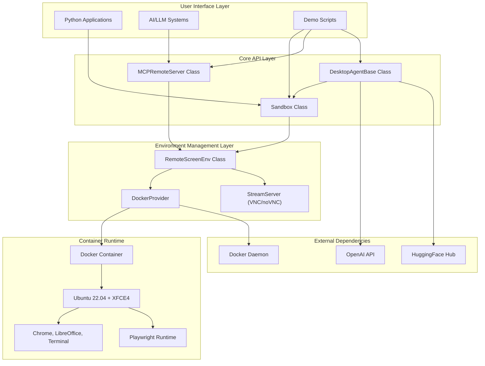

Sources: [README.md:1-426](), [src/screenenv/__init__.py:1-16]()

## Core Component Relationships

The system is built around three primary components that provide different levels of abstraction and access patterns for desktop automation.

### Component Interaction Flow

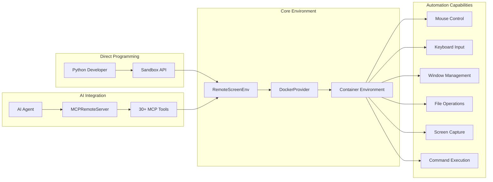

Sources: [README.md:47-71](), [README.md:91-147](), [src/screenenv/__init__.py:1-16]()

### Component Responsibilities

| Component | Primary Responsibility | Key Methods/Features |
|-----------|----------------------|---------------------|
| `Sandbox` | Direct programmatic control | `left_click()`, `write()`, `launch()`, `screenshot()` |
| `MCPRemoteServer` | AI agent integration via MCP protocol | 30+ MCP tools, HTTP transport, tool calling |
| `DesktopAgentBase` | High-level AI automation framework | Agent orchestration, LLM integration |
| `RemoteScreenEnv` | Environment lifecycle management | Container orchestration, resource management |
| `DockerProvider` | Container backend implementation | Docker container management, networking |

Sources: [README.md:234-331](), [README.md:149-188]()

## Data Flow Architecture

The system processes automation requests through a structured flow from high-level commands to low-level system interactions.

### Request Processing Flow

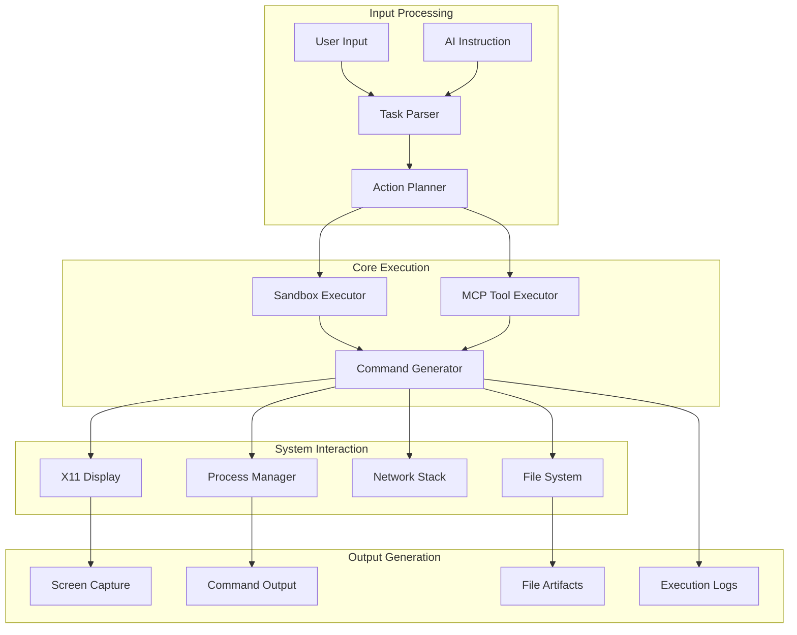

Sources: [README.md:234-331](), [README.md:149-188]()

## Access Patterns

ScreenEnv supports three primary access patterns, each optimized for different use cases and user types.

### Access Pattern Comparison

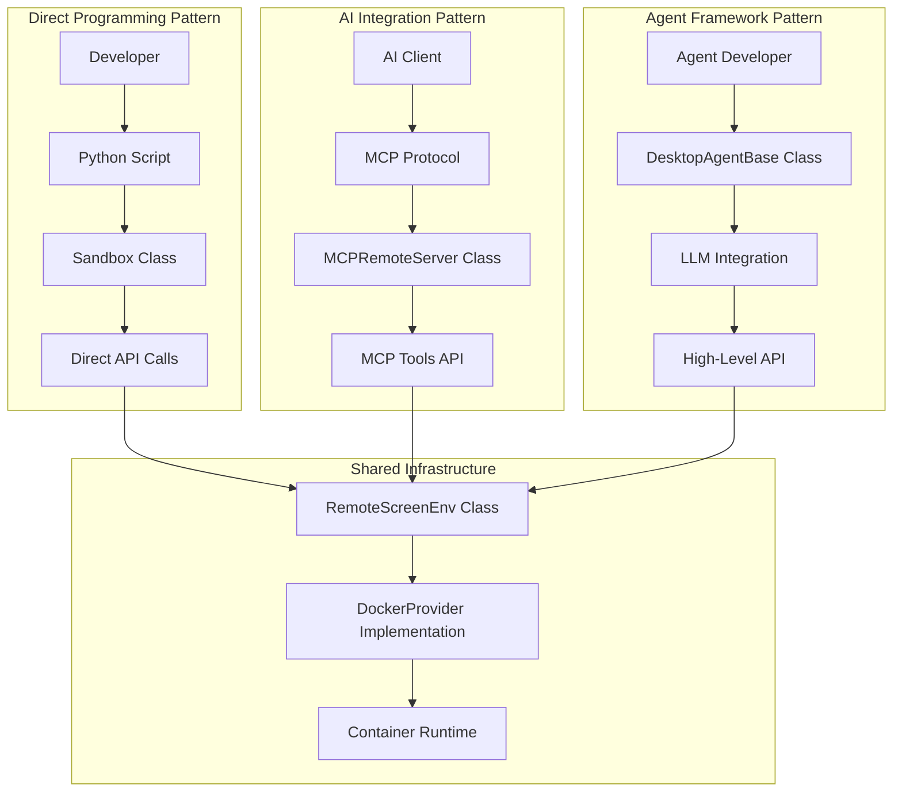

Sources: [README.md:47-71](), [README.md:91-147](), [src/screenenv/__init__.py:1-16]()

## Technology Stack Integration

The system integrates multiple technologies to provide comprehensive desktop automation capabilities.

### Technology Dependencies

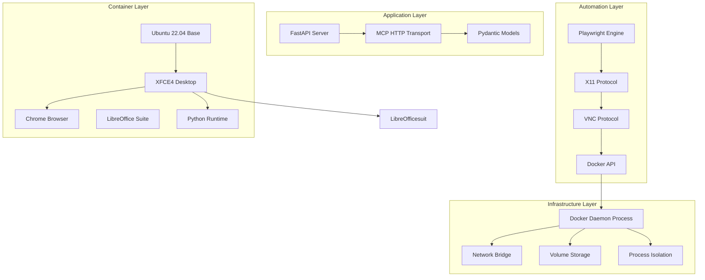

Sources: [README.md:410-426]()

## Environment Lifecycle Management

The system manages the complete lifecycle of desktop environments, from creation to cleanup, with automatic resource management and error handling.

### Environment State Management

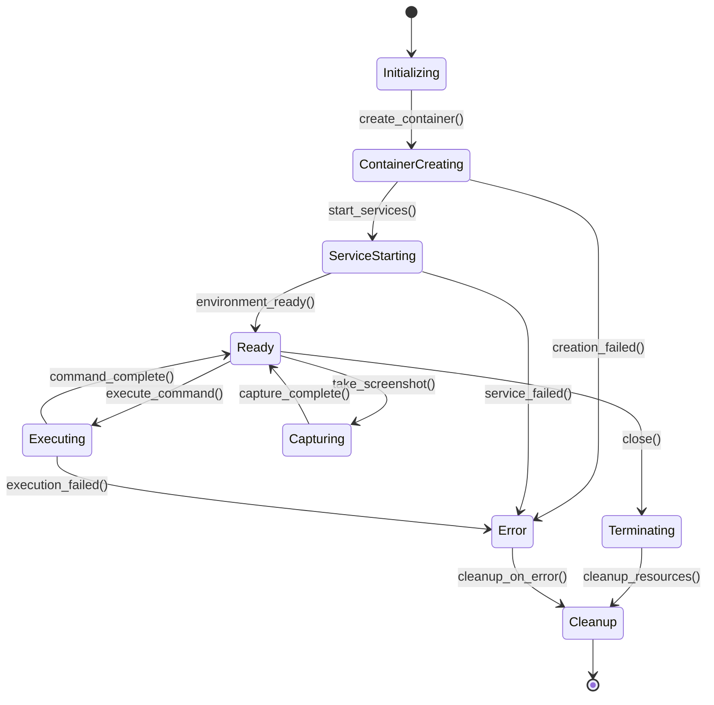

Sources: [README.md:208-232](), [README.md:47-71]()

---

# Page: Core Components

# Core Components

<details>
<summary>Relevant source files</summary>

The following files were used as context for generating this wiki page:

- [src/screenenv/mcp_remote_server.py](src/screenenv/mcp_remote_server.py)
- [src/screenenv/sandbox.py](src/screenenv/sandbox.py)

</details>


This document covers the two primary interfaces for interacting with ScreenEnv's desktop automation capabilities: the `Sandbox` class for direct programming access and the `MCPRemoteServer` class for AI agent integration. For information about the underlying remote environment providers and Docker orchestration, see [Remote Environment Providers](#2.2).

## Overview

ScreenEnv provides two main entry points for desktop automation, each designed for different use cases:

| Component | Purpose | Target Users | Protocol |
|-----------|---------|--------------|----------|
| `Sandbox` | Direct programming interface | Python developers, automation scripts | HTTP REST API |
| `MCPRemoteServer` | AI agent integration | AI systems, LLM applications | Model Context Protocol (MCP) |

Both components inherit from `RemoteScreenEnv` and provide access to the same underlying containerized desktop environment, but through different interfaces optimized for their respective use cases.

## Sandbox Class

The `Sandbox` class serves as the primary interface for direct programming access to the desktop environment. It provides comprehensive control over mouse actions, keyboard input, application management, and system operations.

### Core Architecture

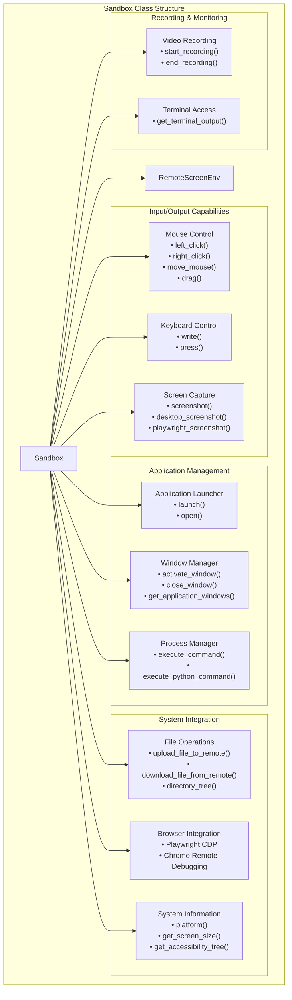

Sources: [src/screenenv/sandbox.py:42-654]()

### HTTP Request Infrastructure

The `Sandbox` class communicates with the remote environment through HTTP requests with built-in retry logic and session management:

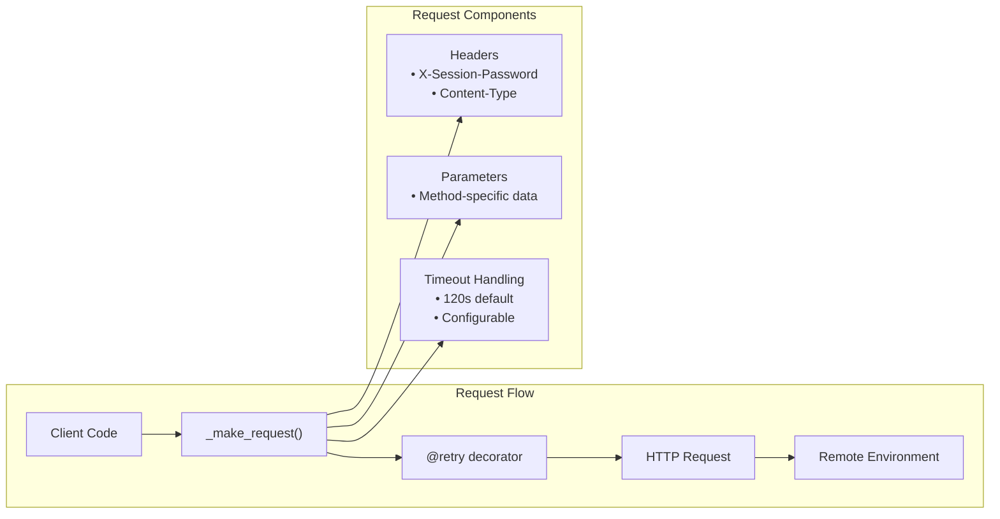

Sources: [src/screenenv/sandbox.py:115-153]()

### Browser Integration

The `Sandbox` class provides sophisticated browser automation through Playwright's Chrome DevTools Protocol (CDP) integration:

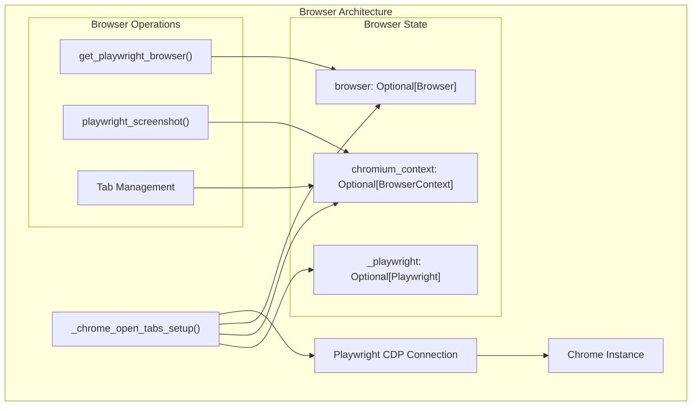

Sources: [src/screenenv/sandbox.py:98-217]()

## MCPRemoteServer Class

The `MCPRemoteServer` class provides a lightweight wrapper around `RemoteScreenEnv` specifically designed for AI agent integration through the Model Context Protocol.

### MCP Integration Architecture

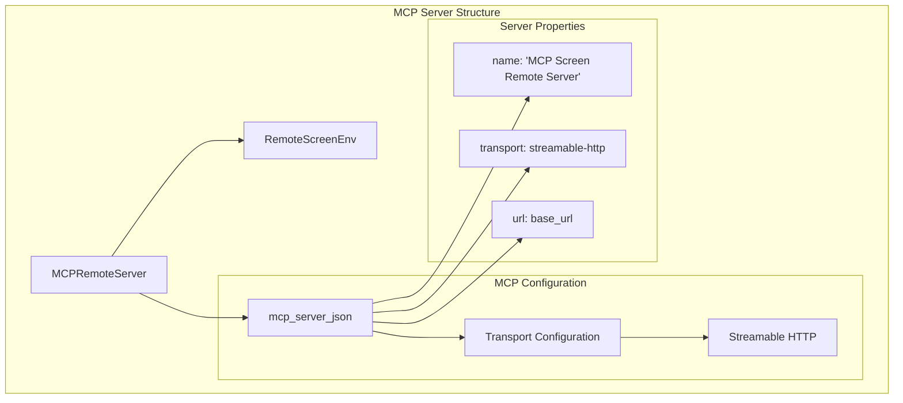

Sources: [src/screenenv/mcp_remote_server.py:9-52]()

### Configuration Parameters

The `MCPRemoteServer` class accepts the same initialization parameters as `RemoteScreenEnv` but sets specific defaults optimized for AI agent usage:

| Parameter | Default Value | Purpose |
|-----------|---------------|---------|
| `session_password` | `True` | Enable session security by default |
| `server_type` | `"mcp"` | Set server type to MCP protocol |
| `headless` | `True` | Run in headless mode for AI agents |
| `stream_server` | `True` | Enable VNC streaming for monitoring |

Sources: [src/screenenv/mcp_remote_server.py:10-44]()

## Component Comparison

### Inheritance Hierarchy

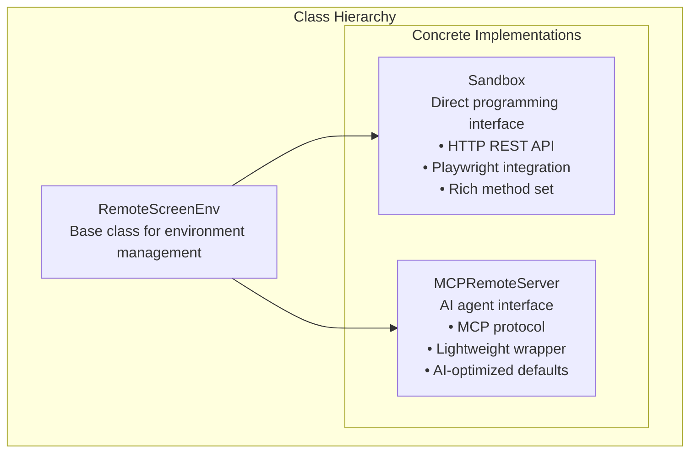

Sources: [src/screenenv/sandbox.py:42-43](), [src/screenenv/mcp_remote_server.py:9-10]()

### Interface Capabilities

| Capability | Sandbox | MCPRemoteServer |
|------------|---------|-----------------|
| Mouse Control | ✓ Direct methods | ✓ Via MCP tools |
| Keyboard Input | ✓ Direct methods | ✓ Via MCP tools |
| Application Management | ✓ Direct methods | ✓ Via MCP tools |
| File Operations | ✓ Direct methods | ✓ Via MCP tools |
| Screenshot Capture | ✓ Multiple methods | ✓ Via MCP tools |
| Browser Automation | ✓ Playwright CDP | ✓ Via MCP tools |
| Video Recording | ✓ Direct methods | ✓ Via MCP tools |
| Protocol | HTTP REST | MCP over HTTP |
| Target Users | Python developers | AI agents/LLMs |

### Method Mapping

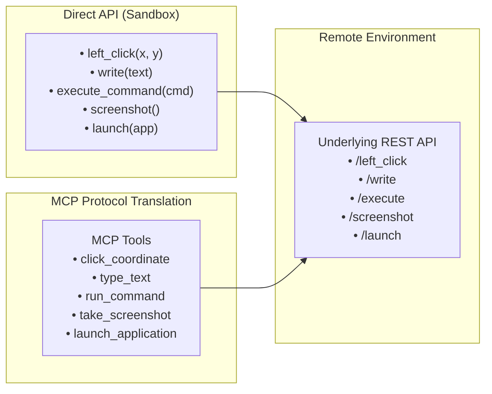

Sources: [src/screenenv/sandbox.py:537-634](), [src/screenenv/mcp_remote_server.py:45-51]()

---

# Page: Remote Environment Providers

# Remote Environment Providers

<details>
<summary>Relevant source files</summary>

The following files were used as context for generating this wiki page:

- [src/screenenv/remote_provider/__init__.py](src/screenenv/remote_provider/__init__.py)
- [src/screenenv/remote_provider/docker/provider.py](src/screenenv/remote_provider/docker/provider.py)
- [src/screenenv/remote_screen_env.py](src/screenenv/remote_screen_env.py)

</details>


This document covers the provider system that manages remote environments in ScreenEnv. The provider system abstracts different backend implementations (Docker, cloud services, etc.) behind a common interface, with the Docker provider being the primary implementation. For information about the overall architecture, see [Architecture](#2). For details about the core components that use providers, see [Core Components](#2.1).

## Provider System Architecture

The provider system follows an abstract factory pattern where different provider implementations can be plugged in through a common interface. The system supports multiple backend types while maintaining consistent behavior for environment lifecycle management.

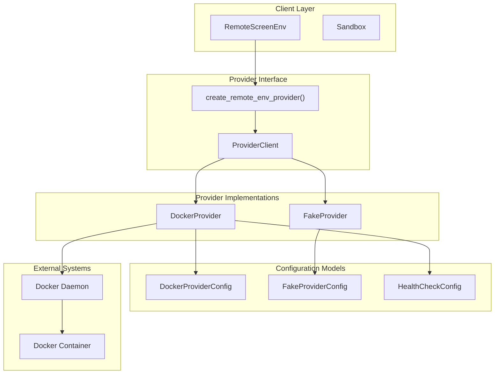

Sources: [src/screenenv/remote_provider/__init__.py:1-19](), [src/screenenv/remote_screen_env.py:235-242]()

## Provider Interface and Factory

The provider system uses a factory function to create provider instances based on configuration. The `ProviderClient` type represents the common interface that all providers must implement.

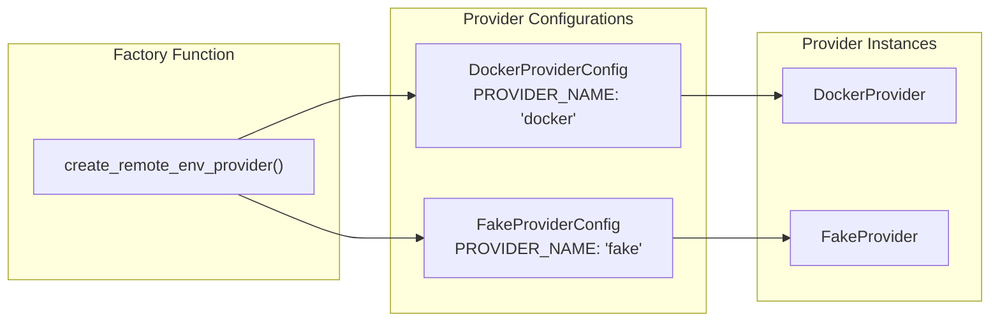

The factory function dispatches to appropriate provider classes based on the `PROVIDER_NAME` field in the configuration.

Sources: [src/screenenv/remote_provider/__init__.py:1-5]()

## Docker Provider Implementation

The `DockerProvider` class is the primary implementation that manages Docker containers as remote environments. It handles container lifecycle, port allocation, and health checking.

### Core Docker Provider Components

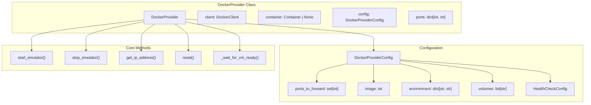

Sources: [src/screenenv/remote_provider/docker/provider.py:65-78]()

### Port Allocation System

The Docker provider implements a sophisticated port allocation system to avoid conflicts between multiple instances and system services.

| Method | Purpose | Line Reference |
|--------|---------|----------------|
| `_get_used_ports()` | Scans system and Docker ports to find conflicts | [src/screenenv/remote_provider/docker/provider.py:85-101]() |
| `_get_available_port()` | Finds next available port starting from a base port | [src/screenenv/remote_provider/docker/provider.py:103-113]() |
| Port allocation with FileLock | Ensures atomic port allocation across processes | [src/screenenv/remote_provider/docker/provider.py:166-182]() |

The port allocation process uses a file lock to ensure that multiple instances don't allocate the same ports simultaneously:

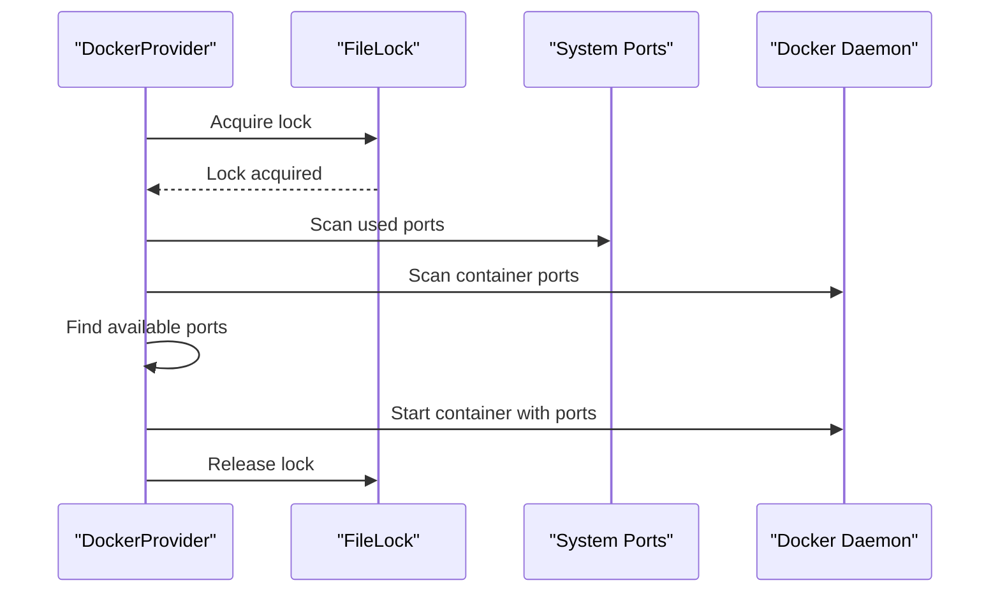

Sources: [src/screenenv/remote_provider/docker/provider.py:164-241]()

## Provider Configuration Models

The provider system uses Pydantic models for configuration validation and type safety.

### DockerProviderConfig

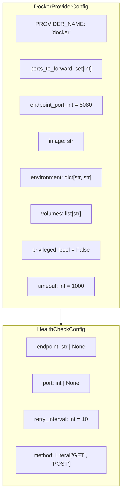

Key configuration fields:

| Field | Type | Default | Purpose |
|-------|------|---------|---------|
| `ports_to_forward` | `set[int]` | Required | Ports to expose from container |
| `endpoint_port` | `int` | 8080 | Main API endpoint port |
| `image` | `str` | Required | Docker image to run |
| `environment` | `dict[str, str]` | `{"DISK_SIZE": "32G", ...}` | Environment variables |
| `timeout` | `int` | 1000 | Health check timeout in seconds |

Sources: [src/screenenv/remote_provider/docker/provider.py:37-63]()

## Provider Lifecycle Management

The provider lifecycle follows a standard pattern across all implementations:

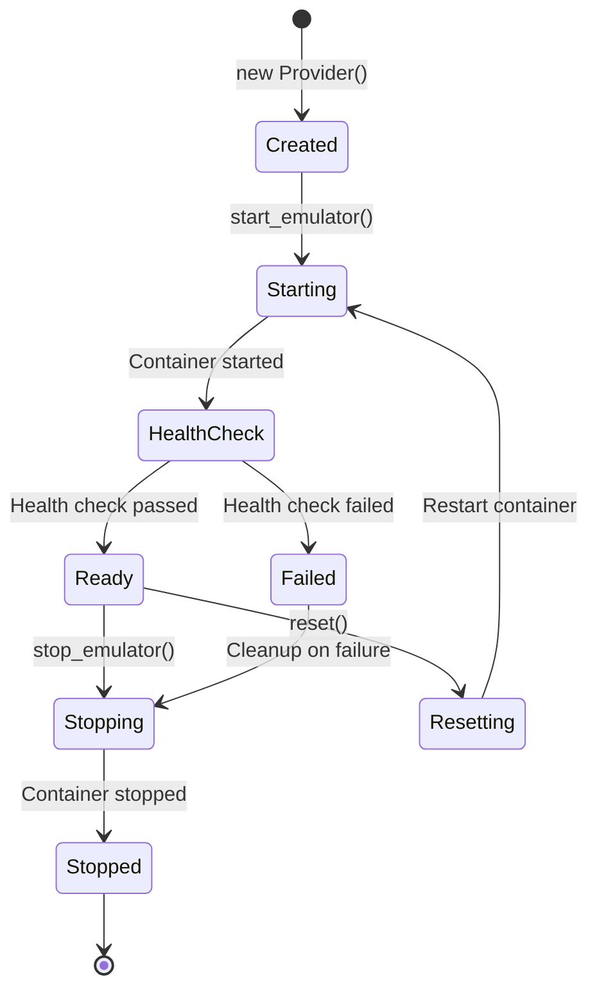

### Start Emulator Process

The `start_emulator()` method orchestrates the complete startup process:

1. **Image Management**: Pull Docker image if not present
2. **Port Allocation**: Allocate required ports with conflict detection
3. **Container Creation**: Start container with configured parameters
4. **Health Check**: Wait for services to be ready

```mermaid
sequenceDiagram
    participant Client as "RemoteScreenEnv"
    participant Provider as "DockerProvider"
    participant Docker as "Docker Daemon"
    participant Container as "Container"
    
    Client->>Provider: start_emulator()
    Provider->>Docker: Check image exists
    Docker-->>Provider: Image status
    Provider->>Docker: Pull image (if needed)
    Provider->>Provider: Allocate ports
    Provider->>Docker: Create container
    Docker-->>Provider: Container created
    Provider->>Container: Start services
    Provider->>Provider: _wait_for_vm_ready()
    Provider-->>Client: Environment ready
```

Sources: [src/screenenv/remote_provider/docker/provider.py:164-241]()

### Health Check System

The health check system ensures that the remote environment is fully operational before returning control to the client:

```mermaid
graph LR
    subgraph "Health Check Loop"
        start["Start Health Check"]
        check_endpoint["Check HTTP Endpoint"]
        success["Return Success"]
        wait_retry["Wait retry_interval"]
        timeout_check["Check Timeout"]
        timeout_error["Raise TimeoutError"]
    end
    
    start --> check_endpoint
    check_endpoint --> success
    check_endpoint --> timeout_check
    timeout_check --> wait_retry
    timeout_check --> timeout_error
    wait_retry --> check_endpoint
```

The health check configuration allows customization of the endpoint, retry interval, and HTTP method used for validation.

Sources: [src/screenenv/remote_provider/docker/provider.py:115-162]()

## Integration with RemoteScreenEnv

The `RemoteScreenEnv` class serves as the primary orchestrator that uses providers to manage remote environments:

```mermaid
graph TB
    subgraph "RemoteScreenEnv"
        init["__init__()"]
        provider["provider: ProviderClient"]
        ip_addr["ip_addr: IPAddr"]
        base_url["base_url: str"]
        StreamServer["StreamServer"]
    end
    
    subgraph "Provider Integration"
        create_remote_env_provider["create_remote_env_provider()"]
        start_emulator["start_emulator()"]
        get_ip_address["get_ip_address()"]
    end
    
    subgraph "Configuration Flow"
        os_type["os_type: Ubuntu"]
        provider_type["provider_type: docker"]
        DockerProviderConfig["DockerProviderConfig"]
    end
    
    init --> create_remote_env_provider
    create_remote_env_provider --> DockerProviderConfig
    DockerProviderConfig --> start_emulator
    start_emulator --> get_ip_address
    get_ip_address --> base_url
    base_url --> StreamServer
```

The integration process:
1. `RemoteScreenEnv` creates provider configuration based on parameters
2. Factory function instantiates appropriate provider
3. Provider starts the remote environment
4. `RemoteScreenEnv` configures URLs and services based on provider's IP address

Sources: [src/screenenv/remote_screen_env.py:234-268]()

---

# Page: Getting Started

# Getting Started

<details>
<summary>Relevant source files</summary>

The following files were used as context for generating this wiki page:

- [README.md](README.md)
- [pyproject.toml](pyproject.toml)
- [setup.py](setup.py)

</details>


This page provides installation instructions, basic setup, and simple usage examples to get users up and running quickly with ScreenEnv. It covers the essential steps needed to create your first isolated desktop environment and perform basic automation tasks.

For comprehensive programming guides, see [Direct Programming Interface](#4.1) and [AI Agent Integration](#4.2). For detailed API documentation, see [Sandbox API](#6.1) and [MCP Server API](#6.2).

## Prerequisites

Before installing ScreenEnv, ensure your system meets the following requirements:

| Component | Requirement | Notes |
|-----------|-------------|-------|
| **Docker** | Must be installed and running | Core dependency for container management |
| **Python** | 3.10 or higher | Required for the ScreenEnv library |
| **Memory** | At least 4GB RAM | Recommended for smooth operation |
| **Storage** | 2GB+ free space | For Docker images and containers |

### Docker Setup

ScreenEnv relies on Docker to provide isolated desktop environments. Ensure Docker is properly installed and your user has permission to run Docker commands:

```bash
# Test Docker installation
docker --version

# Test Docker permissions (should not require sudo)
docker run hello-world
```

If you need to run Docker commands with `sudo`, you may need to add your user to the `docker` group or use `sudo -E` when running ScreenEnv commands.

**Sources:** [README.md:410-425](), [README.md:394-407]()

## Installation

### Installation Flow

```mermaid
flowchart TD
    A["Check Prerequisites"] --> B["Choose Installation Method"]
    B --> C["Install from PyPI"]
    B --> D["Install from Source"]
    
    C --> E["pip install screenenv"]
    C --> F["uv pip install screenenv"]
    
    D --> G["git clone repository"]
    G --> H["pip install ."]
    G --> I["uv sync"]
    
    E --> J["Verify Installation"]
    F --> J
    H --> J
    I --> J
    
    J --> K["First Usage"]
```

**Sources:** [README.md:22-44]()

### Option 1: Install from PyPI (Recommended)

Install the latest stable release using pip or uv:

```bash
pip install screenenv
```

Or using uv (faster):

```bash
uv pip install screenenv
```

### Option 2: Install from Source

For development or to get the latest features:

```bash
# Clone the repository
git clone https://github.com/huggingface/screenenv
cd screenenv

# Install with pip
pip install .

# Or install with uv (recommended for development)
uv sync
```

**Sources:** [README.md:30-44]()

## Basic Setup

### Core Components Overview

```mermaid
graph TD
    User["User Application"] --> Choice{"Usage Pattern"}
    
    Choice --> DirectAPI["Direct Python API"]
    Choice --> MCPAPI["MCP Server API"]
    
    DirectAPI --> Sandbox["Sandbox Class"]
    MCPAPI --> MCPRemoteServer["MCPRemoteServer Class"]
    
    Sandbox --> RemoteScreenEnv["RemoteScreenEnv"]
    MCPRemoteServer --> RemoteScreenEnv
    
    RemoteScreenEnv --> DockerProvider["DockerProvider"]
    DockerProvider --> Container["Docker Container"]
    
    Container --> Ubuntu["Ubuntu 22.04 + XFCE4"]
    Ubuntu --> Applications["Pre-installed Applications"]
    
    Applications --> Chrome["Chrome Browser"]
    Applications --> LibreOffice["LibreOffice Suite"]
    Applications --> Terminal["Terminal Applications"]
```

**Sources:** [README.md:49-71](), [README.md:91-99]()

### Import and Basic Configuration

ScreenEnv provides two main entry points:

1. **`Sandbox`** - Direct Python API for programmatic control
2. **`MCPRemoteServer`** - MCP server for AI/LLM integration

```python
# For direct programming
from screenenv import Sandbox

# For AI/LLM integration via MCP
from screenenv import MCPRemoteServer
```

**Sources:** [README.md:50](), [README.md:92]()

## Simple Usage Examples

### Example 1: Basic Sandbox Usage

This example demonstrates the fundamental pattern for using ScreenEnv's `Sandbox` class:

```python
from screenenv import Sandbox

# Create a sandbox environment
sandbox = Sandbox()

try:
    # Launch a terminal
    sandbox.launch("xfce4-terminal")

    # Type some text
    sandbox.write("echo 'Hello from ScreenEnv!'")
    sandbox.press("Enter")

    # Take a screenshot
    screenshot = sandbox.screenshot()
    with open("screenshot.png", "wb") as f:
        f.write(screenshot)

finally:
    # Clean up
    sandbox.close()
```

**Sources:** [README.md:49-71]()

### Example 2: MCP Server Setup

For AI/LLM integration, start an MCP server:

```python
from screenenv import MCPRemoteServer

# Start MCP server
server = MCPRemoteServer()

print(f"MCP Server URL: {server.server_url}")
print(f"Server Configuration: {server.mcp_server_json}")
```

**Sources:** [README.md:91-99]()

### Typical Automation Workflow

```mermaid
sequenceDiagram
    participant User as "User Code"
    participant Sandbox as "Sandbox Instance"
    participant Container as "Docker Container"
    participant Desktop as "XFCE4 Desktop"
    
    User->>Sandbox: "Create Sandbox()"
    Sandbox->>Container: "Start Ubuntu container"
    Container->>Desktop: "Initialize XFCE4"
    
    User->>Sandbox: "launch('xfce4-terminal')"
    Sandbox->>Desktop: "Execute application launch"
    Desktop-->>Sandbox: "Application started"
    
    User->>Sandbox: "write('echo hello')"
    Sandbox->>Desktop: "Send keyboard input"
    
    User->>Sandbox: "press('Enter')"
    Sandbox->>Desktop: "Send key press"
    
    User->>Sandbox: "screenshot()"
    Sandbox->>Desktop: "Capture screen"
    Desktop-->>Sandbox: "Screenshot data"
    Sandbox-->>User: "Return image bytes"
    
    User->>Sandbox: "close()"
    Sandbox->>Container: "Stop container"
```

**Sources:** [README.md:55-61]()

## Configuration Options

### Sandbox Configuration

The `Sandbox` class accepts various configuration parameters:

```python
sandbox = Sandbox(
    os_type="Ubuntu",           # Currently only Ubuntu is supported
    provider_type="docker",     # Currently only Docker is supported
    headless=True,              # Run without VNC viewer
    resolution=(1920, 1080),    # Screen resolution
    disk_size="32G",            # Container disk size
    ram_size="4G",              # Container RAM allocation
    cpu_cores="4",              # Number of CPU cores
    session_password="your_password",  # VNC session password
    stream_server=True,         # Enable streaming server
    dpi=96,                     # Screen DPI
    timeout=1000                # Operation timeout in seconds
)
```

**Sources:** [README.md:219-232]()

### MCP Server Configuration

Similar configuration options are available for the MCP server:

```python
server = MCPRemoteServer(
    os_type="Ubuntu",
    provider_type="docker",
    headless=True,
    resolution=(1920, 1080),
    disk_size="32G",
    ram_size="4G",
    cpu_cores="4",
    session_password="your_password",
    stream_server=True,
    dpi=96,
    timeout=1000
)
```

**Sources:** [README.md:192-206]()

## Verification

### Test Your Installation

Create a simple test script to verify ScreenEnv is working correctly:

```python
from screenenv import Sandbox
import time

def test_installation():
    print("Testing ScreenEnv installation...")
    
    try:
        # Create sandbox
        sandbox = Sandbox(headless=True)
        print("✓ Sandbox created successfully")
        
        # Test basic functionality
        sandbox.launch("xfce4-terminal")
        print("✓ Terminal launched successfully")
        
        # Test screenshot
        screenshot = sandbox.screenshot()
        print(f"✓ Screenshot captured ({len(screenshot)} bytes)")
        
        # Clean up
        sandbox.close()
        print("✓ Sandbox closed successfully")
        
        print("\nScreenEnv installation verified!")
        
    except Exception as e:
        print(f"✗ Installation test failed: {e}")
        return False
    
    return True

if __name__ == "__main__":
    test_installation()
```

**Sources:** [README.md:340-366]()

## Next Steps

Once you have ScreenEnv installed and verified, you can:

1. **Explore Direct Programming**: See [Direct Programming Interface](#4.1) for comprehensive programming guides using the `Sandbox` class
2. **Try AI Integration**: See [AI Agent Integration](#4.2) for using ScreenEnv with AI agents via MCP
3. **Run Examples**: See [Examples and Demos](#5) for practical use cases and demonstrations
4. **Learn the API**: See [API Reference](#6) for detailed documentation of all available methods

### Running Demo Scripts

ScreenEnv includes several demo scripts you can run immediately:

```bash
# Run the sandbox demo
python -m examples.sandbox_demo

# Run the MCP server demo  
python -m examples.mcp_server_demo

# Run the desktop agent demo
python -m examples.desktop_agent
```

*Note: Add `sudo -E` before the commands if you're not in the Docker group.*

**Sources:** [README.md:391-407]()

---

# Page: User Guides

# User Guides

<details>
<summary>Relevant source files</summary>

The following files were used as context for generating this wiki page:

- [README.md](README.md)
- [src/screenenv/sandbox.py](src/screenenv/sandbox.py)

</details>


This page provides comprehensive guides for using ScreenEnv in different scenarios, covering both direct programming interfaces and AI agent integration patterns. ScreenEnv offers two primary access methods: direct control through the `Sandbox` class for programmatic automation, and standardized AI integration through the Model Context Protocol (MCP) server.

For detailed installation and basic setup instructions, see [Getting Started](#3). For complete API documentation, see [API Reference](#6).

## Usage Patterns Overview

ScreenEnv supports multiple usage patterns depending on your automation needs and integration requirements:

**Usage Pattern Decision Flow**

```mermaid
flowchart TD
    Start["User needs desktop automation"]
    
    PythonDev{"Direct Python<br/>programming?"}
    AIDriven{"AI/LLM<br/>integration?"}
    
    SandboxPath["Sandbox Class<br/>Direct Programming"]
    MCPPath["MCP Server<br/>AI Integration"]
    
    SandboxAPI["sandbox.execute_command()<br/>sandbox.left_click()<br/>sandbox.screenshot()"]
    MCPTools["MCP Tools:<br/>execute_command<br/>left_click<br/>screenshot"]
    
    DirectDemo["examples/sandbox_demo.py"]
    MCPDemo["examples/mcp_server_demo.py"]
    DesktopAgent["examples/desktop_agent.py"]
    
    Start --> PythonDev
    Start --> AIDriven
    
    PythonDev -->|Yes| SandboxPath
    AIDriven -->|Yes| MCPPath
    
    SandboxPath --> SandboxAPI
    MCPPath --> MCPTools
    
    SandboxAPI --> DirectDemo
    MCPTools --> MCPDemo
    MCPTools --> DesktopAgent
    
    classDef userNeed fill:#e8f5e8,stroke:#2e7d32,stroke-width:2px
    classDef decision fill:#fff3e0,stroke:#ef6c00,stroke-width:2px
    classDef interface fill:#f3e5f5,stroke:#7b1fa2,stroke-width:2px
    classDef implementation fill:#e1f5fe,stroke:#0277bd,stroke-width:2px
    classDef examples fill:#ffebee,stroke:#c62828,stroke-width:2px
    
    class Start userNeed
    class PythonDev,AIDriven decision
    class SandboxPath,MCPPath interface
    class SandboxAPI,MCPTools implementation
    class DirectDemo,MCPDemo,DesktopAgent examples
```

Sources: [README.md:47-147](), [examples/sandbox_demo.py:1-50](), [examples/mcp_server_demo.py:1-50]()

## Core Classes and Entry Points

The following diagram maps user automation needs to specific ScreenEnv classes and their key methods:

**Code Entity Mapping**

```mermaid
flowchart LR
    subgraph "User Requirements"
        MouseControl["Mouse Control"]
        KeyboardInput["Keyboard Input"]
        AppManagement["Application Management"]
        FileOps["File Operations"]
        ScreenCapture["Screen Capture"]
        WebAutomation["Web Automation"]
        CommandExecution["Command Execution"]
        AIIntegration["AI Integration"]
    end
    
    subgraph "Core Classes"
        SandboxClass["Sandbox<br/>(src/screenenv/sandbox.py)"]
        MCPServer["MCPRemoteServer<br/>(src/screenenv/mcp_server.py)"]
        RemoteScreenEnv["RemoteScreenEnv<br/>(src/screenenv/remote_screen_env.py)"]
    end
    
    subgraph "Key Methods"
        MouseMethods["left_click()<br/>right_click()<br/>move_mouse()<br/>drag()"]
        KeyboardMethods["write()<br/>press()"]
        AppMethods["launch()<br/>activate_window()<br/>close_window()"]
        FileMethods["upload_file_to_remote()<br/>download_file_from_remote()"]
        ScreenMethods["screenshot()<br/>desktop_screenshot()"]
        WebMethods["open()<br/>playwright_screenshot()"]
        CommandMethods["execute_command()"]
        MCPTools["30+ MCP Tools<br/>via call_tool()"]
    end
    
    MouseControl --> SandboxClass
    KeyboardInput --> SandboxClass
    AppManagement --> SandboxClass
    FileOps --> SandboxClass
    ScreenCapture --> SandboxClass
    WebAutomation --> SandboxClass
    CommandExecution --> SandboxClass
    AIIntegration --> MCPServer
    
    SandboxClass --> MouseMethods
    SandboxClass --> KeyboardMethods
    SandboxClass --> AppMethods
    SandboxClass --> FileMethods
    SandboxClass --> ScreenMethods
    SandboxClass --> WebMethods
    SandboxClass --> CommandMethods
    
    MCPServer --> MCPTools
    
    SandboxClass -.-> RemoteScreenEnv
    MCPServer -.-> RemoteScreenEnv
    
    classDef userReq fill:#e8f5e8,stroke:#2e7d32,stroke-width:2px
    classDef coreClass fill:#f3e5f5,stroke:#7b1fa2,stroke-width:2px
    classDef methods fill:#e1f5fe,stroke:#0277bd,stroke-width:2px
    
    class MouseControl,KeyboardInput,AppManagement,FileOps,ScreenCapture,WebAutomation,CommandExecution,AIIntegration userReq
    class SandboxClass,MCPServer,RemoteScreenEnv coreClass
    class MouseMethods,KeyboardMethods,AppMethods,FileMethods,ScreenMethods,WebMethods,CommandMethods,MCPTools methods
```

Sources: [src/screenenv/sandbox.py:42-654](), [src/screenenv/mcp_server.py:1-50](), [README.md:149-187]()

## Workflow Comparison

| Aspect | Direct Programming | AI Integration |
|--------|-------------------|----------------|
| **Entry Point** | `Sandbox()` class | `MCPRemoteServer()` class |
| **Access Pattern** | Direct method calls | MCP protocol tools |
| **Best For** | Custom automation scripts | AI-driven automation |
| **Code Location** | [src/screenenv/sandbox.py:42-654]() | [src/screenenv/mcp_server.py:1-50]() |
| **Example Usage** | `sandbox.left_click(100, 200)` | `call_tool("left_click", {"x": 100, "y": 200})` |
| **Integration** | Python applications | AI agents, LLMs |
| **Available Operations** | All `Sandbox` methods | 30+ standardized MCP tools |

## Quick Start Reference

### Direct Programming Pattern

```python
from screenenv import Sandbox

# Initialize sandbox
sandbox = Sandbox(headless=True)

# Basic operations
sandbox.launch("xfce4-terminal")
sandbox.write("echo 'Hello World'")
sandbox.press("Enter")
screenshot = sandbox.screenshot()

# Cleanup
sandbox.close()
```

### AI Integration Pattern

```python
from screenenv import MCPRemoteServer

# Start MCP server
server = MCPRemoteServer()
print(f"MCP Server URL: {server.server_url}")

# Use with MCP clients
# (See detailed examples in AI Agent Integration guide)
```

Sources: [README.md:49-71](), [README.md:91-99]()

## Configuration Options

Both `Sandbox` and `MCPRemoteServer` support identical configuration parameters:

| Parameter | Type | Default | Description |
|-----------|------|---------|-------------|
| `headless` | bool | `True` | Run without VNC viewer |
| `resolution` | tuple | `(1920, 1080)` | Screen resolution |
| `ram_size` | str | `"4G"` | Container RAM allocation |
| `cpu_cores` | str | `"4"` | Container CPU cores |
| `timeout` | int | `1000` | Operation timeout in seconds |

Sources: [src/screenenv/sandbox.py:55-90](), [README.md:192-206]()

## Navigation to Detailed Guides

- **For step-by-step direct programming instructions**: See [Direct Programming Interface](#4.1)
- **For AI agent integration and MCP usage**: See [AI Agent Integration](#4.2)
- **For practical examples and demonstrations**: See [Examples and Demos](#5)

Each sub-guide provides comprehensive coverage of its respective usage pattern, including detailed code examples, best practices, and troubleshooting information.

Sources: [README.md:1-426](), [src/screenenv/sandbox.py:1-730]()

---

# Page: Direct Programming Interface

# Direct Programming Interface

<details>
<summary>Relevant source files</summary>

The following files were used as context for generating this wiki page:

- [README.md](README.md)
- [src/screenenv/sandbox.py](src/screenenv/sandbox.py)

</details>


This page covers the direct programming interface for ScreenEnv, which allows developers to programmatically control desktop environments using the `Sandbox` class. This interface provides immediate, synchronous access to desktop automation capabilities without requiring AI agent integration.

For AI agent integration using the Model Context Protocol, see [AI Agent Integration](#4.2). For examples of complete automation workflows, see [Examples and Demos](#5).

## Overview

The `Sandbox` class serves as the primary entry point for direct desktop automation. It provides a Python API that wraps HTTP communication with a containerized Ubuntu desktop environment, enabling programmatic control of mouse, keyboard, applications, and file operations.

**Core Architecture**

```mermaid
graph TB
    subgraph "Python Application"
        UserCode["User Python Code"]
        SandboxAPI["Sandbox Class"]
    end
    
    subgraph "Communication Layer"
        HTTPClient["HTTP Client"]
        RequestHandler["_make_request()"]
    end
    
    subgraph "Remote Environment"
        FastAPIServer["FastAPI Server"]
        DockerContainer["Docker Container"]
        UbuntuDesktop["Ubuntu + XFCE4"]
    end
    
    subgraph "Desktop Applications"
        Terminal["xfce4-terminal"]
        Browser["Chrome Browser"]
        LibreOffice["LibreOffice Suite"]
        FileManager["File Manager"]
    end
    
    UserCode --> SandboxAPI
    SandboxAPI --> HTTPClient
    HTTPClient --> RequestHandler
    RequestHandler --> FastAPIServer
    FastAPIServer --> DockerContainer
    DockerContainer --> UbuntuDesktop
    UbuntuDesktop --> Terminal
    UbuntuDesktop --> Browser
    UbuntuDesktop --> LibreOffice
    UbuntuDesktop --> FileManager
```

Sources: [src/screenenv/sandbox.py:42-154](), [src/screenenv/sandbox.py:115-153]()

## Sandbox Class Structure

The `Sandbox` class extends `RemoteScreenEnv` and provides categorized methods for different automation tasks:

**API Method Categories**

```mermaid
graph LR
    subgraph "Sandbox Class Methods"
        MouseControl["Mouse Control<br/>• left_click()<br/>• right_click()<br/>• double_click()<br/>• move_mouse()<br/>• scroll()<br/>• drag()"]
        
        KeyboardControl["Keyboard Control<br/>• write()<br/>• press()"]
        
        AppManagement["Application Management<br/>• launch()<br/>• open()<br/>• activate_window()<br/>• close_window()<br/>• get_current_window_id()"]
        
        FileOperations["File Operations<br/>• upload_file_to_remote()<br/>• download_file_from_remote()<br/>• download_url_file_to_remote()"]
        
        Screenshots["Screenshots & Recording<br/>• screenshot()<br/>• desktop_screenshot()<br/>• playwright_screenshot()<br/>• start_recording()<br/>• end_recording()"]
        
        Commands["Command Execution<br/>• execute_command()<br/>• execute_python_command()<br/>• get_terminal_output()"]
    end
    
    subgraph "Core Infrastructure"
        HTTPRequests["_make_request()"]
        PlaywrightIntegration["Playwright Integration"]
        RemoteScreenEnv["RemoteScreenEnv Base Class"]
    end
    
    MouseControl --> HTTPRequests
    KeyboardControl --> HTTPRequests
    AppManagement --> HTTPRequests
    FileOperations --> HTTPRequests
    Screenshots --> HTTPRequests
    Commands --> HTTPRequests
    
    Screenshots --> PlaywrightIntegration
    HTTPRequests --> RemoteScreenEnv
```

Sources: [src/screenenv/sandbox.py:42-654](), [src/screenenv/sandbox.py:527-646]()

## Basic Usage Pattern

The fundamental pattern for using the Sandbox involves instantiation, automation tasks, and cleanup:

| Phase | Methods | Purpose |
|-------|---------|---------|
| **Initialization** | `Sandbox()` | Create and configure environment |
| **Automation** | Mouse, keyboard, app methods | Perform desktop tasks |
| **Capture** | `screenshot()`, `start_recording()` | Document activities |
| **Cleanup** | `close()` | Terminate environment |

**Initialization Parameters**

The `Sandbox` constructor accepts configuration parameters that control the containerized environment:

| Parameter | Type | Default | Description |
|-----------|------|---------|-------------|
| `os_type` | `Literal["Ubuntu", "Windows", "MacOS"]` | `"Ubuntu"` | Operating system type |
| `provider_type` | `Literal["docker", "aws", "hf"]` | `"docker"` | Infrastructure provider |
| `headless` | `bool` | `True` | Run without VNC viewer |
| `resolution` | `tuple[int, int]` | `(1920, 1080)` | Screen resolution |
| `disk_size` | `str` | `"32G"` | Container disk allocation |
| `ram_size` | `str` | `"4G"` | Container RAM allocation |
| `cpu_cores` | `str` | `"4"` | Container CPU cores |
| `session_password` | `str \| bool` | `False` | VNC session password |
| `stream_server` | `bool` | `True` | Enable streaming server |
| `timeout` | `int` | `1000` | Request timeout in seconds |

Sources: [src/screenenv/sandbox.py:55-90]()

## Mouse Control Operations

The mouse control API provides precise cursor manipulation and clicking operations:

**Mouse Action Methods**

```mermaid
graph TD
    subgraph "Mouse Position Control"
        MoveMouseMethod["move_mouse(x, y)"]
        GetCursorMethod["get_cursor_position()"]
    end
    
    subgraph "Click Operations"
        LeftClickMethod["left_click(x, y)"]
        RightClickMethod["right_click(x, y)"]
        DoubleClickMethod["double_click(x, y)"]
        MiddleClickMethod["middle_click(x, y)"]
    end
    
    subgraph "Advanced Actions"
        DragMethod["drag(fr, to)"]
        ScrollMethod["scroll(direction, amount)"]
        MousePressMethod["mouse_press(button)"]
        MouseReleaseMethod["mouse_release(button)"]
    end
    
    subgraph "HTTP Endpoints"
        MoveEndpoint["/move_mouse"]
        ClickEndpoints["/left_click, /right_click, /double_click"]
        DragEndpoint["/drag"]
        ScrollEndpoint["/scroll"]
    end
    
    MoveMouseMethod --> MoveEndpoint
    LeftClickMethod --> ClickEndpoints
    RightClickMethod --> ClickEndpoints
    DoubleClickMethod --> ClickEndpoints
    DragMethod --> DragEndpoint
    ScrollMethod --> ScrollEndpoint
```

Sources: [src/screenenv/sandbox.py:537-646](), [src/screenenv/sandbox.py:571-587]()

## Keyboard Input Operations

Keyboard control enables text input and key combination execution:

**Text Input Methods**

| Method | Parameters | Purpose |
|--------|------------|---------|
| `write()` | `text: str, delay_in_ms: int` | Type text with configurable delay |
| `press()` | `key: str \| list[str]` | Press single keys or combinations |

**Key Combination Examples**

The `press()` method accepts both single keys and key combinations:
- Single keys: `"Enter"`, `"Escape"`, `"Tab"`
- Combinations: `["Ctrl", "C"]`, `["Alt", "Tab"]`, `["Shift", "F10"]`

Sources: [src/screenenv/sandbox.py:615-634]()

## Application Management

The application management API controls desktop applications and windows:

**Application Lifecycle Methods**

```mermaid
graph LR
    subgraph "Application Control"
        LaunchMethod["launch(application)"]
        OpenMethod["open(file_or_url)"]
        CloseMethod["close_window(window_id)"]
    end
    
    subgraph "Window Management"
        GetCurrentWindowMethod["get_current_window_id()"]
        GetAppWindowsMethod["get_application_windows()"]
        ActivateWindowMethod["activate_window(window_id)"]
        GetWindowTitleMethod["get_window_title(window_id)"]
        WindowSizeMethod["window_size(window_id)"]
    end
    
    subgraph "Browser Integration"
        ChromeOpenTabsMethod["_chrome_open_tabs_setup()"]
        PlaywrightBrowserMethod["get_playwright_browser()"]
    end
    
    LaunchMethod --> GetCurrentWindowMethod
    OpenMethod --> ChromeOpenTabsMethod
    GetAppWindowsMethod --> ActivateWindowMethod
    ChromeOpenTabsMethod --> PlaywrightBrowserMethod
```

Sources: [src/screenenv/sandbox.py:445-525](), [src/screenenv/sandbox.py:156-217]()

## File Operations

File operations enable data transfer between local and remote environments:

**File Transfer Methods**

| Method | Direction | Parameters | Purpose |
|--------|-----------|------------|---------|
| `upload_file_to_remote()` | Local → Remote | `local_path, remote_path` | Upload files to sandbox |
| `download_file_from_remote()` | Remote → Local | `remote_path, local_dest` | Download files from sandbox |
| `download_url_file_to_remote()` | URL → Remote | `url, remote_path` | Download URL content to sandbox |

**Directory Operations**

| Method | Purpose | Return Type |
|--------|---------|-------------|
| `desktop_path()` | Get desktop directory path | `DesktopPathResponse` |
| `directory_tree()` | List directory contents | `DirectoryTreeResponse` |

Sources: [src/screenenv/sandbox.py:317-360](), [src/screenenv/sandbox.py:301-315]()

## Command Execution

Command execution provides terminal access and Python code execution:

**Command Execution Flow**

```mermaid
graph TB
    subgraph "Command Methods"
        ExecuteCommandMethod["execute_command(command)"]
        ExecutePythonMethod["execute_python_command(command, imports)"]
        GetTerminalOutputMethod["get_terminal_output()"]
    end
    
    subgraph "HTTP Communication"
        ExecuteEndpoint["/execute"]
        TerminalEndpoint["/terminal"]
        MakeRequestMethod["_make_request()"]
    end
    
    subgraph "Response Processing"
        CommandResponse["CommandResponse"]
        TerminalOutputResponse["TerminalOutputResponse"]
        StatusEnum["StatusEnum"]
    end
    
    ExecuteCommandMethod --> ExecuteEndpoint
    ExecutePythonMethod --> ExecuteEndpoint
    GetTerminalOutputMethod --> TerminalEndpoint
    ExecuteEndpoint --> MakeRequestMethod
    TerminalEndpoint --> MakeRequestMethod
    MakeRequestMethod --> CommandResponse
    GetTerminalOutputMethod --> TerminalOutputResponse
    CommandResponse --> StatusEnum
```

Sources: [src/screenenv/sandbox.py:268-294](), [src/screenenv/sandbox.py:248-266](), [src/screenenv/sandbox.py:522-525]()

## Screenshot and Recording

Visual capture capabilities enable documentation and monitoring of automation activities:

**Screenshot Methods**

| Method | Purpose | Return Type |
|--------|---------|-------------|
| `screenshot()` | General screenshot with cursor | `bytes` |
| `desktop_screenshot()` | Desktop environment screenshot | `bytes` |
| `playwright_screenshot()` | Browser content screenshot | `bytes \| None` |

**Recording Methods**

| Method | Purpose | Return Type |
|--------|---------|-------------|
| `start_recording()` | Begin screen recording | `RecordingResponse` |
| `end_recording(dest)` | Stop recording and save to file | `RecordingResponse` |

Sources: [src/screenenv/sandbox.py:361-421](), [src/screenenv/sandbox.py:531-535]()

## Integration with Playwright

The Sandbox integrates with Playwright for advanced browser automation:

**Playwright Integration Architecture**

```mermaid
graph TB
    subgraph "Sandbox Class"
        PlaywrightBrowser["browser: Optional[Browser]"]
        ChromiumContext["chromium_context: Optional[BrowserContext]"]
        PlaywrightInstance["_playwright: Optional[Playwright]"]
    end
    
    subgraph "Browser Methods"
        GetPlaywrightBrowserMethod["get_playwright_browser()"]
        ChromeOpenTabsSetupMethod["_chrome_open_tabs_setup()"]
        PlaywrightScreenshotMethod["playwright_screenshot()"]
    end
    
    subgraph "Remote Chrome"
        RemoteDebuggingURL["chromium_url"]
        CDPConnection["Chrome DevTools Protocol"]
    end
    
    PlaywrightInstance --> GetPlaywrightBrowserMethod
    GetPlaywrightBrowserMethod --> ChromeOpenTabsSetupMethod
    ChromeOpenTabsSetupMethod --> RemoteDebuggingURL
    RemoteDebuggingURL --> CDPConnection
    CDPConnection --> PlaywrightBrowser
    PlaywrightBrowser --> ChromiumContext
    ChromiumContext --> PlaywrightScreenshotMethod
```

Sources: [src/screenenv/sandbox.py:102-114](), [src/screenenv/sandbox.py:156-217](), [src/screenenv/sandbox.py:367-384]()

## Error Handling and Retry Logic

The Sandbox implements robust error handling and retry mechanisms:

**Request Retry Pattern**

The `_make_request()` method includes retry logic with exponential backoff:
- Retry decorator: `@retry(retry_times=10, retry_interval=5.0)`
- HTTP status code validation
- Session password authentication
- Detailed error reporting with request/response information

Sources: [src/screenenv/sandbox.py:115-153]()

## Resource Management

Proper resource cleanup is essential for containerized environments:

**Cleanup Operations**

The `close()` method handles cleanup of:
- Playwright instances (`_playwright.stop()`)
- Browser contexts and connections
- Docker container termination (via `super().close()`)

Sources: [src/screenenv/sandbox.py:647-653]()

---

# Page: AI Agent Integration

# AI Agent Integration

<details>
<summary>Relevant source files</summary>

The following files were used as context for generating this wiki page:

- [README.md](README.md)
- [src/screenenv/mcp_remote_server.py](src/screenenv/mcp_remote_server.py)

</details>


This document covers how to integrate AI agents with ScreenEnv through the Model Context Protocol (MCP) server. This enables AI systems to perform automated desktop tasks using standardized protocols and tools.

For direct programming access to ScreenEnv without AI integration, see [Direct Programming Interface](#4.1). For complete API reference of MCP tools, see [MCP Server API](#6.2).

## Overview

ScreenEnv provides a comprehensive MCP server implementation that exposes desktop automation capabilities to AI agents. The `MCPRemoteServer` class extends the base `RemoteScreenEnv` functionality to provide a standardized interface for AI systems to interact with desktop environments.

### MCP Architecture

```mermaid
graph TB
    subgraph "AI Agent Layer"
        AIAgent["AI Agent"]
        MCPClient["MCP Client"]
        LLMSystem["LLM System"]
    end
    
    subgraph "Protocol Layer"
        StreamableHTTP["Streamable HTTP Transport"]
        MCPProtocol["MCP Protocol"]
    end
    
    subgraph "ScreenEnv MCP Server"
        MCPRemoteServer["MCPRemoteServer"]
        RemoteScreenEnv["RemoteScreenEnv"]
        ToolRegistry["Tool Registry (30+ tools)"]
    end
    
    subgraph "Desktop Environment"
        DockerContainer["Docker Container"]
        UbuntuDesktop["Ubuntu + XFCE4"]
        Applications["Applications"]
    end
    
    AIAgent --> MCPClient
    LLMSystem --> MCPClient
    MCPClient --> StreamableHTTP
    StreamableHTTP --> MCPProtocol
    MCPProtocol --> MCPRemoteServer
    MCPRemoteServer --> RemoteScreenEnv
    MCPRemoteServer --> ToolRegistry
    RemoteScreenEnv --> DockerContainer
    DockerContainer --> UbuntuDesktop
    UbuntuDesktop --> Applications
```

Sources: [README.md:76-147](), [src/screenenv/mcp_remote_server.py:1-52]()

## MCP Server Setup

### Basic Server Configuration

The `MCPRemoteServer` class provides the MCP server functionality with sensible defaults:

```python
from screenenv import MCPRemoteServer

# Basic server setup
server = MCPRemoteServer()
print(f"MCP Server URL: {server.server_url}")
print(f"Server Configuration: {server.mcp_server_json}")
```

### Advanced Configuration

```python
server = MCPRemoteServer(
    os_type="Ubuntu",
    provider_type="docker",
    headless=True,
    resolution=(1920, 1080),
    disk_size="32G",
    ram_size="4G",
    cpu_cores="4",
    session_password="your_password",
    stream_server=True,
    dpi=96,
    timeout=1000
)
```

### Server Configuration Properties

| Parameter | Type | Default | Description |
|-----------|------|---------|-------------|
| `os_type` | `Literal["Ubuntu", "Windows", "MacOS"]` | `"Ubuntu"` | Operating system type |
| `provider_type` | `Literal["docker", "aws", "hf"]` | `"docker"` | Environment provider |
| `headless` | `bool` | `True` | Run without VNC viewer |
| `resolution` | `tuple[int, int]` | `(1920, 1080)` | Screen resolution |
| `stream_server` | `bool` | `True` | Enable streaming server |
| `timeout` | `int` | `1000` | Connection timeout |

Sources: [src/screenenv/mcp_remote_server.py:10-44](), [README.md:191-206]()

## AI Agent Connection Patterns

### MCP Client Connection Flow

```mermaid
sequenceDiagram
    participant AIAgent as "AI Agent"
    participant MCPClient as "MCP Client"
    participant Server as "MCPRemoteServer"
    participant Desktop as "Desktop Environment"
    
    AIAgent->>MCPClient: Initialize connection
    MCPClient->>Server: Connect via streamable HTTP
    Server-->>MCPClient: Connection established
    MCPClient->>Server: Initialize MCP session
    Server-->>MCPClient: Session ready
    
    AIAgent->>MCPClient: Request available tools
    MCPClient->>Server: List tools
    Server-->>MCPClient: Return 30+ tools
    MCPClient-->>AIAgent: Tools available
    
    AIAgent->>MCPClient: Execute tool (e.g., screenshot)
    MCPClient->>Server: Call tool
    Server->>Desktop: Execute action
    Desktop-->>Server: Return result
    Server-->>MCPClient: Tool response
    MCPClient-->>AIAgent: Action completed
```

### Connection Implementation

```python
import asyncio
from mcp import ClientSession
from mcp.client.streamable_http import streamablehttp_client
from screenenv import MCPRemoteServer

async def connect_ai_agent():
    server = MCPRemoteServer(headless=False)
    
    try:
        async with streamablehttp_client(server.server_url) as (
            read_stream, write_stream, _
        ):
            async with ClientSession(read_stream, write_stream) as session:
                await session.initialize()
                
                # AI agent can now use the session
                return session
    finally:
        server.close()
```

Sources: [README.md:103-147]()

## Available Automation Tools

The MCP server exposes over 30 tools categorized by functionality:

### System Operations Tools

```mermaid
graph LR
    subgraph "SystemTools"
        ExecuteCommand["execute_command"]
        GetPlatform["get_platform"]
        GetScreenSize["get_screen_size"]
        GetDesktopPath["get_desktop_path"]
        GetDirectoryTree["get_directory_tree"]
        GetFile["get_file"]
        DownloadFile["download_file"]
        StartRecording["start_recording"]
        EndRecording["end_recording"]
    end
    
    subgraph "Capabilities"
        ShellExecution["Shell Command Execution"]
        FileOperations["File System Operations"]
        ScreenRecording["Screen Recording"]
        SystemInfo["System Information"]
    end
    
    ExecuteCommand --> ShellExecution
    GetPlatform --> SystemInfo
    GetScreenSize --> SystemInfo
    GetDesktopPath --> FileOperations
    GetDirectoryTree --> FileOperations
    GetFile --> FileOperations
    DownloadFile --> FileOperations
    StartRecording --> ScreenRecording
    EndRecording --> ScreenRecording
```

### Application Management Tools

```mermaid
graph LR
    subgraph "ApplicationTools"
        Wait["wait"]
        Open["open"]
        Launch["launch"]
        GetCurrentWindowId["get_current_window_id"]
        GetApplicationWindows["get_application_windows"]
        GetWindowName["get_window_name"]
        GetWindowSize["get_window_size"]
        ActivateWindow["activate_window"]
        CloseWindow["close_window"]
        GetTerminalOutput["get_terminal_output"]
    end
    
    subgraph "WindowManagement"
        WindowControl["Window Control"]
        ApplicationLaunching["Application Launching"]
        TerminalOperations["Terminal Operations"]
    end
    
    Wait --> ApplicationLaunching
    Open --> ApplicationLaunching
    Launch --> ApplicationLaunching
    GetCurrentWindowId --> WindowControl
    GetApplicationWindows --> WindowControl
    GetWindowName --> WindowControl
    GetWindowSize --> WindowControl
    ActivateWindow --> WindowControl
    CloseWindow --> WindowControl
    GetTerminalOutput --> TerminalOperations
```

### GUI Automation Tools

```mermaid
graph LR
    subgraph "GUITools"
        Screenshot["screenshot"]
        LeftClick["left_click"]
        DoubleClick["double_click"]
        RightClick["right_click"]
        MiddleClick["middle_click"]
        Scroll["scroll"]
        MoveMouse["move_mouse"]
        MousePress["mouse_press"]
        MouseRelease["mouse_release"]
        GetCursorPosition["get_cursor_position"]
        Write["write"]
        Press["press"]
        Drag["drag"]
    end
    
    subgraph "InteractionTypes"
        MouseOperations["Mouse Operations"]
        KeyboardOperations["Keyboard Operations"]
        ScreenCapture["Screen Capture"]
    end
    
    Screenshot --> ScreenCapture
    LeftClick --> MouseOperations
    DoubleClick --> MouseOperations
    RightClick --> MouseOperations
    MiddleClick --> MouseOperations
    Scroll --> MouseOperations
    MoveMouse --> MouseOperations
    MousePress --> MouseOperations
    MouseRelease --> MouseOperations
    GetCursorPosition --> MouseOperations
    Drag --> MouseOperations
    Write --> KeyboardOperations
    Press --> KeyboardOperations
```

Sources: [README.md:149-188]()

## Practical AI Agent Workflows

### Basic Automation Workflow

```python
async def ai_desktop_automation():
    server = MCPRemoteServer(headless=False)
    
    try:
        async with streamablehttp_client(server.server_url) as (
            read_stream, write_stream, _
        ):
            async with ClientSession(read_stream, write_stream) as session:
                await session.initialize()
                
                # Launch terminal application
                await session.call_tool("launch", {
                    "application": "xfce4-terminal",
                    "wait_for_window": True
                })
                
                # Type commands
                await session.call_tool("write", {"text": "echo 'Hello MCP!'"})
                await session.call_tool("press", {"key": ["Enter"]})
                
                # Take screenshot for verification
                response = await session.call_tool("screenshot", {})
                screenshot_base64 = response.content[0].data
                
                # Process screenshot data
                screenshot_bytes = base64.b64decode(screenshot_base64)
                # AI agent can now analyze the screenshot
                
    finally:
        server.close()
```

### Multi-Application Workflow

```mermaid
graph TB
    subgraph "AIAgentWorkflow"
        Start["AI Agent Starts"]
        InitMCP["Initialize MCP Connection"]
        LaunchBrowser["Launch Browser"]
        NavigateWeb["Navigate to Website"]
        TakeScreenshot["Take Screenshot"]
        AnalyzeContent["Analyze Content"]
        LaunchEditor["Launch Text Editor"]
        WriteDocument["Write Document"]
        SaveFile["Save File"]
        End["Complete Task"]
    end
    
    Start --> InitMCP
    InitMCP --> LaunchBrowser
    LaunchBrowser --> NavigateWeb
    NavigateWeb --> TakeScreenshot
    TakeScreenshot --> AnalyzeContent
    AnalyzeContent --> LaunchEditor
    LaunchEditor --> WriteDocument
    WriteDocument --> SaveFile
    SaveFile --> End
```

Sources: [README.md:109-147]()

## Advanced Integration Patterns

### Tool Chaining for Complex Tasks

AI agents can chain multiple MCP tools to perform complex desktop automation:

1. **Information Gathering**: Use `screenshot`, `get_directory_tree`, `get_file`
2. **Application Control**: Use `launch`, `activate_window`, `get_application_windows`
3. **User Interface Interaction**: Use `left_click`, `write`, `press`, `drag`
4. **Data Processing**: Use `execute_command`, `download_file`, `get_terminal_output`
5. **Result Capture**: Use `screenshot`, `start_recording`, `end_recording`

### Error Handling and Recovery

```python
async def robust_ai_automation(session):
    try:
        # Attempt primary workflow
        await session.call_tool("launch", {"application": "application"})
        
        # Wait for application to start
        await session.call_tool("wait", {"milliseconds": 2000})
        
        # Verify application launched
        windows = await session.call_tool("get_application_windows", {
            "application": "application"
        })
        
        if not windows.content:
            # Recovery: try alternative approach
            await session.call_tool("execute_command", {
                "command": "application &"
            })
            
    except Exception as e:
        # Fallback to screenshot for debugging
        await session.call_tool("screenshot", {})
        raise
```

### State Management

MCP tools provide state inspection capabilities for AI agents:

| Tool | Purpose | AI Agent Use Case |
|------|---------|-------------------|
| `get_current_window_id` | Get active window | Verify focus state |
| `get_cursor_position` | Get mouse position | Track interaction state |
| `get_terminal_output` | Get terminal text | Parse command results |
| `get_window_size` | Get window dimensions | Plan coordinate-based actions |
| `screenshot` | Capture visual state | Verify UI changes |

Sources: [README.md:149-188]()

## Performance and Scaling Considerations

### Connection Management

The `MCPRemoteServer` manages the underlying `RemoteScreenEnv` connection efficiently:

- **Session Persistence**: Single server instance supports multiple MCP sessions
- **Resource Cleanup**: Automatic cleanup when server is closed
- **Timeout Configuration**: Configurable timeout for long-running operations

### Tool Execution Optimization

For AI agents performing frequent operations:

- **Batch Screenshots**: Take screenshots only when needed for decision-making
- **Window State Caching**: Cache window IDs and sizes to reduce API calls
- **Command Grouping**: Group related keyboard/mouse operations

Sources: [src/screenenv/mcp_remote_server.py:25-44]()

---

# Page: Examples and Demos

# Examples and Demos

<details>
<summary>Relevant source files</summary>

The following files were used as context for generating this wiki page:

- [examples/desktop_agent.py](examples/desktop_agent.py)
- [examples/sandbox_demo.py](examples/sandbox_demo.py)
- [examples/utils.py](examples/utils.py)
- [src/screenenv/desktop_agent/desktop_agent_base.py](src/screenenv/desktop_agent/desktop_agent_base.py)

</details>


This document provides a comprehensive overview of the practical examples and demonstrations available in the ScreenEnv codebase. The examples showcase different usage patterns, from direct programming interfaces to AI-powered desktop automation, demonstrating real-world applications of the core ScreenEnv components.

For detailed API documentation of the underlying classes and methods used in these examples, see [API Reference](#6). For step-by-step usage guides, see [User Guides](#4).

## Demo Categories and Access Patterns

ScreenEnv provides three primary demonstration categories, each targeting different use cases and technical approaches:

```mermaid
graph TB
    subgraph "Demo Categories"
        DirectDemo["`sandbox_demo.py`<br/>Direct Programming Demo"]
        AgentDemo["`desktop_agent.py`<br/>AI Agent Demo"]
        MCPDemo["MCP Server Demo<br/>(Via MCPRemoteServer)"]
    end
    
    subgraph "Core Classes"
        Sandbox["Sandbox<br/>Direct Control API"]
        DesktopAgentBase["DesktopAgentBase<br/>AI Agent Framework"]
        MCPRemoteServer["MCPRemoteServer<br/>MCP Protocol Interface"]
    end
    
    subgraph "Target Audiences"
        Developers["Python Developers<br/>Direct Integration"]
        AIEngineers["AI Engineers<br/>Agent Development"]
        AIClients["AI Clients<br/>Remote Access"]
    end
    
    DirectDemo --> Sandbox
    AgentDemo --> DesktopAgentBase
    MCPDemo --> MCPRemoteServer
    
    Sandbox --> Developers
    DesktopAgentBase --> AIEngineers
    MCPRemoteServer --> AIClients
    
    DesktopAgentBase --> Sandbox
    MCPRemoteServer --> Sandbox
```

**Sources:** [examples/sandbox_demo.py:1-331](), [examples/desktop_agent.py:1-312](), [src/screenenv/desktop_agent/desktop_agent_base.py:1-373]()

## Demo Execution Architecture

The demonstration system follows a consistent execution pattern across all examples, with specific initialization, execution, and cleanup phases:

```mermaid
graph TD
    subgraph "Demo Initialization"
        CreateSandbox["`Sandbox(headless=False)`"]
        StartRecording["`start_recording()`"]
        ConfigureAgent["`CustomDesktopAgent()`"]
    end
    
    subgraph "Core Execution Loop"
        TakeScreenshot["`screenshot()`"]
        AnalyzeState["Analyze Current State"]
        ExecuteAction["`click()` / `write()` / `press()`"]
        WaitForResponse["`sleep()` / `wait()`"]
    end
    
    subgraph "Demo Cleanup"
        EndRecording["`end_recording()`"]
        CloseWindows["`close_window()`"]
        KillSandbox["`kill()`"]
    end
    
    CreateSandbox --> StartRecording
    StartRecording --> TakeScreenshot
    TakeScreenshot --> AnalyzeState
    AnalyzeState --> ExecuteAction
    ExecuteAction --> WaitForResponse
    WaitForResponse --> TakeScreenshot
    
    ExecuteAction --> EndRecording
    EndRecording --> CloseWindows
    CloseWindows --> KillSandbox
```

**Sources:** [examples/sandbox_demo.py:14-26](), [examples/desktop_agent.py:287-312](), [src/screenenv/desktop_agent/desktop_agent_base.py:295-366]()

## Complex GUI Automation Demo Implementation

The `demo_complex_gui_automation()` function in `sandbox_demo.py` demonstrates a comprehensive multi-application workflow that showcases the full capabilities of the `Sandbox` class:

| Phase | Applications | Key Methods | Purpose |
|-------|-------------|-------------|---------|
| Terminal Operations | `xfce4-terminal` | `launch()`, `write()`, `press()` | System analysis and command execution |
| Web Research | `chromium`/`google-chrome` | `open()`, `move_mouse()`, `scroll()` | Browser automation and navigation |
| Document Creation | `libreoffice --writer` | `launch()`, `write()`, `press()` | Professional document generation |
| Data Analysis | `libreoffice --calc` | `launch()`, `write()`, `press()` | Spreadsheet manipulation |
| File Management | `xfce4-terminal` | `execute_command()`, `write()` | Workspace organization |

The demo uses the `recording()` context manager to capture the entire workflow as a video file:

```mermaid
graph LR
    subgraph "Context Manager Flow"
        Enter["`with recording() as s:`"]
        Initialize["`Sandbox(headless=False)`"]
        StartRec["`start_recording()`"]
        YieldSandbox["Yield Sandbox Instance"]
        ExecuteDemo["Execute Demo Phases"]
        EndRec["`end_recording('gui_agent_demo.mp4')`"]
        Cleanup["`s.close()`"]
    end
    
    Enter --> Initialize
    Initialize --> StartRec
    StartRec --> YieldSandbox
    YieldSandbox --> ExecuteDemo
    ExecuteDemo --> EndRec
    EndRec --> Cleanup
```

**Sources:** [examples/sandbox_demo.py:13-26](), [examples/sandbox_demo.py:28-331]()

## AI Desktop Agent Architecture

The `CustomDesktopAgent` class demonstrates how to extend `DesktopAgentBase` to create AI-powered desktop automation agents. The implementation follows the SmolaAgents framework integration pattern:

```mermaid
graph TD
    subgraph "Agent Inheritance Chain"
        CodeAgent["smolagents.CodeAgent"]
        DesktopAgentBase["DesktopAgentBase"]
        CustomDesktopAgent["CustomDesktopAgent"]
    end
    
    subgraph "Tool Registration System"
        SetupTools["`_setup_desktop_tools()`"]
        ToolDecorator["`@tool` decorator"]
        ToolRegistration["`self.tools['tool_name'] = tool`"]
    end
    
    subgraph "Available Tools"
        MouseTools["`click()` / `right_click()` / `double_click()`"]
        KeyboardTools["`write()` / `press()`"]
        NavigationTools["`scroll()` / `drag()` / `move_mouse()`"]
        AppTools["`launch_app()` / `open()` / `execute()`"]
        BrowserTools["`refresh()` / `go_back()`"]
        UtilityTools["`wait()`"]
    end
    
    CodeAgent --> DesktopAgentBase
    DesktopAgentBase --> CustomDesktopAgent
    CustomDesktopAgent --> SetupTools
    SetupTools --> ToolDecorator
    ToolDecorator --> ToolRegistration
    ToolRegistration --> MouseTools
    ToolRegistration --> KeyboardTools
    ToolRegistration --> NavigationTools
    ToolRegistration --> AppTools
    ToolRegistration --> BrowserTools
    ToolRegistration --> UtilityTools
```

**Sources:** [examples/desktop_agent.py:16-41](), [examples/desktop_agent.py:49-247](), [src/screenenv/desktop_agent/desktop_agent_base.py:223-276]()

## Tool Registration Pattern

The agent framework uses a consistent pattern for registering desktop interaction tools. Each tool is decorated with `@tool` and registered in the `tools` dictionary:

```mermaid
graph LR
    subgraph "Tool Definition Pattern"
        DefineFunction["`@tool`<br/>`def tool_name(args):`"]
        ImplementAction["Call `self.desktop.method()`"]
        LogAction["`self.logger.log()`"]
        ReturnMessage["Return status message"]
        RegisterTool["`self.tools['tool_name'] = tool_name`"]
    end
    
    DefineFunction --> ImplementAction
    ImplementAction --> LogAction
    LogAction --> ReturnMessage
    ReturnMessage --> RegisterTool
```

**Sources:** [examples/desktop_agent.py:52-63](), [examples/desktop_agent.py:232-247]()

## Screenshot Callback System

The `DesktopAgentBase` implements a sophisticated screenshot callback system that captures the desktop state after each action and integrates it into the agent's memory:

```mermaid
graph TD
    subgraph "Callback Registration"
        InitAgent["`DesktopAgentBase.__init__()`"]
        RegisterCallback["`self.step_callbacks.append(self.take_screenshot_callback)`"]
    end
    
    subgraph "Screenshot Capture Flow"
        ExecuteAction["Agent Executes Action"]
        TriggerCallback["`take_screenshot_callback()`"]
        CaptureScreen["`self.desktop.screenshot()`"]
        SaveImage["`image.save(step_XXX.png)`"]
        DrawMarker["`draw_marker_on_image()`"]
        UpdateMemory["`memory_step.observations_images`"]
    end
    
    subgraph "Memory Management"
        CleanupPrevious["Remove Previous Screenshots"]
        DetectRepeats["Detect Repeated Actions"]
        AddWarning["Add Warning to Observations"]
    end
    
    InitAgent --> RegisterCallback
    RegisterCallback --> ExecuteAction
    ExecuteAction --> TriggerCallback
    TriggerCallback --> CaptureScreen
    CaptureScreen --> SaveImage
    SaveImage --> DrawMarker
    DrawMarker --> UpdateMemory
    UpdateMemory --> CleanupPrevious
    CleanupPrevious --> DetectRepeats
    DetectRepeats --> AddWarning
```

**Sources:** [src/screenenv/desktop_agent/desktop_agent_base.py:271-272](), [src/screenenv/desktop_agent/desktop_agent_base.py:295-366]()

## Interactive Input System

The `utils.py` module provides an advanced interactive input system using `prompt_toolkit` for better user experience when working with the desktop agent:

```mermaid
graph LR
    subgraph "Input Components"
        PromptSession["`PromptSession`"]
        FileHistory["`FileHistory`"]
        WordCompleter["`WordCompleter`"]
        AutoSuggest["`AutoSuggestFromHistory`"]
        KeyBindings["`KeyBindings`"]
        Style["`Style`"]
    end
    
    subgraph "User Commands"
        TaskInput["Task Description"]
        HelpCommand["`help` command"]
        HistoryCommand["`history` command"]
        QuitCommand["`quit` / `exit`"]
        ClearCommand["`clear` command"]
    end
    
    subgraph "Key Bindings"
        F1Help["`F1` - Show Help"]
        CtrlLClear["`Ctrl+L` - Clear Screen"]
        TabComplete["`Tab` - Auto-complete"]
        ArrowHistory["`Arrow Keys` - History"]
    end
    
    PromptSession --> TaskInput
    FileHistory --> ArrowHistory
    WordCompleter --> TabComplete
    KeyBindings --> F1Help
    KeyBindings --> CtrlLClear
    TaskInput --> HelpCommand
    TaskInput --> HistoryCommand
    TaskInput --> QuitCommand
    TaskInput --> ClearCommand
```

**Sources:** [examples/utils.py:13-170](), [examples/utils.py:71-81](), [examples/utils.py:34-62]()

## Model Integration Patterns

The desktop agent examples demonstrate integration with various AI model providers through the SmolaAgents framework:

| Provider | Class | Configuration | Usage Pattern |
|----------|--------|---------------|---------------|
| OpenAI | `OpenAIServerModel` | `model_id`, `api_key` | Direct API integration |
| Hugging Face | `HfApiModel` | `model_id`, `token`, `provider` | Inference Endpoints |
| Transformers | `TransformersModel` | `model_id`, `device_map`, `torch_dtype` | Local model execution |
| LiteLLM | `LiteLLMModel` | `model_id` | Multi-provider support |

**Sources:** [examples/desktop_agent.py:254-281]()

## System Prompt Template

The `DESKTOP_SYSTEM_PROMPT_TEMPLATE` in `desktop_agent_base.py` provides comprehensive instructions for AI agents operating in the XFCE4 Ubuntu environment:

```mermaid
graph TB
    subgraph "Prompt Template Structure"
        ActionProcess["Action Process Guidelines"]
        ToolsSection["Available Tools Documentation"]
        GUIGuidelines["GUI Interaction Guidelines"]
        TaskExample["Task Resolution Example"]
        GeneralGuidelines["XFCE4 Environment Guidelines"]
    end
    
    subgraph "Dynamic Replacements"
        CurrentDate["`<<current_date>>`"]
        ResolutionX["`<<resolution_x>>`"]
        ResolutionY["`<<resolution_y>>`"]
    end
    
    subgraph "Key Instruction Categories"
        ScreenshotAnalysis["Screenshot Analysis"]
        ActionExecution["Action Execution"]
        AppManagement["Application Management"]
        KeyboardShortcuts["Keyboard Shortcuts Priority"]
        NavigationStrategies["Navigation Strategies"]
        ErrorRecovery["Error Recovery"]
    end
    
    ActionProcess --> ScreenshotAnalysis
    GUIGuidelines --> ActionExecution
    GeneralGuidelines --> AppManagement
    GeneralGuidelines --> KeyboardShortcuts
    GeneralGuidelines --> NavigationStrategies
    GeneralGuidelines --> ErrorRecovery
    
    CurrentDate --> ActionProcess
    ResolutionX --> GUIGuidelines
    ResolutionY --> GUIGuidelines
```

**Sources:** [src/screenenv/desktop_agent/desktop_agent_base.py:19-199](), [src/screenenv/desktop_agent/desktop_agent_base.py:260-262]()

---

# Page: Complex GUI Automation Demo

# Complex GUI Automation Demo

<details>
<summary>Relevant source files</summary>

The following files were used as context for generating this wiki page:

- [examples/sandbox_demo.py](examples/sandbox_demo.py)

</details>


## Purpose and Scope

This document covers the comprehensive GUI automation demonstration implemented in ScreenEnv, which showcases multi-application workflow automation using the `Sandbox` class. The demo illustrates how to programmatically control desktop applications including terminals, web browsers, office suites, and file managers to perform complex, real-world automation tasks.

This demo serves as a practical example of ScreenEnv's capabilities for building sophisticated desktop automation workflows. For AI-driven automation approaches, see [AI Desktop Agent](#5.2). For MCP protocol integration examples, see [MCP Server Demo](#5.3).

## Demo Architecture

The complex GUI automation demo is structured as a multi-phase workflow that demonstrates various automation capabilities across different application types.

### Demo Execution Flow

```mermaid
flowchart TD
    Start["`demo_complex_gui_automation()`"] --> Recording["`recording()` context manager"]
    Recording --> Phase1["Phase 1: Terminal Intelligence Gathering"]
    Recording --> Phase2["Phase 2: Web Research & Data Collection"]
    Recording --> Phase3["Phase 3: Document Creation & Writing"]
    Recording --> Phase4["Phase 4: Data Analysis & Spreadsheets"]
    Recording --> Phase5["Phase 5: File Management & Organization"]
    Recording --> Phase6["Phase 6: Final Demonstration & Cleanup"]
    
    Phase1 --> Terminal["`xfce4-terminal`"]
    Phase2 --> Browser["`chromium/google-chrome`"]
    Phase3 --> Writer["`libreoffice --writer`"]
    Phase4 --> Calc["`libreoffice --calc`"]
    Phase5 --> FileSystem["File system operations"]
    Phase6 --> Cleanup["Application cleanup"]
    
    Terminal --> SystemAnalysis["System analysis commands"]
    Browser --> WebInteraction["Web page interactions"]
    Writer --> DocumentCreation["Report generation"]
    Calc --> DataEntry["Spreadsheet data entry"]
    FileSystem --> WorkspaceOrg["Workspace organization"]
    Cleanup --> VideoOutput["`gui_agent_demo.mp4`"]
```

Sources: [examples/sandbox_demo.py:28-330]()

### Core Automation Components

```mermaid
graph TB
    subgraph "Sandbox Control Layer"
        SandboxInstance["`Sandbox(headless=False)`"]
        Recording["`start_recording()`"]
        VideoOutput["`end_recording()`"]
    end
    
    subgraph "Application Management"
        Launch["`launch()`"]
        Windows["`get_application_windows()`"]
        Activate["`activate_window()`"]
        Close["`close_window()`"]
    end
    
    subgraph "Input Control"
        MouseControl["`move_mouse()`, `left_click()`"]
        KeyboardControl["`write()`, `press()`"]
        KeyCombos["`press(['Ctrl', 'A'])`"]
        ScrollControl["`scroll()`"]
    end
    
    subgraph "Target Applications"
        Terminal["`xfce4-terminal`"]
        Browser["`open(url)`"]
        LibreOffice["`libreoffice --writer/--calc`"]
    end
    
    SandboxInstance --> Launch
    SandboxInstance --> Recording
    Launch --> Windows
    Windows --> Activate
    Activate --> Close
    
    SandboxInstance --> MouseControl
    SandboxInstance --> KeyboardControl
    KeyboardControl --> KeyCombos
    SandboxInstance --> ScrollControl
    
    Launch --> Terminal
    Launch --> Browser
    Launch --> LibreOffice
```

Sources: [examples/sandbox_demo.py:14-26](), [examples/sandbox_demo.py:52-84]()

## Phase-by-Phase Implementation

### Phase 1: Terminal Intelligence Gathering

The demo begins with comprehensive system analysis using terminal commands. This phase demonstrates programmatic terminal control and command execution.

| Operation | Implementation | Purpose |
|-----------|----------------|---------|
| Terminal Launch | `s.launch("xfce4-terminal", wait_for_window=True)` | Open terminal application |
| Command Execution | `s.write(cmd, delay_in_ms=10)` + `s.press("Enter")` | Execute system commands |
| Window Management | `s.get_application_windows("xfce4-terminal")` | Get terminal window handles |
| Analysis Commands | System info, disk usage, memory, processes | Gather system intelligence |

```mermaid
sequenceDiagram
    participant Demo as "demo_complex_gui_automation()"
    participant Sandbox as "Sandbox"
    participant Terminal as "xfce4-terminal"
    
    Demo->>Sandbox: launch("xfce4-terminal", wait_for_window=True)
    Sandbox->>Terminal: Launch process
    Terminal-->>Sandbox: Window created
    
    loop System Commands
        Demo->>Sandbox: write(command, delay_in_ms=10)
        Demo->>Sandbox: press("Enter")
        Sandbox->>Terminal: Execute command
        Terminal-->>Sandbox: Command output
    end
    
    Demo->>Sandbox: get_application_windows("xfce4-terminal")
    Sandbox-->>Demo: Window ID list
    Demo->>Sandbox: close_window(window_id)
```

Sources: [examples/sandbox_demo.py:47-88](), [examples/sandbox_demo.py:57-76]()

### Phase 2: Web Research & Data Collection

This phase demonstrates web browser automation including page navigation, mouse interactions, and multi-tab management.

The implementation uses the `open()` method to launch web pages and combines mouse control with scrolling for page interaction:

```mermaid
graph LR
    WebPhase["`Phase 2: Web Research`"] --> OpenURL["`s.open('https://www.huggingface.co/')`"]
    OpenURL --> MouseOps["`s.move_mouse(x, y)`"]
    MouseOps --> ClickOps["`s.left_click()`"]
    ClickOps --> ScrollOps["`s.scroll(direction='down', amount=10)`"]
    ScrollOps --> TerminalComment["Terminal comment about HuggingFace"]
    TerminalComment --> Cleanup["`s.press(['Ctrl', 'W'])`"]
```

Sources: [examples/sandbox_demo.py:89-131](), [examples/sandbox_demo.py:95-128]()

### Phase 3: Document Creation & Writing

Professional document generation using LibreOffice Writer demonstrates office suite automation capabilities.

| Document Operation | Implementation | Result |
|-------------------|----------------|---------|
| Launch Writer | `s.launch("libreoffice --writer", wait_for_window=True)` | Writer application |
| Content Entry | `s.write(line, delay_in_ms=1)` + `s.press("Enter")` | Report content |
| Formatting | `s.press(["Ctrl", "A"])` | Select all text |
| Save Document | `s.press(["Ctrl", "S"])` + filename | Save as `.odt` file |

The demo creates a structured report with predefined content including executive summary, key findings, technical details, and conclusions.

Sources: [examples/sandbox_demo.py:132-191](), [examples/sandbox_demo.py:144-171]()

### Phase 4: Data Analysis & Spreadsheets

Spreadsheet automation demonstrates data entry and analysis workflows using LibreOffice Calc.

```mermaid
flowchart TD
    CalcLaunch["`s.launch('libreoffice --calc')`"] --> DataPrep["Prepare sample_data matrix"]
    DataPrep --> HomePosition["`s.press(['Ctrl', 'Home'])`"]
    HomePosition --> DataEntry["Nested loop data entry"]
    
    subgraph "Data Entry Logic"
        WriteCell["`s.write(str(cell_data))`"]
        MoveRight["`s.press('Right')`"]
        MoveDown["`s.press('Down')`"]
        HomeKey["`s.press('Home')`"]
    end
    
    DataEntry --> WriteCell
    WriteCell --> MoveRight
    MoveRight --> MoveDown
    MoveDown --> HomeKey
    HomeKey --> SelectAll["`s.press(['Ctrl', 'A'])`"]
    SelectAll --> SaveFile["`s.press(['Ctrl', 'S'])`"]
```

The data entry implementation uses an optimized approach with nested loops to populate spreadsheet cells efficiently, moving through rows and columns systematically.

Sources: [examples/sandbox_demo.py:192-249](), [examples/sandbox_demo.py:203-235]()

### Phase 5: File Management & Organization

File system operations demonstrate terminal-based workspace organization and file management automation.

| File Operation | Command | Purpose |
|----------------|---------|---------|
| Directory Creation | `mkdir -p ~/ai_agent_workspace/reports` | Create organized structure |
| File Movement | `mv ~/Documents/ai_agent_report.odt ~/ai_agent_workspace/reports/` | Organize created files |
| Directory Listing | `ls -R ~/ai_agent_workspace` | Verify organization |
| README Creation | `echo 'Workspace created by AI Agent' > README.txt` | Document workspace |

Sources: [examples/sandbox_demo.py:250-286](), [examples/sandbox_demo.py:255-283]()

## Recording and Context Management

The demo uses a context manager pattern to handle recording lifecycle and resource cleanup:

```mermaid
graph TB
    ContextManager["`recording()` context manager"] --> SandboxInit["`Sandbox(headless=False, session_password=True)`"]
    SandboxInit --> StartRec["`s.start_recording()`"]
    StartRec --> YieldSandbox["Yield sandbox instance"]
    YieldSandbox --> DemoExecution["Execute demo phases"]
    DemoExecution --> EndRec["`s.end_recording('gui_agent_demo.mp4')`"]
    EndRec --> SandboxClose["`s.close()`"]
    
    subgraph "Exception Handling"
        Finally["finally block"]
        Finally --> SandboxClose
    end
```

The `recording()` context manager ensures proper resource cleanup and video file generation regardless of demo execution success or failure.

Sources: [examples/sandbox_demo.py:13-26]()

## Application Window Management

The demo implements sophisticated window management for handling multiple applications:

```mermaid
graph LR
    WindowMgmt["Window Management"] --> GetWindows["`get_application_windows(app_name)`"]
    GetWindows --> ActivateWindow["`activate_window(window_id)`"]
    ActivateWindow --> CloseWindow["`close_window(window_id)`"]
    
    subgraph "Supported Applications"
        Apps["chromium, google-chrome, libreoffice, xfce4-terminal"]
    end
    
    WindowMgmt --> Apps
```

The cleanup phase iterates through multiple application types to ensure proper window closure and resource management.

Sources: [examples/sandbox_demo.py:287-327](), [examples/sandbox_demo.py:295-306]()

## Key Technical Features

### Input Control Mechanisms

The demo showcases various input control methods:

- **Keyboard Control**: `write()` with configurable delays, `press()` for key combinations
- **Mouse Control**: `move_mouse()`, `left_click()`, `scroll()` operations  
- **Application Control**: `launch()`, `open()`, window management functions
- **File Operations**: Terminal commands for file system manipulation

### Timing and Synchronization

The demo uses the `sleep()` function strategically to ensure visual feedback and application responsiveness:

- Phase transitions: 4-second delays for visibility
- Application launches: 1-2 second waits
- Command execution: 0.5-second intervals
- User input simulation: Variable delays based on operation type

Sources: [examples/sandbox_demo.py:8-11]()

### Error Handling and Robustness

The implementation includes error handling for application-specific operations, particularly in the cleanup phase where different browsers may or may not be available depending on the system architecture.

Sources: [examples/sandbox_demo.py:298-306]()

This comprehensive demo demonstrates ScreenEnv's capability to orchestrate complex, multi-application workflows that mirror real-world desktop automation scenarios, making it suitable for both educational purposes and practical automation development.

---

# Page: AI Desktop Agent

# AI Desktop Agent

<details>
<summary>Relevant source files</summary>

The following files were used as context for generating this wiki page:

- [examples/desktop_agent.py](examples/desktop_agent.py)
- [examples/utils.py](examples/utils.py)
- [src/screenenv/desktop_agent/desktop_agent_base.py](src/screenenv/desktop_agent/desktop_agent_base.py)

</details>


## Purpose and Scope

This document covers the AI Desktop Agent system in ScreenEnv, which enables the creation of autonomous AI agents that can perform complex desktop automation tasks through natural language instructions. The system combines large language models with desktop control capabilities to create agents that can operate applications, browse the web, and manipulate files in a containerized Ubuntu environment.

For direct programming control of the desktop without AI integration, see [Direct Programming Interface](#4.1). For the underlying Model Context Protocol server implementation, see [MCP Server Demo](#5.3).

## Architecture Overview

The AI Desktop Agent system is built on a layered architecture that transforms natural language instructions into precise desktop actions through an intelligent agent framework.

### System Components

```mermaid
graph TB
    subgraph "User Interface Layer"
        UserInput["get_user_input()"]
        PromptToolkit["prompt_toolkit"]
        TaskHistory["FileHistory"]
    end
    
    subgraph "Agent Layer"
        CustomDesktopAgent["CustomDesktopAgent"]
        DesktopAgentBase["DesktopAgentBase"]
        SmolaAgents["CodeAgent"]
    end
    
    subgraph "Tool System"
        DesktopTools["Desktop Tools"]
        ClickTool["click()"]
        WriteTool["write()"]
        LaunchTool["launch_app()"]
        ScrollTool["scroll()"]
        WaitTool["wait()"]
    end
    
    subgraph "Language Model"
        OpenAIModel["OpenAIServerModel"]
        HfApiModel["HfApiModel"]
        TransformersModel["TransformersModel"]
    end
    
    subgraph "Desktop Environment"
        Sandbox["Sandbox"]
        Screenshot["screenshot()"]
        LeftClick["left_click()"]
        WriteText["write()"]
    end
    
    subgraph "Recording & Monitoring"
        ScreenRecording["start_recording()"]
        StepCallback["take_screenshot_callback()"]
        LogLevel["LogLevel"]
    end
    
    UserInput --> CustomDesktopAgent
    CustomDesktopAgent --> DesktopAgentBase
    DesktopAgentBase --> SmolaAgents
    CustomDesktopAgent --> DesktopTools
    DesktopTools --> ClickTool
    DesktopTools --> WriteTool
    DesktopTools --> LaunchTool
    DesktopTools --> ScrollTool
    DesktopTools --> WaitTool
    
    SmolaAgents --> OpenAIModel
    SmolaAgents --> HfApiModel
    SmolaAgents --> TransformersModel
    
    DesktopTools --> Sandbox
    Sandbox --> Screenshot
    Sandbox --> LeftClick
    Sandbox --> WriteText
    
    DesktopAgentBase --> StepCallback
    StepCallback --> ScreenRecording
    DesktopAgentBase --> LogLevel
```

**Sources:** [examples/desktop_agent.py:1-311](), [src/screenenv/desktop_agent/desktop_agent_base.py:1-373](), [examples/utils.py:1-170]()

### Agent Execution Flow

```mermaid
flowchart TD
    TaskInput["Task Input"] --> TaskParsing["Task Parsing"]
    TaskParsing --> ModelProcessing["Model Processing"]
    ModelProcessing --> ActionPlanning["Action Planning"]
    ActionPlanning --> ToolExecution["Tool Execution"]
    ToolExecution --> ScreenCapture["Screen Capture"]
    ScreenCapture --> StateAnalysis["State Analysis"]
    StateAnalysis --> ContinueDecision{"Continue?"}
    ContinueDecision -->|Yes| ActionPlanning
    ContinueDecision -->|No| TaskComplete["Task Complete"]
    
    subgraph "Tool Execution Details"
        ToolExecution --> ClickActions["click(x, y)"]
        ToolExecution --> WriteActions["write(text)"]
        ToolExecution --> LaunchActions["launch_app(app_name)"]
        ToolExecution --> ScrollActions["scroll(x, y, direction)"]
        ToolExecution --> WaitActions["wait(seconds)"]
    end
    
    subgraph "State Management"
        ScreenCapture --> TakeScreenshot["take_screenshot_callback()"]
        TakeScreenshot --> SaveImage["save step_XXX.png"]
        SaveImage --> DrawMarker["draw_marker_on_image()"]
        DrawMarker --> UpdateMemory["update ActionStep"]
    end
```

**Sources:** [src/screenenv/desktop_agent/desktop_agent_base.py:295-366](), [examples/desktop_agent.py:49-247]()

## Core Components

### CustomDesktopAgent Class

The `CustomDesktopAgent` class extends `DesktopAgentBase` and implements the complete desktop automation tool set. It serves as the main interface for creating AI-powered desktop agents.

| Component | Description | Code Location |
|-----------|-------------|---------------|
| **Constructor** | Initializes agent with model, desktop, and configuration | [examples/desktop_agent.py:19-41]() |
| **Tool Setup** | Registers all desktop interaction tools | [examples/desktop_agent.py:49-247]() |
| **Model Integration** | Supports multiple LLM providers (OpenAI, HuggingFace, Transformers) | [examples/desktop_agent.py:254-281]() |

### DesktopAgentBase Class

The base class provides the core agent functionality, including the system prompt, screenshot management, and execution callbacks.

| Feature | Method | Purpose |
|---------|---------|---------|
| **System Prompt** | `DESKTOP_SYSTEM_PROMPT_TEMPLATE` | Defines agent behavior and guidelines |
| **Screenshot Callback** | `take_screenshot_callback()` | Captures state after each action |
| **Screen Management** | `get_screen_size()` | Manages display resolution |
| **Resource Cleanup** | `close()` | Terminates sandbox and resources |

**Sources:** [src/screenenv/desktop_agent/desktop_agent_base.py:19-199](), [src/screenenv/desktop_agent/desktop_agent_base.py:295-372]()

### Desktop Tools System

The agent includes a comprehensive set of tools for desktop interaction:

```mermaid
graph LR
    subgraph "Mouse Tools"
        Click["click(x, y)"]
        RightClick["right_click(x, y)"]
        DoubleClick["double_click(x, y)"]
        MoveMouse["move_mouse(x, y)"]
        Drag["drag(x1, y1, x2, y2)"]
        Scroll["scroll(x, y, direction, amount)"]
    end
    
    subgraph "Keyboard Tools"
        Write["write(text)"]
        Press["press(key)"]
    end
    
    subgraph "Application Tools"
        LaunchApp["launch_app(app_name)"]
        Open["open(file_or_url)"]
        Execute["execute(command)"]
    end
    
    subgraph "Browser Tools"
        Refresh["refresh()"]
        GoBack["go_back()"]
    end
    
    subgraph "Utility Tools"
        Wait["wait(seconds)"]
    end
    
    Click --> LeftClick["desktop.left_click()"]
    Write --> WriteText["desktop.write()"]
    LaunchApp --> Launch["desktop.launch()"]
    Open --> OpenFile["desktop.open()"]
```

**Sources:** [examples/desktop_agent.py:52-246]()

## User Interaction System

### Interactive Input Interface

The system provides an advanced interactive interface for task input using `prompt_toolkit`:

| Feature | Implementation | Purpose |
|---------|----------------|---------|
| **Command History** | `FileHistory` | Stores previous tasks for reuse |
| **Auto-completion** | `WordCompleter` | Suggests common tasks and commands |
| **Key Bindings** | `KeyBindings` | Custom shortcuts (F1 for help, Ctrl+L for clear) |
| **Styled Prompts** | `Style.from_dict()` | Enhanced visual interface |

```mermaid
flowchart TD
    UserPrompt["User Prompt"] --> InputValidation["Input Validation"]
    InputValidation --> TaskExamples["Task Examples"]
    TaskExamples --> HistoryLookup["History Lookup"]
    HistoryLookup --> AutoComplete["Auto-complete"]
    AutoComplete --> TaskConfirmation["Task Confirmation"]
    TaskConfirmation --> TaskExecution["Task Execution"]
    
    subgraph "Input Features"
        CommandHistory["Command History"]
        KeyBindings["Key Bindings (F1, Ctrl+L)"]
        StyleFormatting["Style Formatting"]
    end
    
    subgraph "Commands"
        HelpCommand["help"]
        QuitCommand["quit/exit"]
        ClearCommand["clear"]
        HistoryCommand["history"]
    end
    
    InputValidation --> CommandHistory
    InputValidation --> KeyBindings
    InputValidation --> StyleFormatting
    
    TaskConfirmation --> HelpCommand
    TaskConfirmation --> QuitCommand
    TaskConfirmation --> ClearCommand
    TaskConfirmation --> HistoryCommand
```

**Sources:** [examples/utils.py:13-170]()

## Agent Execution Process

### Task Processing Pipeline

The agent processes tasks through a structured pipeline that combines language model reasoning with desktop action execution:

1. **Task Input**: Natural language task description
2. **Model Processing**: LLM analyzes task and current screen state
3. **Action Planning**: Determines next action based on screenshot analysis
4. **Tool Execution**: Executes specific desktop tools
5. **State Capture**: Takes screenshot and updates memory
6. **Iteration**: Continues until task completion

### Screenshot Management

The system maintains visual state through automated screenshot capture:

| Method | Purpose | Timing |
|--------|---------|--------|
| `take_screenshot_callback()` | Captures screen state after each action | Post-action |
| `draw_marker_on_image()` | Adds visual markers to show click locations | During screenshot processing |
| `AgentImage()` | Stores screenshot for model analysis | Each step |

**Sources:** [src/screenenv/desktop_agent/desktop_agent_base.py:295-366]()

### System Prompt and Guidelines

The agent operates using a comprehensive system prompt that defines:

- **Action Process**: Step-by-step execution format
- **Tool Descriptions**: Available desktop tools and their usage
- **GUI Guidelines**: Screen coordinate handling and precision requirements
- **Environment Specifics**: XFCE4 Ubuntu desktop behaviors
- **Error Recovery**: Handling failed actions and alternative approaches

**Sources:** [src/screenenv/desktop_agent/desktop_agent_base.py:19-199]()

## Integration with Language Models

### Supported Model Providers

The system supports multiple language model providers through the SmolaAgents framework:

| Provider | Model Class | Configuration |
|----------|-------------|---------------|
| **OpenAI** | `OpenAIServerModel` | API key authentication |
| **HuggingFace** | `HfApiModel` | Token-based authentication |
| **Transformers** | `TransformersModel` | Local model loading |
| **LiteLLM** | `LiteLLMModel` | Multi-provider support |

```mermaid
graph TB
    subgraph "Model Configuration"
        OpenAIConfig["OpenAIServerModel(model_id='gpt-4o')"]
        HfConfig["HfApiModel(model_id='Qwen/Qwen2.5-VL-72B-Instruct')"]
        TransformersConfig["TransformersModel(device_map='auto')"]
        LiteLLMConfig["LiteLLMModel(model_id='anthropic/claude-sonnet')"]
    end
    
    subgraph "Agent Initialization"
        ModelSelection["Model Selection"]
        AgentSetup["CustomDesktopAgent(model=model)"]
        SandboxSetup["Sandbox(headless=False)"]
        ToolRegistration["_setup_desktop_tools()"]
    end
    
    OpenAIConfig --> ModelSelection
    HfConfig --> ModelSelection
    TransformersConfig --> ModelSelection
    LiteLLMConfig --> ModelSelection
    
    ModelSelection --> AgentSetup
    SandboxSetup --> AgentSetup
    AgentSetup --> ToolRegistration
```

**Sources:** [examples/desktop_agent.py:254-281]()

## Recording and Monitoring

### Screen Recording

The system provides comprehensive recording capabilities for task execution:

| Feature | Method | Purpose |
|---------|---------|---------|
| **Recording Start** | `start_recording()` | Begins video capture |
| **Recording End** | `end_recording()` | Saves video file |
| **Step Screenshots** | `step_XXX.png` | Individual action screenshots |
| **Visual Markers** | `draw_marker_on_image()` | Shows click locations |

### Execution Monitoring

The agent includes built-in monitoring and logging:

- **Log Levels**: Configurable verbosity through `LogLevel`
- **Step Callbacks**: Automated screenshot capture after each action
- **Memory Management**: Removes old screenshots to optimize performance
- **Action Validation**: Warns about repeated actions

**Sources:** [src/screenenv/desktop_agent/desktop_agent_base.py:295-366](), [examples/desktop_agent.py:294-311]()

## Usage Example

### Complete Agent Setup

```python
# Model configuration
model = OpenAIServerModel(
    model_id="gpt-4o",
    api_key=os.getenv("OPENAI_API_KEY"),
)

# Sandbox setup
sandbox = Sandbox(headless=False, resolution=(1280, 700))
sandbox.start_recording()

# Agent initialization
agent = CustomDesktopAgent(
    model=model, 
    data_dir="data", 
    desktop=sandbox
)

# Task execution
result = agent.run("Open LibreOffice and write a report")
```

### Interactive Task Loop

The main execution loop handles user input, agent execution, and cleanup:

```python
while True:
    task = get_user_input()
    if task is None:
        exit()
    
    # Execute task with recording
    result = agent.run(task)
    
    # Save recording and cleanup
    sandbox.end_recording("recording.mp4")
    agent.close()
```

**Sources:** [examples/desktop_agent.py:287-311]()

---

# Page: MCP Server Demo

# MCP Server Demo

<details>
<summary>Relevant source files</summary>

The following files were used as context for generating this wiki page:

- [examples/mcp_server_demo.py](examples/mcp_server_demo.py)

</details>


This document demonstrates how to use ScreenEnv through the Model Context Protocol (MCP) server interface for AI-driven desktop automation. The MCP server provides a standardized protocol for AI agents to interact with desktop environments through a well-defined set of tools and commands.

For direct programming interface usage, see [Direct Programming Interface](#4.1). For building AI agents with language models, see [AI Desktop Agent](#5.2).

## Purpose and Scope

The MCP Server Demo showcases a comprehensive multi-application workflow automation using ScreenEnv's MCP server implementation. This approach enables AI agents to perform complex desktop tasks through standardized tool calls rather than direct API usage, making it ideal for integration with language models and AI frameworks.

## MCP Server Architecture

The MCP server implementation provides a remote interface to ScreenEnv capabilities through HTTP-based communication. The architecture separates the AI client from the desktop environment, enabling distributed automation scenarios.

```mermaid
graph TB
    subgraph "AI Client Environment"
        MCPClient["MCP Client Session"]
        AIAgent["AI Agent/LLM"]
        StreamHTTP["streamablehttp_client"]
    end
    
    subgraph "ScreenEnv Server"
        MCPRemoteServer["MCPRemoteServer"]
        FastAPIServer["FastAPI Server"]
        SandboxAPI["Sandbox API"]
    end
    
    subgraph "Desktop Environment"
        DockerContainer["Docker Container"]
        XFCEDesktop["XFCE4 Desktop"]
        Applications["Applications"]
    end
    
    AIAgent --> MCPClient
    MCPClient --> StreamHTTP
    StreamHTTP --> FastAPIServer
    FastAPIServer --> MCPRemoteServer
    MCPRemoteServer --> SandboxAPI
    SandboxAPI --> DockerContainer
    DockerContainer --> XFCEDesktop
    XFCEDesktop --> Applications
```

**Sources:** [examples/mcp_server_demo.py:20-43]()

## Demo Workflow Overview

The demonstration implements a seven-phase automation workflow that showcases various desktop automation capabilities through MCP tool calls.

```mermaid
graph TB
    subgraph "Phase 1: Terminal Intelligence"
        TerminalLaunch["launch('xfce4-terminal')"]
        SystemCommands["write() + press('Enter')"]
        WindowManagement["get_application_windows()"]
    end
    
    subgraph "Phase 2: Web Research"
        WebOpen["open('https://huggingface.co')"]
        MouseActions["move_mouse() + left_click()"]
        ScrollActions["scroll()"]
    end
    
    subgraph "Phase 3: Document Creation"
        WriterLaunch["launch('libreoffice --writer')"]
        ContentGeneration["write() with report content"]
        DocumentSave["press('Ctrl+S')"]
    end
    
    subgraph "Phase 4: Data Analysis"
        CalcLaunch["launch('libreoffice --calc')"]
        DataEntry["write() + press('Right/Down')"]
        SpreadsheetSave["press('Ctrl+S')"]
    end
    
    subgraph "Phase 5: File Management"
        WorkspaceCreation["write('mkdir') commands"]
        FileOrganization["write('mv') commands"]
        DirectoryListing["write('ls -R')"]
    end
    
    Phase1 --> Phase2
    Phase2 --> Phase3
    Phase3 --> Phase4
    Phase4 --> Phase5
```

**Sources:** [examples/mcp_server_demo.py:45-402]()

## Key MCP Tools and Their Usage

The demo utilizes various MCP tools provided by ScreenEnv's server implementation. Each tool corresponds to specific desktop automation capabilities.

| MCP Tool | Purpose | Usage Pattern |
|----------|---------|---------------|
| `launch` | Application launching | `session.call_tool("launch", {"application": "app_name"})` |
| `write` | Text input | `session.call_tool("write", {"text": "content"})` |
| `press` | Key combinations | `session.call_tool("press", {"key": ["Ctrl", "S"]})` |
| `move_mouse` | Mouse positioning | `session.call_tool("move_mouse", {"x": 100, "y": 200})` |
| `left_click` | Mouse clicking | `session.call_tool("left_click", {})` |
| `scroll` | Scrolling actions | `session.call_tool("scroll", {"direction": "down"})` |
| `screenshot` | Screen capture | `session.call_tool("screenshot", {})` |
| `open` | File/URL opening | `session.call_tool("open", {"file_or_url": "path"})` |
| `get_application_windows` | Window enumeration | `session.call_tool("get_application_windows", {"application": "app"})` |
| `activate_window` | Window activation | `session.call_tool("activate_window", {"window_id": "id"})` |
| `close_window` | Window closing | `session.call_tool("close_window", {"window_id": "id"})` |

**Sources:** [examples/mcp_server_demo.py:69-409]()

## Implementation Details

### Server Connection Management

The demo uses an async context manager pattern to handle MCP server lifecycle and client session management:

```mermaid
graph LR
    subgraph "Connection Flow"
        ServerStart["MCPRemoteServer(headless=False)"]
        ClientConnect["streamablehttp_client()"]
        SessionInit["ClientSession.initialize()"]
        ToolCalls["session.call_tool()"]
        Cleanup["server.close()"]
    end
    
    ServerStart --> ClientConnect
    ClientConnect --> SessionInit
    SessionInit --> ToolCalls
    ToolCalls --> Cleanup
```

The `mcp_server()` context manager handles server instantiation and cleanup automatically, ensuring proper resource management throughout the demo execution.

**Sources:** [examples/mcp_server_demo.py:20-43]()

### Multi-Application Coordination

The demo demonstrates sophisticated application coordination through window management and inter-application workflows:

```mermaid
graph TB
    subgraph "Application Lifecycle"
        Launch["launch() with wait_for_window"]
        WindowQuery["get_application_windows()"]
        WindowActivate["activate_window()"]
        WorkExecution["Tool calls for tasks"]
        WindowClose["close_window()"]
    end
    
    subgraph "Applications Used"
        Terminal["xfce4-terminal"]
        Browser["chromium/google-chrome"]
        Writer["libreoffice --writer"]
        Calc["libreoffice --calc"]
    end
    
    Launch --> WindowQuery
    WindowQuery --> WindowActivate
    WindowActivate --> WorkExecution
    WorkExecution --> WindowClose
    
    Launch --> Terminal
    Launch --> Browser
    Launch --> Writer
    Launch --> Calc
```

**Sources:** [examples/mcp_server_demo.py:69-104](), [examples/mcp_server_demo.py:174-178](), [examples/mcp_server_demo.py:239-243]()

### Data Entry Optimization

The spreadsheet data entry implementation demonstrates efficient cell navigation using keyboard shortcuts:

```mermaid
graph LR
    subgraph "Cell Navigation Pattern"
        WriteData["write(cell_data)"]
        MoveRight["press('Right')"]
        MoveHome["press('Home')"]
        MoveDown["press('Down')"]
    end
    
    subgraph "Row Processing"
        StartRow["Go to first column"]
        FillRow["Fill all columns"]
        NextRow["Move to next row"]
    end
    
    WriteData --> MoveRight
    MoveRight --> WriteData
    WriteData --> MoveHome
    MoveHome --> MoveDown
    MoveDown --> StartRow
    StartRow --> FillRow
    FillRow --> NextRow
```

The optimized approach minimizes mouse usage by leveraging keyboard navigation for efficient spreadsheet manipulation.

**Sources:** [examples/mcp_server_demo.py:256-284]()

### Error Handling and Cleanup

The demo implements comprehensive cleanup procedures that handle multiple application types and window states:

```mermaid
graph TB
    subgraph "Cleanup Process"
        AppList["applications = ['chromium', 'google-chrome', 'libreoffice']"]
        WindowEnum["get_application_windows()"]
        WindowParse["Parse window IDs"]
        WindowClose["activate_window() + close_window()"]
        ErrorHandle["Exception handling"]
    end
    
    AppList --> WindowEnum
    WindowEnum --> WindowParse
    WindowParse --> WindowClose
    WindowClose --> ErrorHandle
```

The cleanup process ensures all opened applications are properly closed, with graceful error handling for different system architectures and application states.

**Sources:** [examples/mcp_server_demo.py:348-371]()

## Screenshot and Recording Capabilities

The demo concludes with screenshot capture and file output generation, demonstrating the MCP server's ability to provide visual feedback and documentation:

```mermaid
graph LR
    subgraph "Output Generation"
        Screenshot["screenshot() tool call"]
        Base64Decode["base64.b64decode()"]
        ImageProcess["PIL.Image.open()"]
        FileSave["image.save('screenshot.png')"]
    end
    
    Screenshot --> Base64Decode
    Base64Decode --> ImageProcess
    ImageProcess --> FileSave
```

**Sources:** [examples/mcp_server_demo.py:404-408]()

---

# Page: API Reference

# API Reference

<details>
<summary>Relevant source files</summary>

The following files were used as context for generating this wiki page:

- [src/screenenv/mcp_remote_server.py](src/screenenv/mcp_remote_server.py)
- [src/screenenv/sandbox.py](src/screenenv/sandbox.py)

</details>


This document provides a comprehensive technical reference for all ScreenEnv APIs, classes, and methods. It covers the complete public interface for interacting with desktop environments programmatically and through AI agents.

For practical usage examples and step-by-step guides, see [User Guides](#4). For implementation details about the underlying architecture, see [Architecture](#2).

## API Architecture Overview

ScreenEnv provides multiple API layers designed for different access patterns and use cases. The system is built around a common base class with specialized implementations for different interaction modes.

### Core API Classes

```mermaid
classDiagram
    class RemoteScreenEnv {
        +os_type: Literal
        +provider_type: Literal
        +resolution: tuple
        +session_password: str
        +base_url: str
        +start()
        +close()
        +get_provider_id()
    }
    
    class Sandbox {
        +execute_command(command: str) CommandResponse
        +left_click(x: int, y: int)
        +right_click(x: int, y: int)
        +write(text: str)
        +press(key: str)
        +screenshot() bytes
        +open(file_or_url: str)
        +launch(application: str)
        +upload_file_to_remote(local_path: str, remote_path: str)
        +download_file_from_remote(remote_path: str, local_dest: str)
        +get_playwright_browser() Browser
    }
    
    class MCPRemoteServer {
        +mcp_server_json: dict
        +base_url: str
    }
    
    RemoteScreenEnv <|-- Sandbox
    RemoteScreenEnv <|-- MCPRemoteServer
    
    note for Sandbox "Direct programming interface\nfor Python applications"
    note for MCPRemoteServer "AI agent interface\nvia MCP protocol"
```

**Sources:** [src/screenenv/sandbox.py:42-654](), [src/screenenv/mcp_remote_server.py:9-52]()

### API Access Patterns

```mermaid
graph TB
    subgraph "Python_Programming_Access"
        PythonApp["Python Applications"]
        DirectCode["Direct Code Integration"]
        TestAutomation["Test Automation"]
    end
    
    subgraph "AI_Agent_Access"
        MCPClients["MCP Clients"]
        LLMSystems["LLM Systems"]
        AIAgents["AI Agents"]
    end
    
    subgraph "Core_API_Classes"
        SandboxAPI["Sandbox Class"]
        MCPServerAPI["MCPRemoteServer Class"]
    end
    
    subgraph "Remote_Environment_Layer"
        RemoteScreenEnvBase["RemoteScreenEnv Base Class"]
        DockerProvider["DockerProvider"]
        StreamServer["StreamServer"]
    end
    
    subgraph "Desktop_Environment"
        Container["Docker Container"]
        DesktopSession["Desktop Session"]
        Applications["Applications"]
    end
    
    PythonApp --> SandboxAPI
    DirectCode --> SandboxAPI
    TestAutomation --> SandboxAPI
    
    MCPClients --> MCPServerAPI
    LLMSystems --> MCPServerAPI
    AIAgents --> MCPServerAPI
    
    SandboxAPI --> RemoteScreenEnvBase
    MCPServerAPI --> RemoteScreenEnvBase
    
    RemoteScreenEnvBase --> DockerProvider
    RemoteScreenEnvBase --> StreamServer
    
    DockerProvider --> Container
    Container --> DesktopSession
    DesktopSession --> Applications
```

**Sources:** [src/screenenv/sandbox.py:42-90](), [src/screenenv/mcp_remote_server.py:9-44]()

## Primary API Classes

### Sandbox Class

The `Sandbox` class provides direct programmatic access to desktop environments with comprehensive mouse, keyboard, and application control capabilities.

| Category | Key Methods | Description |
|----------|-------------|-------------|
| **Mouse Control** | `left_click()`, `right_click()`, `double_click()`, `move_mouse()`, `drag()` | Complete mouse interaction capabilities |
| **Keyboard Control** | `write()`, `press()`, `key_combinations` | Text input and keyboard shortcuts |
| **Application Management** | `launch()`, `open()`, `get_application_windows()`, `activate_window()` | Launch and manage desktop applications |
| **File Operations** | `upload_file_to_remote()`, `download_file_from_remote()`, `directory_tree()` | File system operations |
| **Screen Capture** | `screenshot()`, `desktop_screenshot()`, `playwright_screenshot()` | Screenshot capabilities |
| **Command Execution** | `execute_command()`, `execute_python_command()` | Terminal and Python command execution |
| **Browser Integration** | `get_playwright_browser()`, `_chrome_open_tabs_setup()` | Web browser automation |

**Sources:** [src/screenenv/sandbox.py:42-654]()

### MCPRemoteServer Class

The `MCPRemoteServer` class provides AI-compatible access through the Model Context Protocol, enabling seamless integration with AI agents and language models.

| Feature | Implementation | Description |
|---------|----------------|-------------|
| **MCP Protocol** | `mcp_server_json` configuration | Standardized AI agent interface |
| **Transport** | `streamable-http` | HTTP-based communication protocol |
| **Base URL** | `base_url` property | Server endpoint for MCP clients |
| **Environment Management** | Inherited from `RemoteScreenEnv` | Same environment capabilities as Sandbox |

**Sources:** [src/screenenv/mcp_remote_server.py:9-52]()

## API Method Categories

### Environment Management

```mermaid
graph LR
    subgraph "Environment_Lifecycle"
        Init["__init__()"]
        Start["start()"]
        Close["close()"]
    end
    
    subgraph "Environment_Info"
        GetProviderID["get_provider_id()"]
        Platform["platform()"]
        ScreenSize["get_screen_size()"]
        DesktopPath["desktop_path()"]
    end
    
    subgraph "Session_Management"
        SessionPassword["session_password"]
        BaseURL["base_url"]
        ServerURL["server_url"]
    end
    
    Init --> Start
    Start --> GetProviderID
    GetProviderID --> Platform
    Platform --> ScreenSize
    ScreenSize --> DesktopPath
    Close --> Init
    
    SessionPassword --> Start
    BaseURL --> Start
    ServerURL --> Start
```

**Sources:** [src/screenenv/sandbox.py:55-90](), [src/screenenv/mcp_remote_server.py:10-44]()

### Input/Output Operations

```mermaid
graph TB
    subgraph "Mouse_Operations"
        LeftClick["left_click(x, y)"]
        RightClick["right_click(x, y)"]
        DoubleClick["double_click(x, y)"]
        MoveMouse["move_mouse(x, y)"]
        Drag["drag(fr, to)"]
        Scroll["scroll(direction, amount)"]
    end
    
    subgraph "Keyboard_Operations"
        Write["write(text, delay_in_ms)"]
        Press["press(key)"]
        KeyCombinations["press([key1, key2])"]
    end
    
    subgraph "Screen_Operations"
        Screenshot["screenshot()"]
        DesktopScreenshot["desktop_screenshot()"]
        PlaywrightScreenshot["playwright_screenshot()"]
        GetCursorPosition["get_cursor_position()"]
    end
    
    subgraph "File_Operations"
        UploadFile["upload_file_to_remote()"]
        DownloadFile["download_file_from_remote()"]
        DownloadURL["download_url_file_to_remote()"]
        DirectoryTree["directory_tree()"]
    end
    
    LeftClick --> GetCursorPosition
    Write --> Press
    Screenshot --> DesktopScreenshot
    UploadFile --> DownloadFile
```

**Sources:** [src/screenenv/sandbox.py:537-646]()

## Response Models and Data Types

The API uses strongly-typed response models for all operations:

| Response Type | Purpose | Key Fields |
|---------------|---------|------------|
| `CommandResponse` | Terminal command results | `status`, `output`, `error`, `returncode` |
| `ScreenSizeResponse` | Screen dimensions | `width`, `height` |
| `WindowInfoResponse` | Window information | `window_id`, `window_name` |
| `RecordingResponse` | Video recording metadata | `path`, `size`, `format` |
| `AccessibilityTreeResponse` | UI element tree | `tree_data` |
| `DirectoryTreeResponse` | File system structure | `tree_structure` |

**Sources:** [src/screenenv/sandbox.py:21-35]()

## Error Handling and Retry Logic

The API implements comprehensive error handling with automatic retry mechanisms:

```mermaid
graph TD
    subgraph "Request_Flow"
        MakeRequest["_make_request()"]
        RetryDecorator["@retry(times=10, interval=5.0)"]
        HTTPRequest["requests.request()"]
        StatusCheck["status_code >= 400"]
        ErrorHandling["Exception with details"]
    end
    
    subgraph "Retry_Configuration"
        RetryTimes["retry_times: int = 10"]
        RetryInterval["retry_interval: int = 5"]
        TimeoutConfig["timeout: int = 120"]
    end
    
    RetryDecorator --> MakeRequest
    MakeRequest --> HTTPRequest
    HTTPRequest --> StatusCheck
    StatusCheck --> ErrorHandling
    
    RetryTimes --> RetryDecorator
    RetryInterval --> RetryDecorator
    TimeoutConfig --> HTTPRequest
```

**Sources:** [src/screenenv/sandbox.py:115-153]()

## Detailed API References

For comprehensive method documentation and examples:

- **[Sandbox API](#6.1)** - Complete reference for direct programming interface
- **[MCP Server API](#6.2)** - Model Context Protocol integration reference  
- **[Provider System API](#6.3)** - Remote environment provider interface reference

Each sub-section provides detailed parameter specifications, return types, usage examples, and implementation notes for their respective API components.

---

# Page: Sandbox API

# Sandbox API

<details>
<summary>Relevant source files</summary>

The following files were used as context for generating this wiki page:

- [src/screenenv/sandbox.py](src/screenenv/sandbox.py)
- [src/screenenv/test_sandbox.py](src/screenenv/test_sandbox.py)

</details>


This document provides a comprehensive technical reference for the `Sandbox` class, which serves as the primary direct programming interface for desktop automation in ScreenEnv. The Sandbox API enables programmatic control of mouse/keyboard input, application management, file operations, and screen capture within containerized desktop environments.

For AI agent integration using standardized protocols, see [MCP Server API](#6.2). For information about the underlying provider system that manages remote environments, see [Provider System API](#6.3).

## Architecture Overview

The `Sandbox` class extends `RemoteScreenEnv` and acts as a client that communicates with a FastAPI server running inside a containerized desktop environment. It provides both direct desktop control and Playwright-based browser automation capabilities.

### Class Hierarchy and Communication Flow

```mermaid
graph TB
    subgraph "Python Client Side"
        SandboxClass["Sandbox Class"]
        RemoteScreenEnvClass["RemoteScreenEnv Class"]
        PlaywrightBrowser["Playwright Browser"]
        HTTPClient["HTTP Client (_make_request)"]
    end
    
    subgraph "Remote Environment"
        FastAPIServer["FastAPI Server"]
        DesktopEnvironment["Desktop Environment (XFCE4)"]
        ChromiumBrowser["Chromium Browser"]
        Applications["Applications"]
    end
    
    subgraph "HTTP Endpoints"
        MouseEndpoints["/left_click, /right_click, /move_mouse"]
        KeyboardEndpoints["/write, /press"]
        AppEndpoints["/launch, /open, /activate_window"]
        FileEndpoints["/upload, /download, /file"]
        ScreenEndpoints["/screenshot, /start_recording"]
        SystemEndpoints["/execute, /platform, /screen_size"]
    end
    
    SandboxClass --> RemoteScreenEnvClass
    SandboxClass --> PlaywrightBrowser
    SandboxClass --> HTTPClient
    
    HTTPClient --> FastAPIServer
    PlaywrightBrowser --> ChromiumBrowser
    
    FastAPIServer --> MouseEndpoints
    FastAPIServer --> KeyboardEndpoints
    FastAPIServer --> AppEndpoints
    FastAPIServer --> FileEndpoints
    FastAPIServer --> ScreenEndpoints
    FastAPIServer --> SystemEndpoints
    
    MouseEndpoints --> DesktopEnvironment
    KeyboardEndpoints --> DesktopEnvironment
    AppEndpoints --> Applications
    FileEndpoints --> DesktopEnvironment
    ScreenEndpoints --> DesktopEnvironment
    SystemEndpoints --> DesktopEnvironment
```

Sources: [src/screenenv/sandbox.py:42-101]()

### Request-Response Pattern

```mermaid
sequenceDiagram
    participant Client as "Sandbox Client"
    participant HTTP as "_make_request"
    participant Server as "FastAPI Server"
    participant Desktop as "Desktop Environment"
    
    Client->>HTTP: Method call (e.g., left_click)
    HTTP->>HTTP: Add session password header
    HTTP->>Server: HTTP POST /left_click
    Server->>Desktop: Execute mouse click
    Desktop->>Server: Action result
    Server->>HTTP: JSON response
    HTTP->>Client: Parsed response model
```

Sources: [src/screenenv/sandbox.py:115-153]()

## Core Functionality Categories

The Sandbox API organizes its methods into several functional categories, each addressing specific automation needs:

### Functionality Overview

```mermaid
graph TB
    subgraph "Mouse Control"
        left_click["left_click()"]
        right_click["right_click()"]
        double_click["double_click()"]
        move_mouse["move_mouse()"]
        drag["drag()"]
        scroll["scroll()"]
        mouse_press["mouse_press()"]
        mouse_release["mouse_release()"]
        get_cursor_position["get_cursor_position()"]
    end
    
    subgraph "Keyboard Input"
        write["write()"]
        press["press()"]
    end
    
    subgraph "Application Management"
        launch["launch()"]
        open["open()"]
        activate_window["activate_window()"]
        close_window["close_window()"]
        get_current_window_id["get_current_window_id()"]
        get_application_windows["get_application_windows()"]
        get_window_title["get_window_title()"]
        window_size["window_size()"]
    end
    
    subgraph "File Operations"
        upload_file_to_remote["upload_file_to_remote()"]
        download_file_from_remote["download_file_from_remote()"]
        download_url_file_to_remote["download_url_file_to_remote()"]
        directory_tree["directory_tree()"]
        desktop_path["desktop_path()"]
    end
    
    subgraph "Screen Capture"
        desktop_screenshot["desktop_screenshot()"]
        playwright_screenshot["playwright_screenshot()"]
        start_recording["start_recording()"]
        end_recording["end_recording()"]
    end
    
    subgraph "System Information"
        execute_command["execute_command()"]
        execute_python_command["execute_python_command()"]
        get_screen_size["get_screen_size()"]
        platform["platform()"]
        get_accessibility_tree["get_accessibility_tree()"]
        get_terminal_output["get_terminal_output()"]
    end
    
    subgraph "Browser Automation"
        get_playwright_browser["get_playwright_browser()"]
        _chrome_open_tabs_setup["_chrome_open_tabs_setup()"]
    end
```

Sources: [src/screenenv/sandbox.py:537-654]()

## Method Reference by Category

### Mouse Control Methods

| Method | Parameters | Description | Return Type |
|--------|------------|-------------|-------------|
| `left_click()` | `x: int`, `y: int` (optional) | Clicks left mouse button at coordinates | `None` |
| `right_click()` | `x: int`, `y: int` (optional) | Clicks right mouse button at coordinates | `None` |
| `middle_click()` | `x: int`, `y: int` (optional) | Clicks middle mouse button at coordinates | `None` |
| `double_click()` | `x: int`, `y: int` (optional) | Double-clicks at coordinates | `None` |
| `move_mouse()` | `x: int`, `y: int` | Moves mouse to coordinates | `None` |
| `mouse_press()` | `button: Literal["left", "right", "middle"]` | Presses mouse button | `None` |
| `mouse_release()` | `button: Literal["left", "right", "middle"]` | Releases mouse button | `None` |
| `drag()` | `fr: tuple[int, int]`, `to: tuple[int, int]` | Drags from start to end position | `None` |
| `scroll()` | `direction: Literal["up", "down"]`, `amount: int` | Scrolls mouse wheel | `None` |
| `get_cursor_position()` | None | Gets current cursor position | `tuple[int, int]` |

Sources: [src/screenenv/sandbox.py:537-601]()

### Keyboard Input Methods

| Method | Parameters | Description | Return Type |
|--------|------------|-------------|-------------|
| `write()` | `text: str`, `delay_in_ms: int` | Types text with delay between characters | `None` |
| `press()` | `key: str \| list[str]` | Presses keyboard key(s) or key combinations | `None` |

The `press()` method supports both single keys (e.g., `"Enter"`) and key combinations (e.g., `["Ctrl", "C"]`).

Sources: [src/screenenv/sandbox.py:615-635]()

### Application Management Methods

| Method | Parameters | Description | Return Type |
|--------|------------|-------------|-------------|
| `launch()` | `application: str`, `wait_for_window: bool` | Launches application | `CommandResponse` |
| `open()` | `file_or_url: str` | Opens file or URL in default application | `CommandResponse` |
| `activate_window()` | `window_id: str` | Brings window to foreground | `WindowInfoResponse` |
| `close_window()` | `window_id: str` | Closes specified window | `WindowInfoResponse` |
| `get_current_window_id()` | None | Gets ID of currently active window | `str` |
| `get_application_windows()` | `application: str` | Gets all windows for application | `list[str]` |
| `get_window_title()` | `window_id: str` | Gets window title | `str` |
| `window_size()` | `window_id: str` | Gets window dimensions | `WindowSizeResponse` |

Sources: [src/screenenv/sandbox.py:445-521]()

### File Operations Methods

| Method | Parameters | Description | Return Type |
|--------|------------|-------------|-------------|
| `upload_file_to_remote()` | `local_path: str`, `remote_path: str` | Uploads local file to remote environment | `None` |
| `download_file_from_remote()` | `remote_path: str`, `local_dest: str` | Downloads remote file to local machine | `None` |
| `download_url_file_to_remote()` | `url: str`, `remote_path: str` | Downloads URL content to remote path | `None` |
| `directory_tree()` | `path: str` | Lists directory contents | `DirectoryTreeResponse` |
| `desktop_path()` | None | Gets desktop directory path | `DesktopPathResponse` |

Sources: [src/screenenv/sandbox.py:301-359]()

### Screen Capture Methods

| Method | Parameters | Description | Return Type |
|--------|------------|-------------|-------------|
| `desktop_screenshot()` | None | Captures desktop screenshot | `bytes` |
| `playwright_screenshot()` | `full_page: bool` | Captures browser page screenshot | `bytes \| None` |
| `screenshot()` | None | Alias for `desktop_screenshot()` | `bytes` |
| `start_recording()` | None | Starts screen recording | `RecordingResponse` |
| `end_recording()` | `dest: str` | Stops recording and saves to file | `RecordingResponse` |

Sources: [src/screenenv/sandbox.py:361-422](), [src/screenenv/sandbox.py:531-535]()

### System Information Methods

| Method | Parameters | Description | Return Type |
|--------|------------|-------------|-------------|
| `execute_command()` | `command: str`, `background: bool`, `timeout: int` | Executes shell command | `CommandResponse` |
| `execute_python_command()` | `command: str`, `import_prefix: list[str]` | Executes Python command with imports | `CommandResponse` |
| `get_screen_size()` | None | Gets screen resolution | `tuple[int, int]` |
| `platform()` | None | Gets platform information | `PlatformResponse` |
| `get_accessibility_tree()` | None | Gets accessibility tree | `AccessibilityTreeResponse` |
| `get_terminal_output()` | None | Gets terminal output | `TerminalOutputResponse` |
| `wait()` | `ms: int` | Waits specified milliseconds | `None` |

Sources: [src/screenenv/sandbox.py:248-299](), [src/screenenv/sandbox.py:386-428](), [src/screenenv/sandbox.py:602-613]()

## Browser Automation Integration

The Sandbox class integrates Playwright for browser automation, establishing a connection to a remote Chromium instance running in the desktop environment.

### Browser Connection Flow

```mermaid
graph TB
    subgraph "Browser Setup Process"
        open_method["open(url)"]
        url_check["URL validation"]
        chrome_setup["_chrome_open_tabs_setup()"]
        playwright_start["sync_playwright().start()"]
        cdp_connect["chromium.connect_over_cdp()"]
        context_setup["Browser context setup"]
        page_creation["New page creation"]
        browser_storage["Store browser/context"]
    end
    
    open_method --> url_check
    url_check --> chrome_setup
    chrome_setup --> playwright_start
    playwright_start --> cdp_connect
    cdp_connect --> context_setup
    context_setup --> page_creation
    page_creation --> browser_storage
```

The browser connection uses Chrome DevTools Protocol (CDP) to connect to the remote Chromium instance at `self.chromium_url`.

Sources: [src/screenenv/sandbox.py:156-217](), [src/screenenv/sandbox.py:429-443]()

## Response Models

All Sandbox methods return structured response objects based on Pydantic models:

| Response Type | Used By | Key Fields |
|---------------|---------|------------|
| `CommandResponse` | `execute_command()`, `launch()`, `open()` | `status`, `output`, `error`, `returncode` |
| `WindowInfoResponse` | `get_current_window_id()`, `get_window_title()` | `window_id`, `window_name` |
| `WindowSizeResponse` | `window_size()` | `width`, `height` |
| `RecordingResponse` | `start_recording()`, `end_recording()` | `path`, `size`, `format` |
| `ScreenSizeResponse` | `get_screen_size()` | `width`, `height` |
| `PlatformResponse` | `platform()` | Platform-specific information |

Sources: [src/screenenv/sandbox.py:21-35]()

## Error Handling and Retry Logic

The Sandbox class implements robust error handling through the `_make_request()` method with built-in retry logic:

- **Retry Configuration**: 10 attempts with 5-second intervals
- **Session Authentication**: Automatic session password header injection
- **Detailed Error Reporting**: Comprehensive error context including request/response details
- **HTTP Status Validation**: Raises exceptions for 4xx/5xx responses

Sources: [src/screenenv/sandbox.py:115-153]()

## Initialization and Lifecycle

The Sandbox class inherits initialization parameters from `RemoteScreenEnv` and adds browser-specific attributes:

```python
# Key initialization parameters
os_type: Literal["Ubuntu", "Windows", "MacOS"] = "Ubuntu"
provider_type: Literal["docker", "aws", "hf"] = "docker"
resolution: StandardScreenSize | tuple[int, int] = (1920, 1080)
headless: bool = True
```

The `close()` method properly cleans up both Playwright resources and the underlying Docker environment.

Sources: [src/screenenv/sandbox.py:55-91](), [src/screenenv/sandbox.py:647-653]()

---

# Page: MCP Server API

# MCP Server API

<details>
<summary>Relevant source files</summary>

The following files were used as context for generating this wiki page:

- [README.md](README.md)
- [src/screenenv/mcp_remote_server.py](src/screenenv/mcp_remote_server.py)

</details>


This document provides a comprehensive reference for the MCP (Model Context Protocol) server implementation in ScreenEnv. The MCP server exposes desktop automation capabilities through a standardized protocol that AI agents and LLM systems can use to interact with isolated desktop environments.

For direct programming interface usage, see [Sandbox API](#6.1). For information about the underlying environment management system, see [Provider System API](#6.3).

## Overview

The MCP server provides a standardized interface for AI systems to perform desktop automation tasks through the Model Context Protocol. It acts as a bridge between AI agents and the underlying desktop environment, exposing over 30 automation tools through a streamable HTTP transport mechanism.

```mermaid
graph TB
    subgraph "AI Systems"
        LLM["LLM Applications"]
        MCPClient["MCP Clients"]
        AIAgent["AI Agents"]
    end
    
    subgraph "MCP Server Layer"
        MCPRemoteServer["MCPRemoteServer"]
        ServerConfig["mcp_server_json"]
        StreamableHTTP["Streamable HTTP Transport"]
    end
    
    subgraph "Desktop Environment"
        RemoteScreenEnv["RemoteScreenEnv"]
        DockerProvider["Docker Provider"]
        Ubuntu["Ubuntu Desktop"]
    end
    
    subgraph "Tool Categories"
        SystemOps["System Operations"]
        AppMgmt["Application Management"]
        GUIAuto["GUI Automation"]
    end
    
    LLM --> MCPClient
    MCPClient --> StreamableHTTP
    AIAgent --> StreamableHTTP
    
    StreamableHTTP --> MCPRemoteServer
    MCPRemoteServer --> ServerConfig
    MCPRemoteServer --> RemoteScreenEnv
    
    RemoteScreenEnv --> DockerProvider
    DockerProvider --> Ubuntu
    
    MCPRemoteServer --> SystemOps
    MCPRemoteServer --> AppMgmt
    MCPRemoteServer --> GUIAuto
```

Sources: [README.md:76-149](), [src/screenenv/mcp_remote_server.py:1-52]()

## Server Configuration

The `MCPRemoteServer` class extends `RemoteScreenEnv` to provide MCP-specific functionality. It automatically configures the server transport and generates the necessary connection information for MCP clients.

### Server Initialization

```mermaid
classDiagram
    class MCPRemoteServer {
        +__init__(os_type, provider_type, volumes, headless, session_password, resolution, disk_size, ram_size, cpu_cores, shm_size, stream_server, dpi, api_key, timeout)
        +mcp_server_json: dict
        +server_url: str
        +base_url: str
    }
    
    class RemoteScreenEnv {
        +base_url: str
        +provider: Provider
        +close()
    }
    
    MCPRemoteServer --|> RemoteScreenEnv
    
    class ServerConfig {
        +name: str
        +transport: dict
    }
    
    MCPRemoteServer --> ServerConfig : generates
```

### Configuration Parameters

| Parameter | Type | Default | Description |
|-----------|------|---------|-------------|
| `os_type` | `Literal["Ubuntu", "Windows", "MacOS"]` | `"Ubuntu"` | Operating system type |
| `provider_type` | `Literal["docker", "aws", "hf"]` | `"docker"` | Environment provider |
| `headless` | `bool` | `True` | Run without VNC viewer |
| `resolution` | `StandardScreenSize \| tuple[int, int]` | `(1920, 1080)` | Screen resolution |
| `disk_size` | `str` | `"32G"` | Disk allocation |
| `ram_size` | `str` | `"4G"` | RAM allocation |
| `cpu_cores` | `str` | `"4"` | CPU core count |
| `stream_server` | `bool` | `True` | Enable stream server |
| `timeout` | `int` | `1000` | Operation timeout |

Sources: [src/screenenv/mcp_remote_server.py:10-44]()

## MCP Server JSON Configuration

The server automatically generates a JSON configuration that clients use to connect:

```mermaid
graph LR
    subgraph "Server Configuration"
        Name["name: 'MCP Screen Remote Server'"]
        Transport["transport"]
        Type["type: 'streamable-http'"]
        URL["url: base_url"]
    end
    
    Transport --> Type
    Transport --> URL
    
    subgraph "Client Connection"
        MCPClient["MCP Client"]
        StreamableHTTP["Streamable HTTP"]
    end
    
    URL --> StreamableHTTP
    StreamableHTTP --> MCPClient
```

Sources: [src/screenenv/mcp_remote_server.py:45-51]()

## Available MCP Tools

The MCP server exposes desktop automation capabilities through three main categories of tools:

### System Operations

Tools for system-level interactions and information retrieval:

| Tool | Description | Parameters |
|------|-------------|------------|
| `execute_command` | Execute shell commands | `command: str` |
| `get_platform` | Get system platform information | None |
| `get_screen_size` | Get screen dimensions | None |
| `get_desktop_path` | Get desktop directory path | None |
| `get_directory_tree` | List directory contents | `path: str` |
| `get_file` | Get file contents | `path: str` |
| `download_file` | Download file from URL | `url: str, path: str` |
| `start_recording` | Start screen recording | None |
| `end_recording` | End screen recording | `filename: str` |

### Application Management

Tools for managing desktop applications and windows:

| Tool | Description | Parameters |
|------|-------------|------------|
| `wait` | Wait for specified milliseconds | `ms: int` |
| `open` | Open file or URL | `target: str` |
| `launch` | Launch application | `application: str, wait_for_window: bool` |
| `get_current_window_id` | Get current window ID | None |
| `get_application_windows` | Get windows for application | `application: str` |
| `get_window_name` | Get window name/title | `window_id: str` |
| `get_window_size` | Get window size | `window_id: str` |
| `activate_window` | Activate window | `window_id: str` |
| `close_window` | Close window | `window_id: str` |
| `get_terminal_output` | Get terminal output | None |

### GUI Automation

Tools for mouse and keyboard interaction:

| Tool | Description | Parameters |
|------|-------------|------------|
| `screenshot` | Take screenshot | None |
| `left_click` | Left click at coordinates | `x: int, y: int` |
| `double_click` | Double click at coordinates | `x: int, y: int` |
| `right_click` | Right click at coordinates | `x: int, y: int` |
| `middle_click` | Middle click at coordinates | `x: int, y: int` |
| `scroll` | Scroll mouse wheel | `direction: str, amount: int` |
| `move_mouse` | Move mouse to coordinates | `x: int, y: int` |
| `mouse_press` | Press mouse button | `button: str` |
| `mouse_release` | Release mouse button | `button: str` |
| `get_cursor_position` | Get cursor position | None |
| `write` | Type text | `text: str` |
| `press` | Press keys | `key: str \| list[str]` |
| `drag` | Drag mouse from one position to another | `fr: tuple[int, int], to: tuple[int, int]` |

Sources: [README.md:149-188]()

## Transport Protocol

The MCP server uses streamable HTTP transport for efficient communication with clients. This enables real-time interaction and reduces latency for desktop automation tasks.

```mermaid
sequenceDiagram
    participant Client as "MCP Client"
    participant Server as "MCPRemoteServer"
    participant Desktop as "Desktop Environment"
    
    Client->>Server: Connect via streamable HTTP
    Server->>Client: Initialize session
    
    Client->>Server: call_tool("launch", {"application": "terminal"})
    Server->>Desktop: Launch terminal application
    Desktop->>Server: Application launched
    Server->>Client: Tool response
    
    Client->>Server: call_tool("screenshot", {})
    Server->>Desktop: Capture screenshot
    Desktop->>Server: Screenshot data
    Server->>Client: Base64 encoded image
    
    Client->>Server: call_tool("write", {"text": "hello"})
    Server->>Desktop: Type text
    Desktop->>Server: Text input complete
    Server->>Client: Tool response
```

Sources: [README.md:104-147]()

## Integration with Remote Environment

The MCP server integrates with the remote environment system to provide isolated desktop automation capabilities:

```mermaid
graph TB
    subgraph "MCP Server Layer"
        MCPRemoteServer["MCPRemoteServer"]
        ServerType["server_type: 'mcp'"]
    end
    
    subgraph "Remote Environment Layer"
        RemoteScreenEnv["RemoteScreenEnv"]
        BaseURL["base_url"]
        Provider["provider"]
    end
    
    subgraph "Provider Layer"
        DockerProvider["DockerProvider"]
        Container["Docker Container"]
    end
    
    subgraph "Desktop Environment"
        Ubuntu["Ubuntu 22.04"]
        XFCE4["XFCE4 Desktop"]
        Applications["Applications"]
    end
    
    MCPRemoteServer --> ServerType
    MCPRemoteServer --> RemoteScreenEnv
    RemoteScreenEnv --> BaseURL
    RemoteScreenEnv --> Provider
    Provider --> DockerProvider
    DockerProvider --> Container
    Container --> Ubuntu
    Ubuntu --> XFCE4
    XFCE4 --> Applications
```

Sources: [src/screenenv/mcp_remote_server.py:27-44]()

## Usage Examples

### Basic Server Setup

```python
from screenenv import MCPRemoteServer

# Start MCP server with default configuration
server = MCPRemoteServer()
print(f"Server URL: {server.server_url}")
print(f"Configuration: {server.mcp_server_json}")
```

### Advanced Configuration

```python
# Custom MCP server configuration
server = MCPRemoteServer(
    os_type="Ubuntu",
    provider_type="docker",
    headless=True,
    resolution=(1920, 1080),
    disk_size="32G",
    ram_size="4G",
    cpu_cores="4",
    session_password="secure_password",
    stream_server=True,
    dpi=96,
    timeout=1000
)
```

### Client Connection

```python
import asyncio
from mcp import ClientSession
from mcp.client.streamable_http import streamablehttp_client

async def connect_to_mcp():
    server = MCPRemoteServer(headless=False)
    
    async with streamablehttp_client(server.server_url) as (
        read_stream, write_stream, _
    ):
        async with ClientSession(read_stream, write_stream) as session:
            await session.initialize()
            
            # Use MCP tools
            await session.call_tool("launch", {
                "application": "xfce4-terminal",
                "wait_for_window": True
            })
            
            await session.call_tool("write", {"text": "echo 'Hello MCP!'"})
            await session.call_tool("press", {"key": ["Enter"]})
```

Sources: [README.md:91-147]()

---

# Page: Provider System API

# Provider System API

<details>
<summary>Relevant source files</summary>

The following files were used as context for generating this wiki page:

- [src/screenenv/remote_provider/__init__.py](src/screenenv/remote_provider/__init__.py)
- [src/screenenv/remote_provider/docker/provider.py](src/screenenv/remote_provider/docker/provider.py)
- [src/screenenv/remote_screen_env.py](src/screenenv/remote_screen_env.py)

</details>


## Purpose and Scope

The Provider System API defines the interface and implementations for managing different remote environment backends in ScreenEnv. This system abstracts the complexity of starting, configuring, and managing virtualized environments across different platforms like Docker containers, cloud services, and testing environments.

The provider system handles environment lifecycle management, port allocation, health checking, and network configuration. For information about the high-level remote environment management, see [Architecture](#2.2). For details about the main user-facing API that uses providers, see [Sandbox API](#6.1).

## Provider Interface Overview

The provider system follows an abstract base class pattern where all providers implement the core `Provider` interface defined in [src/screenenv/remote_provider/provider.py:16]().

### Core Provider Interface

```mermaid
classDiagram
    class Provider {
        <<abstract>>
        +id: str | None
        +config: ProviderConfig
        +start_emulator()
        +stop_emulator()
        +get_ip_address() IPAddr
        +save_state(snapshot_name: str)
        +revert_to_snapshot(snapshot_name: str)
        +reset()
    }
    
    class DockerProvider {
        +client: DockerClient
        +container: Container | None
        +config: DockerProviderConfig
        +ports: dict[int, int]
        +start_emulator()
        +stop_emulator()
        +get_ip_address() IPAddr
        +reset()
    }
    
    class FakeProvider {
        +config: FakeProviderConfig
        +start_emulator()
        +stop_emulator()
        +get_ip_address() IPAddr
    }
    
    Provider <|-- DockerProvider
    Provider <|-- FakeProvider
```

**Sources:** [src/screenenv/remote_provider/provider.py:16](), [src/screenenv/remote_provider/docker/provider.py:65](), [src/screenenv/remote_provider/__init__.py:7]()

### Provider Configuration System

Each provider type has its own configuration class that inherits from a base configuration pattern:

```mermaid
classDiagram
    class ProviderConfig {
        <<abstract>>
        +PROVIDER_NAME: str
    }
    
    class DockerProviderConfig {
        +PROVIDER_NAME: "docker"
        +ports_to_forward: set[int]
        +endpoint_port: int
        +healthcheck_config: HealthCheckConfig
        +environment: dict[str, str]
        +image: str
        +volumes: list[str]
        +privileged: bool
        +timeout: int
    }
    
    class FakeProviderConfig {
        +PROVIDER_NAME: "fake"
    }
    
    class HealthCheckConfig {
        +endpoint: str | None
        +port: int | None
        +retry_interval: int
        +headers: dict[str, str] | None
        +method: "GET" | "POST"
    }
    
    ProviderConfig <|-- DockerProviderConfig
    ProviderConfig <|-- FakeProviderConfig
    DockerProviderConfig --> HealthCheckConfig
```

**Sources:** [src/screenenv/remote_provider/docker/provider.py:37-63](), [src/screenenv/remote_provider/docker/provider.py:28-35]()

## Docker Provider Implementation

The `DockerProvider` is the primary implementation, handling Docker container-based environments with comprehensive port management and health checking.

### Docker Provider Architecture

```mermaid
flowchart TD
    subgraph "DockerProvider Lifecycle"
        Start["start_emulator()"] --> ImageCheck["Check/Pull Docker Image"]
        ImageCheck --> PortAlloc["Allocate Ports with FileLock"]
        PortAlloc --> ContainerStart["Start Docker Container"]
        ContainerStart --> HealthCheck["Health Check Loop"]
        HealthCheck --> Ready["Environment Ready"]
        
        Ready --> Reset["reset()"]
        Ready --> Stop["stop_emulator()"]
        
        Reset --> Stop
        Stop --> Cleanup["Container Cleanup"]
    end
    
    subgraph "Port Management"
        GetUsedPorts["_get_used_ports()"] --> SystemPorts["System Ports"]
        GetUsedPorts --> DockerPorts["Docker Ports"]
        SystemPorts --> AvailablePort["_get_available_port()"]
        DockerPorts --> AvailablePort
    end
    
    subgraph "Health Checking"
        HealthLoop["_wait_for_vm_ready()"] --> HTTPCheck["HTTP Health Check"]
        HTTPCheck --> Timeout{"Timeout?"}
        Timeout -->|No| Retry["Sleep & Retry"]
        Timeout -->|Yes| Error["TimeoutError"]
        Retry --> HTTPCheck
    end
    
    PortAlloc --> GetUsedPorts
    ContainerStart --> HealthLoop
```

**Sources:** [src/screenenv/remote_provider/docker/provider.py:164-241](), [src/screenenv/remote_provider/docker/provider.py:85-113](), [src/screenenv/remote_provider/docker/provider.py:115-162]()

### Key Docker Provider Features

| Feature | Implementation | Configuration |
|---------|---------------|---------------|
| Port Allocation | Thread-safe with `FileLock` | `ports_to_forward: set[int]` |
| Image Management | Auto-pull missing images | `image: str` |
| Health Checking | Configurable HTTP endpoints | `HealthCheckConfig` |
| Environment Variables | Pass-through to container | `environment: dict[str, str]` |
| Volume Mounting | Host path mounting | `volumes: list[str]` |
| Privileged Mode | Optional elevated permissions | `privileged: bool` |
| Container Capabilities | Linux capabilities | `cap_add: list[str]` |

**Sources:** [src/screenenv/remote_provider/docker/provider.py:37-63](), [src/screenenv/remote_provider/docker/provider.py:166-184]()

## Provider Factory System

The provider system uses a factory pattern through the `create_remote_env_provider` function to instantiate the appropriate provider based on configuration.

### Provider Creation Flow

```mermaid
flowchart TD
    Config["ProviderConfig"] --> Factory["create_remote_env_provider()"]
    Factory --> TypeCheck{"config.PROVIDER_NAME"}
    TypeCheck -->|"docker"| DockerProvider["DockerProvider(config)"]
    TypeCheck -->|"fake"| FakeProvider["FakeProvider(config)"]
    TypeCheck -->|other| Error["NotImplementedError"]
    
    DockerProvider --> ProviderClient["ProviderClient"]
    FakeProvider --> ProviderClient
    
    ProviderClient --> Methods["start_emulator()<br/>stop_emulator()<br/>get_ip_address()<br/>reset()"]
```

**Sources:** [src/screenenv/remote_provider/create_remote_env.py](), [src/screenenv/remote_provider/__init__.py:1-5]()

## Integration with RemoteScreenEnv

The provider system integrates with `RemoteScreenEnv` to provide a unified interface for environment management.

### RemoteScreenEnv Provider Integration

```mermaid
sequenceDiagram
    participant RSE as RemoteScreenEnv
    participant Factory as create_remote_env_provider
    participant Provider as DockerProvider
    participant Docker as Docker Container
    
    RSE->>Factory: create_remote_env_provider(config)
    Factory->>Provider: new DockerProvider(config)
    Provider->>RSE: provider instance
    
    RSE->>Provider: start_emulator()
    Provider->>Docker: containers.run()
    Provider->>Provider: _wait_for_vm_ready()
    Provider->>RSE: environment started
    
    RSE->>Provider: get_ip_address()
    Provider->>RSE: IPAddr(ip_address, host_port)
    
    RSE->>RSE: setup URLs (base_url, server_url, etc.)
    
    Note over RSE: Environment ready for use
    
    RSE->>Provider: stop_emulator()
    Provider->>Docker: container.stop()
    Provider->>Docker: container.remove()
```

**Sources:** [src/screenenv/remote_screen_env.py:235-241](), [src/screenenv/remote_screen_env.py:243-253](), [src/screenenv/remote_screen_env.py:303-310]()

## Network Configuration and IP Address Management

The provider system handles network configuration through the `IPAddr` class and port mapping system.

### IPAddr Structure

```mermaid
classDiagram
    class IPAddr {
        +ip_address: str
        +host_port: dict[int, int]
    }
    
    class DockerProvider {
        +ports: dict[int, int]
        +get_ip_address() IPAddr
    }
    
    class RemoteScreenEnv {
        +ip_addr: IPAddr
        +base_url: str
        +server_url: str
        +chromium_url: str
    }
    
    DockerProvider --> IPAddr : returns
    RemoteScreenEnv --> IPAddr : uses
```

The `IPAddr` class maps container ports to host ports, enabling external access to services running inside the provider environment.

**Sources:** [src/screenenv/remote_provider/docker/provider.py:242-248](), [src/screenenv/remote_screen_env.py:244-253]()

## Error Handling and Lifecycle Management

The provider system includes comprehensive error handling and cleanup mechanisms.

### Error Handling Patterns

| Error Type | Handling Strategy | Implementation |
|------------|------------------|----------------|
| `PortAllocationError` | Retry with next available port | [src/screenenv/remote_provider/docker/provider.py:24-25]() |
| `TimeoutError` | Configurable timeout with cleanup | [src/screenenv/remote_provider/docker/provider.py:162]() |
| Container Start Failure | Automatic cleanup on exception | [src/screenenv/remote_provider/docker/provider.py:232-241]() |
| Provider Stop Failure | Graceful degradation with logging | [src/screenenv/remote_provider/docker/provider.py:262-273]() |

### Lifecycle Management

```mermaid
stateDiagram-v2
    [*] --> Uninitialized
    Uninitialized --> Starting : start_emulator()
    Starting --> Running : Health Check Pass
    Starting --> Failed : Health Check Fail
    Running --> Resetting : reset()
    Running --> Stopping : stop_emulator()
    Resetting --> Starting : Restart Process
    Stopping --> Stopped : Cleanup Complete
    Failed --> Stopping : Error Cleanup
    Stopped --> [*]
```

**Sources:** [src/screenenv/remote_provider/docker/provider.py:256-273](), [src/screenenv/remote_provider/docker/provider.py:232-241]()

---

# Page: Development Guide

# Development Guide

<details>
<summary>Relevant source files</summary>

The following files were used as context for generating this wiki page:

- [.github/actions/setup-uv/action.yml](.github/actions/setup-uv/action.yml)
- [.github/workflows/pre-commit.yml](.github/workflows/pre-commit.yml)
- [.vscode/settings.json](.vscode/settings.json)
- [pyproject.toml](pyproject.toml)
- [setup.py](setup.py)
- [src/screenenv/remote_provider/create_remote_env.py](src/screenenv/remote_provider/create_remote_env.py)

</details>


This document provides comprehensive guidance for developers who want to contribute to the ScreenEnv project. It covers the development environment setup, build system, code quality standards, testing framework, and continuous integration pipeline.

For information about setting up ScreenEnv for end-user development, see [Project Setup](#7.1). For details about the testing framework and running tests, see [Testing](#7.2). For code standards and development best practices, see [Development Environment](#7.3).

## Development Workflow Overview

The ScreenEnv project follows a modern Python development workflow with automated tooling for code quality, testing, and packaging. The development process is designed to maintain high code quality standards while enabling efficient collaboration.

### Development Toolchain Architecture

```mermaid
graph TB
    subgraph "Package Management"
        UV["uv<br/>Package Manager"]
        PyProjectToml["pyproject.toml<br/>Project Configuration"]
        SetupPy["setup.py<br/>Legacy Setup"]
    end
    
    subgraph "Code Quality Tools"
        PreCommit["pre-commit<br/>Git Hook Manager"]
        Black["black<br/>Code Formatter"]
        Isort["isort<br/>Import Sorter"]
        Flake8["flake8<br/>Linter"]
        MyPy["mypy<br/>Type Checker"]
        Ruff["ruff<br/>Fast Linter"]
    end
    
    subgraph "Testing Framework"
        Pytest["pytest<br/>Test Runner"]
        PytestAsyncio["pytest-asyncio<br/>Async Test Support"]
        PytestCov["pytest-cov<br/>Coverage Reports"]
    end
    
    subgraph "CI/CD Pipeline"
        GitHubActions["GitHub Actions<br/>CI/CD"]
        PreCommitCI["Pre-commit CI<br/>Code Quality"]
        SetupUV["setup-uv<br/>Custom Action"]
    end
    
    subgraph "Development Environment"
        VSCode["VSCode<br/>Editor Configuration"]
        Python311["Python 3.11<br/>Runtime"]
        VirtualEnv["Virtual Environment<br/>Isolation"]
    end
    
    %% Dependencies
    UV --> PyProjectToml
    PyProjectToml --> SetupPy
    
    PreCommit --> Black
    PreCommit --> Isort
    PreCommit --> Flake8
    PreCommit --> MyPy
    PreCommit --> Ruff
    
    GitHubActions --> PreCommitCI
    GitHubActions --> SetupUV
    PreCommitCI --> PreCommit
    
    VSCode --> Ruff
    VSCode --> Python311
    UV --> VirtualEnv
    
    %% Testing
    Pytest --> PytestAsyncio
    Pytest --> PytestCov
```

Sources: [pyproject.toml:1-96](), [setup.py:1-66](), [.vscode/settings.json:1-17](), [.github/workflows/pre-commit.yml:1-27](), [.github/actions/setup-uv/action.yml:1-22]()

## Build System and Dependencies

ScreenEnv uses a modern Python packaging approach with dual build system configuration supporting both `pyproject.toml` and `setup.py` for maximum compatibility.

### Package Configuration

| Configuration File | Purpose | Build Backend |
|-------------------|---------|---------------|
| `pyproject.toml` | Modern Python packaging standard | hatchling |
| `setup.py` | Legacy compatibility | setuptools |

The project supports Python 3.10+ with the following key dependencies:

### Core Dependencies

| Package | Version | Purpose |
|---------|---------|---------|
| `pydantic` | >=2.11.7 | Data validation and settings |
| `docker` | >=7.1.0 | Container management |
| `playwright` | >=1.52.0 | Browser automation |
| `fastapi` | >=0.115.13 | API server framework |
| `mcp` | >=1.9.4 | Model Context Protocol |
| `smolagents` | ==1.15.0 | AI agent framework |

### Development Dependencies

The project includes comprehensive development tooling configured in the `dev` extra:

```mermaid
graph LR
    subgraph "Code Quality"
        Black["black>=23.0.0<br/>Code Formatter"]
        Isort["isort>=5.12.0<br/>Import Organizer"]
        Flake8["flake8>=6.0.0<br/>Linter"]
        MyPy["mypy>=1.0.0<br/>Type Checker"]
    end
    
    subgraph "Testing"
        Pytest["pytest>=7.0.0<br/>Test Framework"]
        PytestAsyncio["pytest-asyncio>=0.21.0<br/>Async Testing"]
        PytestCov["pytest-cov>=4.0.0<br/>Coverage Analysis"]
    end
    
    subgraph "Development Workflow"
        PreCommit["pre-commit>=3.0.0<br/>Git Hooks"]
        UV["uv<br/>Package Manager"]
    end
    
    PreCommit --> Black
    PreCommit --> Isort
    PreCommit --> Flake8
    PreCommit --> MyPy
    
    UV --> Pytest
    UV --> PytestAsyncio
    UV --> PytestCov
```

Sources: [pyproject.toml:26-53](), [setup.py:28-59]()

## Code Quality Standards

The project enforces consistent code quality through automated tooling and pre-commit hooks.

### Formatter Configuration

The codebase uses `black` as the primary code formatter with `isort` for import organization. The VSCode configuration automatically applies formatting on save:

- **Black**: Code formatting with default settings
- **Isort**: Import sorting with `--profile black` for compatibility
- **Ruff**: Fast linting with automatic fixes enabled

### Editor Integration

VSCode is configured with the following quality assurance features:

| Setting | Value | Purpose |
|---------|-------|---------|
| `editor.formatOnSave` | `true` | Automatic formatting |
| `editor.defaultFormatter` | `charliermarsh.ruff` | Use Ruff for Python |
| `source.organizeImports` | `always` | Auto-organize imports |
| `source.fixAll.ruff` | `always` | Auto-fix linting issues |

### Coverage Configuration

Test coverage is tracked using `pytest-cov` with configuration in `pyproject.toml`:

- **Source**: `src/` directory
- **Omit**: Test files, cache directories, migrations
- **Exclusions**: Debug code, abstract methods, main blocks

Sources: [.vscode/settings.json:1-17](), [pyproject.toml:74-95]()

## Testing Framework

The project uses `pytest` as the primary testing framework with support for asynchronous testing and coverage reporting.

### Test Configuration Dependencies

```mermaid
graph TB
    subgraph "Test Execution"
        Pytest["pytest<br/>Test Runner"]
        PytestAsyncio["pytest-asyncio<br/>Async Support"]
        PytestCov["pytest-cov<br/>Coverage Reports"]
    end
    
    subgraph "Test Organization"
        TestFiles["test_*.py<br/>Test Files"]
        SrcDir["src/<br/>Source Code"]
        CoverageConfig["coverage.run<br/>Configuration"]
    end
    
    subgraph "Coverage Analysis"
        CoverageReport["coverage.report<br/>Report Settings"]
        ExcludeLines["exclude_lines<br/>Coverage Exclusions"]
        OmitPaths["omit<br/>Path Exclusions"]
    end
    
    Pytest --> PytestAsyncio
    Pytest --> PytestCov
    PytestCov --> CoverageConfig
    
    CoverageConfig --> SrcDir
    CoverageConfig --> OmitPaths
    CoverageReport --> ExcludeLines
    
    TestFiles --> Pytest
```

### Coverage Exclusions

The coverage configuration excludes common patterns that don't require testing:

- Debug and development code (`if self.debug:`, `if settings.DEBUG`)
- Abstract methods (`@abstractmethod`)
- Exception handling (`raise NotImplementedError`)
- Main execution blocks (`if __name__ == "__main__"`)
- Protocol definitions (`class .*\bProtocol\):`)

Sources: [pyproject.toml:74-95](), [pyproject.toml:44-58]()

## CI/CD Pipeline

The project uses GitHub Actions for continuous integration with automated code quality checks.

### GitHub Actions Workflow

```mermaid
graph TB
    subgraph "Trigger Events"
        PushMain["push: main"]
        PullRequest["pull_request: main"]
    end
    
    subgraph "CI Job: pre-commit"
        CheckoutCode["actions/checkout@v4"]
        SetupPython["actions/setup-python@v5"]
        SetupUV["setup-uv<br/>Custom Action"]
        RunPreCommit["pre-commit run --all-files"]
    end
    
    subgraph "Setup UV Action"
        InstallUV["Install UV<br/>curl -LsSf astral.sh/uv/install.sh"]
        SyncDeps["uv sync --all-extras --all-groups"]
        InstallEditable["uv pip install -e ."]
    end
    
    PushMain --> CheckoutCode
    PullRequest --> CheckoutCode
    CheckoutCode --> SetupPython
    SetupPython --> SetupUV
    SetupUV --> RunPreCommit
    
    SetupUV --> InstallUV
    InstallUV --> SyncDeps
    SyncDeps --> InstallEditable
```

### CI Configuration Details

The CI pipeline is configured with:

- **Runtime**: Ubuntu Latest
- **Python Version**: 3.11
- **Package Manager**: UV for fast dependency resolution
- **Quality Checks**: Pre-commit hooks run on all files
- **Submodules**: Automatically checked out with code

The custom `setup-uv` action provides a reusable workflow for:
1. Installing UV package manager
2. Syncing all dependencies and extras
3. Installing the package in editable mode

Sources: [.github/workflows/pre-commit.yml:1-27](), [.github/actions/setup-uv/action.yml:1-22]()

## Development Environment Setup

### Prerequisites

Before contributing to ScreenEnv, ensure you have:

- Python 3.10 or higher
- Docker (for running containerized environments)
- Git (for version control)
- UV package manager (recommended) or pip

### Quick Setup

1. **Clone the repository and install dependencies**:
   ```bash
   git clone https://github.com/huggingface/screenenv.git
   cd screenenv
   uv sync --all-extras --all-groups
   ```

2. **Install pre-commit hooks**:
   ```bash
   uv run pre-commit install
   ```

3. **Install the package in editable mode**:
   ```bash
   uv pip install -e .
   ```

### Project Structure

The project follows standard Python packaging conventions:

- `src/screenenv/`: Main package source code
- `tests/`: Test files (if present)
- `pyproject.toml`: Modern Python project configuration
- `setup.py`: Legacy setup for compatibility

Sources: [pyproject.toml:64-72](), [.github/actions/setup-uv/action.yml:18-21]()

---

# Page: Project Setup

# Project Setup

<details>
<summary>Relevant source files</summary>

The following files were used as context for generating this wiki page:

- [.github/actions/setup-uv/action.yml](.github/actions/setup-uv/action.yml)
- [.github/workflows/pre-commit.yml](.github/workflows/pre-commit.yml)
- [.vscode/settings.json](.vscode/settings.json)
- [pyproject.toml](pyproject.toml)
- [setup.py](setup.py)
- [src/screenenv/remote_provider/create_remote_env.py](src/screenenv/remote_provider/create_remote_env.py)

</details>


This document provides a comprehensive guide for setting up the ScreenEnv development environment. It covers the installation of dependencies, configuration of development tools, and project structure setup required for contributing to the ScreenEnv codebase.

For information about running tests after setup, see [Testing](#7.2). For details about code standards and development practices, see [Development Environment](#7.3).

## Prerequisites

ScreenEnv requires Python 3.10 or later and uses modern Python packaging standards. The project utilizes UV for fast dependency management and supports multiple Python versions.

### System Requirements

| Component | Version | Purpose |
|-----------|---------|---------|
| Python | ≥3.10 | Core runtime environment |
| Docker | Latest | Container management for remote environments |
| Git | Latest | Version control |
| UV | Latest | Package management (recommended) |

### Supported Python Versions

The project supports Python 3.10, 3.11, and 3.12 as specified in [pyproject.toml:19-21]().

Sources: [pyproject.toml:26](), [setup.py:27]()

## Development Environment Setup

### UV-Based Setup (Recommended)

The project uses UV for fast dependency management and virtual environment handling. This is the recommended approach used in CI/CD pipelines.

```mermaid
flowchart TD
    A["Install UV"] --> B["Clone Repository"]
    B --> C["UV Sync Dependencies"]
    C --> D["Install Package in Editable Mode"]
    D --> E["Setup Pre-commit Hooks"]
    E --> F["Verify Installation"]
    
    C --> G["Development Dependencies"]
    C --> H["Test Dependencies"]
    C --> I["Core Dependencies"]
    
    G --> J["black, isort, flake8"]
    G --> K["mypy, pre-commit"]
    H --> L["pytest, pytest-asyncio"]
    I --> M["pydantic, docker, playwright"]
```

**Development Environment Setup Process**

1. **Install UV**:
   ```bash
   curl -LsSf https://astral.sh/uv/install.sh | sh
   ```

2. **Clone and setup**:
   ```bash
   git clone https://github.com/huggingface/screenenv.git
   cd screenenv
   uv sync --all-extras --all-groups
   uv pip install -e .
   ```

3. **Setup pre-commit hooks**:
   ```bash
   uv run pre-commit install
   ```

Sources: [.github/actions/setup-uv/action.yml:8-21](), [.github/workflows/pre-commit.yml:24-26]()

### Traditional Setup

For environments where UV is not available, use standard pip-based installation:

```bash
git clone https://github.com/huggingface/screenenv.git
cd screenenv
pip install -e .[dev]
```

Sources: [pyproject.toml:43-53](), [setup.py:43-53]()

## Project Structure and Build Configuration

### Package Configuration

The project uses modern Python packaging with Hatchling as the build backend:

```mermaid
graph TD
    A["pyproject.toml"] --> B["Build System"]
    A --> C["Project Metadata"]
    A --> D["Dependencies"]
    A --> E["Development Tools"]
    
    B --> F["hatchling"]
    C --> G["screenenv v0.1.1"]
    C --> H["MIT License"]
    
    D --> I["Core Dependencies"]
    D --> J["Optional Dependencies"]
    
    I --> K["pydantic>=2.11.7"]
    I --> L["docker>=7.1.0"]
    I --> M["playwright>=1.52.0"]
    I --> N["fastapi>=0.115.13"]
    I --> O["mcp>=1.9.4"]
    
    J --> P["dev extras"]
    J --> Q["test extras"]
    
    E --> R["Coverage Configuration"]
    E --> S["Tool Settings"]
```

**Project Package Structure**

### Core Dependencies

The project has several categories of dependencies as defined in [pyproject.toml:27-41]():

| Category | Key Dependencies | Purpose |
|----------|------------------|---------|
| **Core Runtime** | `pydantic>=2.11.7`, `psutil>=7.0.0` | Data validation and system monitoring |
| **Container Management** | `docker>=7.1.0`, `filelock>=3.18.0` | Docker integration and file locking |
| **Web Automation** | `playwright>=1.52.0`, `fastapi>=0.115.13` | Browser automation and API server |
| **AI Integration** | `mcp>=1.9.4`, `smolagents[openai]==1.15.0` | Model Context Protocol and AI agents |
| **External Services** | `openai==1.91.0`, `huggingface_hub==0.33.1` | AI model providers |

### Development Dependencies

Development tools are organized into `dev` and `test` extras:

```mermaid
graph LR
    A["Development Tools"] --> B["Code Quality"]
    A --> C["Testing"]
    A --> D["Type Checking"]
    
    B --> E["black>=23.0.0"]
    B --> F["isort>=5.12.0"]
    B --> G["flake8>=6.0.0"]
    B --> H["pre-commit>=3.0.0"]
    
    C --> I["pytest>=7.0.0"]
    C --> J["pytest-asyncio>=0.21.0"]
    C --> K["pytest-cov>=4.0.0"]
    
    D --> L["mypy>=1.0.0"]
```

**Development Tools Configuration**

Sources: [pyproject.toml:44-53](), [setup.py:44-53]()

## IDE Configuration

### VSCode Configuration

The project includes VSCode settings for consistent development experience:

```json
{
    "editor.formatOnSave": true,
    "editor.defaultFormatter": "charliermarsh.ruff",
    "python.analysis.typeCheckingMode": "basic"
}
```

Key VSCode settings from [.vscode/settings.json:2-16]():

- **Format on Save**: Automatically formats code using Ruff
- **Import Organization**: Uses isort with black profile
- **Type Checking**: Basic type checking enabled
- **Auto-fix**: Runs Ruff fixes on save

Sources: [.vscode/settings.json:1-16]()

## Provider System Setup

### Remote Environment Providers

The project uses a provider system for managing different remote environment backends:

```mermaid
graph TD
    A["ProviderConfig"] --> B["DockerProviderConfig"]
    A --> C["FakeProviderConfig"]
    
    B --> D["DockerProvider"]
    C --> E["FakeProvider"]
    
    F["create_remote_env_provider"] --> G["Provider Factory"]
    G --> H["Runtime Provider Selection"]
    
    D --> I["Container Management"]
    E --> J["Testing/Development"]
```

**Provider System Architecture**

The provider system supports different backends through a factory pattern implemented in [src/screenenv/remote_provider/create_remote_env.py:15-24]().

Sources: [src/screenenv/remote_provider/create_remote_env.py:1-25]()

## Coverage and Testing Configuration

### Coverage Settings

Test coverage is configured to focus on source code while excluding test files and generated content:

- **Source Directory**: `src/` [pyproject.toml:75]()
- **Excluded Patterns**: Tests, cache, migrations [pyproject.toml:76-81]()
- **Coverage Exclusions**: Debug code, abstract methods [pyproject.toml:84-95]()

### Build Targets

The project uses Hatchling with specific build target configurations:

- **Wheel Packages**: `src/screenenv` [pyproject.toml:65]()
- **Source Distribution**: Includes `/src`, `/README.md`, `/LICENSE` [pyproject.toml:67-72]()

Sources: [pyproject.toml:64-96]()

## Verification Steps

After completing the setup, verify the installation:

1. **Check Python version**:
   ```bash
   python --version  # Should be >=3.10
   ```

2. **Import ScreenEnv**:
   ```bash
   python -c "import screenenv; print('ScreenEnv imported successfully')"
   ```

3. **Run development tools**:
   ```bash
   uv run black --check .
   uv run isort --check-only .
   uv run flake8 .
   uv run mypy src/
   ```

4. **Test Docker integration**:
   ```bash
   docker --version
   docker info
   ```

The setup is complete when all verification steps pass without errors.

Sources: [.github/workflows/pre-commit.yml:18-26](), [pyproject.toml:26]()

---

# Page: Testing

# Testing

<details>
<summary>Relevant source files</summary>

The following files were used as context for generating this wiki page:

- [src/screenenv/test_sandbox.py](src/screenenv/test_sandbox.py)

</details>


This document covers the testing framework and infrastructure for ScreenEnv, including how to run tests, understand test structure, and contribute new tests. The testing system focuses on integration testing of the core `Sandbox` class functionality through automated desktop environment interactions.

For information about setting up the development environment, see [Project Setup](#7.1). For code standards and development practices, see [Development Environment](#7.3).

## Test Structure Overview

ScreenEnv uses a pragmatic testing approach focused on integration testing of the `Sandbox` class. The test suite validates real desktop automation functionality by executing commands within the containerized environment and verifying the results.

### Test File Organization

The primary test file is located at [src/screenenv/test_sandbox.py:1-299]() and contains comprehensive integration tests for the `Sandbox` API. The tests are organized into logical groupings that cover different aspects of desktop automation:

| Test Function | Purpose | Key Areas Tested |
|---------------|---------|------------------|
| `test_with_xfce4_terminal()` | Terminal application workflow | Window management, terminal I/O, application lifecycle |
| `test_sandbox_misc_functions()` | Comprehensive API coverage | Mouse/keyboard actions, file operations, screenshots, recording |

### Test Execution Flow

```mermaid
graph TD
    subgraph "Test Entry Points"
        MainExecution["__main__ execution"]
        TerminalTest["test_with_xfce4_terminal()"]
        MiscTest["test_sandbox_misc_functions()"]
    end
    
    subgraph "Sandbox Lifecycle"
        SandboxInit["Sandbox() initialization"]
        RecordingStart["start_recording()"]
        TestOperations["Test Operations"]
        RecordingEnd["end_recording()"]
        SandboxClose["close() / kill()"]
    end
    
    subgraph "Test Categories"
        WindowOps["Window Management"]
        MouseOps["Mouse Operations"]
        KeyboardOps["Keyboard Operations"]
        FileOps["File Operations"]
        ScreenOps["Screenshot Operations"]
        TerminalOps["Terminal Operations"]
    end
    
    subgraph "Verification"
        AssertChecks["Assertion Checks"]
        OutputValidation["Output Validation"]
        StateVerification["State Verification"]
    end
    
    MainExecution --> TerminalTest
    MainExecution --> MiscTest
    MainExecution --> RecordingContext["recording() context manager"]
    
    TerminalTest --> SandboxInit
    MiscTest --> SandboxInit
    RecordingContext --> SandboxInit
    
    SandboxInit --> RecordingStart
    RecordingStart --> TestOperations
    TestOperations --> RecordingEnd
    RecordingEnd --> SandboxClose
    
    TestOperations --> WindowOps
    TestOperations --> MouseOps
    TestOperations --> KeyboardOps
    TestOperations --> FileOps
    TestOperations --> ScreenOps
    TestOperations --> TerminalOps
    
    WindowOps --> AssertChecks
    MouseOps --> OutputValidation
    KeyboardOps --> StateVerification
    FileOps --> OutputValidation
    ScreenOps --> StateVerification
    TerminalOps --> AssertChecks
```

*Sources: [src/screenenv/test_sandbox.py:1-299]()*

## Test Categories

### Window Management Tests

The window management tests validate the `Sandbox` class's ability to launch, control, and monitor desktop applications. These tests use `xfce4-terminal` as the primary test application.

**Core Functions Tested:**
- `launch()` - Application launching
- `get_current_window_id()` - Window identification
- `get_application_windows()` - Application window enumeration
- `get_window_title()` - Window title retrieval
- `window_size()` - Window size information
- `activate_window()` - Window activation
- `close_window()` - Window closure

```mermaid
graph LR
    subgraph "Window Lifecycle Testing"
        LaunchApp["launch('xfce4-terminal')"]
        GetWindowID["get_current_window_id()"]
        GetAppWindows["get_application_windows()"]
        WindowTitle["get_window_title()"]
        WindowSize["window_size()"]
        ActivateWindow["activate_window()"]
        CloseWindow["close_window()"]
    end
    
    subgraph "Validation Steps"
        IDAssertion["assert win_list[0] == window_id"]
        TitleValidation["Validate window title"]
        SizeValidation["Validate window dimensions"]
        ActivationValidation["Validate window activation"]
    end
    
    LaunchApp --> GetWindowID
    GetWindowID --> GetAppWindows
    GetAppWindows --> IDAssertion
    IDAssertion --> WindowTitle
    WindowTitle --> TitleValidation
    TitleValidation --> WindowSize
    WindowSize --> SizeValidation
    SizeValidation --> ActivateWindow
    ActivateWindow --> ActivationValidation
    ActivationValidation --> CloseWindow
```

*Sources: [src/screenenv/test_sandbox.py:28-97]()*

### Mouse and Keyboard Operations Tests

The input operation tests validate precise mouse and keyboard control functionality essential for desktop automation.

**Mouse Operations Tested:**
- `left_click()`, `right_click()`, `middle_click()` - Mouse clicking
- `double_click()` - Double-click operations
- `scroll()` - Scrolling with direction and amount
- `move_mouse()` - Mouse positioning
- `mouse_press()`, `mouse_release()` - Low-level mouse control
- `get_cursor_position()` - Cursor position retrieval
- `drag()` - Drag operations between coordinates

**Keyboard Operations Tested:**
- `write()` - Text input
- `press()` - Key press operations

*Sources: [src/screenenv/test_sandbox.py:198-255]()*

### File Operations Tests

File operation tests validate the `Sandbox` class's ability to handle file transfers and manipulation between the local environment and the remote desktop.

**File Operations Tested:**
- `upload_file_to_remote()` - Local to remote file transfer
- `download_file_from_remote()` - Remote to local file transfer
- `download_url_file_to_remote()` - URL to remote file download
- `directory_tree()` - Directory structure enumeration
- `desktop_path()` - Desktop path retrieval

*Sources: [src/screenenv/test_sandbox.py:127-153]()*

### Screenshot and Recording Tests

Visual capture tests validate the various screenshot and recording capabilities of the `Sandbox` class.

**Screenshot Operations Tested:**
- `screenshot()` - General screenshot capture
- `desktop_screenshot()` - Desktop-specific screenshot
- `playwright_screenshot()` - Playwright-based screenshot
- `start_recording()`, `end_recording()` - Screen recording functionality

*Sources: [src/screenenv/test_sandbox.py:17-25], [src/screenenv/test_sandbox.py:162-179], [src/screenenv/test_sandbox.py:190-196]()*

## Running Tests

### Manual Test Execution

The test suite is designed to be run manually for comprehensive integration testing:

```bash
# Run all tests
python src/screenenv/test_sandbox.py

# Run specific test functions (modify the __main__ section)
# Uncomment specific test functions in the main execution block
```

### Test Execution Context

The tests use a `recording()` context manager that provides automatic cleanup and recording functionality:

```python
@contextmanager
def recording() -> Generator[Sandbox, None, None]:
    try:
        s = Sandbox(headless=False)
        resp = s.start_recording()
        print(resp)
        yield s
        resp = s.end_recording("test.mp4")
        print(resp)
        sleep()
    finally:
        pass
        # s.close()
```

*Sources: [src/screenenv/test_sandbox.py:13-26]()*

### Test Artifacts

The test suite generates various artifacts during execution:

| Artifact Type | Example Files | Purpose |
|---------------|---------------|---------|
| Screenshots | `desktop_screenshot.png`, `playwright_screenshot.png` | Visual validation |
| Screen Recordings | `test0.mp4`, `test1.mp4` | Workflow documentation |
| Downloaded Files | `dummy_README.md`, `dummy_example.html` | File operation validation |

All test artifacts are automatically cleaned up after test completion.

*Sources: [src/screenenv/test_sandbox.py:293-298]()*

## Test Coverage

### API Coverage Map

```mermaid
graph TB
    subgraph "Sandbox API Methods"
        subgraph "Application Control"
            LaunchMethod["launch()"]
            OpenMethod["open()"]
            CloseMethod["close()"]
            KillMethod["kill()"]
        end
        
        subgraph "Window Management"
            GetCurrentWindowID["get_current_window_id()"]
            GetAppWindows["get_application_windows()"]
            GetWindowTitle["get_window_title()"]
            WindowSizeMethod["window_size()"]
            ActivateWindow["activate_window()"]
            CloseWindow["close_window()"]
        end
        
        subgraph "Input Operations"
            MouseClicks["left_click(), right_click(), middle_click()"]
            DoubleClick["double_click()"]
            ScrollMethod["scroll()"]
            MoveMouse["move_mouse()"]
            MousePress["mouse_press(), mouse_release()"]
            GetCursorPos["get_cursor_position()"]
            DragMethod["drag()"]
            WriteMethod["write()"]
            PressMethod["press()"]
        end
        
        subgraph "System Operations"
            ExecuteCommand["execute_command()"]
            ExecutePython["execute_python_command()"]
            GetAccessibilityTree["get_accessibility_tree()"]
            GetScreenSize["get_screen_size()"]
            PlatformMethod["platform()"]
            WaitMethod["wait()"]
        end
        
        subgraph "File Operations"
            UploadFile["upload_file_to_remote()"]
            DownloadFile["download_file_from_remote()"]
            DownloadURL["download_url_file_to_remote()"]
            DesktopPath["desktop_path()"]
            DirectoryTree["directory_tree()"]
        end
        
        subgraph "Visual Capture"
            ScreenshotMethod["screenshot()"]
            DesktopScreenshot["desktop_screenshot()"]
            PlaywrightScreenshot["playwright_screenshot()"]
            StartRecording["start_recording()"]
            EndRecording["end_recording()"]
        end
        
        subgraph "Terminal Operations"
            GetTerminalOutput["get_terminal_output()"]
        end
    end
    
    subgraph "Test Functions"
        TestTerminal["test_with_xfce4_terminal()"]
        TestMisc["test_sandbox_misc_functions()"]
        RecordingContext["recording() context"]
    end
    
    TestTerminal --> LaunchMethod
    TestTerminal --> GetCurrentWindowID
    TestTerminal --> GetAppWindows
    TestTerminal --> GetWindowTitle
    TestTerminal --> WindowSizeMethod
    TestTerminal --> ActivateWindow
    TestTerminal --> CloseWindow
    TestTerminal --> WriteMethod
    TestTerminal --> PressMethod
    TestTerminal --> GetTerminalOutput
    TestTerminal --> GetScreenSize
    TestTerminal --> StartRecording
    TestTerminal --> EndRecording
    
    TestMisc --> ExecuteCommand
    TestMisc --> ExecutePython
    TestMisc --> GetAccessibilityTree
    TestMisc --> DesktopPath
    TestMisc --> DirectoryTree
    TestMisc --> UploadFile
    TestMisc --> DownloadFile
    TestMisc --> DownloadURL
    TestMisc --> OpenMethod
    TestMisc --> DesktopScreenshot
    TestMisc --> PlaywrightScreenshot
    TestMisc --> PlatformMethod
    TestMisc --> WaitMethod
    TestMisc --> ScreenshotMethod
    TestMisc --> MouseClicks
    TestMisc --> DoubleClick
    TestMisc --> ScrollMethod
    TestMisc --> MoveMouse
    TestMisc --> MousePress
    TestMisc --> GetCursorPos
    TestMisc --> DragMethod
    TestMisc --> CloseMethod
    TestMisc --> KillMethod
    
    RecordingContext --> StartRecording
    RecordingContext --> EndRecording
    RecordingContext --> OpenMethod
```

*Sources: [src/screenenv/test_sandbox.py:1-299]()*

The current test suite provides comprehensive coverage of the `Sandbox` class API, focusing on integration testing rather than unit testing. This approach validates the complete desktop automation workflow from application launch to cleanup, ensuring that all components work together correctly in the containerized environment.

---

# Page: Development Environment

# Development Environment

<details>
<summary>Relevant source files</summary>

The following files were used as context for generating this wiki page:

- [.github/actions/setup-uv/action.yml](.github/actions/setup-uv/action.yml)
- [.github/workflows/pre-commit.yml](.github/workflows/pre-commit.yml)
- [.gitignore](.gitignore)
- [.vscode/settings.json](.vscode/settings.json)
- [src/screenenv/remote_provider/create_remote_env.py](src/screenenv/remote_provider/create_remote_env.py)

</details>


This document covers the development environment setup, code standards, and tooling used in the ScreenEnv project. It provides guidance for contributors on the coding practices, automated quality checks, and development workflow.

For information about initial project setup and installation, see [Project Setup](#7.1). For testing procedures and test framework details, see [Testing](#7.2).

## Development Tooling

ScreenEnv uses modern Python development tools to ensure code quality and consistency across the project.

### Package Management

The project uses UV as its primary package manager for fast and reliable dependency management. UV provides reproducible builds and efficient virtual environment handling.

```mermaid
graph TD
    subgraph "Package Management"
        UV["UV Package Manager"]
        PyProject["pyproject.toml"]
        LockFile["uv.lock"]
        VirtualEnv["Virtual Environment"]
    end
    
    subgraph "Development Dependencies"
        PreCommit["pre-commit"]
        Ruff["ruff"]
        Pytest["pytest"]
        TypeChecker["mypy/pyright"]
    end
    
    subgraph "Runtime Dependencies"
        Pydantic["pydantic"]
        FastAPI["fastapi"]
        Playwright["playwright"]
        Docker["docker"]
    end
    
    UV --> PyProject
    PyProject --> LockFile
    UV --> VirtualEnv
    VirtualEnv --> PreCommit
    VirtualEnv --> Ruff
    VirtualEnv --> Pytest
    VirtualEnv --> TypeChecker
    VirtualEnv --> Pydantic
    VirtualEnv --> FastAPI
    VirtualEnv --> Playwright
    VirtualEnv --> Docker
```

*Sources: [.github/actions/setup-uv/action.yml:1-22]()*

### Code Formatting and Linting

The project enforces consistent code style through automated formatting and linting tools.

| Tool | Purpose | Configuration |
|------|---------|---------------|
| Ruff | Linting and formatting | Replaces black, isort, flake8 |
| Pre-commit | Git hooks | Runs quality checks before commits |
| Type checking | Static analysis | Basic type checking enabled |

The development environment automatically formats code on save and organizes imports using the black profile.

*Sources: [.vscode/settings.json:1-16]()*

## Code Standards

### Python Code Style

The project follows these coding standards:

- **Formatting**: Automatic formatting using Ruff with black-compatible settings
- **Import organization**: Imports are automatically sorted using isort with black profile
- **Type hints**: Modern Python type annotations are used throughout the codebase
- **Pydantic models**: Data validation and serialization uses Pydantic models

```mermaid
graph LR
    subgraph "Code Quality Pipeline"
        Editor["Code Editor"]
        FormatOnSave["Format on Save"]
        ImportSort["Import Organization"]
        TypeCheck["Type Checking"]
        PreCommit["Pre-commit Hooks"]
        CI["GitHub Actions"]
    end
    
    Editor --> FormatOnSave
    FormatOnSave --> ImportSort
    ImportSort --> TypeCheck
    TypeCheck --> PreCommit
    PreCommit --> CI
```

*Sources: [.vscode/settings.json:2-15](), [src/screenenv/remote_provider/create_remote_env.py:1-24]()*

### File Organization

The project maintains a clean file structure with proper `.gitignore` patterns:

- **Python artifacts**: `__pycache__`, `*.pyc`, `*.egg-info` directories are ignored
- **Development environments**: `.venv`, `venv`, `.env` files are excluded
- **IDE configurations**: Editor-specific files are managed appropriately
- **Build artifacts**: `dist/`, `build/`, `target/` directories are ignored
- **Cache directories**: `.ruff_cache/`, `.pytest_cache/`, `.mypy_cache/` are excluded

*Sources: [.gitignore:1-202]()*

## Development Workflow

### Pre-commit Hooks

The project uses pre-commit hooks to enforce code quality before commits are made to the repository.

```mermaid
flowchart TD
    subgraph "Developer Workflow"
        CodeChange["Code Changes"]
        GitCommit["git commit"]
        PreCommitHooks["Pre-commit Hooks"]
        QualityChecks["Quality Checks"]
        CommitSuccess["Commit Success"]
        CommitFail["Commit Rejected"]
    end
    
    subgraph "Quality Checks"
        RuffLint["Ruff Linting"]
        RuffFormat["Ruff Formatting"]
        TypeCheck["Type Checking"]
        ImportSort["Import Sorting"]
    end
    
    CodeChange --> GitCommit
    GitCommit --> PreCommitHooks
    PreCommitHooks --> QualityChecks
    QualityChecks --> RuffLint
    QualityChecks --> RuffFormat
    QualityChecks --> TypeCheck
    QualityChecks --> ImportSort
    RuffLint --> CommitSuccess
    RuffFormat --> CommitSuccess
    TypeCheck --> CommitSuccess
    ImportSort --> CommitSuccess
    RuffLint --> CommitFail
    RuffFormat --> CommitFail
    TypeCheck --> CommitFail
    ImportSort --> CommitFail
```

*Sources: [.github/workflows/pre-commit.yml:1-27]()*

### Continuous Integration

The project uses GitHub Actions for continuous integration, automatically running quality checks on all pull requests and pushes to the main branch.

#### CI Pipeline Components

The CI pipeline includes:

- **Python 3.11**: Standard Python version for development
- **UV setup**: Fast dependency installation using UV
- **Pre-commit execution**: All quality checks run in CI environment
- **Editable installation**: Package is installed in development mode for testing

*Sources: [.github/workflows/pre-commit.yml:13-27](), [.github/actions/setup-uv/action.yml:1-22]()*

## Development Environment Configuration

### VS Code Integration

The project provides optimized VS Code settings for development:

```json
{
    "editor.formatOnSave": true,
    "editor.codeActionsOnSave": {
        "source.organizeImports": "always",
        "source.fixAll.ruff": "always"
    },
    "[python]": {
        "editor.defaultFormatter": "charliermarsh.ruff"
    },
    "python.analysis.typeCheckingMode": "basic"
}
```

Key features:
- **Automatic formatting**: Code is formatted on every save
- **Import management**: Imports are automatically organized
- **Ruff integration**: All linting and formatting uses Ruff
- **Type checking**: Basic type analysis is enabled

*Sources: [.vscode/settings.json:1-16]()*

### Provider System Architecture

The development environment supports the extensible provider system used throughout ScreenEnv:

```mermaid
graph TD
    subgraph "Provider Development Pattern"
        ProviderConfig["ProviderConfig TypeAlias"]
        ProviderClient["ProviderClient TypeAlias"]
        CreateProvider["create_remote_env_provider"]
        DockerProvider["DockerProvider"]
        FakeProvider["FakeProvider"]
    end
    
    subgraph "Type Safety"
        Discriminator["Field discriminator"]
        TypeOverload["@overload decorators"]
        TypeAlias["TypeAlias annotations"]
    end
    
    ProviderConfig --> CreateProvider
    CreateProvider --> DockerProvider
    CreateProvider --> FakeProvider
    ProviderConfig --> Discriminator
    CreateProvider --> TypeOverload
    ProviderConfig --> TypeAlias
    ProviderClient --> TypeAlias
```

This demonstrates the project's commitment to type safety and extensible architecture patterns.

*Sources: [src/screenenv/remote_provider/create_remote_env.py:1-24]()*

## Best Practices for Contributors

### Code Quality Standards

1. **Type annotations**: All public methods and functions must include type hints
2. **Pydantic models**: Use Pydantic for data validation and serialization
3. **Documentation**: Code should be self-documenting with clear variable names
4. **Error handling**: Implement proper error handling with descriptive messages

### Development Process

1. **Local development**: Use the provided VS Code settings for consistent formatting
2. **Pre-commit checks**: Ensure all pre-commit hooks pass before pushing
3. **Type checking**: Run type checking locally before submitting PRs
4. **Testing**: Write tests for new functionality (see [Testing](#7.2))

The development environment ensures that all code meets the project's quality standards through automated tooling and consistent configuration across development environments.

*Sources: [.vscode/settings.json:1-16](), [.github/workflows/pre-commit.yml:1-27](), [.gitignore:183-194]()*