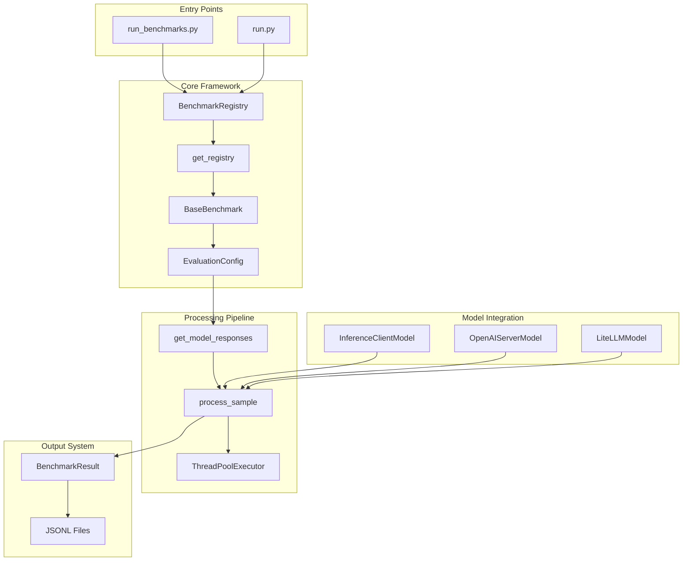
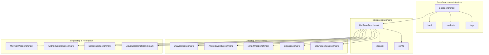
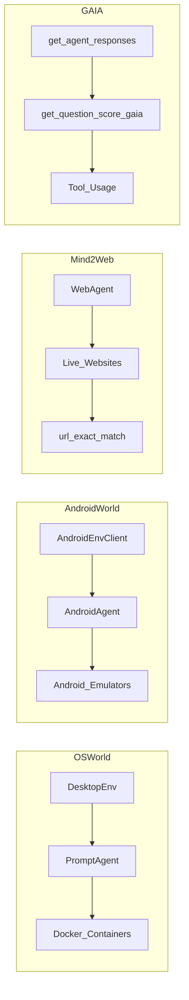
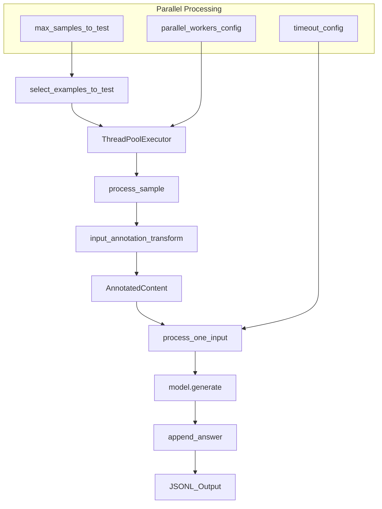
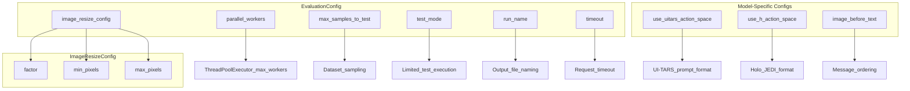
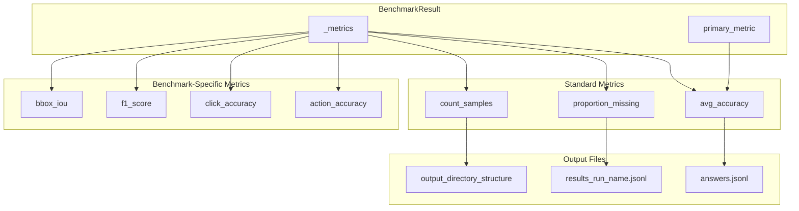

<!-- source: DeepWiki mcp.deepwiki.com · repo huggingface/screensuite · page 1 Overview · fetched 2026-10-26 -->

# Overview

Relevant source files

The following files were used as context for generating this wiki page:

- [README.md](README.md)
- [examples/run_benchmarks.py](examples/run_benchmarks.py)
- [pyproject.toml](pyproject.toml)
- [run.py](run.py)
- [src/screensuite/benchmarks/multistep/android_world/benchmark.py](src/screensuite/benchmarks/multistep/android_world/benchmark.py)
- [src/screensuite/benchmarks/multistep/browse_comp/benchmark.py](src/screensuite/benchmarks/multistep/browse_comp/benchmark.py)
- [src/screensuite/benchmarks/multistep/gaia/benchmark.py](src/screensuite/benchmarks/multistep/gaia/benchmark.py)
- [src/screensuite/benchmarks/multistep/mind2web/benchmark.py](src/screensuite/benchmarks/multistep/mind2web/benchmark.py)
- [src/screensuite/benchmarks/multistep/osworld/benchmark.py](src/screensuite/benchmarks/multistep/osworld/benchmark.py)
- [src/screensuite/response_generation.py](src/screensuite/response_generation.py)

## Purpose and Scope

ScreenSuite is a comprehensive benchmarking framework for evaluating Graphical User Interface (GUI) agents and multimodal large language models (MLLMs) across three distinct areas of capability: perception, single-step agentic behavior, and multi-step agentic behavior. The framework provides standardized evaluation protocols for comparing model performance on GUI interaction tasks rather than agent implementations themselves, utilizing simple agent implementations based on `smolagents`.

For installation instructions and basic usage, see [Getting Started](#2). For detailed information about specific benchmark categories, see [Benchmark Categories](#4). For model configuration and integration details, see [Model Integration](#6).

Sources: [README.md:1-7](), [pyproject.toml:1-11]()

## System Architecture

The ScreenSuite framework follows a modular architecture centered around a registry-based benchmark discovery system, parallel processing pipeline, and standardized evaluation interfaces.

### Core Architecture Components

The architecture separates concerns between benchmark discovery (`BenchmarkRegistry`), execution orchestration (`get_model_responses`), and result collection (`BenchmarkResult`). The system supports multiple entry points for both programmatic and interactive usage.

Sources: [examples/run_benchmarks.py:1-30](), [run.py:1-20](), [src/screensuite/response_generation.py:115-170]()

### Benchmark Type Hierarchy

The type hierarchy establishes common interfaces while allowing specialization for different benchmark requirements. `HubBaseBenchmark` provides Hugging Face dataset integration, while direct `BaseBenchmark` implementations handle custom data sources.

Sources: [src/screensuite/benchmarks/multistep/osworld/benchmark.py:25-30](), [src/screensuite/benchmarks/multistep/android_world/benchmark.py:251-257](), [src/screensuite/benchmarks/multistep/mind2web/benchmark.py:33-34]()

## Benchmark Categories

ScreenSuite organizes benchmarks into three primary categories based on interaction complexity and evaluation approach.

| Category | Description | Environment | Evaluation Method |
|----------|-------------|-------------|-------------------|
| **Multistep** | Complex online agent tasks requiring sequential interactions | Live environments (Docker, Android emulators, web) | Task completion scoring |
| **Singlestep** | Offline prediction tasks from screenshots | Static image datasets | Action accuracy metrics |
| **Perception** | Understanding and reasoning without actions | Static datasets | Text matching, QA scoring |

### Multistep Online Benchmarks

Multistep benchmarks require environment setup and sequential interaction capabilities. Each implements specialized evaluation methods: OSWorld uses Docker containers for desktop tasks, AndroidWorld manages Android emulators, Mind2Web validates URL navigation, and GAIA focuses on complex reasoning with tool usage.

Sources: [src/screensuite/benchmarks/multistep/osworld/benchmark.py:142-158](), [src/screensuite/benchmarks/multistep/android_world/benchmark.py:224-230](), [src/screensuite/benchmarks/multistep/mind2web/benchmark.py:35-48](), [src/screensuite/benchmarks/multistep/gaia/benchmark.py:47-54]()

## Processing Pipeline

The evaluation pipeline implements two-level parallelization: model-level concurrency for evaluating multiple models simultaneously, and sample-level concurrency within each model evaluation.

### Response Generation Pipeline

The pipeline transforms raw dataset samples through `input_annotation_transform` functions into `AnnotatedContent` objects containing `ChatMessage` sequences. These are processed through `model.generate()` calls with configurable parallelization and timeout handling.

Sources: [src/screensuite/response_generation.py:115-170](), [src/screensuite/response_generation.py:43-67](), [src/screensuite/response_generation.py:89-113]()

### Evaluation Configuration System

`EvaluationConfig` centralizes execution parameters while supporting model-specific customizations for specialized UI models like UI-TARS, Holo, and JEDI through action space and formatting flags.

Sources: [examples/run_benchmarks.py:105-109](), [examples/run_benchmarks.py:149-156](), [examples/run_benchmarks.py:160-171](), [examples/run_benchmarks.py:180-191]()

## Model Integration Layer

ScreenSuite integrates multiple model types through the `smolagents` framework, supporting both general-purpose and specialized UI models.

### Supported Model Categories

| Model Type | Implementation | Key Models | Configuration |
|------------|----------------|------------|---------------|
| **OpenAI** | `OpenAIServerModel` | `gpt-4o` | Standard API |
| **Anthropic** | `LiteLLMModel` | `claude-sonnet-4` | Via LiteLLM |
| **Qwen Vision** | `InferenceClientModel` | `Qwen2.5-VL-32B/72B` | Fireworks, Nebius |
| **Specialized UI** | `InferenceClientModel` | UI-TARS, JEDI, Holo | Custom endpoints |

The framework automatically handles model-specific prompt formatting, image processing, and response parsing through configuration flags and specialized evaluation configs.

Sources: [examples/run_benchmarks.py:111-119](), [examples/run_benchmarks.py:130-141](), [examples/run_benchmarks.py:144-147](), [examples/run_benchmarks.py:174-196]()

## Output and Results System

All benchmark results are standardized through the `BenchmarkResult` class and persisted in JSONL format for analysis and comparison.

### Result Structure

Results include both universal metrics (`avg_accuracy`, `proportion_missing`, `count_samples`) and benchmark-specific measures. The output system maintains detailed logs in `answers.jsonl` and summary metrics in `results_{run_name}.jsonl` for comprehensive analysis.

Sources: [examples/run_benchmarks.py:68-73](), [src/screensuite/response_generation.py:129-146](), [src/screensuite/benchmarks/multistep/osworld/benchmark.py:201-208]()

---

