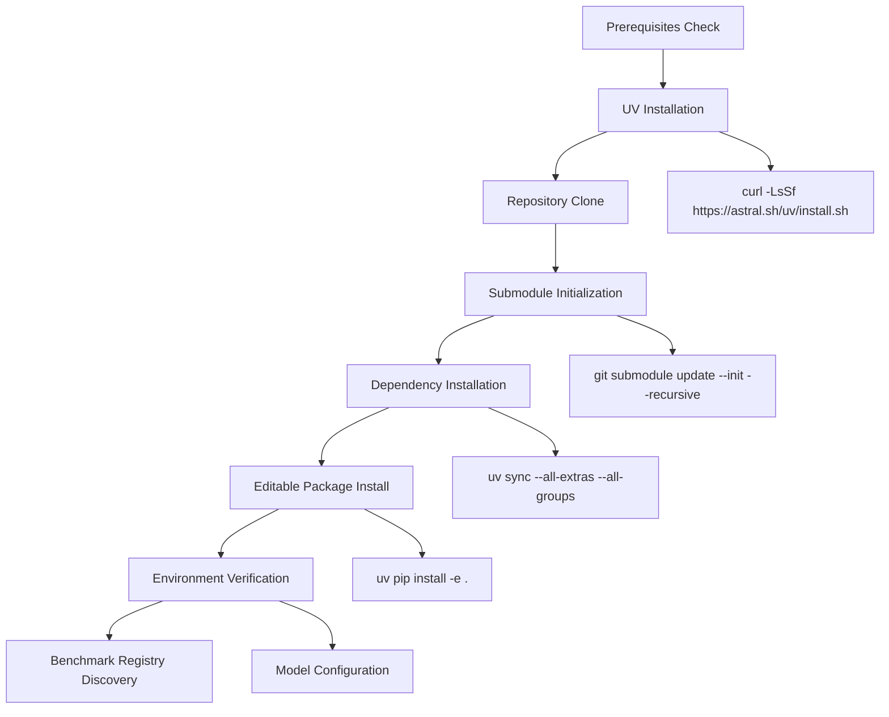
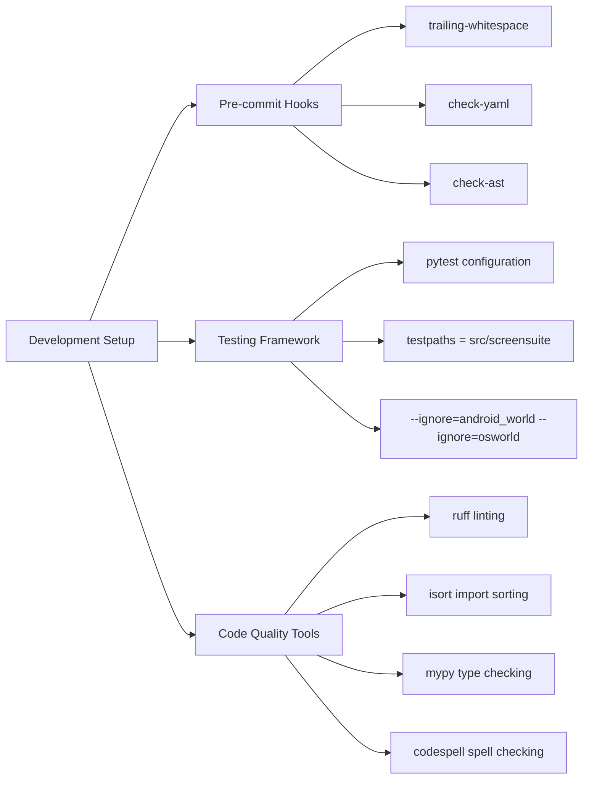
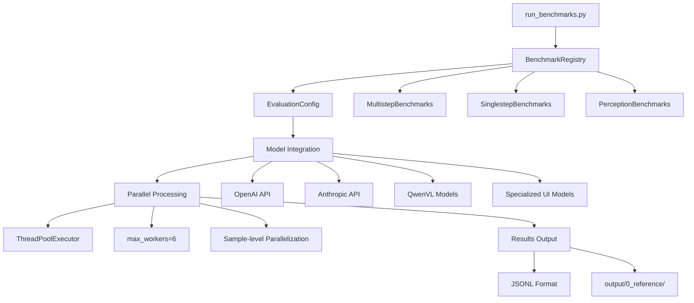

<!-- source: DeepWiki mcp.deepwiki.com · repo huggingface/screensuite · page 2 Getting Started · fetched 2026-10-26 -->

# Getting Started

<details>
<summary>Relevant source files</summary>

The following files were used as context for generating this wiki page:

- [.github/actions/setup-uv/action.yml](.github/actions/setup-uv/action.yml)
- [.gitmodules](.gitmodules)
- [.pre-commit-config.yaml](.pre-commit-config.yaml)
- [pytest.ini](pytest.ini)
- [requirements.txt](requirements.txt)

</details>


This document provides installation instructions, environment setup guidance, and basic usage examples for the screensuite benchmarking framework. It covers the essential steps needed to run your first benchmarks and evaluate GUI agents or multimodal large language models.

For detailed information about the framework architecture, see [Core Framework](#3). For comprehensive benchmark descriptions, see [Benchmark Categories](#4). For performance analysis and results interpretation, see [Results and Performance Analysis](#7).

## Prerequisites and System Requirements

The screensuite framework requires Python 3.8+ and uses the UV package manager for dependency management. The system supports both local and distributed execution of benchmarks with parallel processing capabilities.

### Installation Flow Overview



Sources: [.github/actions/setup-uv/action.yml:8-21](), [.gitmodules:1-9]()

## Installation Process

### Step 1: UV Package Manager Setup

Install the UV package manager using the official installation script:

```bash
curl -LsSf https://astral.sh/uv/install.sh | sh
echo "$HOME/.cargo/bin" >> $GITHUB_PATH
```

UV provides fast, reliable Python package management and is the recommended approach for screensuite development and deployment.

### Step 2: Repository and Submodules

Clone the repository and initialize the required submodules:

```bash
git clone https://github.com/huggingface/screensuite.git
cd screensuite
git submodule update --init --recursive
```

The framework includes two critical submodules: `osworld` for desktop environment benchmarks and `android_world` for mobile environment benchmarks.

### Step 3: Dependency Installation

Install all dependencies including optional extras and development groups:

```bash
uv sync --all-extras --all-groups
```

This command installs the complete dependency tree, including benchmark-specific requirements, evaluation utilities, and development tools.

### Step 4: Editable Package Installation

Install screensuite in editable mode for development:

```bash
uv pip install -e .
```

This allows modifications to the source code to be immediately available without reinstallation.

Sources: [.github/actions/setup-uv/action.yml:13-21](), [.gitmodules:1-9]()

## Environment Configuration

### Development Environment Setup

The framework includes comprehensive code quality tools and testing infrastructure:



Install pre-commit hooks for automated code quality checks:

```bash
pre-commit install
```

The configuration excludes external submodules and examples directories from linting to focus on core framework code.

### Testing Configuration

Run the test suite to verify installation:

```bash
pytest
```

The test configuration uses specific settings optimized for the framework structure, including verbose output and duration tracking.

Sources: [.pre-commit-config.yaml:1-41](), [pytest.ini:1-7]()

## Basic Usage

### Benchmark Execution Architecture

The central execution system orchestrates benchmark runs through a registry-based approach:



### Running Your First Benchmark

Execute a basic benchmark evaluation:

```bash
python run_benchmarks.py --benchmark screenqa --model qwen2.5-vl-7b --max-samples 10
```

This command runs the ScreenQA perception benchmark using the Qwen2.5-VL-7B model on 10 samples, demonstrating the basic evaluation pipeline.

### Output Structure

Benchmark results are stored in structured JSONL format in the `output/0_reference/` directory, with separate files for each model-benchmark combination. Each result includes evaluation metrics, model responses, and execution metadata.

Sources: Based on system architecture diagrams and framework structure

## Verification and Next Steps

### Environment Verification

Verify your installation by checking the benchmark registry:

```python
from screensuite import get_benchmark_registry
registry = get_benchmark_registry()
print(f"Available benchmarks: {len(registry)}")
```

This confirms that the framework can discover and load all available benchmarks.

### Development Workflow

For development contributions, the framework uses:
- **ruff** for fast Python linting and formatting
- **mypy** for static type checking with import handling
- **isort** with black profile for import organization
- **codespell** for spell checking (excluding data files)

### Next Steps

1. **Explore Benchmarks**: Review [Benchmark Categories](#4) to understand available evaluation tasks
2. **Model Integration**: See [Model Integration](#6) for adding new models or APIs
3. **Custom Benchmarks**: Refer to [Core Framework](#3) for implementing custom evaluation tasks
4. **Performance Analysis**: Use [Results and Performance Analysis](#7) for interpreting results

The framework is designed for extensibility, allowing researchers to add new benchmarks, models, and evaluation metrics while maintaining consistent interfaces and parallel execution capabilities.

Sources: [.pre-commit-config.yaml:16-40](), [pytest.ini:1-7](), [requirements.txt:1-6]()

---

