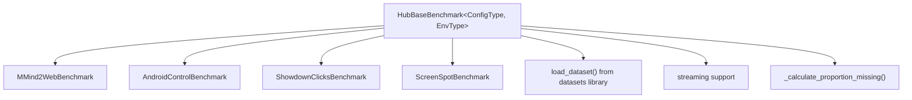
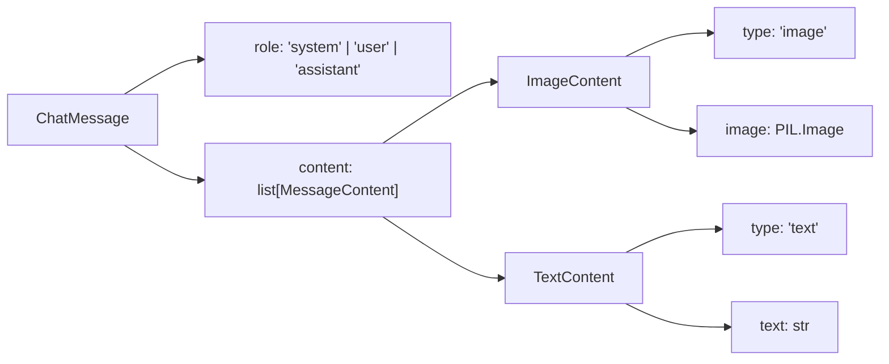
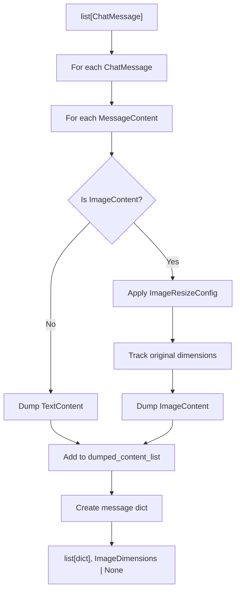
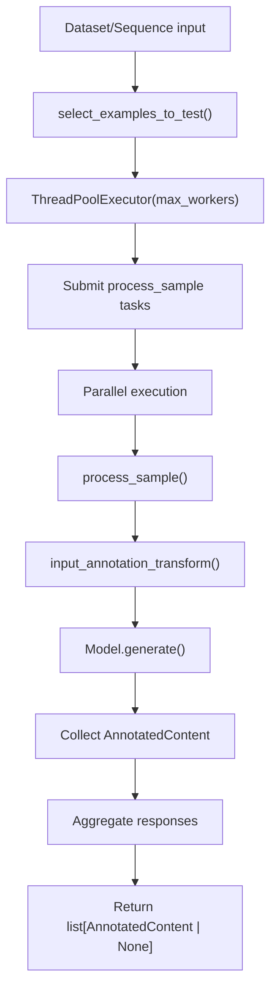
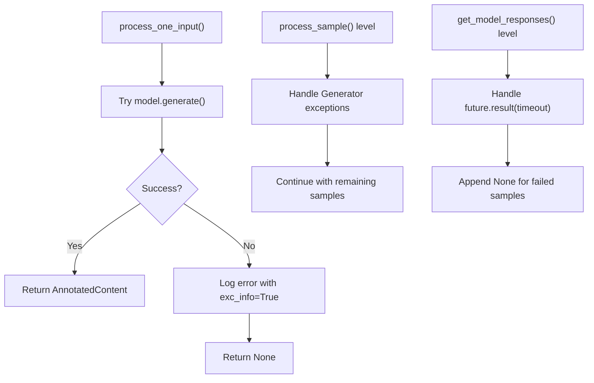
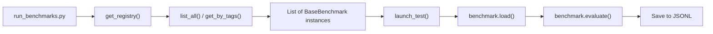
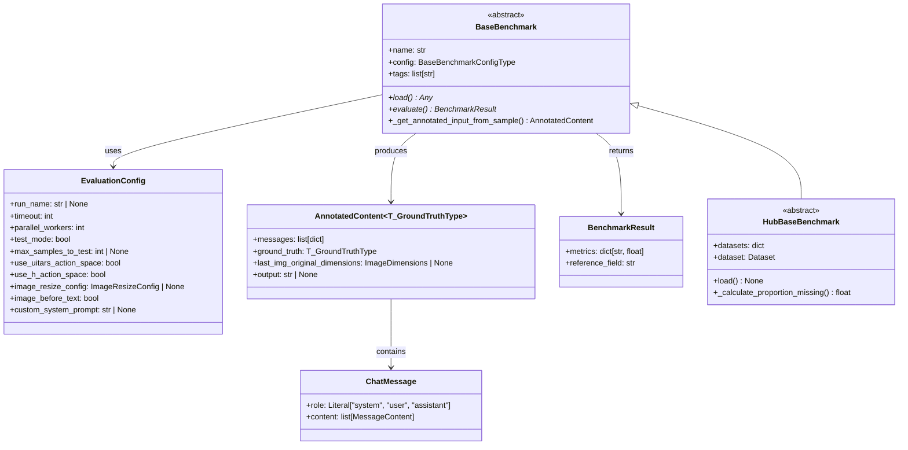

<!-- source: DeepWiki mcp.deepwiki.com · repo huggingface/screensuite · page 3 Core Framework · fetched 2026-10-26 -->

# Core Framework

<details>
<summary>Relevant source files</summary>

The following files were used as context for generating this wiki page:

- [examples/run_benchmarks.py](examples/run_benchmarks.py)
- [pyproject.toml](pyproject.toml)
- [src/screensuite/basebenchmark.py](src/screensuite/basebenchmark.py)
- [src/screensuite/benchmarks/perception/screenspot/benchmark.py](src/screensuite/benchmarks/perception/screenspot/benchmark.py)
- [src/screensuite/benchmarks/singlestep/androidcontrol/benchmark.py](src/screensuite/benchmarks/singlestep/androidcontrol/benchmark.py)
- [src/screensuite/benchmarks/singlestep/mmind2web/benchmark.py](src/screensuite/benchmarks/singlestep/mmind2web/benchmark.py)
- [src/screensuite/benchmarks/singlestep/showdown_clicks/benchmark.py](src/screensuite/benchmarks/singlestep/showdown_clicks/benchmark.py)
- [src/screensuite/chat_message.py](src/screensuite/chat_message.py)
- [src/screensuite/response_generation.py](src/screensuite/response_generation.py)

</details>


The Core Framework provides the foundational architecture and components that power the screensuite benchmarking system. This document covers the base classes, configuration systems, message handling, and execution pipeline that enable consistent evaluation of GUI agents and multimodal large language models across diverse benchmarks.

For information about specific benchmark implementations, see [Benchmark Categories](#4). For details about evaluation metrics and scoring, see [Evaluation System](#5).

## Architecture Overview

The Core Framework is built around several key components that work together to provide a unified benchmarking interface:

### Core Components Diagram


Sources: [src/screensuite/basebenchmark.py:66-90](), [src/screensuite/benchmarks/hubbasebenchmark.py](), [src/screensuite/chat_message.py:45-50](), [src/screensuite/benchmark_result.py]()

## Base Benchmark Architecture

The `BaseBenchmark` class serves as the abstract foundation for all benchmark implementations in screensuite. It defines the essential interface that every benchmark must implement:

### BaseBenchmark Interface

| Method | Purpose | Return Type |
|--------|---------|-------------|
| `load()` | Load benchmark data and resources | `Any` |
| `evaluate()` | Execute model evaluation | `BenchmarkResult` |
| `_get_annotated_input_from_sample()` | Transform sample to model input | `AnnotatedContent` |

The class uses generic type parameters to ensure type safety:
- `BaseBenchmarkConfigType`: Configuration specific to each benchmark
- `BaseBenchmarkEnvironmentConfigType`: Environment-specific configuration

Sources: [src/screensuite/basebenchmark.py:66-90]()

### HubBaseBenchmark Extension

Most benchmarks inherit from `HubBaseBenchmark`, which provides common functionality for Hugging Face dataset integration:



Sources: [src/screensuite/benchmarks/hubbasebenchmark.py](), [src/screensuite/benchmarks/singlestep/mmind2web/benchmark.py:40](), [src/screensuite/benchmarks/singlestep/androidcontrol/benchmark.py:117]()

## Message System

The framework uses a structured message system to standardize communication with models across different benchmark types.

### ChatMessage Structure



The message system supports:
- **Multi-modal content**: Images and text within the same message
- **Image resizing**: Automatic resizing based on model requirements
- **Standardized format**: Consistent structure across all benchmarks

Sources: [src/screensuite/chat_message.py:45-50](), [src/screensuite/chat_message.py:10-23](), [src/screensuite/chat_message.py:35-40]()

### Message Processing Pipeline

The `dump_chat_message_list()` function transforms `ChatMessage` objects into the format expected by model APIs:



Sources: [src/screensuite/chat_message.py:52-71]()

## Configuration System

The `EvaluationConfig` class centralizes all evaluation parameters and provides validation logic:

### Configuration Parameters

| Parameter | Type | Purpose | Default |
|-----------|------|---------|---------|
| `run_name` | `str \| None` | Identifies evaluation run for output | `None` |
| `timeout` | `int` | Maximum time per evaluation (seconds) | `300` |
| `parallel_workers` | `int` | Number of concurrent workers | `1` |
| `test_mode` | `bool` | Limits samples for testing | `False` |
| `max_samples_to_test` | `int \| None` | Maximum samples to process | `None` |
| `use_uitars_action_space` | `bool` | Use UI-TARS action format | `False` |
| `use_h_action_space` | `bool` | Use H-model action format | `False` |
| `image_resize_config` | `ImageResizeConfig \| None` | Image preprocessing settings | `None` |
| `image_before_text` | `bool` | Image placement in messages | `True` |
| `custom_system_prompt` | `str \| None` | Override system prompt | `None` |

### Configuration Validation

The config includes validation logic to ensure consistent behavior:

```python
@model_validator(mode="after")
def validate_max_samples_to_test(self) -> Self:
    if self.max_samples_to_test is not None and self.max_samples_to_test < 1:
        self.max_samples_to_test = None
    if self.max_samples_to_test is not None and self.max_samples_to_test < self.parallel_workers:
        self.parallel_workers = self.max_samples_to_test
    return self
```

Sources: [src/screensuite/basebenchmark.py:33-61]()

## Response Generation Pipeline

The response generation system manages parallel execution and model communication through the `get_model_responses()` function:

### Execution Flow



### Key Functions

The pipeline uses several key functions:

| Function | Purpose | Input | Output |
|----------|---------|-------|--------|
| `get_model_responses()` | Main orchestrator | Dataset, Model, transform function | `list[AnnotatedContent \| None]` |
| `process_sample()` | Process single sample | Sample, Model, transform | `list[AnnotatedContent \| None]` |
| `process_one_input()` | Generate model response | AnnotatedContent, Model | `AnnotatedContent \| None` |
| `select_examples_to_test()` | Filter dataset | Dataset, EvaluationConfig | Filtered dataset |

Sources: [src/screensuite/response_generation.py:115-169](), [src/screensuite/response_generation.py:69-86](), [src/screensuite/response_generation.py:43-66]()

## Error Handling and Resilience

The framework includes comprehensive error handling to ensure robust execution:

### Error Management Strategy



The error handling ensures:
- **Graceful degradation**: Failed samples return `None` rather than crashing
- **Detailed logging**: Errors logged with full stack traces
- **Timeout protection**: Prevents hanging on slow model responses
- **Partial results**: Successful samples processed even if others fail

Sources: [src/screensuite/response_generation.py:43-66](), [src/screensuite/response_generation.py:161-168]()

## Integration with Benchmark Execution

The Core Framework integrates with the main execution script through a standardized interface:

### Benchmark Registry Integration



The main execution flow in [examples/run_benchmarks.py:54-77]() demonstrates how the Core Framework components work together:

1. **Registry Discovery**: Find benchmarks by tags
2. **Configuration Setup**: Create `EvaluationConfig` instances
3. **Parallel Execution**: Use `ThreadPoolExecutor` for model-level parallelism
4. **Result Collection**: Aggregate metrics and save to JSONL format

Sources: [examples/run_benchmarks.py:23-77](), [examples/run_benchmarks.py:92-99]()

# Core Framework

The Core Framework provides the foundational architecture and components that power the screensuite benchmarking system. This document covers the base classes, configuration systems, message handling, and execution pipeline that enable consistent evaluation of GUI agents and multimodal large language models across diverse benchmarks.

For information about specific benchmark implementations, see [Benchmark Categories](#4). For details about evaluation metrics and scoring, see [Evaluation System](#5).

## Architecture Overview

The Core Framework is built around several key components that work together to provide a unified benchmarking interface:

### Core Components Diagram



Sources: [src/screensuite/basebenchmark.py:66-90](), [src/screensuite/benchmarks/hubbasebenchmark.py](), [src/screensuite/chat_message.py:45-50](), [src/screensuite/benchmark_result.py]()

## Base Benchmark Architecture

The `BaseBenchmark` class serves as the abstract foundation for all benchmark implementations in screensuite. It defines the essential interface that every benchmark must implement:

### BaseBenchmark Interface

| Method | Purpose | Return Type |
|--------|---------|-------------|
| `load()` | Load benchmark data and resources | `Any` |
| `evaluate()` | Execute model evaluation | `BenchmarkResult` |
| `_get_annotated_input_from_sample()` | Transform sample to model input | `AnnotatedContent` |

The class uses generic type parameters to ensure type safety:
- `BaseBenchmarkConfigType`: Configuration specific to each benchmark
- `BaseBenchmarkEnvironmentConfigType`: Environment-specific configuration

Sources: [src/screensuite/basebenchmark.py:66-90]()

### HubBaseBenchmark Extension

Most benchmarks inherit from `HubBaseBenchmark`, which provides common functionality for Hugging Face dataset integration:


Sources: [src/screensuite/benchmarks/hubbasebenchmark.py](), [src/screensuite/benchmarks/singlestep/mmind2web/benchmark.py:40](), [src/screensuite/benchmarks/singlestep/androidcontrol/benchmark.py:117]()

## Message System

The framework uses a structured message system to standardize communication with models across different benchmark types.

### ChatMessage Structure


The message system supports:
- **Multi-modal content**: Images and text within the same message
- **Image resizing**: Automatic resizing based on model requirements
- **Standardized format**: Consistent structure across all benchmarks

Sources: [src/screensuite/chat_message.py:45-50](), [src/screensuite/chat_message.py:10-23](), [src/screensuite/chat_message.py:35-40]()

### Message Processing Pipeline

The `dump_chat_message_list()` function transforms `ChatMessage` objects into the format expected by model APIs:


Sources: [src/screensuite/chat_message.py:52-71]()

## Configuration System

The `EvaluationConfig` class centralizes all evaluation parameters and provides validation logic:

### Configuration Parameters

| Parameter | Type | Purpose | Default |
|-----------|------|---------|---------|
| `run_name` | `str \| None` | Identifies evaluation run for output | `None` |
| `timeout` | `int` | Maximum time per evaluation (seconds) | `300` |
| `parallel_workers` | `int` | Number of concurrent workers | `1` |
| `test_mode` | `bool` | Limits samples for testing | `False` |
| `max_samples_to_test` | `int \| None` | Maximum samples to process | `None` |
| `use_uitars_action_space` | `bool` | Use UI-TARS action format | `False` |
| `use_h_action_space` | `bool` | Use H-model action format | `False` |
| `image_resize_config` | `ImageResizeConfig \| None` | Image preprocessing settings | `None` |
| `image_before_text` | `bool` | Image placement in messages | `True` |
| `custom_system_prompt` | `str \| None` | Override system prompt | `None` |

### Configuration Validation

The config includes validation logic to ensure consistent behavior:

```python
@model_validator(mode="after")
def validate_max_samples_to_test(self) -> Self:
    if self.max_samples_to_test is not None and self.max_samples_to_test < 1:
        self.max_samples_to_test = None
    if self.max_samples_to_test is not None and self.max_samples_to_test < self.parallel_workers:
        self.parallel_workers = self.max_samples_to_test
    return self
```

Sources: [src/screensuite/basebenchmark.py:33-61]()

## Response Generation Pipeline

The response generation system manages parallel execution and model communication through the `get_model_responses()` function:

### Execution Flow


### Key Functions

The pipeline uses several key functions:

| Function | Purpose | Input | Output |
|----------|---------|-------|--------|
| `get_model_responses()` | Main orchestrator | Dataset, Model, transform function | `list[AnnotatedContent \| None]` |
| `process_sample()` | Process single sample | Sample, Model, transform | `list[AnnotatedContent \| None]` |
| `process_one_input()` | Generate model response | AnnotatedContent, Model | `AnnotatedContent \| None` |
| `select_examples_to_test()` | Filter dataset | Dataset, EvaluationConfig | Filtered dataset |

Sources: [src/screensuite/response_generation.py:115-169](), [src/screensuite/response_generation.py:69-86](), [src/screensuite/response_generation.py:43-66]()

## Error Handling and Resilience

The framework includes comprehensive error handling to ensure robust execution:

### Error Management Strategy


The error handling ensures:
- **Graceful degradation**: Failed samples return `None` rather than crashing
- **Detailed logging**: Errors logged with full stack traces
- **Timeout protection**: Prevents hanging on slow model responses
- **Partial results**: Successful samples processed even if others fail

Sources: [src/screensuite/response_generation.py:43-66](), [src/screensuite/response_generation.py:161-168]()

## Integration with Benchmark Execution

The Core Framework integrates with the main execution script through a standardized interface:

### Benchmark Registry Integration


The main execution flow in [examples/run_benchmarks.py:54-77]() demonstrates how the Core Framework components work together:

1. **Registry Discovery**: Find benchmarks by tags
2. **Configuration Setup**: Create `EvaluationConfig` instances
3. **Parallel Execution**: Use `ThreadPoolExecutor` for model-level parallelism
4. **Result Collection**: Aggregate metrics and save to JSONL format

Sources: [examples/run_benchmarks.py:23-77](), [examples/run_benchmarks.py:92-99]()

---

