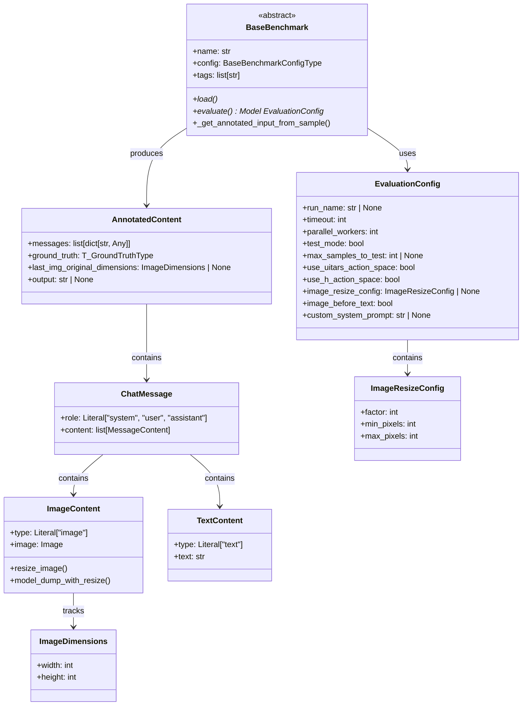
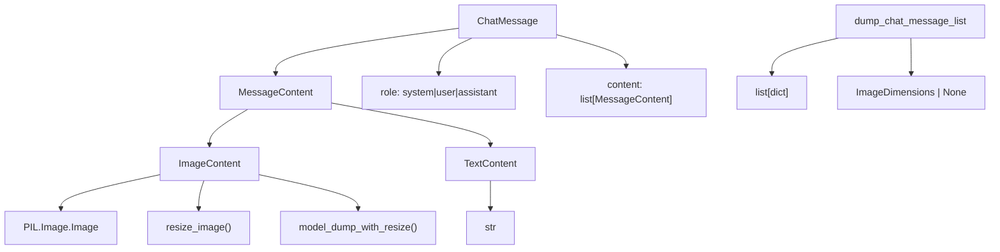
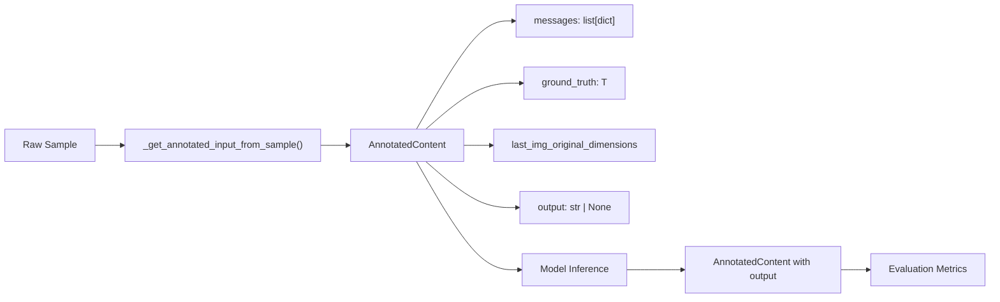
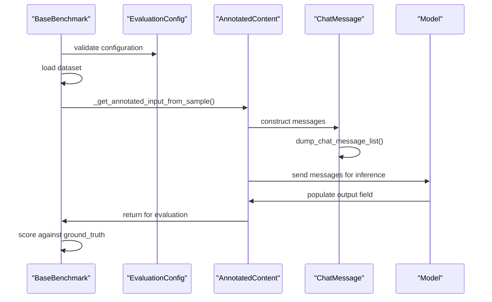

<!-- source: DeepWiki mcp.deepwiki.com · repo huggingface/screensuite · page 3.1 Base Components · fetched 2026-10-26 -->

# Base Components

<details>
<summary>Relevant source files</summary>

The following files were used as context for generating this wiki page:

- [src/screensuite/basebenchmark.py](src/screensuite/basebenchmark.py)
- [src/screensuite/benchmarks/perception/screenspot/benchmark.py](src/screensuite/benchmarks/perception/screenspot/benchmark.py)
- [src/screensuite/benchmarks/singlestep/androidcontrol/benchmark.py](src/screensuite/benchmarks/singlestep/androidcontrol/benchmark.py)
- [src/screensuite/benchmarks/singlestep/mmind2web/benchmark.py](src/screensuite/benchmarks/singlestep/mmind2web/benchmark.py)
- [src/screensuite/benchmarks/singlestep/showdown_clicks/benchmark.py](src/screensuite/benchmarks/singlestep/showdown_clicks/benchmark.py)
- [src/screensuite/chat_message.py](src/screensuite/chat_message.py)

</details>


The base components provide the foundational architecture for the screensuite benchmarking framework. These abstract classes, configuration objects, and data structures establish the common interface and data flow patterns that all benchmarks must implement. This document covers the core building blocks including `BaseBenchmark`, `EvaluationConfig`, `ChatMessage`, and `AnnotatedContent`.

For information about the benchmark execution pipeline that orchestrates these components, see [Benchmark Execution Pipeline](#3.2). For details about the response generation system that processes these data structures, see [Response Generation System](#3.3).

## Core Component Architecture

The base components form a layered architecture where abstract classes define contracts, configuration classes control behavior, and data containers manage information flow between components.



Sources: [src/screensuite/basebenchmark.py:66-90](), [src/screensuite/chat_message.py:45-50](), [src/screensuite/basebenchmark.py:26-31]()

## BaseBenchmark Abstract Class

The `BaseBenchmark` class serves as the foundational abstract base class that all benchmarks must inherit from. It defines the essential contract for benchmark implementations through abstract methods and provides common functionality for configuration and tagging.

| Method | Purpose | Implementation |
|--------|---------|----------------|
| `__init__` | Initialize benchmark with name, config, and tags | Concrete |
| `load()` | Load benchmark dataset | Abstract |
| `evaluate()` | Execute evaluation with model and config | Abstract |
| `_get_annotated_input_from_sample()` | Transform samples to `AnnotatedContent` | Optional override |

The class uses generic type parameters to ensure type safety across different benchmark configurations:

```python
class BaseBenchmark(Generic[BaseBenchmarkConfigType, BaseBenchmarkEnvironmentConfigType], ABC)
```

Concrete implementations like `MMind2WebBenchmark`, `AndroidControlBenchmark`, and `ScreenSpotBenchmark` all inherit from `BaseBenchmark` and provide specific implementations for their evaluation domains.

Sources: [src/screensuite/basebenchmark.py:66-90](), [src/screensuite/benchmarks/singlestep/mmind2web/benchmark.py:40](), [src/screensuite/benchmarks/singlestep/androidcontrol/benchmark.py:117]()

## EvaluationConfig Configuration Class

The `EvaluationConfig` class centralizes all configuration parameters that control benchmark execution behavior. It provides validation logic and cross-parameter consistency checks.

### Core Configuration Parameters

| Parameter | Type | Default | Purpose |
|-----------|------|---------|---------|
| `run_name` | `str \| None` | `None` | Identifies the evaluation run for output |
| `timeout` | `int` | `300` | Maximum seconds per sample evaluation |
| `parallel_workers` | `int` | `1` | Number of concurrent evaluation threads |
| `test_mode` | `bool` | `False` | Enables abbreviated testing |
| `max_samples_to_test` | `int \| None` | `None` | Limits sample count for testing |

### Model Behavior Controls

| Parameter | Type | Default | Purpose |
|-----------|------|---------|---------|
| `use_uitars_action_space` | `bool` | `False` | Enables UI-TARS specific action format |
| `use_h_action_space` | `bool` | `False` | Enables H-action space format |
| `image_before_text` | `bool` | `True` | Controls message content ordering |
| `custom_system_prompt` | `str \| None` | `None` | Overrides default system prompts |

The configuration includes validation logic that automatically adjusts `parallel_workers` when `max_samples_to_test` is smaller, and enforces mutual exclusivity between action space options.

Sources: [src/screensuite/basebenchmark.py:33-60]()

## ChatMessage System

The message system provides a structured format for model communication that handles both text and image content consistently across all benchmarks.



### Message Construction Pattern

Benchmarks construct messages using a consistent pattern seen across implementations:

1. Create `ChatMessage` with appropriate role (`"user"` for input, `"system"` for prompts)
2. Add `TextContent` for instructions and prompts
3. Add `ImageContent` for screenshots
4. Apply optional system prompts based on `EvaluationConfig.custom_system_prompt`
5. Serialize using `dump_chat_message_list()` with image resizing

### Image Handling

The `ImageContent` class provides sophisticated image processing capabilities:

- **Automatic resizing**: Uses `ImageResizeConfig` parameters to resize images for model compatibility
- **Dimension tracking**: Maintains original dimensions for coordinate transformation
- **Flexible serialization**: `model_dump_with_resize()` returns both serialized content and original dimensions

Sources: [src/screensuite/chat_message.py:45-50](), [src/screensuite/chat_message.py:10-33](), [src/screensuite/chat_message.py:52-71]()

## AnnotatedContent Data Container

The `AnnotatedContent` class serves as the primary data container that flows through the evaluation pipeline, linking input messages with ground truth data and model outputs.



### Generic Type Support

The class uses generic typing to support different ground truth formats across benchmark types:

- **Click benchmarks**: `AnnotatedContent[NormalizedBoundingBox]`
- **Action benchmarks**: `AnnotatedContent[list[Operation]]`
- **Multi-action benchmarks**: `AnnotatedContent[tuple[list[Operation], NormalizedBoundingBox]]`

### Usage in Evaluation Pipeline

The typical flow involves:

1. **Generation**: `_get_annotated_input_from_sample()` creates `AnnotatedContent` with `messages` and `ground_truth`
2. **Processing**: Response generation system populates the `output` field
3. **Evaluation**: Benchmark-specific scoring compares `output` against `ground_truth`

Sources: [src/screensuite/basebenchmark.py:26-31](), [src/screensuite/benchmarks/singlestep/mmind2web/benchmark.py:120-124](), [src/screensuite/benchmarks/singlestep/androidcontrol/benchmark.py:201-205]()

## Integration Pattern

The base components work together in a standardized pattern that ensures consistency across all benchmark implementations.



This integration pattern is implemented consistently across benchmark types:

- **Singlestep benchmarks**: Direct sample-to-AnnotatedContent transformation
- **Multistep benchmarks**: Iterative generation of AnnotatedContent for each step
- **Perception benchmarks**: Simplified single-message AnnotatedContent creation

The base components provide the flexibility to handle different evaluation paradigms while maintaining a unified interface for the broader framework.

Sources: [src/screensuite/benchmarks/singlestep/mmind2web/benchmark.py:304-379](), [src/screensuite/benchmarks/singlestep/androidcontrol/benchmark.py:254-293](), [src/screensuite/benchmarks/perception/screenspot/benchmark.py:115-171]()

---

