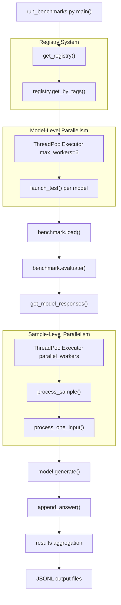
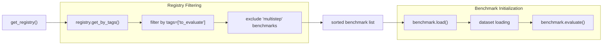
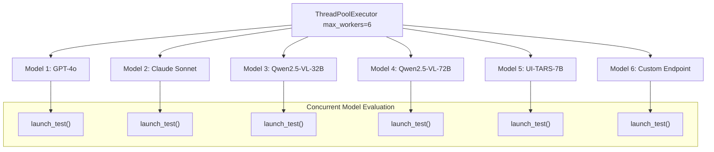
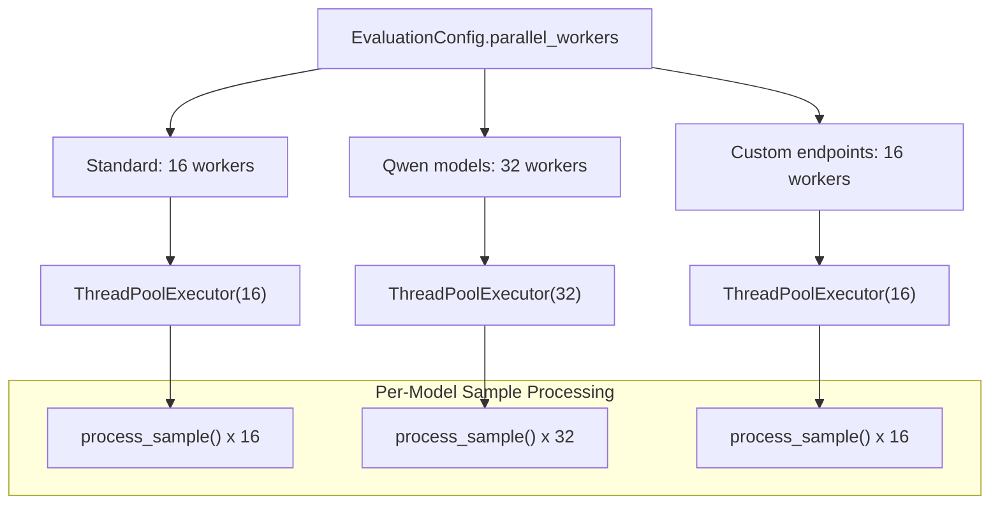
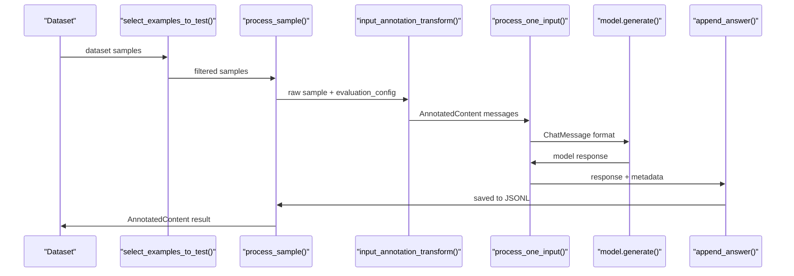
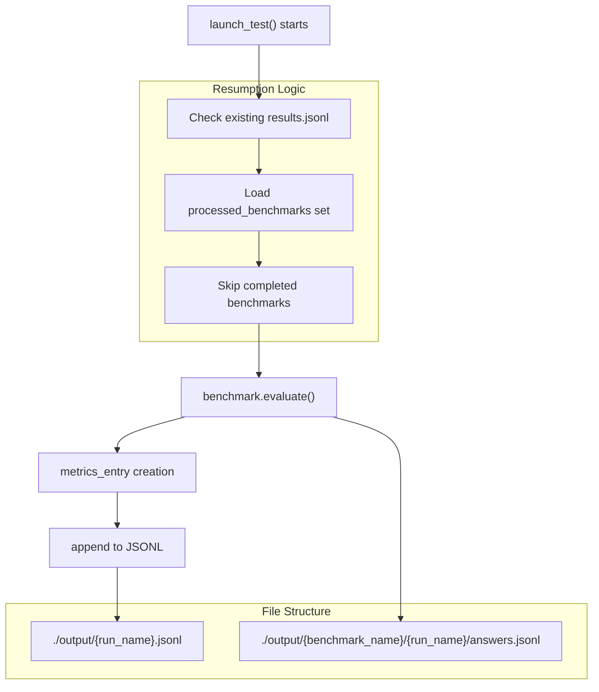
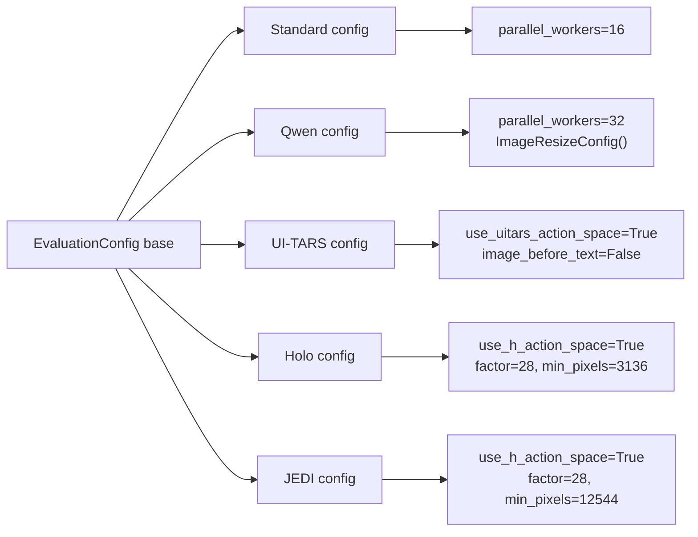

<!-- source: DeepWiki mcp.deepwiki.com · repo huggingface/screensuite · page 3.2 Benchmark Execution Pipeline · fetched 2026-10-26 -->

# Benchmark Execution Pipeline

<details>
<summary>Relevant source files</summary>

The following files were used as context for generating this wiki page:

- [examples/run_benchmarks.py](examples/run_benchmarks.py)
- [pyproject.toml](pyproject.toml)
- [src/screensuite/response_generation.py](src/screensuite/response_generation.py)

</details>


## Purpose and Scope

The Benchmark Execution Pipeline is the core orchestration system that manages the end-to-end execution of benchmarks across multiple models in the screensuite framework. This pipeline handles benchmark discovery, parallel execution coordination, sample processing, and result aggregation. 

For information about the individual benchmark categories and their specific evaluation logic, see [Benchmark Categories](#4). For details about the response generation mechanics and model integration, see [Response Generation System](#3.3) and [Model Integration](#6).

## Pipeline Architecture Overview

The benchmark execution pipeline operates through a two-level orchestration system managed primarily by the `run_benchmarks.py` script, with core processing handled by the response generation system.

### High-Level Execution Flow



Sources: [examples/run_benchmarks.py:208-214](), [src/screensuite/response_generation.py:115-170]()

## Benchmark Discovery and Loading

The pipeline begins with benchmark discovery through the registry system, which provides centralized access to all available benchmarks with tag-based filtering capabilities.

### Registry Integration Process



The main execution script filters benchmarks using configurable tags and excludes multistep benchmarks by default, as shown in [examples/run_benchmarks.py:95-103](). The registry system allows for flexible benchmark selection based on evaluation requirements.

Sources: [examples/run_benchmarks.py:92-104]()

## Parallel Execution Architecture

The pipeline implements a two-tier parallelization strategy to maximize throughput while managing resource constraints across different model types and inference endpoints.

### Model-Level Parallelization



The top-level parallelization runs up to 6 models concurrently using `ThreadPoolExecutor`, as defined in [examples/run_benchmarks.py:208-214](). Each model evaluation runs independently with its own configuration and result tracking.

### Sample-Level Parallelization



Sample-level parallelization is configured per model type, with higher-capacity endpoints like Qwen models using 32 workers while others use 16, as shown in [examples/run_benchmarks.py:106-127]().

Sources: [examples/run_benchmarks.py:208-214](), [examples/run_benchmarks.py:123-127](), [src/screensuite/response_generation.py:147-160]()

## Sample Processing Pipeline

The core sample processing pipeline transforms individual benchmark samples into model inputs, executes inference, and collects responses through a standardized interface.

### Processing Flow



The processing pipeline begins with sample selection through `select_examples_to_test()`, which handles test mode limiting and max sample constraints [src/screensuite/response_generation.py:89-112](). Each sample undergoes transformation via the benchmark-specific `input_annotation_transform` function before model inference.

### Sample Selection and Filtering

| Configuration | Behavior | Code Reference |
|---------------|----------|----------------|
| `test_mode=True` | Limit to `parallel_workers` samples | [response_generation.py:97-101]() |
| `max_samples_to_test` | Random sample selection with seed=42 | [response_generation.py:103-112]() |
| Default | Process entire dataset | [response_generation.py:112]() |

Sources: [src/screensuite/response_generation.py:69-86](), [src/screensuite/response_generation.py:89-112](), [src/screensuite/response_generation.py:43-67]()

## Result Storage and Resumption

The pipeline implements robust result persistence and resumption capabilities to handle long-running evaluations and infrastructure interruptions.

### Result File Management



The system maintains two types of result files: benchmark-level metrics in the main results file and detailed sample-level responses in benchmark-specific answer files. The resumption logic reads existing results to skip already-processed benchmarks, as implemented in [examples/run_benchmarks.py:37-52]().

### Threading Safety and File I/O

The pipeline uses thread-safe file operations through the `APPEND_ANSWER_LOCK` mechanism to prevent race conditions during concurrent writes:

```python
# Thread-safe result appending
APPEND_ANSWER_LOCK = threading.Lock()
```

Sources: [examples/run_benchmarks.py:37-76](), [src/screensuite/response_generation.py:29-41](), [src/screensuite/response_generation.py:129-146]()

## Configuration and Customization

The execution pipeline supports extensive customization through the `EvaluationConfig` system and model-specific configurations.

### Configuration Hierarchy

| Configuration Type | Purpose | Example Values |
|-------------------|---------|----------------|
| `EvaluationConfig` | General execution parameters | `parallel_workers=16`, `max_samples_to_test=300` |
| Model-specific | Custom inference settings | `max_tokens=4096`, provider endpoints |
| Benchmark-specific | Action spaces and image handling | `use_uitars_action_space=True`, `image_before_text=False` |

### Specialized Model Configurations



The configuration system allows for model-specific optimizations, including different worker counts, image preprocessing parameters, and action space definitions, as demonstrated in [examples/run_benchmarks.py:123-191]().

Sources: [examples/run_benchmarks.py:105-206]()

---

