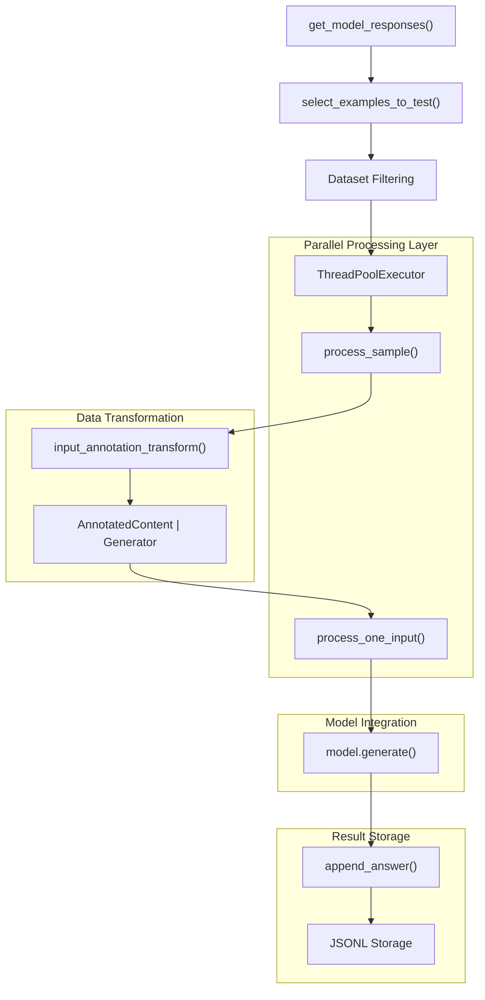
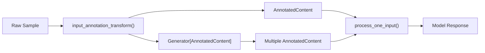
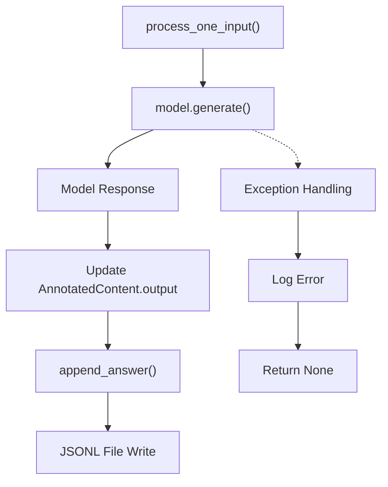
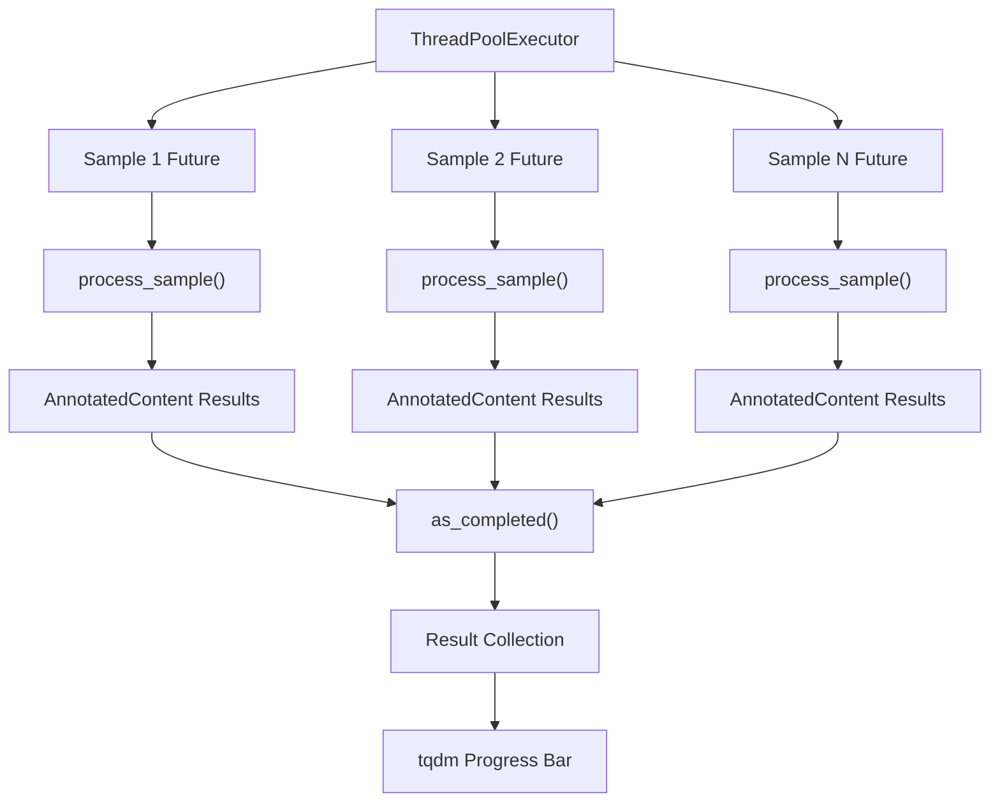
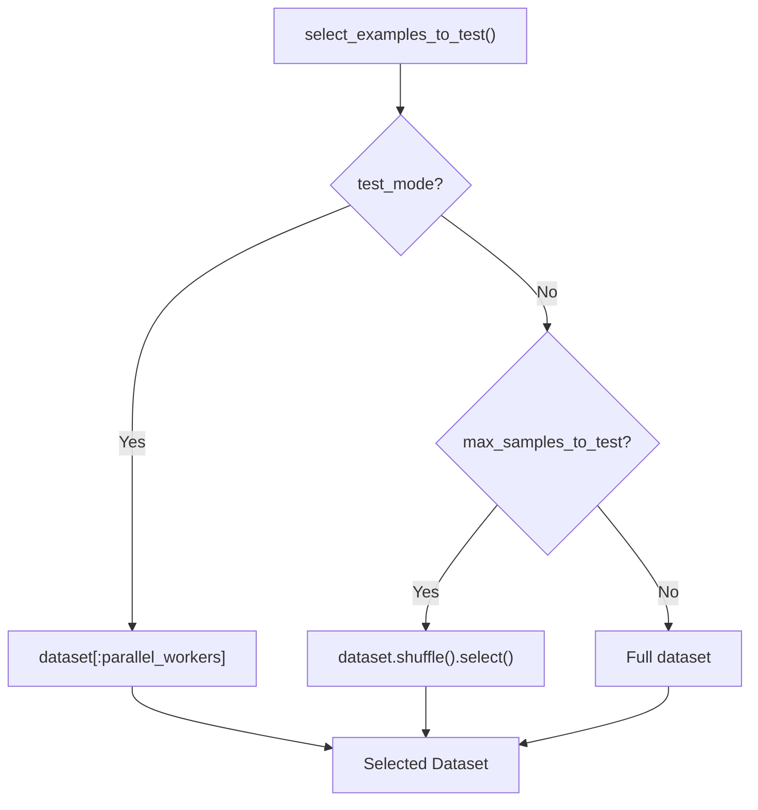
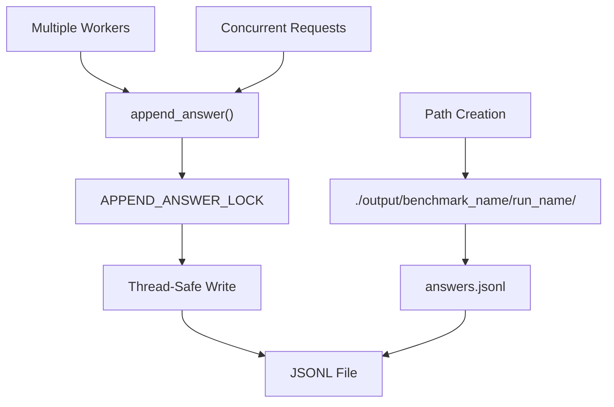
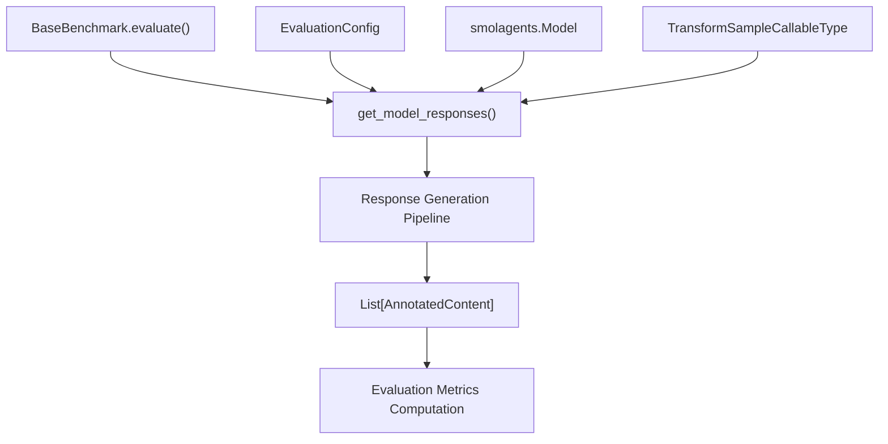

<!-- source: DeepWiki mcp.deepwiki.com · repo huggingface/screensuite · page 3.3 Response Generation System · fetched 2026-10-26 -->

# Response Generation System

<details>
<summary>Relevant source files</summary>

The following files were used as context for generating this wiki page:

- [examples/run_benchmarks.py](examples/run_benchmarks.py)
- [pyproject.toml](pyproject.toml)
- [src/screensuite/response_generation.py](src/screensuite/response_generation.py)

</details>


The Response Generation System is the core pipeline responsible for transforming benchmark samples into model inputs, invoking language models to generate responses, and collecting the results for evaluation. This system handles the parallel processing of samples, manages model communication through the smolagents framework, and provides standardized result storage.

For information about benchmark execution orchestration, see [Benchmark Execution Pipeline](#3.2). For details about evaluation metrics computation, see [Evaluation System](#5).

## Architecture Overview

The Response Generation System operates as a multi-stage pipeline that transforms raw benchmark samples into evaluable model responses through parallel processing.

**Response Generation Pipeline Architecture**



Sources: [src/screensuite/response_generation.py:115-170]()

## Core Components

### AnnotatedContent Processing

The system centers around the `AnnotatedContent` data structure which packages model inputs with their expected outputs. The transformation process converts raw benchmark samples into this standardized format.

| Component | Type | Purpose |
|-----------|------|---------|
| `AnnotatedContent` | Data Class | Contains messages, ground truth, and model output |
| `TransformSampleCallableType` | Type Alias | Function signature for sample transformation |
| `input_annotation_transform` | Callable | Benchmark-specific transformation logic |

**Sample Transformation Flow**



Sources: [src/screensuite/response_generation.py:25-27](), [src/screensuite/response_generation.py:69-86]()

### Model Invocation Pipeline

The `process_one_input()` function handles individual model invocations through the smolagents framework, managing error handling and response collection.

```python
# Core model invocation process
annotated_input: AnnotatedContent
model_output = model.generate(annotated_input.messages, **generation_kwargs).content
annotated_input.output = model_output
```

**Model Processing Architecture**



Sources: [src/screensuite/response_generation.py:43-67]()

## Parallel Processing System

The system implements two-level parallelization: sample-level parallel processing within benchmarks and model-level parallelization across different model configurations.

### ThreadPoolExecutor Configuration

| Configuration | Default Value | Purpose |
|---------------|---------------|---------|
| `parallel_workers` | 16-32 | Number of concurrent sample processors |
| `max_workers` | 6 | Model-level parallelization limit |
| `timeout` | Configurable | Per-sample processing timeout |

**Parallel Processing Architecture**



Sources: [src/screensuite/response_generation.py:147-169]()

## Dataset Selection and Filtering

The `select_examples_to_test()` function implements flexible dataset sampling strategies based on evaluation configuration.

### Selection Strategies

| Mode | Behavior | Implementation |
|------|----------|---------------|
| `test_mode` | Sample size = `parallel_workers` | First N samples |
| `max_samples_to_test` | Limited random sampling | Shuffled selection |
| Default | Full dataset | No filtering |

**Dataset Selection Logic**



Sources: [src/screensuite/response_generation.py:89-112]()

## Result Storage System

The system provides persistent storage of model responses through thread-safe JSONL file operations.

### Storage Structure

```json
{
  "input": "ChatMessage format",
  "answer": "Model response",
  "ground_truth": "Expected output"
}
```

**File Storage Architecture**



Sources: [src/screensuite/response_generation.py:32-41](), [src/screensuite/response_generation.py:129-146]()

## Integration with Benchmark System

The Response Generation System integrates with the broader benchmark framework through the `get_model_responses()` function, which serves as the primary entry point for benchmark evaluation.

### Integration Points

| Component | Integration Method | Purpose |
|-----------|-------------------|---------|
| `BaseBenchmark.evaluate()` | Calls `get_model_responses()` | Main evaluation entry point |
| `EvaluationConfig` | Configuration parameter | Controls processing behavior |
| `smolagents.Model` | Model parameter | Provides unified model interface |

**System Integration Flow**



Sources: [src/screensuite/response_generation.py:115-122](), [examples/run_benchmarks.py:64-67]()

---

