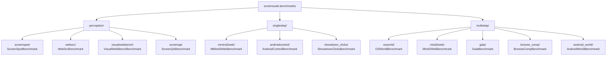
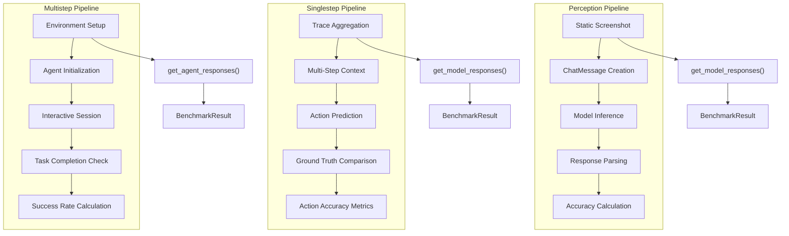
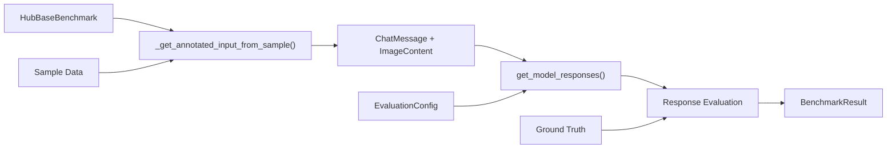
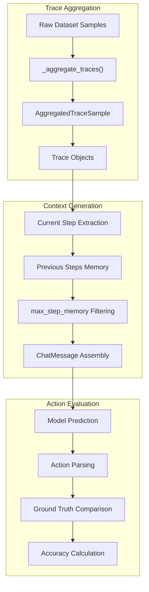
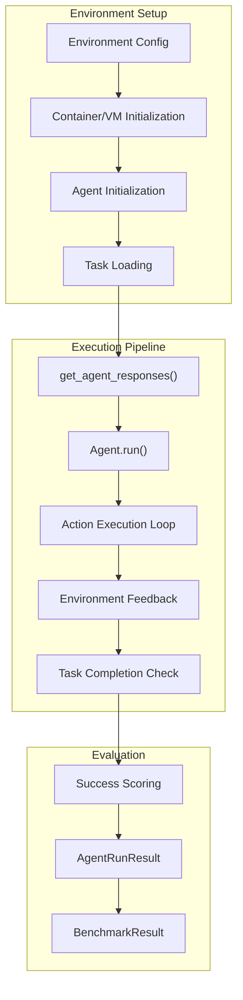
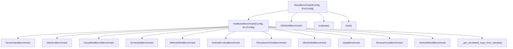

<!-- source: DeepWiki mcp.deepwiki.com · repo huggingface/screensuite · page 4 Benchmark Categories · fetched 2026-10-26 -->

# Benchmark Categories

<details>
<summary>Relevant source files</summary>

The following files were used as context for generating this wiki page:

- [README.md](README.md)
- [run.py](run.py)
- [src/screensuite/basebenchmark.py](src/screensuite/basebenchmark.py)
- [src/screensuite/benchmarks/multistep/android_world/benchmark.py](src/screensuite/benchmarks/multistep/android_world/benchmark.py)
- [src/screensuite/benchmarks/multistep/browse_comp/benchmark.py](src/screensuite/benchmarks/multistep/browse_comp/benchmark.py)
- [src/screensuite/benchmarks/multistep/gaia/benchmark.py](src/screensuite/benchmarks/multistep/gaia/benchmark.py)
- [src/screensuite/benchmarks/multistep/mind2web/benchmark.py](src/screensuite/benchmarks/multistep/mind2web/benchmark.py)
- [src/screensuite/benchmarks/multistep/osworld/benchmark.py](src/screensuite/benchmarks/multistep/osworld/benchmark.py)
- [src/screensuite/benchmarks/perception/screenqa/benchmark.py](src/screensuite/benchmarks/perception/screenqa/benchmark.py)
- [src/screensuite/benchmarks/perception/screenspot/benchmark.py](src/screensuite/benchmarks/perception/screenspot/benchmark.py)
- [src/screensuite/benchmarks/perception/visualwebbench/benchmark.py](src/screensuite/benchmarks/perception/visualwebbench/benchmark.py)
- [src/screensuite/benchmarks/perception/websrc/benchmark.py](src/screensuite/benchmarks/perception/websrc/benchmark.py)
- [src/screensuite/benchmarks/singlestep/androidcontrol/benchmark.py](src/screensuite/benchmarks/singlestep/androidcontrol/benchmark.py)
- [src/screensuite/benchmarks/singlestep/mmind2web/benchmark.py](src/screensuite/benchmarks/singlestep/mmind2web/benchmark.py)
- [src/screensuite/benchmarks/singlestep/showdown_clicks/benchmark.py](src/screensuite/benchmarks/singlestep/showdown_clicks/benchmark.py)
- [src/screensuite/chat_message.py](src/screensuite/chat_message.py)

</details>


This document explains the three main categories of benchmarks in screensuite and how they differ in their evaluation approaches, technical requirements, and use cases. Each category tests different aspects of GUI agent capabilities through distinct evaluation paradigms.

For implementation details of the core evaluation system, see [Core Framework](#3). For specific benchmark implementations within each category, see [Multistep Benchmarks](#4.1), [Singlestep Benchmarks](#4.2), and [Perception Benchmarks](#4.3).

## Overview

ScreenSuite organizes benchmarks into three distinct categories based on their evaluation approach and complexity:



Sources: [README.md:7-38](), [src/screensuite/benchmarks/perception/screenspot/benchmark.py:34](), [src/screensuite/benchmarks/singlestep/mmind2web/benchmark.py:40](), [src/screensuite/benchmarks/multistep/osworld/benchmark.py:25]()

### Category Characteristics

| Category | Environment | Interaction | Evaluation Focus | Complexity |
|----------|-------------|-------------|------------------|------------|
| **Perception** | Static screenshots | None | Understanding & grounding | Low |
| **Singlestep** | Static traces | Single action prediction | Immediate action accuracy | Medium |
| **Multistep** | Live environments | Extended interaction | Task completion success | High |

## Evaluation Pipeline Architecture

The three categories utilize different evaluation pipelines with varying levels of environmental setup and interaction complexity:



Sources: [src/screensuite/benchmarks/perception/screenspot/benchmark.py:115-171](), [src/screensuite/benchmarks/singlestep/mmind2web/benchmark.py:304-379](), [src/screensuite/benchmarks/multistep/gaia/benchmark.py:25-69]()

## Perception Benchmarks

Perception benchmarks evaluate models' ability to understand and ground elements in static GUI screenshots without requiring action execution. They test fundamental visual comprehension capabilities.

### Core Implementation Pattern



**Key Characteristics:**
- **No environment setup required** - operates on static data
- **Single inference per sample** - one model call per evaluation item
- **Immediate evaluation** - responses can be scored immediately
- **Focus on understanding** - tests visual comprehension, not action execution

### Benchmark Implementations

| Benchmark | Task Type | Evaluation Metric | Platform |
|-----------|-----------|------------------|----------|
| `ScreenSpotBenchmark` | Element localization | Click/BBox accuracy | Web |
| `WebSrcBenchmark` | Question answering | F1 score | Web |  
| `VisualWebBenchBenchmark` | Multi-task evaluation | Task-specific metrics | Web |
| `ScreenQABenchmark` | Mobile QA | F1 score | Mobile |

Sources: [src/screensuite/benchmarks/perception/screenspot/benchmark.py:34-172](), [src/screensuite/benchmarks/perception/websrc/benchmark.py:30-112](), [src/screensuite/benchmarks/perception/visualwebbench/benchmark.py:37-210](), [src/screensuite/benchmarks/perception/screenqa/benchmark.py:25-105]()

## Singlestep Benchmarks  

Singlestep benchmarks evaluate models' ability to predict the next correct action given a sequence of previous actions and screenshots. They test action reasoning without requiring live environment interaction.

### Trace Processing Architecture



**Key Characteristics:**
- **Trace reconstruction** - builds sequential context from disaggregated samples
- **Memory management** - limits context window with `max_step_memory`
- **Action-focused evaluation** - tests specific action prediction accuracy
- **No live interaction** - operates on pre-recorded traces

### Memory Management

Singlestep benchmarks implement context window management to handle long traces:

```python
# Example from MMind2WebBenchmark._get_annotated_input_from_sample()
for i in range(current_step):
    if i < current_step - self.config.max_step_memory:
        continue  # Skip steps beyond memory window
    # Add step to context
```

Sources: [src/screensuite/benchmarks/singlestep/mmind2web/benchmark.py:72-80](), [src/screensuite/benchmarks/singlestep/androidcontrol/benchmark.py:153-157]()

### Action Space Support

Singlestep benchmarks support multiple action space formats through `EvaluationConfig` flags:

| Flag | Action Format | Example |
|------|---------------|---------|
| `use_uitars_action_space` | UI-TARS format | Custom UI action syntax |
| `use_h_action_space` | H format | `Click()` vs `click()` |
| Default | Standard format | `click(x, y)` |

Sources: [src/screensuite/benchmarks/singlestep/mmind2web/benchmark.py:86-91](), [src/screensuite/basebenchmark.py:40-41]()

## Multistep Benchmarks

Multistep benchmarks evaluate complete task execution in live environments, requiring complex setup and extended agent interactions. They test end-to-end task completion capabilities.

### Environment Management Architecture



**Key Characteristics:**
- **Live environment setup** - requires containers, VMs, or emulators
- **Extended interaction sessions** - multiple action execution cycles  
- **Complex state management** - handles environment cleanup and recovery
- **Task completion focus** - evaluates overall success, not individual actions

### Environment-Specific Implementations

| Benchmark | Environment | Setup Requirements | Evaluation Method |
|-----------|-------------|-------------------|------------------|
| `OSWorldBenchmark` | Desktop VMs | Docker containers, KVM | Task-specific scoring |
| `AndroidWorldBenchmark` | Android emulators | Android env client | Success rate |
| `GaiaBenchmark` | Web browser | Live web access | Exact match |
| `Mind2WebBenchmark` | Web browser | Live websites | URL matching |
| `BrowseCompBenchmark` | Web browser | Live web access | LLM judge |

### Parallel Execution Management

Multistep benchmarks implement sophisticated parallel execution to manage multiple environment instances:

```python
# Example from OSWorldBenchmark.evaluate()
distributed_tasks = distribute_tasks(
    self.dataset, 
    evaluation_config.parallel_workers, 
    evaluation_config.max_samples_to_test
)

# Set up multiple environments
for env_idx in range(evaluation_config.parallel_workers):
    env = DesktopEnv(...)
    agent = PromptAgent(...)
    envs.append(env)
    agents.append(agent)
```

Sources: [src/screensuite/benchmarks/multistep/osworld/benchmark.py:119-141](), [src/screensuite/benchmarks/multistep/android_world/benchmark.py:331-348]()

## Technical Integration

All benchmark categories integrate with the core framework through consistent interfaces while implementing category-specific evaluation logic.

### Base Class Hierarchy



### Response Generation Integration

Each category uses different response generation functions:

- **Perception & Singlestep**: `get_model_responses()` from `response_generation.py`
- **Multistep**: `get_agent_responses()` from `multistep/generation.py`

The choice depends on whether the benchmark requires environment interaction or simple model inference.

Sources: [src/screensuite/basebenchmark.py:66-82](), [src/screensuite/benchmarks/hubbasebenchmark.py](), [src/screensuite/response_generation.py](), [src/screensuite/benchmarks/multistep/generation.py]()

---

