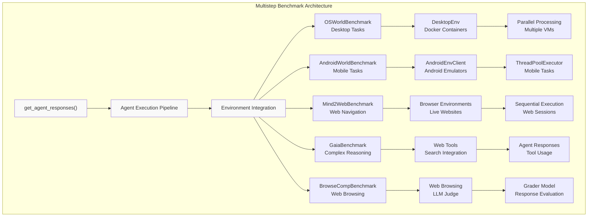
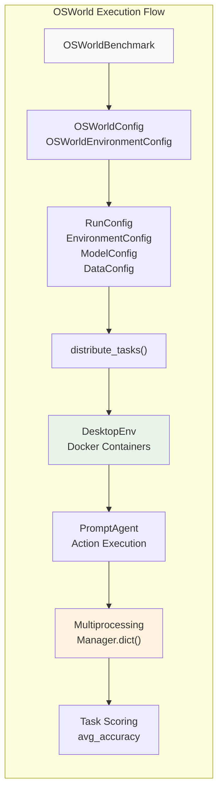
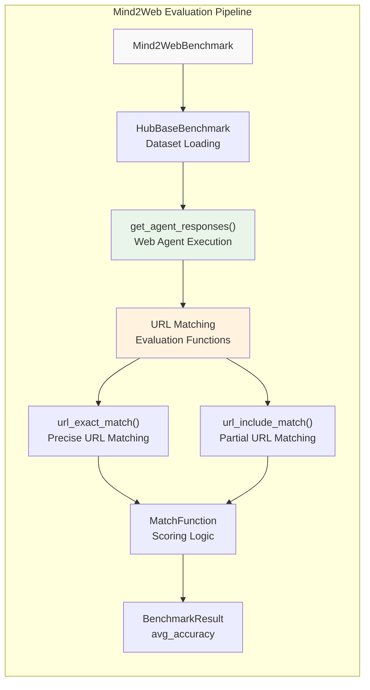
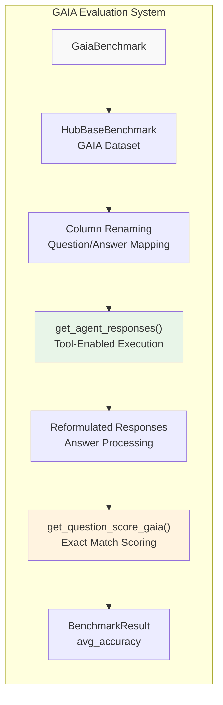
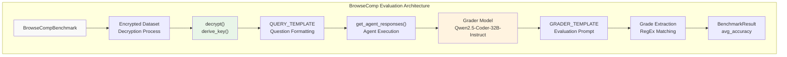
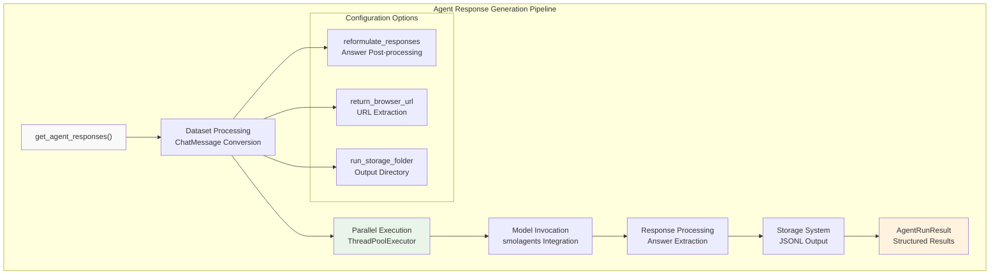
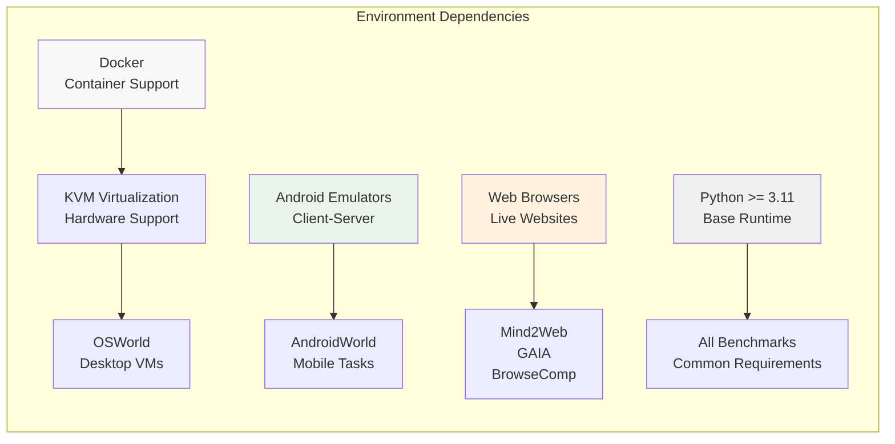

<!-- source: DeepWiki mcp.deepwiki.com · repo huggingface/screensuite · page 4.1 Multistep Benchmarks · fetched 2026-10-26 -->

# Multistep Benchmarks

Relevant source files

The following files were used as context for generating this wiki page:

- [README.md](README.md)
- [run.py](run.py)
- [src/screensuite/benchmarks/multistep/android_world/benchmark.py](src/screensuite/benchmarks/multistep/android_world/benchmark.py)
- [src/screensuite/benchmarks/multistep/browse_comp/benchmark.py](src/screensuite/benchmarks/multistep/browse_comp/benchmark.py)
- [src/screensuite/benchmarks/multistep/gaia/benchmark.py](src/screensuite/benchmarks/multistep/gaia/benchmark.py)
- [src/screensuite/benchmarks/multistep/mind2web/benchmark.py](src/screensuite/benchmarks/multistep/mind2web/benchmark.py)
- [src/screensuite/benchmarks/multistep/osworld/benchmark.py](src/screensuite/benchmarks/multistep/osworld/benchmark.py)

This document covers the multistep benchmark category within the screensuite framework. Multistep benchmarks evaluate online agents that can perform complex, sequential interactions across multiple steps to complete tasks in live environments. These benchmarks test the model's ability to plan, execute, and adapt through extended interaction sequences.

For information about single-step offline agent evaluations, see [Singlestep Benchmarks](#4.2). For understanding-focused evaluations without action requirements, see [Perception Benchmarks](#4.3).

## Overview

Multistep benchmarks in screensuite represent the most complex evaluation category, requiring models to act as autonomous agents in live environments. Unlike singlestep benchmarks that evaluate individual actions, multistep benchmarks assess the model's ability to:

- Plan and execute multi-step task sequences
- Adapt to dynamic environment changes
- Maintain context across extended interactions
- Handle real-world unpredictability in live systems

Sources: [src/screensuite/benchmarks/multistep/osworld/benchmark.py:1-225](), [src/screensuite/benchmarks/multistep/android_world/benchmark.py:1-378](), [src/screensuite/benchmarks/multistep/mind2web/benchmark.py:1-189](), [src/screensuite/benchmarks/multistep/gaia/benchmark.py:1-78](), [src/screensuite/benchmarks/multistep/browse_comp/benchmark.py:1-140]()

## Benchmark Types

### OSWorld - Desktop Environment Tasks

`OSWorldBenchmark` evaluates agents in desktop operating system environments using virtualized machines. The benchmark tests the agent's ability to perform complex software tasks across different desktop applications.

The `OSWorldBenchmark` class extends `BaseBenchmark[OSWorldConfig, OSWorldEnvironmentConfig]` and implements parallel task execution across multiple desktop environments. Key components include:

- **Environment Setup**: Uses `DesktopEnv` with Docker containers for isolated VM execution
- **Agent Integration**: Employs `PromptAgent` with configurable action spaces and observation types
- **Task Distribution**: Implements `distribute_tasks()` for parallel processing across multiple workers
- **Scoring**: Evaluates task completion with environment-specific scoring mechanisms

The benchmark supports various desktop environments and can be configured for different operating systems through `OSWorldEnvironmentConfig`.

Sources: [src/screensuite/benchmarks/multistep/osworld/benchmark.py:25-209](), [src/screensuite/benchmarks/multistep/osworld/config.py]()

### AndroidWorld - Mobile Environment Tasks

`AndroidWorldBenchmark` evaluates agents in Android mobile environments using emulated devices. The benchmark tests mobile app interaction capabilities across different Android applications.

```mermaid
graph TB
    subgraph "AndroidWorld Task Processing"
        A["AndroidWorldBenchmark"] --> B["TaskRegistry<br/>create_suite()"]
        B --> C["task_chunks<br/>Thread Distribution"]
        C --> D["ThreadPoolExecutor<br/>Parallel Processing"]
        
        D --> E["AndroidAgent<br/>AndroidEnvClient"]
        E --> F["answer_single_question()<br/>Task Execution"]
        F --> G["process_single_task()<br/>Score Calculation"]
        G --> H["task_cleanup()<br/>Environment Reset"]
        
        H --> I["AgentRunResult<br/>Result Collection"]
        I --> J["BenchmarkResult<br/>avg_accuracy"]
    end
    
    style A fill:#f9f9f9
    style D fill:#e8f5e8
    style E fill:#fff3e0
```

Key features of the Android benchmark include:

- **Task Registry**: Uses `TaskRegistry` to manage Android app tasks with `create_suite()` for test generation
- **Mobile Agent**: Implements `AndroidAgent` with `AndroidEnvClient` for device interaction
- **Parallel Execution**: Distributes tasks across multiple threads using `ThreadPoolExecutor`
- **Error Handling**: Includes retry mechanisms and environment respawning for robust execution
- **Cleanup Management**: Uses `task_cleanup()` context manager for proper resource management

The benchmark evaluates tasks with optimal step counts and includes comprehensive error handling for mobile environment instability.

Sources: [src/screensuite/benchmarks/multistep/android_world/benchmark.py:251-359](), [src/screensuite/agents/vision_agents/android_agent.py](), [src/screensuite/agents/client/android_env_client.py]()

### Mind2Web - Web Navigation Tasks

`Mind2WebBenchmark` evaluates agents performing web navigation tasks on live websites. The benchmark tests the agent's ability to complete multi-step web interactions and reach target URLs.

The Mind2Web benchmark implements sophisticated URL matching for web navigation evaluation:

- **Dataset Processing**: Renames columns from "task" to "question" and "evaluation" to "reference_answer"
- **Agent Execution**: Uses `get_agent_responses()` with browser URL return enabled
- **URL Evaluation**: Implements `url_exact_match()` and `url_include_match()` for flexible URL comparison
- **Match Functions**: Utilizes `MatchFunction` class for exact and inclusion-based matching
- **Score Aggregation**: Averages scores across multiple evaluation criteria per task

The benchmark supports both exact URL matching and partial matching for robust web navigation assessment.

Sources: [src/screensuite/benchmarks/multistep/mind2web/benchmark.py:33-169](), [src/screensuite/benchmarks/multistep/generation.py]()

### GAIA - Complex Reasoning Tasks

`GaiaBenchmark` evaluates agents on complex reasoning tasks that require web browsing and tool usage. The benchmark tests the model's ability to perform multi-step research and analysis tasks.

GAIA benchmark characteristics:

- **Dataset Preparation**: Renames "Final answer" to "reference_answer" and "Question" to "question"
- **Tool Integration**: Enables `reformulate_responses=True` for enhanced answer processing
- **Scoring Method**: Uses `get_question_score_gaia()` for exact match evaluation
- **Research Tasks**: Focuses on complex reasoning requiring web search and information synthesis

The benchmark evaluates the agent's ability to break down complex questions, gather information through web browsing, and synthesize accurate answers.

Sources: [src/screensuite/benchmarks/multistep/gaia/benchmark.py:13-69](), [src/screensuite/benchmarks/multistep/gaia/gaia_scoring.py]()

### BrowseComp - Web Browsing with LLM Judge

`BrowseCompBenchmark` evaluates web browsing agents using an LLM judge for response evaluation. The benchmark includes encrypted datasets and sophisticated grading mechanisms.

BrowseComp implements advanced evaluation features:

- **Data Security**: Uses `decrypt()` and `derive_key()` functions for encrypted dataset access
- **Template System**: Employs `QUERY_TEMPLATE` and `GRADER_TEMPLATE` for consistent formatting
- **LLM Judge**: Integrates `InferenceClientModel` with Qwen2.5-Coder-32B-Instruct for response grading
- **Grade Parsing**: Extracts "correct: yes/no" patterns from grader responses using regex
- **Error Handling**: Includes fallback mechanisms for grader model failures

The benchmark represents a sophisticated approach to web browsing evaluation with automated grading.

Sources: [src/screensuite/benchmarks/multistep/browse_comp/benchmark.py:42-132](), [src/screensuite/benchmarks/multistep/browse_comp/prompts.py]()

## Execution Architecture

### Agent Response Generation

All multistep benchmarks utilize the `get_agent_responses()` function as the central execution pipeline:

The `get_agent_responses()` function provides:

- **Standardized Execution**: Common interface for all multistep benchmarks
- **Parallel Processing**: Configurable worker threads for scalable execution
- **Response Management**: Structured `AgentRunResult` objects with comprehensive metadata
- **Storage Integration**: Automatic JSONL output for result persistence
- **Configuration Flexibility**: Options for response reformulation and URL extraction

Sources: [src/screensuite/benchmarks/multistep/generation.py]()

### Evaluation Metrics

Multistep benchmarks employ various evaluation approaches depending on the task type:

| Benchmark | Primary Metric | Evaluation Method | Secondary Metrics |
|-----------|----------------|-------------------|-------------------|
| OSWorld | `avg_accuracy` | Environment scoring | `proportion_missing`, `count_sample` |
| AndroidWorld | `avg_accuracy` | Task completion scoring | `proportion_missing`, `count_sample` |
| Mind2Web | `avg_accuracy` | URL matching functions | `proportion_missing`, `count_samples` |
| GAIA | `avg_accuracy` | Exact match scoring | `proportion_missing`, `count_samples` |
| BrowseComp | `avg_accuracy` | LLM judge evaluation | `proportion_missing`, `count_samples` |

All benchmarks return `BenchmarkResult` objects with consistent metric naming and structure for cross-benchmark comparison.

Sources: [src/screensuite/benchmark_result.py](), [src/screensuite/benchmarks/multistep/osworld/benchmark.py:201-208](), [src/screensuite/benchmarks/multistep/android_world/benchmark.py:350-358]()

## Configuration and Setup

### Environment Requirements

Multistep benchmarks require specialized environment configurations:

Key environment requirements include:

- **Docker Support**: Required for OSWorld VM containerization
- **KVM Virtualization**: Hardware-level virtualization for desktop environments
- **Android Emulation**: Client-server architecture for mobile task execution
- **Web Connectivity**: Live website access for web-based benchmarks
- **Python Runtime**: Version 3.11+ with uv package management

Sources: [README.md:64-71](), [src/screensuite/benchmarks/multistep/osworld/config.py]()

### Parallel Processing Configuration

Each multistep benchmark implements parallel processing differently:

- **OSWorld**: Uses `multiprocessing.Manager()` with `Process` objects for VM isolation
- **AndroidWorld**: Employs `ThreadPoolExecutor` for mobile task distribution
- **Web Benchmarks**: Utilize `ThreadPoolExecutor` through `get_agent_responses()`

The `EvaluationConfig.parallel_workers` parameter controls concurrency across all benchmark types, with automatic scaling based on available resources and task requirements.

Sources: [src/screensuite/basebenchmark.py](), [src/screensuite/benchmarks/multistep/osworld/benchmark.py:162-176](), [src/screensuite/benchmarks/multistep/android_world/benchmark.py:331-349]()

---

