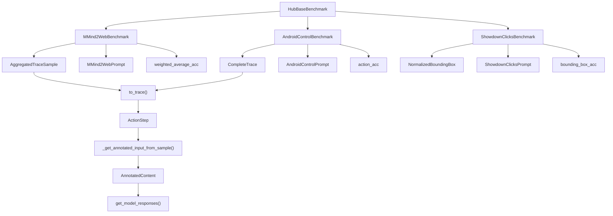
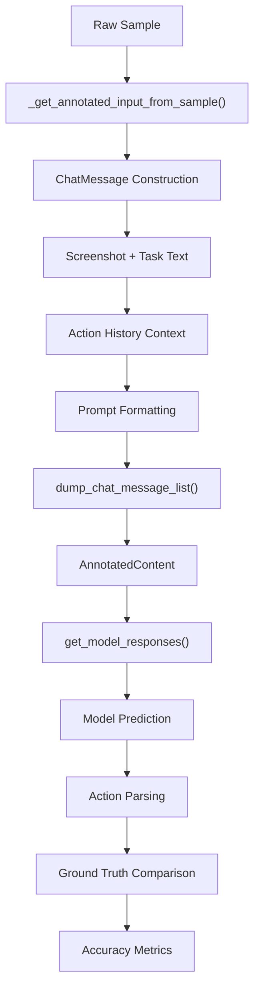
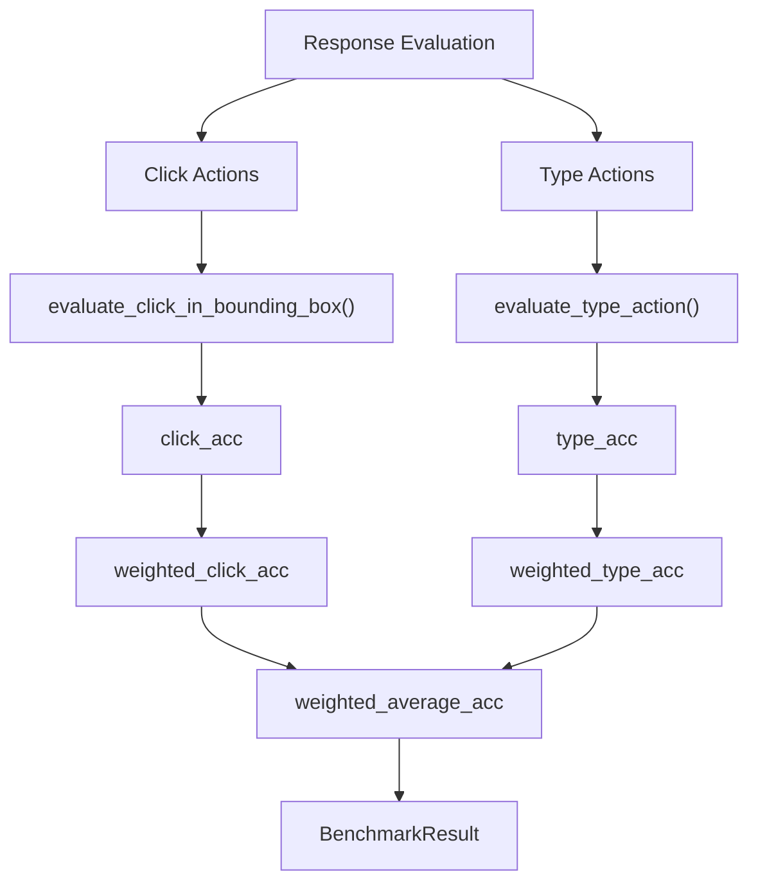
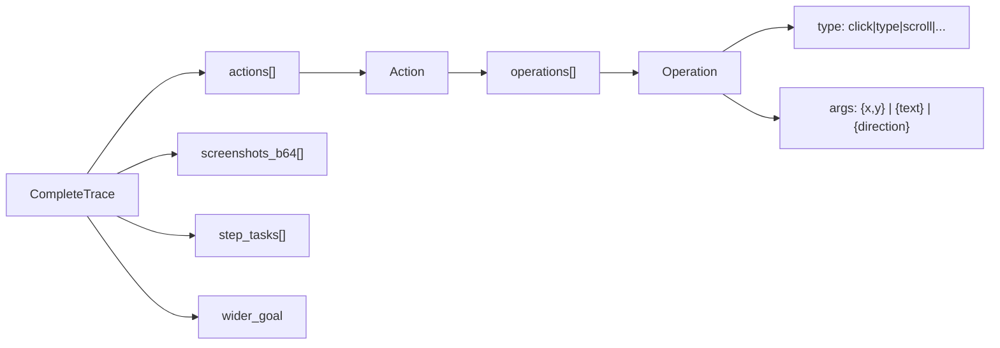
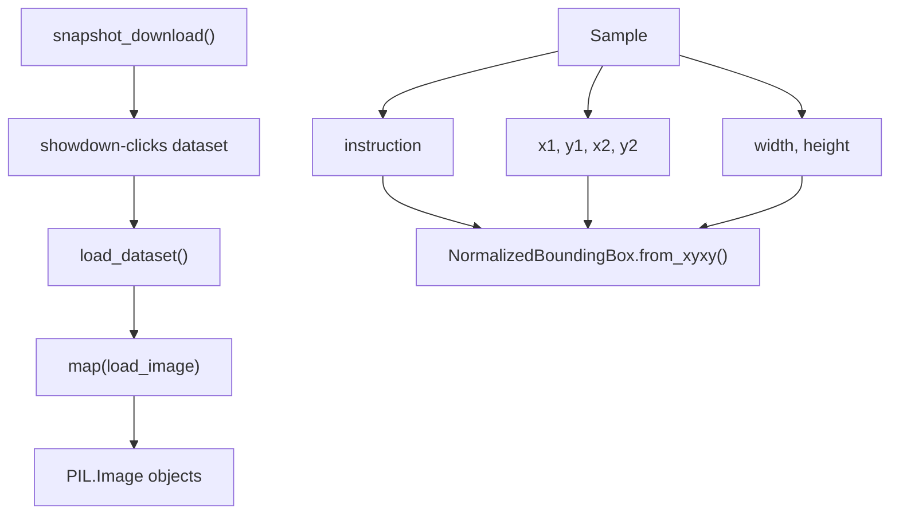
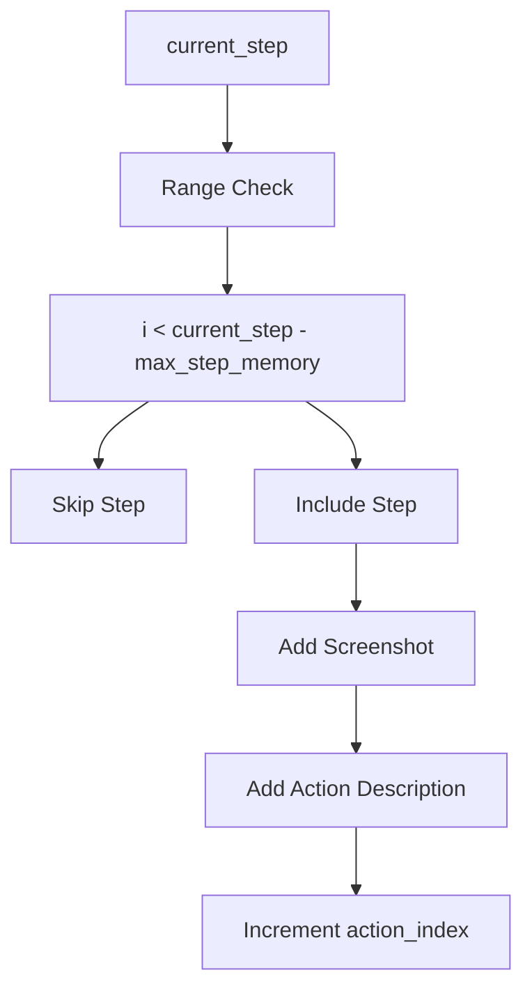

<!-- source: DeepWiki mcp.deepwiki.com · repo huggingface/screensuite · page 4.2 Singlestep Benchmarks · fetched 2026-10-26 -->

# Singlestep Benchmarks

Relevant source files

The following files were used as context for generating this wiki page:

- [src/screensuite/basebenchmark.py](src/screensuite/basebenchmark.py)
- [src/screensuite/benchmarks/perception/screenspot/benchmark.py](src/screensuite/benchmarks/perception/screenspot/benchmark.py)
- [src/screensuite/benchmarks/singlestep/androidcontrol/benchmark.py](src/screensuite/benchmarks/singlestep/androidcontrol/benchmark.py)
- [src/screensuite/benchmarks/singlestep/mmind2web/benchmark.py](src/screensuite/benchmarks/singlestep/mmind2web/benchmark.py)
- [src/screensuite/benchmarks/singlestep/showdown_clicks/benchmark.py](src/screensuite/benchmarks/singlestep/showdown_clicks/benchmark.py)
- [src/screensuite/chat_message.py](src/screensuite/chat_message.py)

This document covers the singlestep benchmark category in screensuite, which evaluates GUI agents through offline, single-action prediction tasks. These benchmarks test a model's ability to predict the next appropriate action given a screenshot and task description, without requiring live environment interaction.

For multistep agent evaluations that require sequential environment interaction, see [Multistep Benchmarks](#4.1). For understanding-focused evaluations without action prediction, see [Perception Benchmarks](#4.3).

## Overview

Singlestep benchmarks evaluate models on their ability to predict individual GUI actions from static screenshots. Unlike multistep benchmarks that require environment setup and sequential interaction, singlestep benchmarks work with pre-collected traces and screenshots, making them faster to run and more deterministic.

The framework includes three main singlestep benchmarks:
- **MMind2Web**: Web interaction prediction from aggregated traces
- **AndroidControl**: Mobile UI action prediction  
- **ShowdownClicks**: Click coordinate prediction and grounding

## Architecture

All singlestep benchmarks inherit from `HubBaseBenchmark` and follow a common evaluation pattern:

**Sources:** [src/screensuite/benchmarks/singlestep/mmind2web/benchmark.py:40-41](), [src/screensuite/benchmarks/singlestep/androidcontrol/benchmark.py:117](), [src/screensuite/benchmarks/singlestep/showdown_clicks/benchmark.py:42]()

### Common Evaluation Pipeline

The evaluation pipeline transforms raw samples into model inputs through a standardized process:

**Sources:** [src/screensuite/benchmarks/singlestep/mmind2web/benchmark.py:41-124](), [src/screensuite/basebenchmark.py:83-90](), [src/screensuite/response_generation.py:29-33]()

## MMind2Web Benchmark

MMind2Web evaluates web interaction prediction using aggregated traces from the Mind2Web dataset. It processes multi-step web navigation sequences and evaluates individual action predictions.

### Data Processing

The benchmark uses `AggregatedTraceSample` to group related actions into traces:

| Component | Purpose | Ground Truth |
|-----------|---------|--------------|
| `AggregatedTraceSample` | Groups operations, screenshots, and tasks | List of `Operation` + `NormalizedBoundingBox` |
| `to_trace()` | Converts to processable trace format | Action sequences with context |
| `max_step_memory` | Limits historical context | Previous N steps |

The trace aggregation process groups individual samples by `target_action_index` to reconstruct complete navigation sequences [src/screensuite/benchmarks/singlestep/mmind2web/benchmark.py:127-216]().

### Evaluation Metrics

MMind2Web calculates weighted accuracy across different action types:

**Sources:** [src/screensuite/benchmarks/singlestep/mmind2web/benchmark.py:217-274](), [src/screensuite/benchmarks/singlestep/mmind2web/benchmark.py:346-375]()

## AndroidControl Benchmark

AndroidControl evaluates mobile UI interaction prediction using Android app screenshots and action sequences.

### Action Types

The benchmark supports multiple Android action types through `convert_android_control_operation()`:

| Action Type | Parameters | Evaluation Method |
|-------------|------------|-------------------|
| `click` / `longpress` | `x`, `y` coordinates | `evaluate_click_distance()` |
| `input_text` | `text` content | `evaluate_type_action()` |
| `scroll` | `direction` | String matching |
| `open_app` | `app_name` | Substring matching |
| `navigate_back` / `navigate_home` | None | Command matching |

**Sources:** [src/screensuite/benchmarks/singlestep/androidcontrol/benchmark.py:92-114](), [src/screensuite/benchmarks/singlestep/androidcontrol/benchmark.py:207-252]()

### Trace Processing

AndroidControl uses `CompleteTrace` to structure action sequences:

**Sources:** [src/screensuite/benchmarks/singlestep/androidcontrol/benchmark.py:127-136](), [src/screensuite/benchmarks/singlestep/androidcontrol/models.py:16-21]()

## ShowdownClicks Benchmark

ShowdownClicks focuses on click coordinate prediction and element grounding tasks.

### Data Loading

The benchmark downloads and processes click grounding data:

**Sources:** [src/screensuite/benchmarks/singlestep/showdown_clicks/benchmark.py:43-62](), [src/screensuite/benchmarks/singlestep/showdown_clicks/benchmark.py:70-79]()

### Dual Evaluation Metrics

ShowdownClicks provides two complementary accuracy measures:

| Metric | Method | Purpose |
|--------|--------|---------|
| `click_acc` | `evaluate_click_distance()` | Distance-based accuracy |
| `bounding_box_acc` | `evaluate_click_in_bounding_box()` | Binary hit/miss accuracy |

**Sources:** [src/screensuite/benchmarks/singlestep/showdown_clicks/benchmark.py:132-160](), [src/screensuite/benchmarks/singlestep/showdown_clicks/benchmark.py:195-199]()

## Prompt Systems

Singlestep benchmarks support multiple action space formats through configurable prompts:

### Action Space Variants

| Configuration | Prompt Format | Use Case |
|---------------|---------------|----------|
| Default | `click(x, y)` | Standard coordinate format |
| `use_uitars_action_space` | UI-TARS specific format | Specialized UI models |
| `use_h_action_space` | `Click(x, y)` | Alternative capitalization |

Each benchmark implements prompt variants in their respective prompt modules:
- `MMind2WebPrompt.ASSISTANT_PROMPT_ABSOLUTE_CLICK_UITARS`
- `AndroidControlPrompt.ASSISTANT_PROMPT_ABSOLUTE_CLICK_UITARS`  
- `ShowdownClicksPrompt.PROMPT_ABSOLUTE_CLICK_UITARS`

**Sources:** [src/screensuite/benchmarks/singlestep/mmind2web/benchmark.py:86-91](), [src/screensuite/benchmarks/singlestep/androidcontrol/benchmark.py:169-174](), [src/screensuite/benchmarks/singlestep/showdown_clicks/benchmark.py:81-88]()

### Context Management

Singlestep benchmarks manage action history through `max_step_memory` configuration:

**Sources:** [src/screensuite/benchmarks/singlestep/mmind2web/benchmark.py:70-80](), [src/screensuite/benchmarks/singlestep/androidcontrol/benchmark.py:152-163]()

## Evaluation Utilities

Singlestep benchmarks rely on shared evaluation utilities from `screensuite.benchmarks.utils`:

| Function | Purpose | Return Type |
|----------|---------|-------------|
| `evaluate_click_in_bounding_box()` | Binary hit/miss for clicks | `float` (0.0 or 1.0) |
| `evaluate_click_distance()` | Distance-based click accuracy | `float` (0.0 to 1.0) |
| `evaluate_type_action()` | Text input accuracy | `float` (F1 score) |
| `bootstrap_confidence_interval()` | Statistical confidence bounds | `tuple[float, tuple[float, float]]` |

**Sources:** [src/screensuite/benchmarks/utils.py:22-27](), [src/screensuite/benchmarks/singlestep/mmind2web/benchmark.py:22-25](), [src/screensuite/benchmarks/singlestep/androidcontrol/benchmark.py:23-27]()

---

