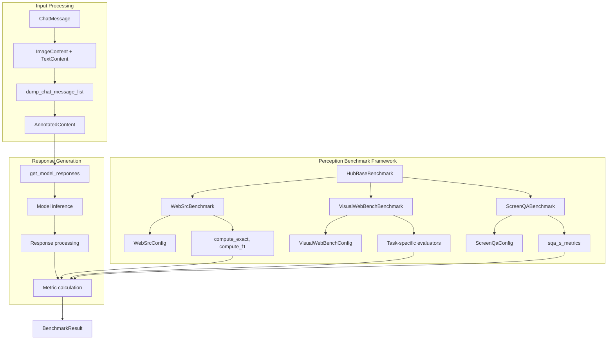
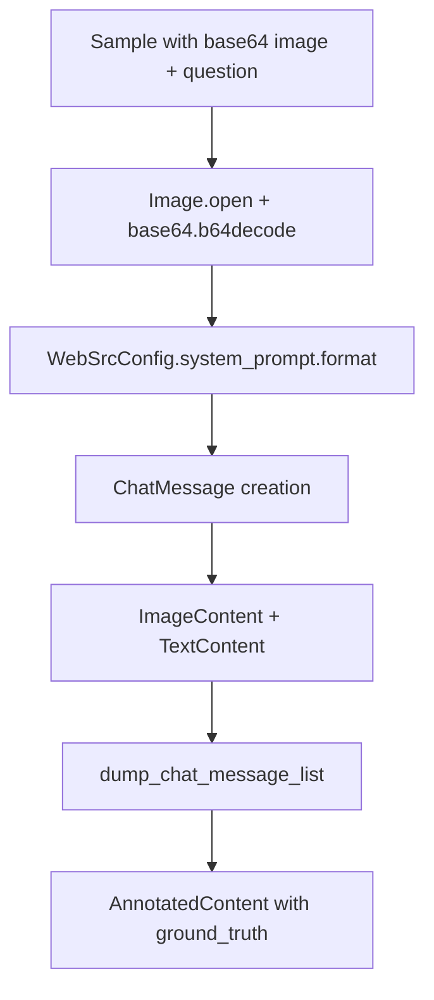
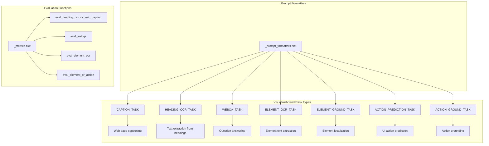
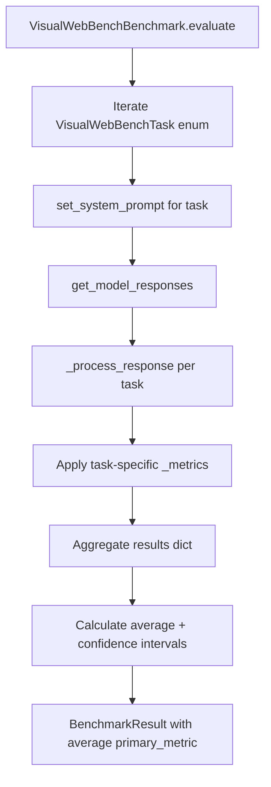
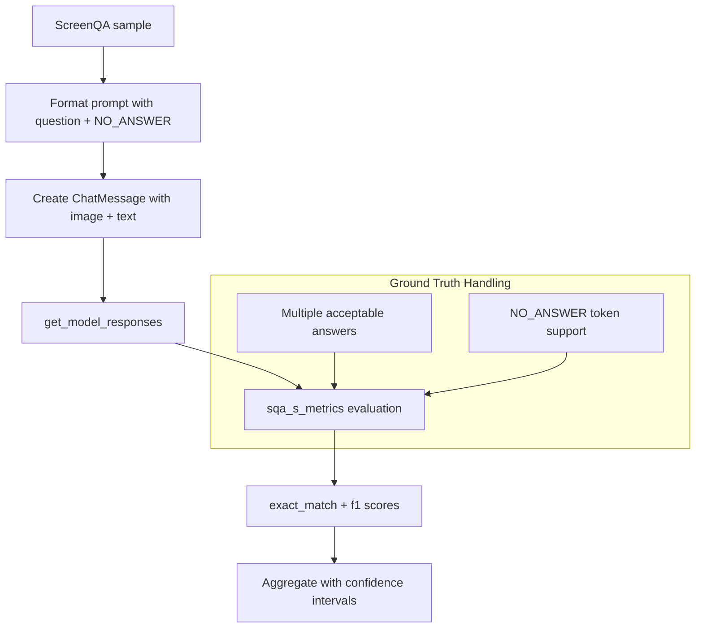
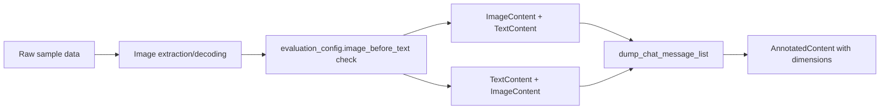

<!-- source: DeepWiki mcp.deepwiki.com · repo huggingface/screensuite · page 4.3 Perception Benchmarks · fetched 2026-10-26 -->

# Perception Benchmarks

Relevant source files

The following files were used as context for generating this wiki page:

- [src/screensuite/benchmarks/perception/screenqa/benchmark.py](src/screensuite/benchmarks/perception/screenqa/benchmark.py)
- [src/screensuite/benchmarks/perception/visualwebbench/benchmark.py](src/screensuite/benchmarks/perception/visualwebbench/benchmark.py)
- [src/screensuite/benchmarks/perception/websrc/benchmark.py](src/screensuite/benchmarks/perception/websrc/benchmark.py)

## Purpose and Scope

Perception benchmarks evaluate multimodal large language models' ability to understand and extract information from user interface screenshots without requiring any actions or environment interaction. These benchmarks focus on visual comprehension, text extraction, and reasoning about GUI elements. For action-based evaluations, see [Singlestep Benchmarks](#4.2) and [Multistep Benchmarks](#4.1).

The perception category includes three core benchmarks: WebSrc for web content understanding, VisualWebBench for multi-task visual web evaluation, and ScreenQA for screen-based question answering.

## Benchmark Architecture

**Architecture Overview**: All perception benchmarks inherit from `HubBaseBenchmark` and follow a common pattern of image-text input processing, model inference, and metric-based evaluation without environment interaction.

Sources: [src/screensuite/benchmarks/perception/websrc/benchmark.py:30](), [src/screensuite/benchmarks/perception/visualwebbench/benchmark.py:37](), [src/screensuite/benchmarks/perception/screenqa/benchmark.py:25]()

## WebSrc Benchmark

The `WebSrcBenchmark` class evaluates models' ability to understand web content and answer questions based on webpage screenshots. It uses exact match and F1 score metrics to assess comprehension accuracy.

### Input Processing

The benchmark transforms samples into `ChatMessage` objects containing both image and text content:

**WebSrc Input Flow**: The benchmark decodes base64 images, formats prompts with questions, and creates structured chat messages for model consumption.

Sources: [src/screensuite/benchmarks/perception/websrc/benchmark.py:31-58]()

### Evaluation Metrics

WebSrc uses two primary metrics calculated via utility functions:

| Metric | Function | Purpose |
|--------|----------|---------|
| Exact Match | `compute_exact()` | Binary accuracy for perfect answer matches |
| F1 Score | `compute_f1()` | Token-level overlap between prediction and ground truth |
| Confidence Interval | `bootstrap_confidence_interval()` | Statistical confidence bounds for F1 scores |

The evaluation process in [src/screensuite/benchmarks/perception/websrc/benchmark.py:93-111]() iterates through responses, calculates both metrics, and aggregates results with confidence intervals.

Sources: [src/screensuite/benchmarks/perception/websrc/benchmark.py:97](), [src/screensuite/benchmarks/perception/websrc/benchmark.py:107-109]()

## VisualWebBench Benchmark

The `VisualWebBenchBenchmark` class implements a comprehensive multi-task evaluation covering seven distinct visual web understanding tasks through the `VisualWebBenchTask` enum.

### Task-Specific Architecture

**VisualWebBench Task System**: Each task type has dedicated prompt formatters and evaluation functions, enabling comprehensive assessment across different visual understanding capabilities.

Sources: [src/screensuite/benchmarks/perception/visualwebbench/benchmark.py:55-83]()

### Response Processing Pipeline

The benchmark includes task-specific response processing in `_process_response()` method:

- **Caption Task**: Extracts meta description tags using regex patterns
- **Action Prediction**: Returns first character in uppercase
- **WebQA/Element OCR**: Strips formatting and extracts content after colons
- **Other Tasks**: Returns raw response content

Sources: [src/screensuite/benchmarks/perception/visualwebbench/benchmark.py:118-151]()

### Multi-Task Evaluation Flow

**Multi-Task Evaluation**: The benchmark processes each task type independently, applies task-specific metrics, and aggregates results with statistical confidence measures.

Sources: [src/screensuite/benchmarks/perception/visualwebbench/benchmark.py:174-209]()

## ScreenQA Benchmark

The `ScreenQABenchmark` class evaluates screen-based question answering using mobile and web interface screenshots. It supports both short and complex question variants through different configurations.

### Configuration Variants

The benchmark provides two main configurations accessible via class methods:

- **ScreenQaConfig.short()**: For concise questions requiring brief answers
- **ScreenQaConfig.complex()**: For detailed questions requiring comprehensive responses

### Evaluation Methodology

ScreenQA uses the `sqa_s_metrics` function which returns both exact match and F1 scores. The evaluation handles multiple ground truth answers per question:

**ScreenQA Evaluation Flow**: The benchmark supports multiple ground truth answers and includes a NO_ANSWER token for cases where questions cannot be answered from the screen content.

Sources: [src/screensuite/benchmarks/perception/screenqa/benchmark.py:77-93](), [src/screensuite/benchmarks/perception/screenqa/benchmark.py:32]()

## Common Patterns

### Base Implementation Structure

All perception benchmarks follow consistent patterns inherited from `HubBaseBenchmark`:

| Method | Purpose | Common Implementation |
|--------|---------|----------------------|
| `_get_annotated_input_from_sample` | Transform samples to `AnnotatedContent` | Image + text prompt formatting |
| `evaluate` | Main evaluation logic | Model response generation + metric calculation |
| Response processing | Task-specific output handling | String processing and format normalization |

### Image Processing Pipeline

**Image Processing**: All benchmarks support configurable image-text ordering and consistent image resizing through `evaluation_config.image_resize_config`.

Sources: [src/screensuite/benchmarks/perception/websrc/benchmark.py:41-54](), [src/screensuite/benchmarks/perception/visualwebbench/benchmark.py:99-112](), [src/screensuite/benchmarks/perception/screenqa/benchmark.py:34-47]()

### Metric Calculation

Each benchmark implements specific metric calculation but follows common patterns:

- **Response Validation**: Check for non-null responses before metric calculation
- **Statistical Aggregation**: Use numpy for mean calculations across samples  
- **Confidence Intervals**: Apply `bootstrap_confidence_interval` for statistical rigor
- **Missing Data Tracking**: Calculate `proportion_missing` via `_calculate_proportion_missing`

The final `BenchmarkResult` consistently includes count_samples, proportion_missing, and confidence intervals alongside primary metrics.

Sources: [src/screensuite/benchmarks/perception/websrc/benchmark.py:101-111](), [src/screensuite/benchmarks/perception/visualwebbench/benchmark.py:201-209](), [src/screensuite/benchmarks/perception/screenqa/benchmark.py:94-104]()

---

