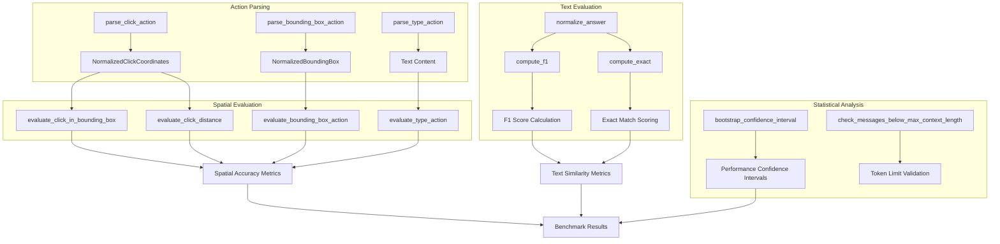
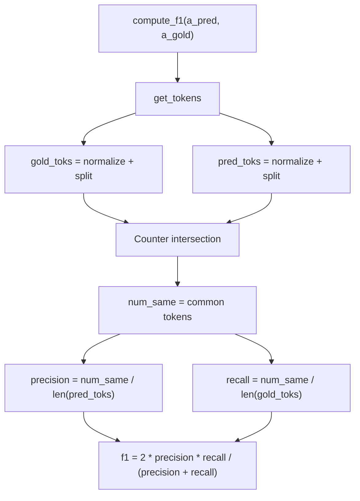
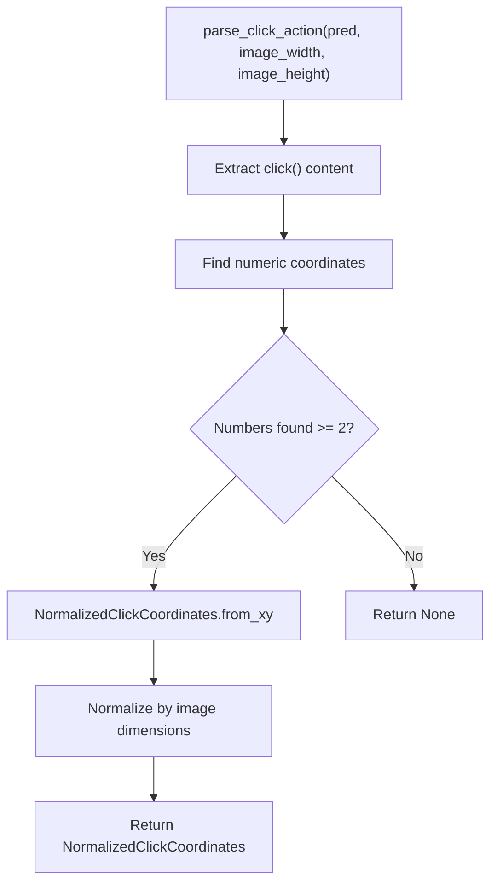
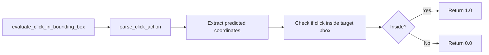
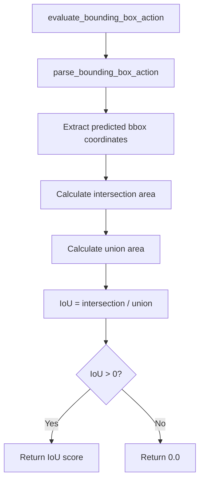
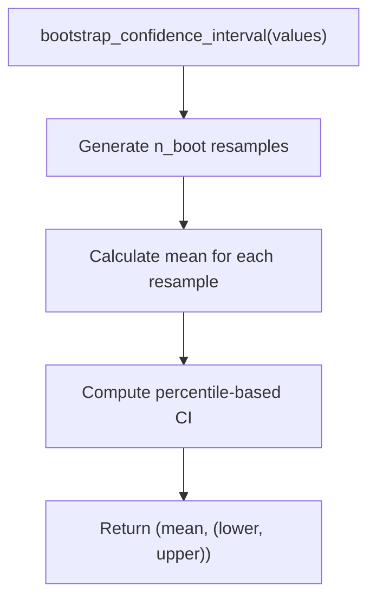
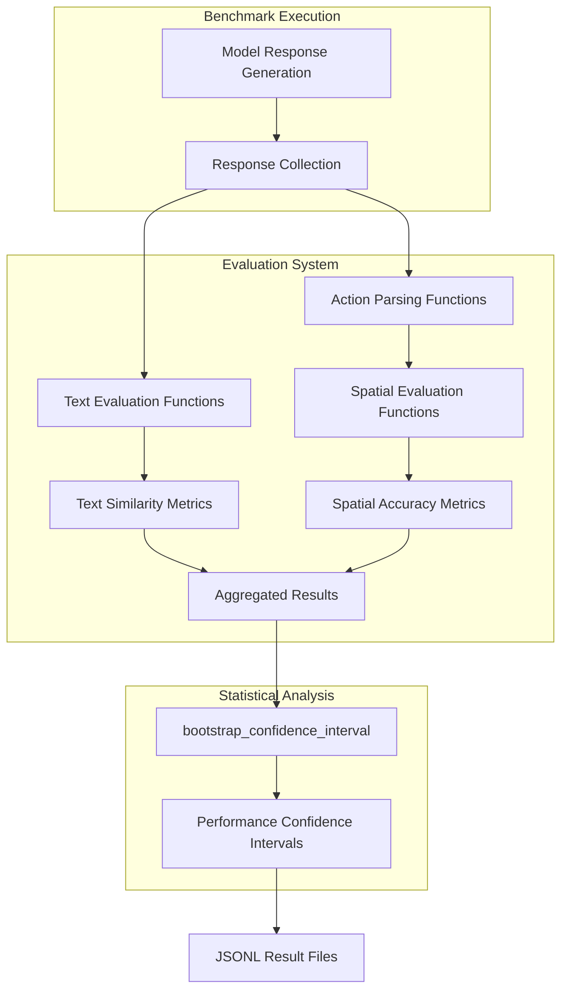

<!-- source: DeepWiki mcp.deepwiki.com · repo huggingface/screensuite · page 5 Evaluation System · fetched 2026-10-26 -->

# Evaluation System

<details>
<summary>Relevant source files</summary>

The following files were used as context for generating this wiki page:

- [src/screensuite/__init__.py](src/screensuite/__init__.py)
- [src/screensuite/benchmarks/singlestep/androidcontrol/prompt.py](src/screensuite/benchmarks/singlestep/androidcontrol/prompt.py)
- [src/screensuite/benchmarks/tests/test_utils.py](src/screensuite/benchmarks/tests/test_utils.py)
- [src/screensuite/benchmarks/utils.py](src/screensuite/benchmarks/utils.py)

</details>


The Evaluation System provides comprehensive metrics, scoring functions, and evaluation utilities used across all benchmark types in screensuite. It handles evaluation of text responses, spatial interactions (clicks, bounding boxes), and statistical analysis of results. The system ensures consistent and accurate measurement of model performance across diverse GUI agent tasks.

For information about how prompts are structured to guide model behavior, see [Prompt Systems](#5.1). For details on benchmark execution and model integration, see [Core Framework](#3).

## Core Evaluation Architecture

The evaluation system is built around modular utility functions that can be composed for different benchmark requirements. Each evaluation type handles specific aspects of GUI agent performance measurement.

**Evaluation System Components**



Sources: [src/screensuite/benchmarks/utils.py:1-264]()

## Text Evaluation Metrics

The text evaluation system handles comparison of predicted text against ground truth answers, supporting both exact matching and fuzzy similarity scoring.

### Answer Normalization

The `normalize_answer` function standardizes text for consistent comparison by removing articles, punctuation, and normalizing whitespace:

| Normalization Step | Function | Purpose |
|-------------------|----------|---------|
| Case normalization | `lower()` | Convert to lowercase |
| Article removal | `remove_articles()` | Remove "a", "an", "the" |
| Punctuation removal | `remove_punc()` | Strip all punctuation |
| Whitespace normalization | `white_space_fix()` | Normalize spacing |

### Scoring Functions

**F1 Score Calculation**



**Exact Match Evaluation**

The `compute_exact` function returns 1 for perfect matches after normalization, 0 otherwise. This binary metric is crucial for tasks requiring precise text reproduction.

Sources: [src/screensuite/benchmarks/utils.py:21-74](), [src/screensuite/benchmarks/tests/test_utils.py:19-79]()

## Action Parsing System

The action parsing system extracts structured actions from natural language model responses, supporting multiple action formats used across different benchmarks.

### Click Action Parsing

The `parse_click_action` function handles diverse click coordinate formats:

| Format Type | Example | Parsing Strategy |
|------------|---------|------------------|
| Normalized coordinates | `click(0.5, 0.75)` | Direct extraction |
| Pixel coordinates | `click(100, 200)` | Normalize by image dimensions |
| UITars format | `click(point='<point>100 200</point>')` | XML-like parsing |
| Start box format | `click(start_box='(537,212)')` | Parentheses extraction |

**Click Parsing Pipeline**



### Bounding Box Parsing

The `parse_bounding_box_action` function extracts rectangular regions in the format `boundingbox(x1,y1,x2,y2)` and converts them to `NormalizedBoundingBox` objects for consistent evaluation.

### Type Action Parsing

The `parse_type_action` function extracts text content from typing actions, handling both quoted and unquoted formats while preserving the intended text for comparison.

Sources: [src/screensuite/benchmarks/utils.py:76-139](), [src/screensuite/benchmarks/tests/test_utils.py:81-305]()

## Spatial Evaluation Metrics

Spatial evaluation measures the accuracy of predicted coordinates and regions against ground truth targets using geometric calculations.

### Click Accuracy Evaluation

**Bounding Box Containment**



**Distance-Based Scoring**

The `evaluate_click_distance` function computes proximity-based scores using normalized Euclidean distance:

```
distance = sqrt(((pred_x - gt_x)² + (pred_y - gt_y)²) / 2)
score = max(0, 1 - distance * 2)
```

### Bounding Box IoU Evaluation

The `evaluate_bounding_box_action` function calculates Intersection over Union (IoU) between predicted and ground truth bounding boxes:

**IoU Calculation Steps**



Sources: [src/screensuite/benchmarks/utils.py:141-218](), [src/screensuite/benchmarks/tests/test_utils.py:154-208]()

## Statistical Analysis Tools

The evaluation system includes statistical utilities for robust performance measurement and confidence estimation.

### Bootstrap Confidence Intervals

The `bootstrap_confidence_interval` function provides statistical confidence measures for benchmark results:

| Parameter | Default | Purpose |
|-----------|---------|---------|
| `n_boot` | 1000 | Number of bootstrap resamples |
| `ci` | 95 | Confidence level percentage |
| `seed` | 42 | Random seed for reproducibility |

**Bootstrap Process**



### Token Length Validation

The `check_messages_below_max_context_length` function validates that chat messages don't exceed model context limits using the Qwen processor for tokenization.

Sources: [src/screensuite/benchmarks/utils.py:220-264](), [src/screensuite/benchmarks/tests/test_utils.py:236-263]()

## Integration with Benchmark Pipeline

The evaluation system integrates seamlessly with the broader screensuite architecture through standardized interfaces and data models.

### Evaluation Flow Integration



### Data Model Integration

The evaluation system works with standardized data models:

- `NormalizedClickCoordinates`: Represents click positions with coordinate normalization
- `NormalizedBoundingBox`: Represents rectangular regions with dimension normalization
- `ChatMessage`: Standard format for model communication (imported from framework)

Sources: [src/screensuite/benchmarks/utils.py:13-16](), [src/screensuite/benchmarks/model.py]() (referenced in imports)

## Prompt Format Support

The evaluation system supports multiple action formats to accommodate different model training paradigms and benchmark requirements.

### Supported Action Formats

| Format | Coordinate System | Example Usage |
|--------|------------------|---------------|
| Normalized | 0.0-1.0 range | General benchmarks |
| Absolute Pixel | Raw pixel values | AndroidControl |
| UITars XML | XML-wrapped coordinates | Specialized UI models |

The `AndroidControlPrompt` enum demonstrates format variations:

- `ASSISTANT_PROMPT_NORMALIZED_CLICK`: Uses normalized coordinates
- `ASSISTANT_PROMPT_ABSOLUTE_CLICK`: Uses pixel coordinates  
- `ASSISTANT_PROMPT_ABSOLUTE_CLICK_UITARS`: Uses XML-wrapped format

Sources: [src/screensuite/benchmarks/singlestep/androidcontrol/prompt.py:1-52]()

---

