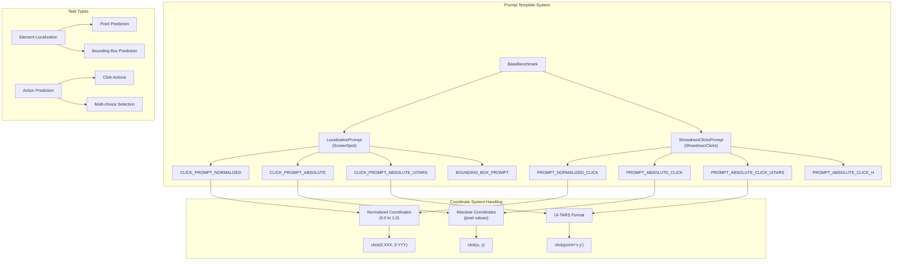
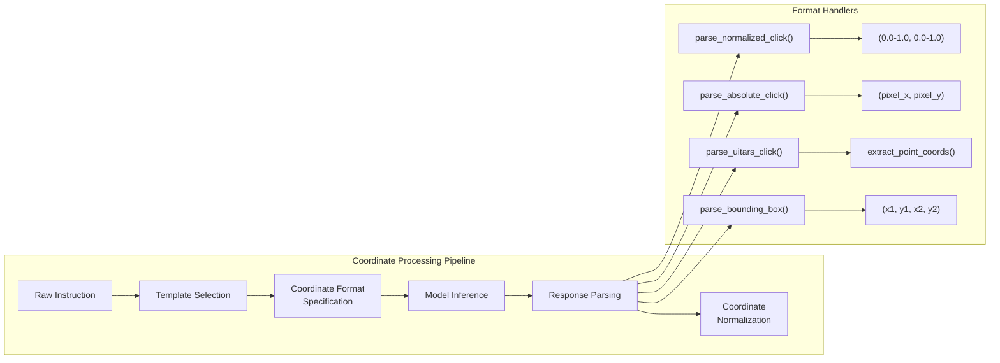
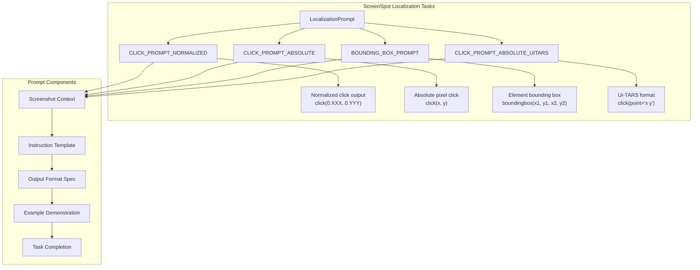
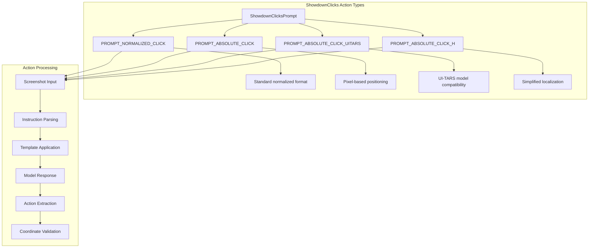
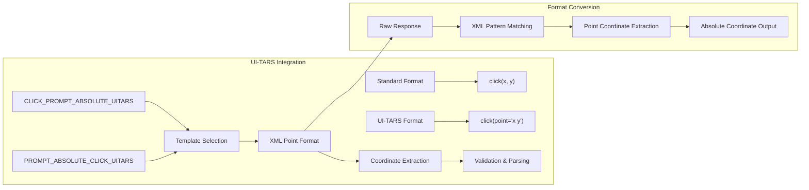
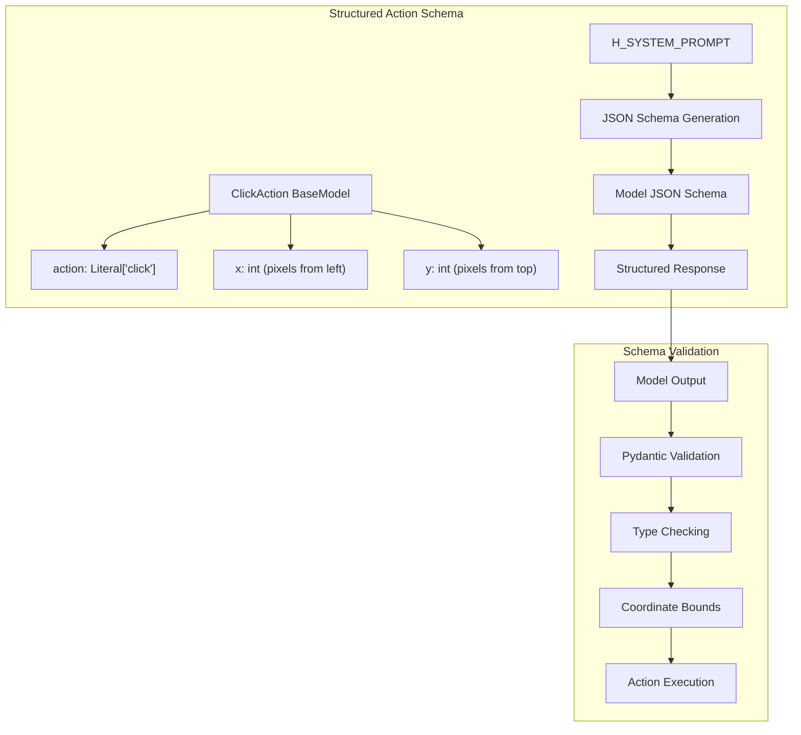
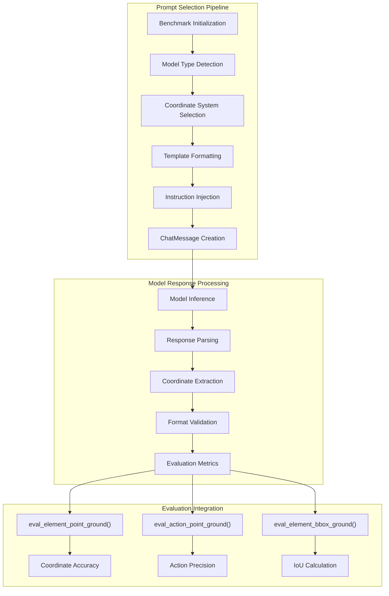

<!-- source: DeepWiki mcp.deepwiki.com · repo huggingface/screensuite · page 5.1 Prompt Systems · fetched 2026-10-26 -->

# Prompt Systems

<details>
<summary>Relevant source files</summary>

The following files were used as context for generating this wiki page:

- [src/screensuite/benchmarks/perception/screenspot/prompt.py](src/screensuite/benchmarks/perception/screenspot/prompt.py)
- [src/screensuite/benchmarks/singlestep/showdown_clicks/prompt.py](src/screensuite/benchmarks/singlestep/showdown_clicks/prompt.py)
- [src/screensuite/benchmarks/singlestep/showdown_clicks/utils.py](src/screensuite/benchmarks/singlestep/showdown_clicks/utils.py)

</details>


The prompt systems in screensuite define how models are instructed to perform GUI interaction tasks across different benchmarks. These systems standardize the communication between the evaluation framework and various multimodal models, ensuring consistent task specifications and output formats. This page covers the prompt templates, coordinate system handling, and model-specific adaptations used throughout the benchmarking pipeline.

For information about how prompts integrate with the broader evaluation pipeline, see [Response Generation System](#3.3). For details on how prompt outputs are processed and scored, see [Evaluation System](#5).

## Prompt Architecture Overview

The prompt system is organized around task-specific enums that define templates for different interaction types. Each benchmark implements its own prompt variations to handle coordinate systems, output formats, and model-specific requirements.



Sources: [src/screensuite/benchmarks/perception/screenspot/prompt.py:1-57](), [src/screensuite/benchmarks/singlestep/showdown_clicks/prompt.py:1-47]()

## Coordinate System Standardization

The framework supports multiple coordinate systems to accommodate different model architectures and training paradigms. Each coordinate system has specific prompt templates and parsing requirements.

| Coordinate Type | Format | Use Case | Example Output |
|----------------|--------|----------|----------------|
| Normalized | `click(0.XXX, 0.YYY)` | General models, resolution-independent | `click(0.254, 0.753)` |
| Absolute | `click(x, y)` | Pixel-precise models | `click(412, 387)` |
| UI-TARS | `click(point='<point>x y</point>')` | UI-TARS model format | `click(point='<point>412 387</point>')` |
| Bounding Box | `boundingbox(x1, y1, x2, y2)` | Element localization | `boundingbox(0.1, 0.2, 0.3, 0.4)` |



Sources: [src/screensuite/benchmarks/perception/screenspot/prompt.py:5-20](), [src/screensuite/benchmarks/perception/screenspot/prompt.py:22-31](), [src/screensuite/benchmarks/perception/screenspot/prompt.py:33-40]()

## Task-Specific Prompt Patterns

### Element Localization Prompts

Element localization tasks require models to identify and target specific GUI elements. The `LocalizationPrompt` enum provides templates for different localization scenarios.



The normalized click prompt template demonstrates the standard structure:

```
Using the screenshot, you will get an instruction and will need to output a click that completes the instruction or targets the given element.

Just write your action as follows:
Action: click(0.XXX, 0.YYY)

With 0.XXX and 0.YYY the normalized coordinates of the click position on the screenshot, representing relative horizontal (X-axis) and vertical (Y-axis) positions on the screen respectively.

For example, this action would click towards the top left of the screen:
Action: click(0.254, 0.753)

Keep the answer concise and to the point. The action should be formatted as above.
When clicking an element, always click the center of the element.

Now write the click needed to complete the instruction:
Instruction: {instruction}
```

Sources: [src/screensuite/benchmarks/perception/screenspot/prompt.py:4-20](), [src/screensuite/benchmarks/perception/screenspot/prompt.py:45-56]()

### Action Prediction Prompts  

Action prediction tasks in `ShowdownClicksPrompt` focus on immediate GUI interactions based on visual screenshots and instructions.



Sources: [src/screensuite/benchmarks/singlestep/showdown_clicks/prompt.py:4-47]()

## Model-Specific Adaptations

### UI-TARS Format Support

The UI-TARS model requires a specific XML-like format for coordinate specification. Both `LocalizationPrompt` and `ShowdownClicksPrompt` include UI-TARS variants.



Sources: [src/screensuite/benchmarks/perception/screenspot/prompt.py:33-40](), [src/screensuite/benchmarks/singlestep/showdown_clicks/prompt.py:33-43]()

### Specialized Model Integration

The `H_SYSTEM_PROMPT` in the utilities demonstrates integration with structured model schemas for action specification.



Sources: [src/screensuite/benchmarks/singlestep/showdown_clicks/utils.py:208-219]()

## Integration with Evaluation Pipeline

Prompts are dynamically selected and formatted during benchmark execution, with the choice depending on the model being evaluated and the specific task requirements.



Sources: [src/screensuite/benchmarks/singlestep/showdown_clicks/utils.py:131-155](), [src/screensuite/benchmarks/singlestep/showdown_clicks/utils.py:66-87]()

---

