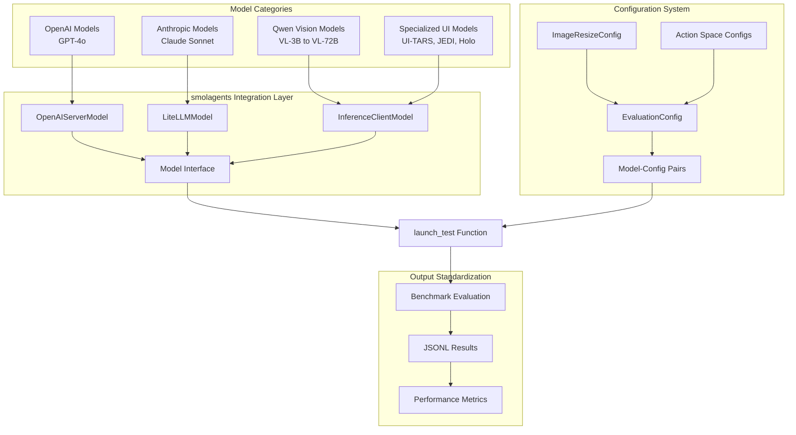
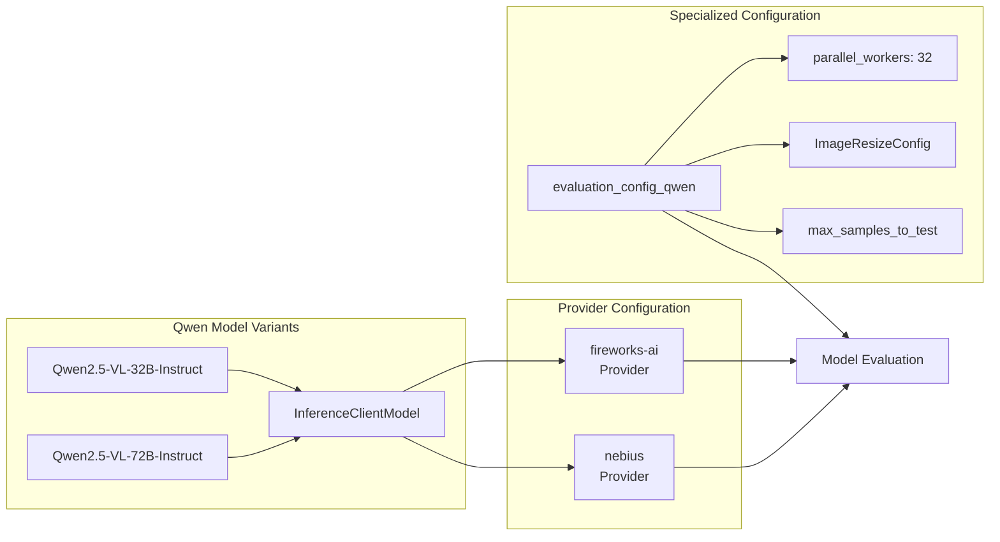
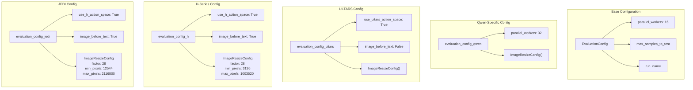
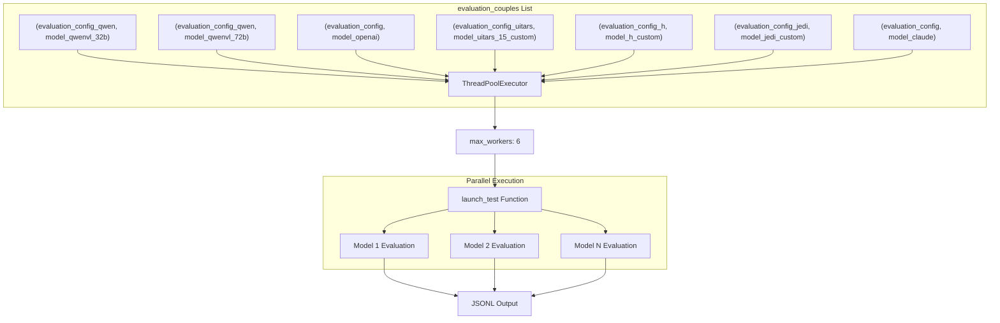
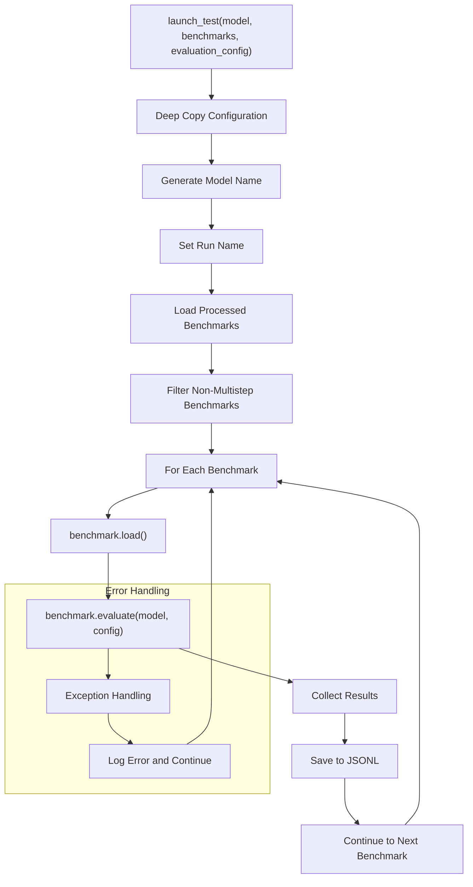
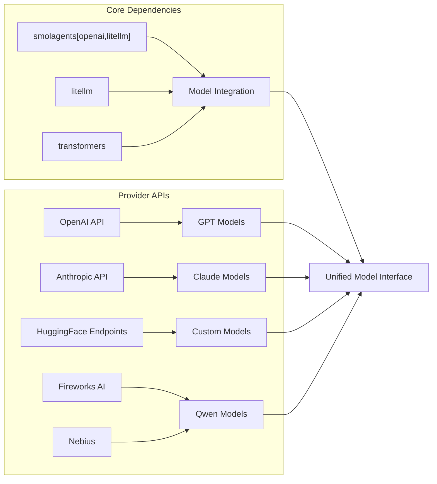

<!-- source: DeepWiki mcp.deepwiki.com · repo huggingface/screensuite · page 6 Model Integration · fetched 2026-10-26 -->

# Model Integration

Relevant source files

The following files were used as context for generating this wiki page:

- [examples/run_benchmarks.py](examples/run_benchmarks.py)
- [output/0_reference/Qwen-Qwen2.5-VL-32B-Instruct_2025-06-05.jsonl](output/0_reference/Qwen-Qwen2.5-VL-32B-Instruct_2025-06-05.jsonl)
- [output/0_reference/Qwen-Qwen2.5-VL-72B-Instruct_2025-06-05.jsonl](output/0_reference/Qwen-Qwen2.5-VL-72B-Instruct_2025-06-05.jsonl)
- [output/0_reference/anthropic-claude-sonnet-4-20250514_2025-06-05.jsonl](output/0_reference/anthropic-claude-sonnet-4-20250514_2025-06-05.jsonl)
- [output/0_reference/gpt-4o_2025-06-05.jsonl](output/0_reference/gpt-4o_2025-06-05.jsonl)
- [output/0_reference/holo-7b_2025-06-06.jsonl](output/0_reference/holo-7b_2025-06-06.jsonl)
- [output/0_reference/jedi-7b_2025-06-05.jsonl](output/0_reference/jedi-7b_2025-06-05.jsonl)
- [output/0_reference/mistralai-Mistral-Small-3.1-24B-Instruct-2503_2025-06-05.jsonl](output/0_reference/mistralai-Mistral-Small-3.1-24B-Instruct-2503_2025-06-05.jsonl)
- [output/0_reference/qwen2-5-vl-3b_2025-06-05.jsonl](output/0_reference/qwen2-5-vl-3b_2025-06-05.jsonl)
- [output/0_reference/qwen2-5-vl-7b_2025-06-05.jsonl](output/0_reference/qwen2-5-vl-7b_2025-06-05.jsonl)
- [output/0_reference/ui-tars-1-5-7b_2025-06-05.jsonl](output/0_reference/ui-tars-1-5-7b_2025-06-05.jsonl)
- [pyproject.toml](pyproject.toml)
- [src/screensuite/response_generation.py](src/screensuite/response_generation.py)

This document describes how different types of machine learning models are integrated into the screensuite benchmarking framework. It covers model instantiation, configuration management, and the execution pipeline that enables fair comparison across diverse model architectures and providers.

For information about benchmark execution and evaluation metrics, see [Evaluation System](#5). For details about response generation and processing pipelines, see [Response Generation System](#3.3).

## Model Architecture Overview

The screensuite framework supports four main categories of models through a unified integration layer built on the `smolagents` library. Each model type requires specific configuration and setup patterns.

**Sources**: [examples/run_benchmarks.py:10-13](), [examples/run_benchmarks.py:111-206]()

## Model Types and Instantiation

### OpenAI Models

OpenAI models use the `OpenAIServerModel` class with direct API integration. Configuration is straightforward with standard parameters.

| Parameter | Value | Purpose |
|-----------|--------|---------|
| `model_id` | `"gpt-4o"` | Specifies the model variant |
| `max_tokens` | `4096` | Controls response length |

**Sources**: [examples/run_benchmarks.py:111-114]()

### Anthropic Models  

Anthropic models integrate through `LiteLLMModel` which provides a unified interface for various model providers.

| Parameter | Value | Purpose |
|-----------|--------|---------|
| `model_id` | `"anthropic/claude-sonnet-4-20250514"` | Provider-prefixed model identifier |
| `max_tokens` | `4096` | Response length limitation |

**Sources**: [examples/run_benchmarks.py:116-119]()

### Qwen Vision-Language Models

Qwen models use `InferenceClientModel` with provider-specific endpoints. These models demonstrate the highest performance across most benchmarks.

**Sources**: [examples/run_benchmarks.py:123-140]()

### Specialized UI Models

Specialized UI models (UI-TARS, JEDI, Holo) require custom configurations including specific action spaces and image processing parameters.

| Model | Endpoint Type | Action Space | Image Position |
|-------|---------------|--------------|----------------|
| UI-TARS | Custom HuggingFace | `use_uitars_action_space` | `image_before_text: False` |
| JEDI | Custom HuggingFace | `use_h_action_space` | `image_before_text: True` |
| Holo | Custom HuggingFace | `use_h_action_space` | `image_before_text: True` |

**Sources**: [examples/run_benchmarks.py:144-196]()

## Configuration System

### EvaluationConfig Variants

Different model types require specialized `EvaluationConfig` instances to optimize performance and compatibility.

**Sources**: [examples/run_benchmarks.py:105-191]()

### Image Processing Configuration

The `ImageResizeConfig` class handles model-specific image preprocessing requirements:

| Model Type | Factor | Min Pixels | Max Pixels | Purpose |
|------------|--------|------------|------------|---------|
| Standard | Default | Default | Default | General compatibility |
| Holo | 28 | 3,136 | 1,003,520 | Optimized for model architecture |
| JEDI | 28 | 12,544 | 2,116,800 | Higher resolution support |

**Sources**: [examples/run_benchmarks.py:166-190]()

## Model-Configuration Pairing

The framework uses a tuple-based system to pair models with their appropriate configurations for parallel execution.

**Sources**: [examples/run_benchmarks.py:198-214]()

## Integration Pipeline

### Model Loading and Execution

The `launch_test` function orchestrates model evaluation with proper configuration handling and result storage.

**Sources**: [examples/run_benchmarks.py:23-77]()

### Model Name Resolution

The system handles various model identifier formats for consistent naming:

| Model Type | Identifier Format | Resolved Name |
|------------|------------------|---------------|
| Standard | `"gpt-4o"` | `"gpt-4o"` |
| URL-based | `"https://...endpoint.cloud"` | Last 10 characters |
| Custom | `None` | `"custom-endpoint"` |
| Path-based | `"Qwen/Model-Name"` | Full path |

**Sources**: [examples/run_benchmarks.py:25-30]()

## Performance Results Integration

### Results Storage Format

All models output results in a standardized JSONL format enabling cross-model comparison:

| Field | Purpose | Example |
|-------|---------|---------|
| `benchmark_name` | Identifies the benchmark | `"android_control"` |
| `metrics` | Performance measurements | `{"action_acc": 0.64, ...}` |
| `proportion_missing` | Failed inference rate | `0.103` |
| `count_samples` | Total samples evaluated | `1569` |

**Sources**: [examples/run_benchmarks.py:71-73](), [output/0_reference/*.jsonl files]()

### Performance Comparison Overview

Based on the results files, model performance varies significantly across categories:

| Model Category | Best Performer | Action Accuracy | Key Strength |
|----------------|----------------|-----------------|--------------|
| Large VL Models | Qwen2.5-VL-72B | 0.648 | Consistent high performance |
| Mid-size VL Models | Qwen2.5-VL-32B | 0.619 | Good balance of speed/accuracy |
| General Purpose | Claude Sonnet | 0.082 | Text understanding tasks |
| Specialized UI | Holo-7B | 0.494 | Domain-specific optimization |

**Sources**: [output/0_reference/Qwen-Qwen2.5-VL-72B-Instruct_2025-06-05.jsonl](), [output/0_reference/Qwen-Qwen2.5-VL-32B-Instruct_2025-06-05.jsonl](), [output/0_reference/anthropic-claude-sonnet-4-20250514_2025-06-05.jsonl](), [output/0_reference/holo-7b_2025-06-06.jsonl]()

## Dependencies and Requirements

The model integration system relies on specific dependencies for different model types:

**Sources**: [pyproject.toml:11-25]()

---

