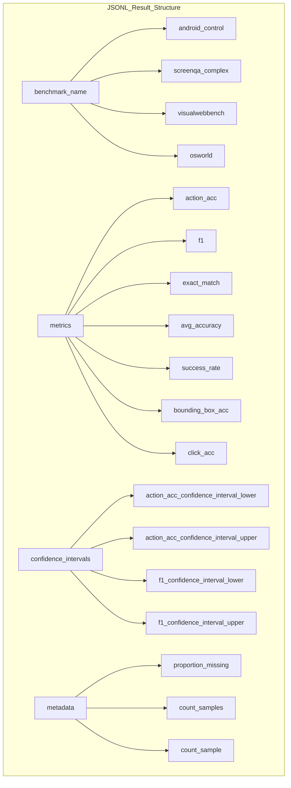
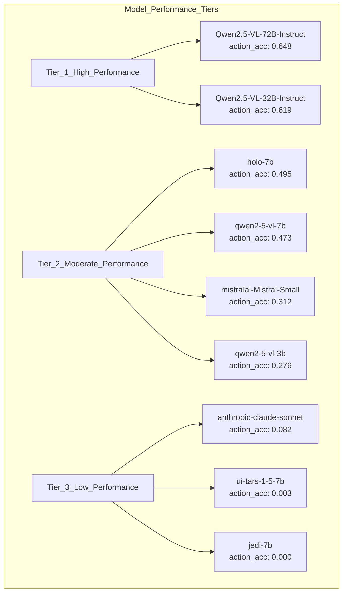
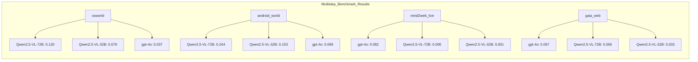
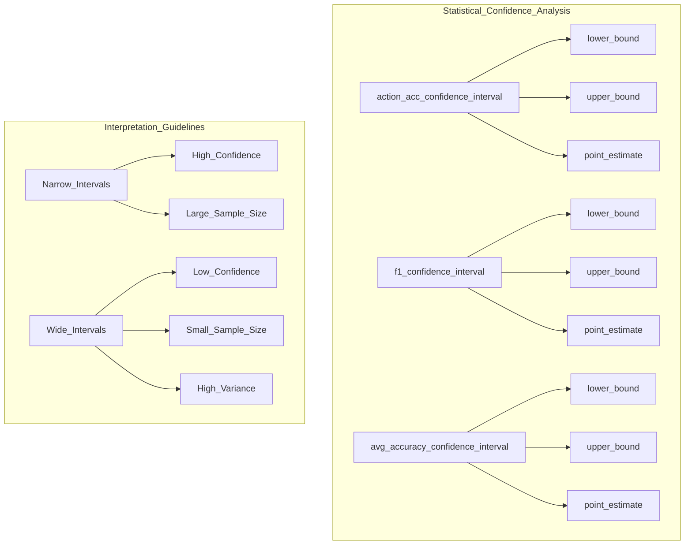

<!-- source: DeepWiki mcp.deepwiki.com · repo huggingface/screensuite · page 7 Results and Performance Analysis · fetched 2026-10-26 -->

# Results and Performance Analysis

Relevant source files

The following files were used as context for generating this wiki page:

- [output/0_reference/Qwen-Qwen2.5-VL-32B-Instruct_2025-06-05.jsonl](output/0_reference/Qwen-Qwen2.5-VL-32B-Instruct_2025-06-05.jsonl)
- [output/0_reference/Qwen-Qwen2.5-VL-72B-Instruct_2025-06-05.jsonl](output/0_reference/Qwen-Qwen2.5-VL-72B-Instruct_2025-06-05.jsonl)
- [output/0_reference/anthropic-claude-sonnet-4-20250514_2025-06-05.jsonl](output/0_reference/anthropic-claude-sonnet-4-20250514_2025-06-05.jsonl)
- [output/0_reference/gpt-4o_2025-06-05.jsonl](output/0_reference/gpt-4o_2025-06-05.jsonl)
- [output/0_reference/holo-7b_2025-06-06.jsonl](output/0_reference/holo-7b_2025-06-06.jsonl)
- [output/0_reference/jedi-7b_2025-06-05.jsonl](output/0_reference/jedi-7b_2025-06-05.jsonl)
- [output/0_reference/mistralai-Mistral-Small-3.1-24B-Instruct-2503_2025-06-05.jsonl](output/0_reference/mistralai-Mistral-Small-3.1-24B-Instruct-2503_2025-06-05.jsonl)
- [output/0_reference/qwen2-5-vl-3b_2025-06-05.jsonl](output/0_reference/qwen2-5-vl-3b_2025-06-05.jsonl)
- [output/0_reference/qwen2-5-vl-7b_2025-06-05.jsonl](output/0_reference/qwen2-5-vl-7b_2025-06-05.jsonl)
- [output/0_reference/ui-tars-1-5-7b_2025-06-05.jsonl](output/0_reference/ui-tars-1-5-7b_2025-06-05.jsonl)

This page covers the interpretation and analysis of benchmark results generated by the screensuite framework. It explains the output format structure, performance metrics, and provides comparative analysis across different models and benchmark categories.

For information about the evaluation system and metrics computation, see [Evaluation System](#5). For details about specific benchmark implementations, see [Benchmark Categories](#4).

## Output Format and Structure

Benchmark results are stored as JSONL files in the `output/0_reference/` directory, with one file per model containing all benchmark results for that model. Each line represents results from a single benchmark evaluation.

### JSONL Result Schema

**Sources:** [output/0_reference/qwen2-5-vl-3b_2025-06-05.jsonl:1-9](), [output/0_reference/Qwen-Qwen2.5-VL-72B-Instruct_2025-06-05.jsonl:1-13]()

### Key Metric Types

| Metric Category | Metrics | Benchmarks Using |
|-----------------|---------|------------------|
| **Action Accuracy** | `action_acc`, `test_website_click_acc`, `test_website_type_acc` | `android_control`, `mmind2web` |
| **Text Matching** | `exact_match`, `f1` | `screenqa_complex`, `screenqa_short`, `websrc_dev` |
| **Spatial Accuracy** | `avg_accuracy`, `success_rate`, `bounding_box_acc`, `click_acc` | `screenspot-pro-click-prompt`, `screenspot-v2-click-prompt`, `showdown_clicks` |
| **Multi-task Composite** | `web_caption`, `heading_ocr`, `webqa`, `element_ocr`, `action_prediction`, `element_ground`, `action_ground`, `average` | `visualwebbench` |
| **Task Success** | `avg_accuracy` | `android_world`, `osworld`, `gaia_web`, `mind2web_live` |

**Sources:** [output/0_reference/qwen2-5-vl-3b_2025-06-05.jsonl:1-8](), [output/0_reference/Qwen-Qwen2.5-VL-72B-Instruct_2025-06-05.jsonl:7-7]()

## Model Performance Comparison

### Overall Performance Rankings

**Sources:** [output/0_reference/Qwen-Qwen2.5-VL-72B-Instruct_2025-06-05.jsonl:1-1](), [output/0_reference/Qwen-Qwen2.5-VL-32B-Instruct_2025-06-05.jsonl:3-3](), [output/0_reference/holo-7b_2025-06-06.jsonl:1-1](), [output/0_reference/qwen2-5-vl-7b_2025-06-05.jsonl:1-1](), [output/0_reference/mistralai-Mistral-Small-3.1-24B-Instruct-2503_2025-06-05.jsonl:1-1]()

### Performance by Benchmark Category

#### Perception Benchmarks Performance

| Model | WebSrc F1 | ScreenQA Short F1 | ScreenQA Complex F1 |
|-------|-----------|-------------------|---------------------|
| **claude-sonnet** | **0.950** | **0.880** | 0.674 |
| **Qwen2.5-VL-72B** | 0.946 | 0.848 | **0.791** |
| **qwen2-5-vl-7b** | 0.942 | 0.853 | 0.769 |
| **Qwen2.5-VL-32B** | 0.923 | 0.847 | 0.739 |
| **ui-tars-7b** | 0.899 | 0.854 | 0.765 |
| **holo-7b** | 0.911 | 0.848 | 0.368 |
| **mistral-small** | 0.882 | 0.806 | 0.696 |
| **qwen2-5-vl-3b** | 0.915 | 0.839 | 0.747 |
| **jedi-7b** | 0.901 | 0.770 | 0.539 |

**Sources:** [output/0_reference/anthropic-claude-sonnet-4-20250514_2025-06-05.jsonl:8-8](), [output/0_reference/Qwen-Qwen2.5-VL-72B-Instruct_2025-06-05.jsonl:8-8](), [output/0_reference/qwen2-5-vl-7b_2025-06-05.jsonl:8-8]()

#### Spatial Grounding Performance

| Model | ScreenSpot-v2 Accuracy | ScreenSpot-Pro Accuracy | Showdown Clicks Click Acc |
|-------|------------------------|-------------------------|----------------------------|
| **Qwen2.5-VL-72B** | **0.933** | **0.557** | 0.141 |
| **Qwen2.5-VL-32B** | 0.857 | 0.440 | 0.150 |
| **qwen2-5-vl-7b** | 0.857 | 0.223 | **0.155** |
| **qwen2-5-vl-3b** | 0.800 | 0.293 | 0.159 |
| **ui-tars-7b** | 0.740 | 0.386 | 0.150 |
| **holo-7b** | - | - | 0.144 |
| **claude-sonnet** | 0.185 | 0.004 | 0.135 |
| **mistral-small** | 0.037 | 0.003 | 0.224 |
| **gpt-4o** | 0.037 | 0.007 | - |
| **jedi-7b** | 0.016 | 0.000 | 0.059 |

**Sources:** [output/0_reference/Qwen-Qwen2.5-VL-72B-Instruct_2025-06-05.jsonl:4-6](), [output/0_reference/Qwen-Qwen2.5-VL-32B-Instruct_2025-06-05.jsonl:1-6](), [output/0_reference/gpt-4o_2025-06-05.jsonl:1-2]()

## Benchmark-Specific Analysis

### Multistep Online Agent Performance

**Sources:** [output/0_reference/Qwen-Qwen2.5-VL-72B-Instruct_2025-06-05.jsonl:10-12](), [output/0_reference/Qwen-Qwen2.5-VL-32B-Instruct_2025-06-05.jsonl:9-12](), [output/0_reference/gpt-4o_2025-06-05.jsonl:3-6]()

### Missing Response Analysis

The `proportion_missing` metric indicates how often models fail to provide responses. High missing rates suggest model limitations or infrastructure issues:

| Model | Android Control Missing | VisualWebBench Missing | ScreenSpot-Pro Missing |
|-------|-------------------------|------------------------|------------------------|
| **qwen2-5-vl-3b** | 67.9% | 92.2% | 38.7% |
| **qwen2-5-vl-7b** | 66.0% | 74.8% | 38.7% |
| **ui-tars-7b** | 64.2% | 92.2% | 38.7% |
| **jedi-7b** | 74.1% | 20.4% | 56.0% |
| **holo-7b** | 25.4% | 92.2% | - |
| **Qwen2.5-VL-32B** | 4.5% | 0.0% | 0.7% |
| **Qwen2.5-VL-72B** | 10.3% | 54.4% | 0.0% |
| **claude-sonnet** | 7.9% | 0.0% | 21.3% |

**Sources:** [output/0_reference/qwen2-5-vl-3b_2025-06-05.jsonl:1-7](), [output/0_reference/jedi-7b_2025-06-05.jsonl:1-8](), [output/0_reference/Qwen-Qwen2.5-VL-32B-Instruct_2025-06-05.jsonl:1-7]()

## Statistical Significance and Confidence Intervals

Results include 95% confidence intervals for key metrics, computed using bootstrap sampling. These provide statistical bounds on the true performance:

### Confidence Interval Analysis

**Sources:** [output/0_reference/Qwen-Qwen2.5-VL-72B-Instruct_2025-06-05.jsonl:1-8](), [output/0_reference/Qwen-Qwen2.5-VL-32B-Instruct_2025-06-05.jsonl:1-8]()

## Key Performance Insights

### Scale Effects

Clear performance improvements with model size in the Qwen2.5-VL series:
- **72B parameters**: 0.648 action accuracy on `android_control`
- **32B parameters**: 0.619 action accuracy on `android_control`  
- **7B parameters**: 0.473 action accuracy on `android_control`
- **3B parameters**: 0.276 action accuracy on `android_control`

### Vision-Language Specialization

Models specifically trained for vision-language tasks significantly outperform general-purpose models on GUI interaction:
- **Qwen2.5-VL models** consistently achieve highest scores across spatial grounding tasks
- **Claude Sonnet** excels at text understanding but struggles with spatial tasks
- **GPT-4o** shows mixed performance, strong on some multistep tasks but weak on spatial grounding

### UI-Specific Model Performance

Specialized UI models show inconsistent results:
- **UI-TARS-7B**: Good text understanding (0.899 WebSrc F1) but poor action accuracy (0.003)
- **JEDI-7B**: Complete failure on action prediction tasks (0.000 action accuracy)
- **Holo-7B**: Moderate performance across tasks (0.495 action accuracy)

**Sources:** [output/0_reference/Qwen-Qwen2.5-VL-72B-Instruct_2025-06-05.jsonl:1-13](), [output/0_reference/ui-tars-1-5-7b_2025-06-05.jsonl:1-8](), [output/0_reference/jedi-7b_2025-06-05.jsonl:1-9](), [output/0_reference/holo-7b_2025-06-06.jsonl:1-6]()

---

