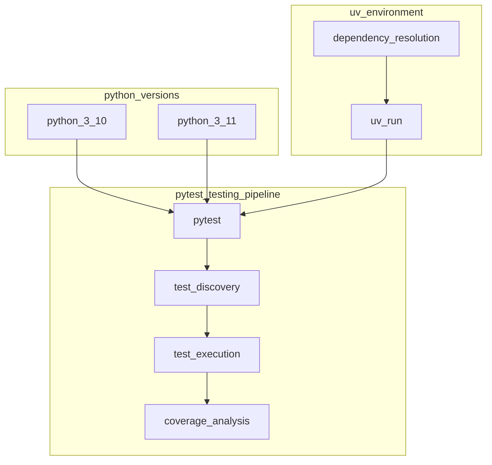
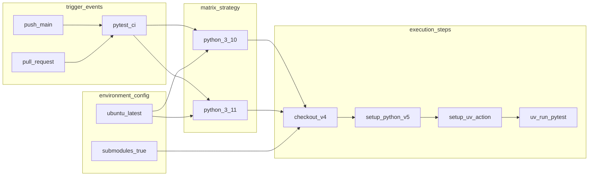
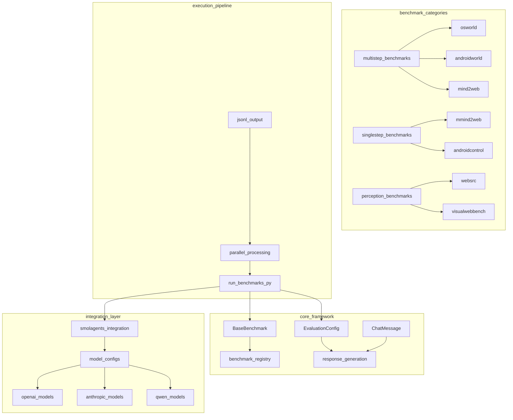

<!-- source: DeepWiki mcp.deepwiki.com · repo huggingface/screensuite · page 8 Development and Contributing · fetched 2026-10-26 -->

# Development and Contributing

Relevant source files

The following files were used as context for generating this wiki page:

- [.github/workflows/pytest.yml](.github/workflows/pytest.yml)
- [.gitignore](.gitignore)

This document provides comprehensive guidance for developers contributing to the screensuite benchmarking framework. It covers development environment setup, code quality standards, testing infrastructure, and the contribution workflow. For information about the core framework architecture, see [Core Framework](#3). For details about running benchmarks and basic usage, see [Getting Started](#2).

## Development Environment Setup

The screensuite project uses modern Python tooling with `uv` for dependency management and virtual environment handling. The development environment supports Python 3.10 and 3.11, as configured in the CI pipeline.

### Environment Configuration

The project follows standard Python development practices with comprehensive exclusions for generated files and environment-specific directories. The development environment excludes several categories of files and directories to maintain a clean workspace:

| Category | Excluded Items | Purpose |
|----------|---------------|---------|
| Python Runtime | `__pycache__/`, `*.pyc`, `.pytest_cache/` | Compiled bytecode and test artifacts |
| Virtual Environments | `.venv/`, `venv/`, `ENV/` | Local development environments |
| Build Artifacts | `build/`, `dist/`, `*.egg-info/` | Package distribution files |
| Benchmarking Data | `**/docker_vm_data/`, `**/cache/`, `examples/output/` | Runtime data and cached results |
| Dependencies | `uv.lock` | Lock file management |

**Sources:** [.gitignore:1-191]()

### Dependency Management

The project uses `uv` as the primary dependency manager, which provides fast package resolution and installation. The CI pipeline demonstrates the standard setup pattern using `uv run` for executing commands within the managed environment.

## Code Quality and Testing Infrastructure

### Testing Framework

The project implements comprehensive testing using `pytest` as the primary testing framework. The testing infrastructure supports multiple Python versions to ensure compatibility across different deployment environments.

#### Testing Configuration

Testing Pipeline Architecture

The testing pipeline integrates with the `uv` dependency management system to ensure consistent environments across development and CI contexts. Test execution occurs within isolated environments managed by `uv run pytest`.

**Sources:** [.github/workflows/pytest.yml:27-29]()

### Code Quality Standards

The project maintains code quality through several mechanisms:

- **Linting**: Ruff cache management indicates the use of the Ruff linter for code style enforcement
- **Type Checking**: Configuration for mypy, pytype, and Pyre type checkers
- **Coverage Analysis**: HTML coverage reports and coverage.xml generation

**Sources:** [.gitignore:170-171](), [.gitignore:149-158](), [.gitignore:39-52]()

## CI/CD Pipeline

### GitHub Actions Workflow

The continuous integration pipeline implements a matrix strategy for comprehensive testing across supported Python versions. The workflow triggers on both push events to the main branch and pull request creation.

#### CI Pipeline Structure

CI/CD Pipeline Flow

The pipeline uses GitHub Actions with specific version pins for reliability: `checkout@v4` for repository access and `setup-python@v5` for Python environment configuration. The workflow includes submodule initialization, indicating dependencies on external repositories.

**Sources:** [.github/workflows/pytest.yml:1-30]()

### Pipeline Configuration

| Component | Configuration | Purpose |
|-----------|--------------|---------|
| Trigger Events | `push: [main]`, `pull_request: [main]` | Automated quality gates |
| Python Versions | `3.10`, `3.11` | Multi-version compatibility |
| Runner Environment | `ubuntu-latest` | Consistent Linux environment |
| Submodule Handling | `submodules: true` | External dependency integration |

## Contributing Workflow

### Development Process

Contributors should follow the established workflow that integrates with the CI/CD infrastructure:

1. **Environment Setup**: Use `uv` for dependency management and virtual environment creation
2. **Code Quality**: Ensure compliance with Ruff linting standards and type checking requirements  
3. **Testing**: Execute `pytest` locally before submitting changes
4. **Submission**: Create pull requests that trigger the automated CI pipeline

### Project Structure for Developers

The screensuite codebase follows a modular architecture that supports extensibility for new benchmarks and model integrations. Understanding the core structure helps developers navigate and contribute effectively.

#### Core Development Areas

Developer-Focused Architecture Overview

This architecture diagram highlights the key extension points for developers: `BaseBenchmark` for new benchmark types, model integration through configuration classes, and the central `run_benchmarks.py` orchestration system.

### Adding New Components

#### Benchmark Development

New benchmarks should inherit from `BaseBenchmark` and implement the required interface methods. The benchmark registry automatically discovers properly structured benchmark classes.

#### Model Integration

Model integrations follow the established pattern of configuration classes that interface with the `smolagents` integration layer. New models require configuration classes and appropriate API client setup.

### Testing and Validation

Contributors should ensure their changes pass the full test suite across both supported Python versions. The CI pipeline provides automated validation, but local testing with `uv run pytest` is recommended for faster iteration.

**Sources:** [.github/workflows/pytest.yml:14-29]()

---

