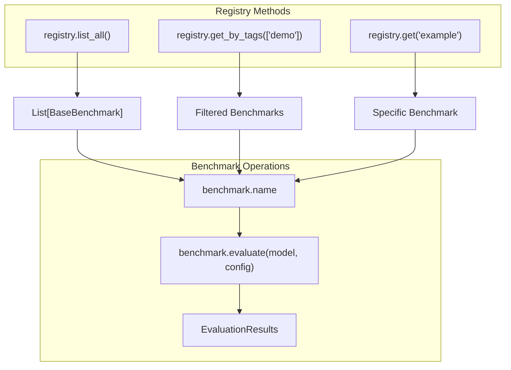
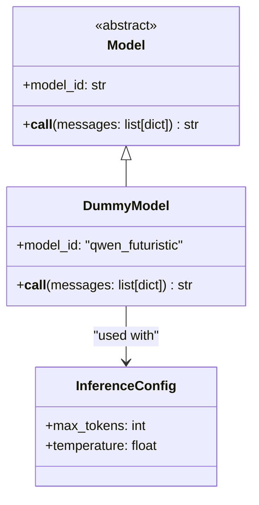
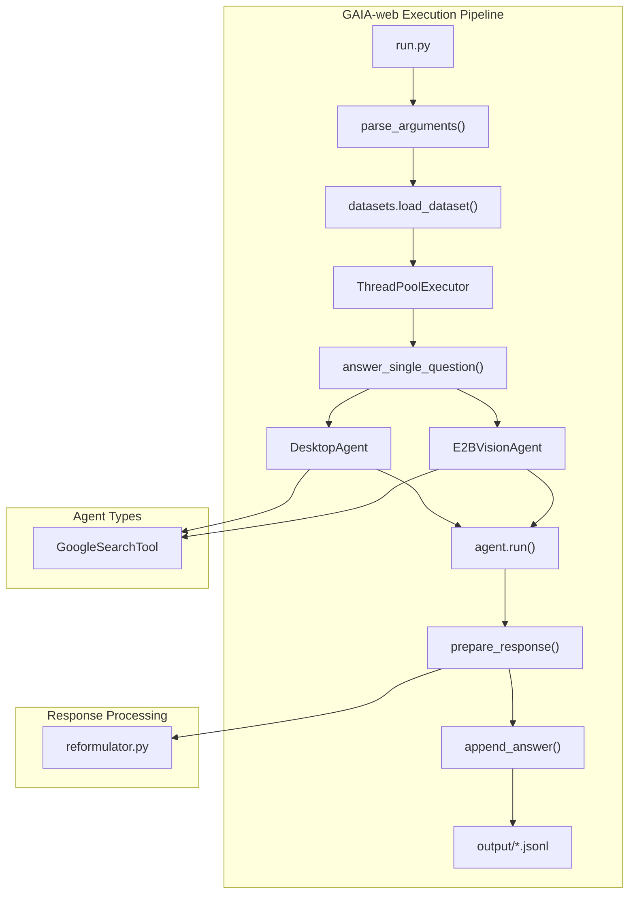
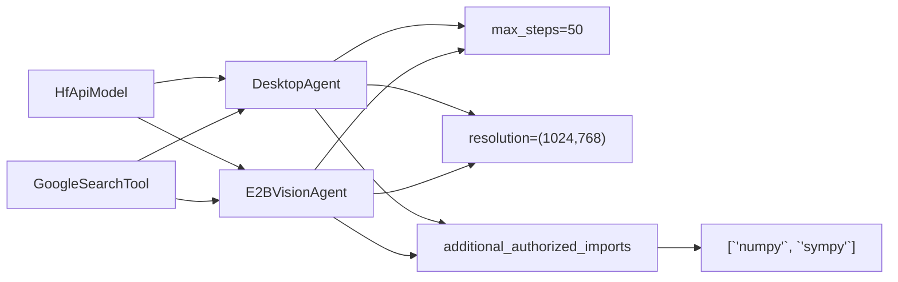
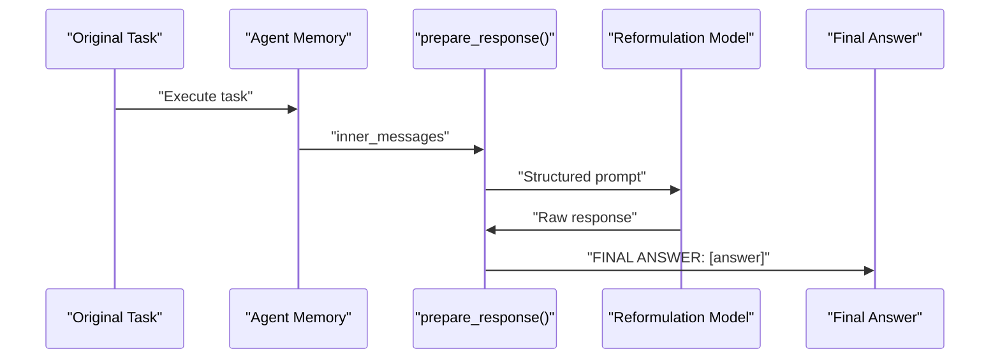
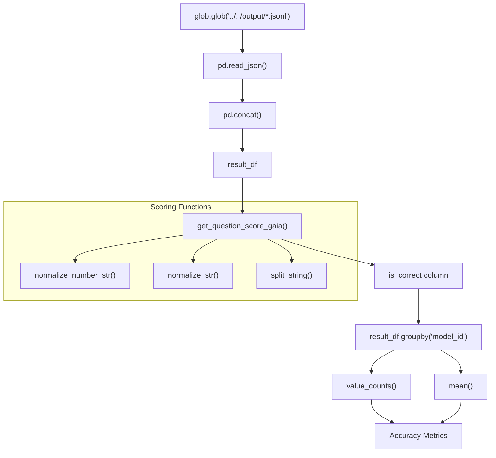
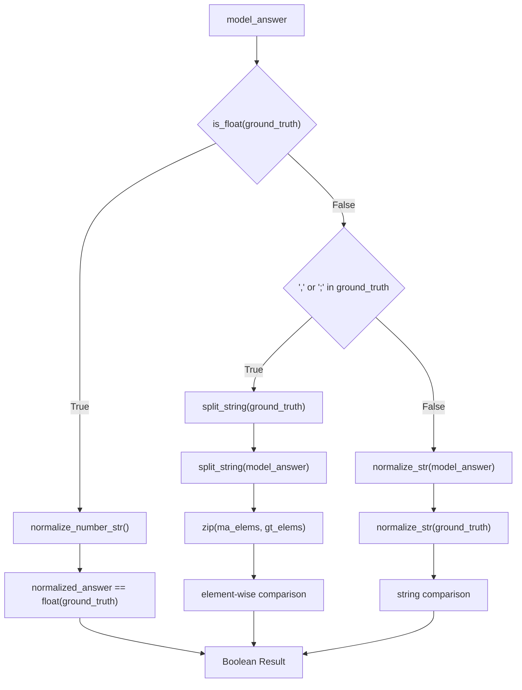
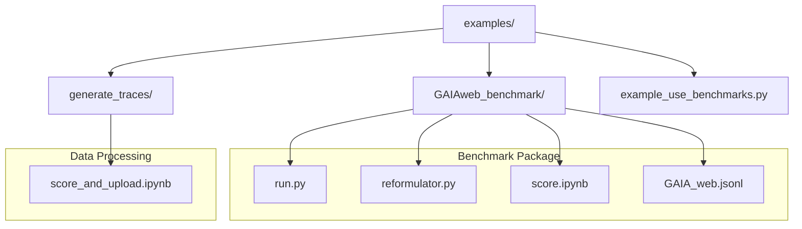

<!-- source: DeepWiki mcp.deepwiki.com · repo huggingface/screensuite · page 9 Examples and Tutorials · fetched 2026-10-26 -->

# Examples and Tutorials

<details>
<summary>Relevant source files</summary>

The following files were used as context for generating this wiki page:

- [examples/GAIAweb_benchmark/GAIA_web.jsonl](examples/GAIAweb_benchmark/GAIA_web.jsonl)
- [examples/GAIAweb_benchmark/reformulator.py](examples/GAIAweb_benchmark/reformulator.py)
- [examples/GAIAweb_benchmark/run.py](examples/GAIAweb_benchmark/run.py)
- [examples/GAIAweb_benchmark/score.ipynb](examples/GAIAweb_benchmark/score.ipynb)
- [examples/example_use_benchmarks.py](examples/example_use_benchmarks.py)
- [examples/generate_traces/score_and_upload.ipynb](examples/generate_traces/score_and_upload.ipynb)

</details>


This page provides practical examples and step-by-step tutorials for using the screensuite benchmarking framework. It covers basic registry interactions, comprehensive benchmark implementations, data processing workflows, and result analysis patterns.

For information about core framework concepts, see [Core Framework](#3). For detailed benchmark descriptions, see [Benchmark Categories](#4). For model integration patterns, see [Model Integration](#6).

## Basic Registry Usage

The simplest way to interact with screensuite is through the benchmark registry, which provides discovery and execution capabilities for all available benchmarks.

### Registry Discovery Pattern



**Registry Discovery and Execution Flow**

The registry provides three primary discovery methods: `list_all()` returns all available benchmarks, `get_by_tags()` filters by metadata tags, and `get()` retrieves specific benchmarks by name. All methods return `BaseBenchmark` instances that expose a common `evaluate()` interface.

Sources: [examples/example_use_benchmarks.py:12-46]()

### Dummy Model Implementation



**Model Interface Implementation**

Custom models must inherit from `Model` and implement the `__call__` method to process message lists. The `DummyModel` demonstrates pattern matching on message content to return appropriate responses.

Sources: [examples/example_use_benchmarks.py:32-46]()

## GAIA-web Benchmark Tutorial

The GAIA-web benchmark provides a comprehensive example of complex benchmark execution with web agents, demonstrating parallel processing, response reformulation, and result collection patterns.

### Architecture Overview



**GAIA-web Pipeline Architecture**

The pipeline processes GAIA-web tasks using either `DesktopAgent` or `E2BVisionAgent`, both configured with `GoogleSearchTool`. Results are reformulated using `prepare_response()` and stored as JSONL files.

Sources: [examples/GAIAweb_benchmark/run.py:1-193]()

### Agent Configuration



**Agent Configuration Pattern**

Both agent types accept the same configuration parameters: model instance, tools list, step limits, screen resolution, and authorized imports. The `E2BVisionAgent` additionally requires an API key.

Sources: [examples/GAIAweb_benchmark/run.py:69-89]()

### Parallel Processing Implementation

The benchmark implements two-level parallelization: task-level parallelization using `ThreadPoolExecutor` and model-level parallelization within each task execution.

```python
# Task-level parallelization
with ThreadPoolExecutor(max_workers=parallel_workers) as exe:
    futures = [exe.submit(answer_single_question, example, model, file_name) 
               for example in examples_todo]
    for f in tqdm(as_completed(futures), total=len(examples_todo)):
        f.result()
```

Sources: [examples/GAIAweb_benchmark/run.py:157-161]()

### Response Reformulation



**Response Reformulation Sequence**

The reformulation process converts agent execution traces into structured final answers using a specialized prompt template that emphasizes formatting requirements and answer extraction.

Sources: [examples/GAIAweb_benchmark/reformulator.py:9-64]()

## Data Processing Workflows

The framework includes comprehensive data processing workflows for result analysis and benchmark evaluation.

### Scoring and Analysis Pipeline



**Result Processing Pipeline**

The scoring pipeline aggregates JSONL output files, applies task-specific scoring functions, and generates accuracy metrics grouped by model. The `get_question_score_gaia()` function handles different answer types including numbers, strings, and comma-separated lists.

Sources: [examples/GAIAweb_benchmark/score.ipynb:321-420](), [examples/generate_traces/score_and_upload.ipynb:52-62]()

### Answer Type Normalization



**Answer Normalization Logic**

The scoring system handles three answer types: numeric values (normalized and compared as floats), comma-separated lists (split and compared element-wise), and strings (normalized by removing punctuation and whitespace).

Sources: [examples/GAIAweb_benchmark/score.ipynb:48-141]()

## Development Patterns

### File Structure Convention



**Example Directory Structure**

Each benchmark example follows a consistent pattern: main execution script (`run.py`), specialized utilities (`reformulator.py`), analysis notebooks (`score.ipynb`), and sample data files (`GAIA_web.jsonl`).

Sources: [examples/GAIAweb_benchmark/](), [examples/generate_traces/](), [examples/example_use_benchmarks.py]()

### Configuration Management

```python
# Environment variable handling
load_dotenv(override=True)
assert os.getenv("HF_TOKEN") is not None, "Need to set HF_TOKEN"

# Argument parsing pattern
parser = argparse.ArgumentParser(description="Runs an agent powered by the given model")
parser.add_argument("--model-id", type=str, default="Qwen/Qwen2.5-VL-7B-Instruct")
parser.add_argument("--parallel-workers", type=int, default=4)
```

The framework uses environment variables for API keys and command-line arguments for runtime configuration. Thread limits are enforced based on provider constraints (e.g., E2B free tier limit of 20 workers).

Sources: [examples/GAIAweb_benchmark/run.py:19-23](), [examples/GAIAweb_benchmark/run.py:27-59](), [examples/GAIAweb_benchmark/run.py:173-174]()

### Error Handling and Serialization

```python
def serialize_agent_error(obj):
    if isinstance(obj, AgentError):
        return {"error_type": obj.__class__.__name__, "message": obj.message}
    else:
        return str(obj)
```

Agent errors are serialized with type information and error messages to facilitate debugging and result analysis. The framework includes proper cleanup procedures with `agent.close()` calls in finally blocks.

Sources: [examples/GAIAweb_benchmark/run.py:62-66](), [examples/GAIAweb_benchmark/run.py:126-130]()