# Page: Overview

# Overview

<details>
<summary>Relevant source files</summary>

The following files were used as context for generating this wiki page:

- [README.md](README.md)
- [examples/run_benchmarks.py](examples/run_benchmarks.py)
- [pyproject.toml](pyproject.toml)
- [run.py](run.py)
- [src/screensuite/benchmarks/multistep/android_world/benchmark.py](src/screensuite/benchmarks/multistep/android_world/benchmark.py)
- [src/screensuite/benchmarks/multistep/browse_comp/benchmark.py](src/screensuite/benchmarks/multistep/browse_comp/benchmark.py)
- [src/screensuite/benchmarks/multistep/gaia/benchmark.py](src/screensuite/benchmarks/multistep/gaia/benchmark.py)
- [src/screensuite/benchmarks/multistep/mind2web/benchmark.py](src/screensuite/benchmarks/multistep/mind2web/benchmark.py)
- [src/screensuite/benchmarks/multistep/osworld/benchmark.py](src/screensuite/benchmarks/multistep/osworld/benchmark.py)
- [src/screensuite/response_generation.py](src/screensuite/response_generation.py)

</details>


## Purpose and Scope

ScreenSuite is a comprehensive benchmarking framework for evaluating Graphical User Interface (GUI) agents and multimodal large language models (MLLMs) across three distinct areas of capability: perception, single-step agentic behavior, and multi-step agentic behavior. The framework provides standardized evaluation protocols for comparing model performance on GUI interaction tasks rather than agent implementations themselves, utilizing simple agent implementations based on `smolagents`.

For installation instructions and basic usage, see [Getting Started](#2). For detailed information about specific benchmark categories, see [Benchmark Categories](#4). For model configuration and integration details, see [Model Integration](#6).

Sources: [README.md:1-7](), [pyproject.toml:1-11]()

## System Architecture

The ScreenSuite framework follows a modular architecture centered around a registry-based benchmark discovery system, parallel processing pipeline, and standardized evaluation interfaces.

### Core Architecture Components

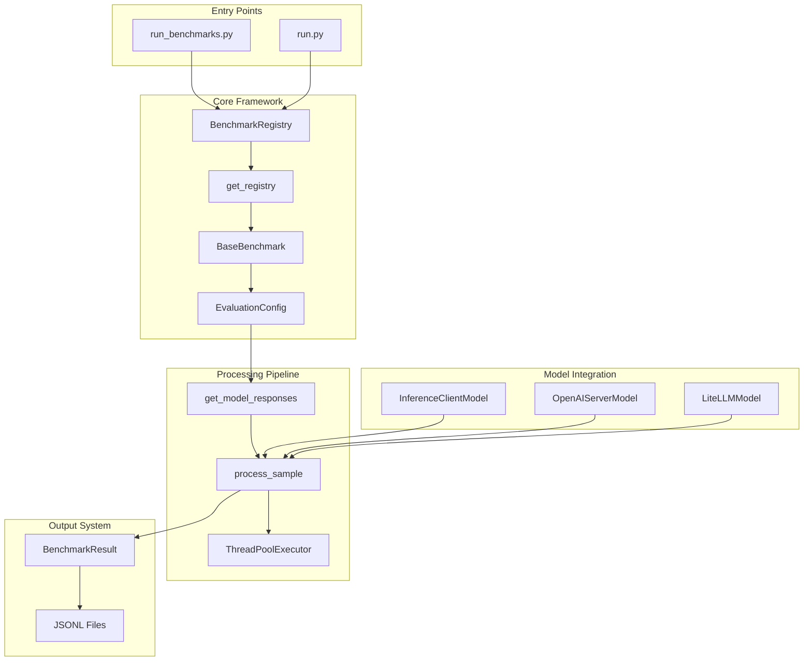

The architecture separates concerns between benchmark discovery (`BenchmarkRegistry`), execution orchestration (`get_model_responses`), and result collection (`BenchmarkResult`). The system supports multiple entry points for both programmatic and interactive usage.

Sources: [examples/run_benchmarks.py:1-30](), [run.py:1-20](), [src/screensuite/response_generation.py:115-170]()

### Benchmark Type Hierarchy

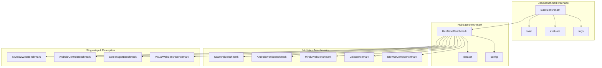

The type hierarchy establishes common interfaces while allowing specialization for different benchmark requirements. `HubBaseBenchmark` provides Hugging Face dataset integration, while direct `BaseBenchmark` implementations handle custom data sources.

Sources: [src/screensuite/benchmarks/multistep/osworld/benchmark.py:25-30](), [src/screensuite/benchmarks/multistep/android_world/benchmark.py:251-257](), [src/screensuite/benchmarks/multistep/mind2web/benchmark.py:33-34]()

## Benchmark Categories

ScreenSuite organizes benchmarks into three primary categories based on interaction complexity and evaluation approach.

| Category | Description | Environment | Evaluation Method |
|----------|-------------|-------------|-------------------|
| **Multistep** | Complex online agent tasks requiring sequential interactions | Live environments (Docker, Android emulators, web) | Task completion scoring |
| **Singlestep** | Offline prediction tasks from screenshots | Static image datasets | Action accuracy metrics |
| **Perception** | Understanding and reasoning without actions | Static datasets | Text matching, QA scoring |

### Multistep Online Benchmarks

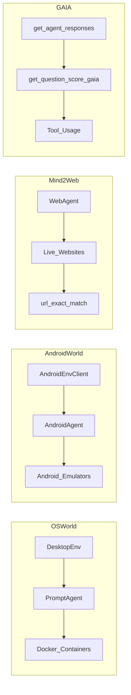

Multistep benchmarks require environment setup and sequential interaction capabilities. Each implements specialized evaluation methods: OSWorld uses Docker containers for desktop tasks, AndroidWorld manages Android emulators, Mind2Web validates URL navigation, and GAIA focuses on complex reasoning with tool usage.

Sources: [src/screensuite/benchmarks/multistep/osworld/benchmark.py:142-158](), [src/screensuite/benchmarks/multistep/android_world/benchmark.py:224-230](), [src/screensuite/benchmarks/multistep/mind2web/benchmark.py:35-48](), [src/screensuite/benchmarks/multistep/gaia/benchmark.py:47-54]()

## Processing Pipeline

The evaluation pipeline implements two-level parallelization: model-level concurrency for evaluating multiple models simultaneously, and sample-level concurrency within each model evaluation.

### Response Generation Pipeline

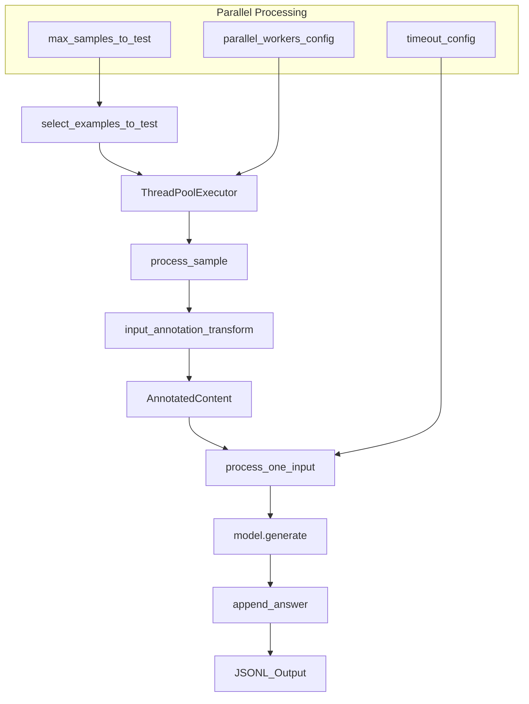

The pipeline transforms raw dataset samples through `input_annotation_transform` functions into `AnnotatedContent` objects containing `ChatMessage` sequences. These are processed through `model.generate()` calls with configurable parallelization and timeout handling.

Sources: [src/screensuite/response_generation.py:115-170](), [src/screensuite/response_generation.py:43-67](), [src/screensuite/response_generation.py:89-113]()

### Evaluation Configuration System

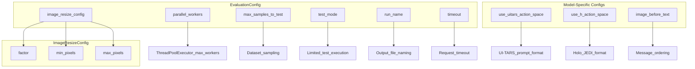

`EvaluationConfig` centralizes execution parameters while supporting model-specific customizations for specialized UI models like UI-TARS, Holo, and JEDI through action space and formatting flags.

Sources: [examples/run_benchmarks.py:105-109](), [examples/run_benchmarks.py:149-156](), [examples/run_benchmarks.py:160-171](), [examples/run_benchmarks.py:180-191]()

## Model Integration Layer

ScreenSuite integrates multiple model types through the `smolagents` framework, supporting both general-purpose and specialized UI models.

### Supported Model Categories

| Model Type | Implementation | Key Models | Configuration |
|------------|----------------|------------|---------------|
| **OpenAI** | `OpenAIServerModel` | `gpt-4o` | Standard API |
| **Anthropic** | `LiteLLMModel` | `claude-sonnet-4` | Via LiteLLM |
| **Qwen Vision** | `InferenceClientModel` | `Qwen2.5-VL-32B/72B` | Fireworks, Nebius |
| **Specialized UI** | `InferenceClientModel` | UI-TARS, JEDI, Holo | Custom endpoints |

The framework automatically handles model-specific prompt formatting, image processing, and response parsing through configuration flags and specialized evaluation configs.

Sources: [examples/run_benchmarks.py:111-119](), [examples/run_benchmarks.py:130-141](), [examples/run_benchmarks.py:144-147](), [examples/run_benchmarks.py:174-196]()

## Output and Results System

All benchmark results are standardized through the `BenchmarkResult` class and persisted in JSONL format for analysis and comparison.

### Result Structure

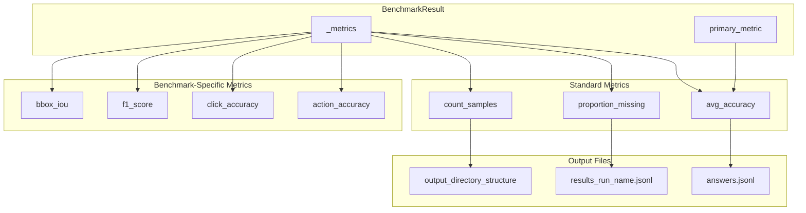

Results include both universal metrics (`avg_accuracy`, `proportion_missing`, `count_samples`) and benchmark-specific measures. The output system maintains detailed logs in `answers.jsonl` and summary metrics in `results_{run_name}.jsonl` for comprehensive analysis.

Sources: [examples/run_benchmarks.py:68-73](), [src/screensuite/response_generation.py:129-146](), [src/screensuite/benchmarks/multistep/osworld/benchmark.py:201-208]()

---

# Page: Getting Started

# Getting Started

<details>
<summary>Relevant source files</summary>

The following files were used as context for generating this wiki page:

- [.github/actions/setup-uv/action.yml](.github/actions/setup-uv/action.yml)
- [.gitmodules](.gitmodules)
- [.pre-commit-config.yaml](.pre-commit-config.yaml)
- [pytest.ini](pytest.ini)
- [requirements.txt](requirements.txt)

</details>


This document provides installation instructions, environment setup guidance, and basic usage examples for the screensuite benchmarking framework. It covers the essential steps needed to run your first benchmarks and evaluate GUI agents or multimodal large language models.

For detailed information about the framework architecture, see [Core Framework](#3). For comprehensive benchmark descriptions, see [Benchmark Categories](#4). For performance analysis and results interpretation, see [Results and Performance Analysis](#7).

## Prerequisites and System Requirements

The screensuite framework requires Python 3.8+ and uses the UV package manager for dependency management. The system supports both local and distributed execution of benchmarks with parallel processing capabilities.

### Installation Flow Overview

```mermaid
flowchart TD
    A["Prerequisites Check"] --> B["UV Installation"]
    B --> C["Repository Clone"]
    C --> D["Submodule Initialization"]
    D --> E["Dependency Installation"]
    E --> F["Editable Package Install"]
    F --> G["Environment Verification"]
    
    B --> B1["curl -LsSf https://astral.sh/uv/install.sh"]
    D --> D1["git submodule update --init --recursive"]
    E --> E1["uv sync --all-extras --all-groups"]
    F --> F1["uv pip install -e ."]
    G --> G1["Benchmark Registry Discovery"]
    G --> G2["Model Configuration"]
```

Sources: [.github/actions/setup-uv/action.yml:8-21](), [.gitmodules:1-9]()

## Installation Process

### Step 1: UV Package Manager Setup

Install the UV package manager using the official installation script:

```bash
curl -LsSf https://astral.sh/uv/install.sh | sh
echo "$HOME/.cargo/bin" >> $GITHUB_PATH
```

UV provides fast, reliable Python package management and is the recommended approach for screensuite development and deployment.

### Step 2: Repository and Submodules

Clone the repository and initialize the required submodules:

```bash
git clone https://github.com/huggingface/screensuite.git
cd screensuite
git submodule update --init --recursive
```

The framework includes two critical submodules: `osworld` for desktop environment benchmarks and `android_world` for mobile environment benchmarks.

### Step 3: Dependency Installation

Install all dependencies including optional extras and development groups:

```bash
uv sync --all-extras --all-groups
```

This command installs the complete dependency tree, including benchmark-specific requirements, evaluation utilities, and development tools.

### Step 4: Editable Package Installation

Install screensuite in editable mode for development:

```bash
uv pip install -e .
```

This allows modifications to the source code to be immediately available without reinstallation.

Sources: [.github/actions/setup-uv/action.yml:13-21](), [.gitmodules:1-9]()

## Environment Configuration

### Development Environment Setup

The framework includes comprehensive code quality tools and testing infrastructure:

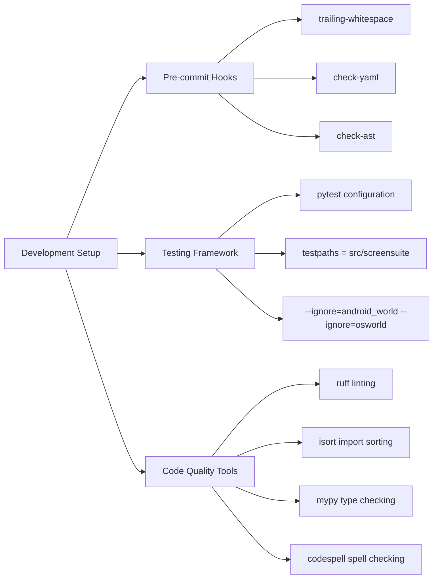

Install pre-commit hooks for automated code quality checks:

```bash
pre-commit install
```

The configuration excludes external submodules and examples directories from linting to focus on core framework code.

### Testing Configuration

Run the test suite to verify installation:

```bash
pytest
```

The test configuration uses specific settings optimized for the framework structure, including verbose output and duration tracking.

Sources: [.pre-commit-config.yaml:1-41](), [pytest.ini:1-7]()

## Basic Usage

### Benchmark Execution Architecture

The central execution system orchestrates benchmark runs through a registry-based approach:

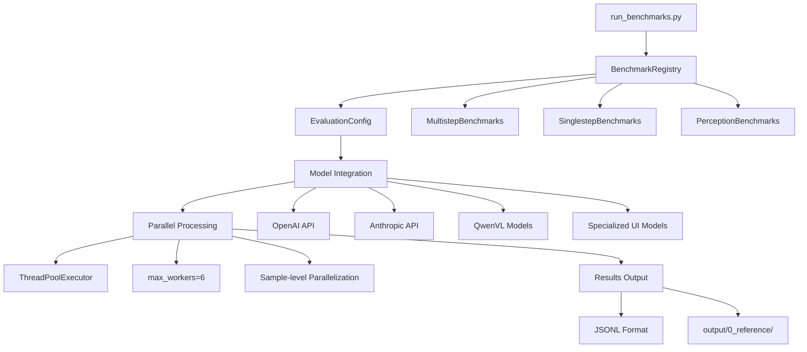

### Running Your First Benchmark

Execute a basic benchmark evaluation:

```bash
python run_benchmarks.py --benchmark screenqa --model qwen2.5-vl-7b --max-samples 10
```

This command runs the ScreenQA perception benchmark using the Qwen2.5-VL-7B model on 10 samples, demonstrating the basic evaluation pipeline.

### Output Structure

Benchmark results are stored in structured JSONL format in the `output/0_reference/` directory, with separate files for each model-benchmark combination. Each result includes evaluation metrics, model responses, and execution metadata.

Sources: Based on system architecture diagrams and framework structure

## Verification and Next Steps

### Environment Verification

Verify your installation by checking the benchmark registry:

```python
from screensuite import get_benchmark_registry
registry = get_benchmark_registry()
print(f"Available benchmarks: {len(registry)}")
```

This confirms that the framework can discover and load all available benchmarks.

### Development Workflow

For development contributions, the framework uses:
- **ruff** for fast Python linting and formatting
- **mypy** for static type checking with import handling
- **isort** with black profile for import organization
- **codespell** for spell checking (excluding data files)

### Next Steps

1. **Explore Benchmarks**: Review [Benchmark Categories](#4) to understand available evaluation tasks
2. **Model Integration**: See [Model Integration](#6) for adding new models or APIs
3. **Custom Benchmarks**: Refer to [Core Framework](#3) for implementing custom evaluation tasks
4. **Performance Analysis**: Use [Results and Performance Analysis](#7) for interpreting results

The framework is designed for extensibility, allowing researchers to add new benchmarks, models, and evaluation metrics while maintaining consistent interfaces and parallel execution capabilities.

Sources: [.pre-commit-config.yaml:16-40](), [pytest.ini:1-7](), [requirements.txt:1-6]()

---

# Page: Core Framework

# Core Framework

<details>
<summary>Relevant source files</summary>

The following files were used as context for generating this wiki page:

- [examples/run_benchmarks.py](examples/run_benchmarks.py)
- [pyproject.toml](pyproject.toml)
- [src/screensuite/basebenchmark.py](src/screensuite/basebenchmark.py)
- [src/screensuite/benchmarks/perception/screenspot/benchmark.py](src/screensuite/benchmarks/perception/screenspot/benchmark.py)
- [src/screensuite/benchmarks/singlestep/androidcontrol/benchmark.py](src/screensuite/benchmarks/singlestep/androidcontrol/benchmark.py)
- [src/screensuite/benchmarks/singlestep/mmind2web/benchmark.py](src/screensuite/benchmarks/singlestep/mmind2web/benchmark.py)
- [src/screensuite/benchmarks/singlestep/showdown_clicks/benchmark.py](src/screensuite/benchmarks/singlestep/showdown_clicks/benchmark.py)
- [src/screensuite/chat_message.py](src/screensuite/chat_message.py)
- [src/screensuite/response_generation.py](src/screensuite/response_generation.py)

</details>


The Core Framework provides the foundational architecture and components that power the screensuite benchmarking system. This document covers the base classes, configuration systems, message handling, and execution pipeline that enable consistent evaluation of GUI agents and multimodal large language models across diverse benchmarks.

For information about specific benchmark implementations, see [Benchmark Categories](#4). For details about evaluation metrics and scoring, see [Evaluation System](#5).

## Architecture Overview

The Core Framework is built around several key components that work together to provide a unified benchmarking interface:

### Core Components Diagram

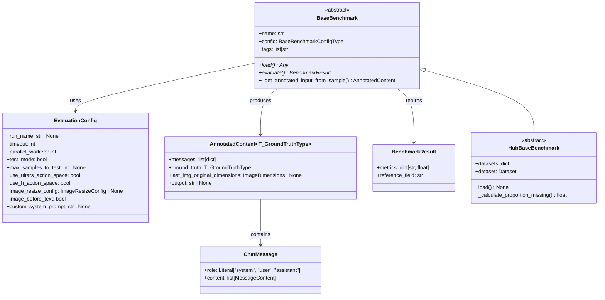

Sources: [src/screensuite/basebenchmark.py:66-90](), [src/screensuite/benchmarks/hubbasebenchmark.py](), [src/screensuite/chat_message.py:45-50](), [src/screensuite/benchmark_result.py]()

## Base Benchmark Architecture

The `BaseBenchmark` class serves as the abstract foundation for all benchmark implementations in screensuite. It defines the essential interface that every benchmark must implement:

### BaseBenchmark Interface

| Method | Purpose | Return Type |
|--------|---------|-------------|
| `load()` | Load benchmark data and resources | `Any` |
| `evaluate()` | Execute model evaluation | `BenchmarkResult` |
| `_get_annotated_input_from_sample()` | Transform sample to model input | `AnnotatedContent` |

The class uses generic type parameters to ensure type safety:
- `BaseBenchmarkConfigType`: Configuration specific to each benchmark
- `BaseBenchmarkEnvironmentConfigType`: Environment-specific configuration

Sources: [src/screensuite/basebenchmark.py:66-90]()

### HubBaseBenchmark Extension

Most benchmarks inherit from `HubBaseBenchmark`, which provides common functionality for Hugging Face dataset integration:

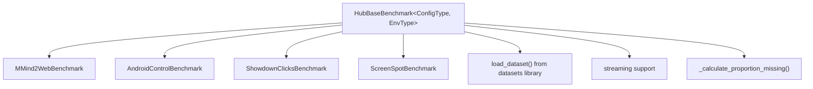

Sources: [src/screensuite/benchmarks/hubbasebenchmark.py](), [src/screensuite/benchmarks/singlestep/mmind2web/benchmark.py:40](), [src/screensuite/benchmarks/singlestep/androidcontrol/benchmark.py:117]()

## Message System

The framework uses a structured message system to standardize communication with models across different benchmark types.

### ChatMessage Structure

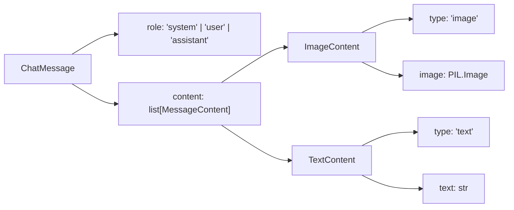

The message system supports:
- **Multi-modal content**: Images and text within the same message
- **Image resizing**: Automatic resizing based on model requirements
- **Standardized format**: Consistent structure across all benchmarks

Sources: [src/screensuite/chat_message.py:45-50](), [src/screensuite/chat_message.py:10-23](), [src/screensuite/chat_message.py:35-40]()

### Message Processing Pipeline

The `dump_chat_message_list()` function transforms `ChatMessage` objects into the format expected by model APIs:

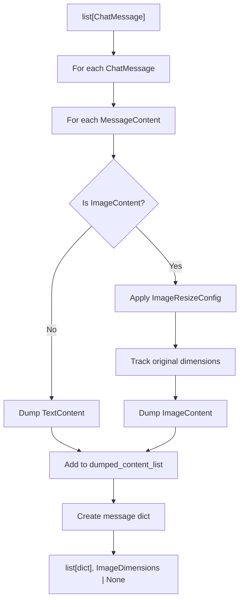

Sources: [src/screensuite/chat_message.py:52-71]()

## Configuration System

The `EvaluationConfig` class centralizes all evaluation parameters and provides validation logic:

### Configuration Parameters

| Parameter | Type | Purpose | Default |
|-----------|------|---------|---------|
| `run_name` | `str \| None` | Identifies evaluation run for output | `None` |
| `timeout` | `int` | Maximum time per evaluation (seconds) | `300` |
| `parallel_workers` | `int` | Number of concurrent workers | `1` |
| `test_mode` | `bool` | Limits samples for testing | `False` |
| `max_samples_to_test` | `int \| None` | Maximum samples to process | `None` |
| `use_uitars_action_space` | `bool` | Use UI-TARS action format | `False` |
| `use_h_action_space` | `bool` | Use H-model action format | `False` |
| `image_resize_config` | `ImageResizeConfig \| None` | Image preprocessing settings | `None` |
| `image_before_text` | `bool` | Image placement in messages | `True` |
| `custom_system_prompt` | `str \| None` | Override system prompt | `None` |

### Configuration Validation

The config includes validation logic to ensure consistent behavior:

```python
@model_validator(mode="after")
def validate_max_samples_to_test(self) -> Self:
    if self.max_samples_to_test is not None and self.max_samples_to_test < 1:
        self.max_samples_to_test = None
    if self.max_samples_to_test is not None and self.max_samples_to_test < self.parallel_workers:
        self.parallel_workers = self.max_samples_to_test
    return self
```

Sources: [src/screensuite/basebenchmark.py:33-61]()

## Response Generation Pipeline

The response generation system manages parallel execution and model communication through the `get_model_responses()` function:

### Execution Flow

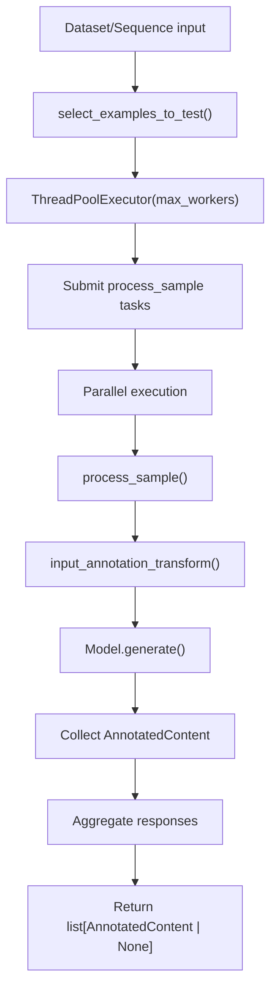

### Key Functions

The pipeline uses several key functions:

| Function | Purpose | Input | Output |
|----------|---------|-------|--------|
| `get_model_responses()` | Main orchestrator | Dataset, Model, transform function | `list[AnnotatedContent \| None]` |
| `process_sample()` | Process single sample | Sample, Model, transform | `list[AnnotatedContent \| None]` |
| `process_one_input()` | Generate model response | AnnotatedContent, Model | `AnnotatedContent \| None` |
| `select_examples_to_test()` | Filter dataset | Dataset, EvaluationConfig | Filtered dataset |

Sources: [src/screensuite/response_generation.py:115-169](), [src/screensuite/response_generation.py:69-86](), [src/screensuite/response_generation.py:43-66]()

## Error Handling and Resilience

The framework includes comprehensive error handling to ensure robust execution:

### Error Management Strategy

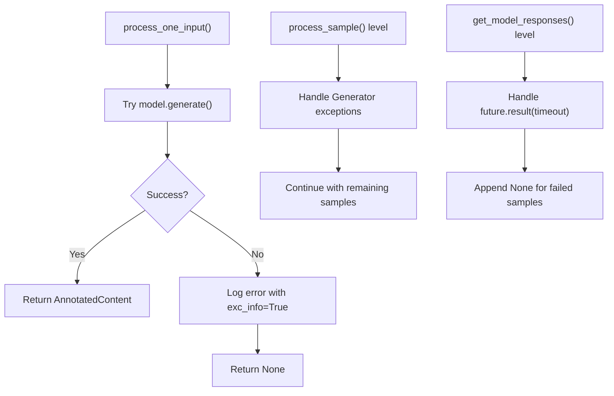

The error handling ensures:
- **Graceful degradation**: Failed samples return `None` rather than crashing
- **Detailed logging**: Errors logged with full stack traces
- **Timeout protection**: Prevents hanging on slow model responses
- **Partial results**: Successful samples processed even if others fail

Sources: [src/screensuite/response_generation.py:43-66](), [src/screensuite/response_generation.py:161-168]()

## Integration with Benchmark Execution

The Core Framework integrates with the main execution script through a standardized interface:

### Benchmark Registry Integration

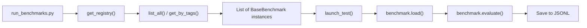

The main execution flow in [examples/run_benchmarks.py:54-77]() demonstrates how the Core Framework components work together:

1. **Registry Discovery**: Find benchmarks by tags
2. **Configuration Setup**: Create `EvaluationConfig` instances
3. **Parallel Execution**: Use `ThreadPoolExecutor` for model-level parallelism
4. **Result Collection**: Aggregate metrics and save to JSONL format

Sources: [examples/run_benchmarks.py:23-77](), [examples/run_benchmarks.py:92-99]()

# Core Framework

The Core Framework provides the foundational architecture and components that power the screensuite benchmarking system. This document covers the base classes, configuration systems, message handling, and execution pipeline that enable consistent evaluation of GUI agents and multimodal large language models across diverse benchmarks.

For information about specific benchmark implementations, see [Benchmark Categories](#4). For details about evaluation metrics and scoring, see [Evaluation System](#5).

## Architecture Overview

The Core Framework is built around several key components that work together to provide a unified benchmarking interface:

### Core Components Diagram


Sources: [src/screensuite/basebenchmark.py:66-90](), [src/screensuite/benchmarks/hubbasebenchmark.py](), [src/screensuite/chat_message.py:45-50](), [src/screensuite/benchmark_result.py]()

## Base Benchmark Architecture

The `BaseBenchmark` class serves as the abstract foundation for all benchmark implementations in screensuite. It defines the essential interface that every benchmark must implement:

### BaseBenchmark Interface

| Method | Purpose | Return Type |
|--------|---------|-------------|
| `load()` | Load benchmark data and resources | `Any` |
| `evaluate()` | Execute model evaluation | `BenchmarkResult` |
| `_get_annotated_input_from_sample()` | Transform sample to model input | `AnnotatedContent` |

The class uses generic type parameters to ensure type safety:
- `BaseBenchmarkConfigType`: Configuration specific to each benchmark
- `BaseBenchmarkEnvironmentConfigType`: Environment-specific configuration

Sources: [src/screensuite/basebenchmark.py:66-90]()

### HubBaseBenchmark Extension

Most benchmarks inherit from `HubBaseBenchmark`, which provides common functionality for Hugging Face dataset integration:


Sources: [src/screensuite/benchmarks/hubbasebenchmark.py](), [src/screensuite/benchmarks/singlestep/mmind2web/benchmark.py:40](), [src/screensuite/benchmarks/singlestep/androidcontrol/benchmark.py:117]()

## Message System

The framework uses a structured message system to standardize communication with models across different benchmark types.

### ChatMessage Structure


The message system supports:
- **Multi-modal content**: Images and text within the same message
- **Image resizing**: Automatic resizing based on model requirements
- **Standardized format**: Consistent structure across all benchmarks

Sources: [src/screensuite/chat_message.py:45-50](), [src/screensuite/chat_message.py:10-23](), [src/screensuite/chat_message.py:35-40]()

### Message Processing Pipeline

The `dump_chat_message_list()` function transforms `ChatMessage` objects into the format expected by model APIs:


Sources: [src/screensuite/chat_message.py:52-71]()

## Configuration System

The `EvaluationConfig` class centralizes all evaluation parameters and provides validation logic:

### Configuration Parameters

| Parameter | Type | Purpose | Default |
|-----------|------|---------|---------|
| `run_name` | `str \| None` | Identifies evaluation run for output | `None` |
| `timeout` | `int` | Maximum time per evaluation (seconds) | `300` |
| `parallel_workers` | `int` | Number of concurrent workers | `1` |
| `test_mode` | `bool` | Limits samples for testing | `False` |
| `max_samples_to_test` | `int \| None` | Maximum samples to process | `None` |
| `use_uitars_action_space` | `bool` | Use UI-TARS action format | `False` |
| `use_h_action_space` | `bool` | Use H-model action format | `False` |
| `image_resize_config` | `ImageResizeConfig \| None` | Image preprocessing settings | `None` |
| `image_before_text` | `bool` | Image placement in messages | `True` |
| `custom_system_prompt` | `str \| None` | Override system prompt | `None` |

### Configuration Validation

The config includes validation logic to ensure consistent behavior:

```python
@model_validator(mode="after")
def validate_max_samples_to_test(self) -> Self:
    if self.max_samples_to_test is not None and self.max_samples_to_test < 1:
        self.max_samples_to_test = None
    if self.max_samples_to_test is not None and self.max_samples_to_test < self.parallel_workers:
        self.parallel_workers = self.max_samples_to_test
    return self
```

Sources: [src/screensuite/basebenchmark.py:33-61]()

## Response Generation Pipeline

The response generation system manages parallel execution and model communication through the `get_model_responses()` function:

### Execution Flow

```mermaid
flowchart TD
    dataset["Dataset/Sequence input"] --> select_samples["select_examples_to_test()"]
    select_samples --> create_executor["ThreadPoolExecutor(max_workers)"]
    
    create_executor --> submit_tasks["Submit process_sample tasks"]
    submit_tasks --> parallel_execution["Parallel execution"]
    
    parallel_execution --> process_sample["process_sample()"]
    process_sample --> transform["input_annotation_transform()"]
    transform --> generate["Model.generate()"]
    generate --> collect["Collect AnnotatedContent"]
    
    collect --> aggregate["Aggregate responses"]
    aggregate --> return_results["Return list[AnnotatedContent | None]"]
```

### Key Functions

The pipeline uses several key functions:

| Function | Purpose | Input | Output |
|----------|---------|-------|--------|
| `get_model_responses()` | Main orchestrator | Dataset, Model, transform function | `list[AnnotatedContent \| None]` |
| `process_sample()` | Process single sample | Sample, Model, transform | `list[AnnotatedContent \| None]` |
| `process_one_input()` | Generate model response | AnnotatedContent, Model | `AnnotatedContent \| None` |
| `select_examples_to_test()` | Filter dataset | Dataset, EvaluationConfig | Filtered dataset |

Sources: [src/screensuite/response_generation.py:115-169](), [src/screensuite/response_generation.py:69-86](), [src/screensuite/response_generation.py:43-66]()

## Error Handling and Resilience

The framework includes comprehensive error handling to ensure robust execution:

### Error Management Strategy

```mermaid
graph TD
    process_input["process_one_input()"] --> try_generate["Try model.generate()"]
    try_generate --> success{"Success?"}
    success -->|Yes| return_result["Return AnnotatedContent"]
    success -->|No| log_error["Log error with exc_info=True"]
    log_error --> return_none["Return None"]
    
    process_sample_level["process_sample() level"] --> handle_generator["Handle Generator exceptions"]
    handle_generator --> continue_processing["Continue with remaining samples"]
    
    top_level["get_model_responses() level"] --> timeout_handling["Handle future.result(timeout)"]
    timeout_handling --> append_none["Append None for failed samples"]
```

The error handling ensures:
- **Graceful degradation**: Failed samples return `None` rather than crashing
- **Detailed logging**: Errors logged with full stack traces
- **Timeout protection**: Prevents hanging on slow model responses
- **Partial results**: Successful samples processed even if others fail

Sources: [src/screensuite/response_generation.py:43-66](), [src/screensuite/response_generation.py:161-168]()

## Integration with Benchmark Execution

The Core Framework integrates with the main execution script through a standardized interface:

### Benchmark Registry Integration

```mermaid
graph LR
    run_benchmarks["run_benchmarks.py"] --> get_registry["get_registry()"]
    get_registry --> registry_methods["list_all() / get_by_tags()"]
    registry_methods --> benchmark_list["List of BaseBenchmark instances"]
    
    benchmark_list --> launch_test["launch_test()"]
    launch_test --> benchmark_load["benchmark.load()"]
    benchmark_load --> benchmark_evaluate["benchmark.evaluate()"]
    benchmark_evaluate --> save_results["Save to JSONL"]
```

The main execution flow in [examples/run_benchmarks.py:54-77]() demonstrates how the Core Framework components work together:

1. **Registry Discovery**: Find benchmarks by tags
2. **Configuration Setup**: Create `EvaluationConfig` instances
3. **Parallel Execution**: Use `ThreadPoolExecutor` for model-level parallelism
4. **Result Collection**: Aggregate metrics and save to JSONL format

Sources: [examples/run_benchmarks.py:23-77](), [examples/run_benchmarks.py:92-99]()

---

# Page: Base Components

# Base Components

<details>
<summary>Relevant source files</summary>

The following files were used as context for generating this wiki page:

- [src/screensuite/basebenchmark.py](src/screensuite/basebenchmark.py)
- [src/screensuite/benchmarks/perception/screenspot/benchmark.py](src/screensuite/benchmarks/perception/screenspot/benchmark.py)
- [src/screensuite/benchmarks/singlestep/androidcontrol/benchmark.py](src/screensuite/benchmarks/singlestep/androidcontrol/benchmark.py)
- [src/screensuite/benchmarks/singlestep/mmind2web/benchmark.py](src/screensuite/benchmarks/singlestep/mmind2web/benchmark.py)
- [src/screensuite/benchmarks/singlestep/showdown_clicks/benchmark.py](src/screensuite/benchmarks/singlestep/showdown_clicks/benchmark.py)
- [src/screensuite/chat_message.py](src/screensuite/chat_message.py)

</details>


The base components provide the foundational architecture for the screensuite benchmarking framework. These abstract classes, configuration objects, and data structures establish the common interface and data flow patterns that all benchmarks must implement. This document covers the core building blocks including `BaseBenchmark`, `EvaluationConfig`, `ChatMessage`, and `AnnotatedContent`.

For information about the benchmark execution pipeline that orchestrates these components, see [Benchmark Execution Pipeline](#3.2). For details about the response generation system that processes these data structures, see [Response Generation System](#3.3).

## Core Component Architecture

The base components form a layered architecture where abstract classes define contracts, configuration classes control behavior, and data containers manage information flow between components.

```mermaid
classDiagram
    class BaseBenchmark {
        <<abstract>>
        +name: str
        +config: BaseBenchmarkConfigType
        +tags: list[str]
        +load()* 
        +evaluate()* Model EvaluationConfig
        +_get_annotated_input_from_sample()
    }
    
    class EvaluationConfig {
        +run_name: str | None
        +timeout: int
        +parallel_workers: int
        +test_mode: bool
        +max_samples_to_test: int | None
        +use_uitars_action_space: bool
        +use_h_action_space: bool
        +image_resize_config: ImageResizeConfig | None
        +image_before_text: bool
        +custom_system_prompt: str | None
    }
    
    class AnnotatedContent {
        +messages: list[dict[str, Any]]
        +ground_truth: T_GroundTruthType
        +last_img_original_dimensions: ImageDimensions | None
        +output: str | None
    }
    
    class ChatMessage {
        +role: Literal["system", "user", "assistant"]
        +content: list[MessageContent]
    }
    
    class ImageContent {
        +type: Literal["image"]
        +image: Image
        +resize_image()
        +model_dump_with_resize()
    }
    
    class TextContent {
        +type: Literal["text"] 
        +text: str
    }
    
    class ImageDimensions {
        +width: int
        +height: int
    }
    
    class ImageResizeConfig {
        +factor: int
        +min_pixels: int
        +max_pixels: int
    }
    
    BaseBenchmark --> EvaluationConfig : uses
    BaseBenchmark --> AnnotatedContent : produces
    AnnotatedContent --> ChatMessage : contains
    ChatMessage --> ImageContent : contains
    ChatMessage --> TextContent : contains
    ImageContent --> ImageDimensions : tracks
    EvaluationConfig --> ImageResizeConfig : contains
```

Sources: [src/screensuite/basebenchmark.py:66-90](), [src/screensuite/chat_message.py:45-50](), [src/screensuite/basebenchmark.py:26-31]()

## BaseBenchmark Abstract Class

The `BaseBenchmark` class serves as the foundational abstract base class that all benchmarks must inherit from. It defines the essential contract for benchmark implementations through abstract methods and provides common functionality for configuration and tagging.

| Method | Purpose | Implementation |
|--------|---------|----------------|
| `__init__` | Initialize benchmark with name, config, and tags | Concrete |
| `load()` | Load benchmark dataset | Abstract |
| `evaluate()` | Execute evaluation with model and config | Abstract |
| `_get_annotated_input_from_sample()` | Transform samples to `AnnotatedContent` | Optional override |

The class uses generic type parameters to ensure type safety across different benchmark configurations:

```python
class BaseBenchmark(Generic[BaseBenchmarkConfigType, BaseBenchmarkEnvironmentConfigType], ABC)
```

Concrete implementations like `MMind2WebBenchmark`, `AndroidControlBenchmark`, and `ScreenSpotBenchmark` all inherit from `BaseBenchmark` and provide specific implementations for their evaluation domains.

Sources: [src/screensuite/basebenchmark.py:66-90](), [src/screensuite/benchmarks/singlestep/mmind2web/benchmark.py:40](), [src/screensuite/benchmarks/singlestep/androidcontrol/benchmark.py:117]()

## EvaluationConfig Configuration Class

The `EvaluationConfig` class centralizes all configuration parameters that control benchmark execution behavior. It provides validation logic and cross-parameter consistency checks.

### Core Configuration Parameters

| Parameter | Type | Default | Purpose |
|-----------|------|---------|---------|
| `run_name` | `str \| None` | `None` | Identifies the evaluation run for output |
| `timeout` | `int` | `300` | Maximum seconds per sample evaluation |
| `parallel_workers` | `int` | `1` | Number of concurrent evaluation threads |
| `test_mode` | `bool` | `False` | Enables abbreviated testing |
| `max_samples_to_test` | `int \| None` | `None` | Limits sample count for testing |

### Model Behavior Controls

| Parameter | Type | Default | Purpose |
|-----------|------|---------|---------|
| `use_uitars_action_space` | `bool` | `False` | Enables UI-TARS specific action format |
| `use_h_action_space` | `bool` | `False` | Enables H-action space format |
| `image_before_text` | `bool` | `True` | Controls message content ordering |
| `custom_system_prompt` | `str \| None` | `None` | Overrides default system prompts |

The configuration includes validation logic that automatically adjusts `parallel_workers` when `max_samples_to_test` is smaller, and enforces mutual exclusivity between action space options.

Sources: [src/screensuite/basebenchmark.py:33-60]()

## ChatMessage System

The message system provides a structured format for model communication that handles both text and image content consistently across all benchmarks.

```mermaid
graph TB
    ChatMessage --> MessageContent
    MessageContent --> ImageContent
    MessageContent --> TextContent
    
    ImageContent --> PIL_Image["PIL.Image.Image"]
    ImageContent --> resize_image["resize_image()"]
    ImageContent --> model_dump_with_resize["model_dump_with_resize()"]
    
    TextContent --> text_string["str"]
    
    ChatMessage --> role["role: system|user|assistant"]
    ChatMessage --> content_list["content: list[MessageContent]"]
    
    dump_chat_message_list --> serialized_messages["list[dict]"]
    dump_chat_message_list --> last_img_dimensions["ImageDimensions | None"]
```

### Message Construction Pattern

Benchmarks construct messages using a consistent pattern seen across implementations:

1. Create `ChatMessage` with appropriate role (`"user"` for input, `"system"` for prompts)
2. Add `TextContent` for instructions and prompts
3. Add `ImageContent` for screenshots
4. Apply optional system prompts based on `EvaluationConfig.custom_system_prompt`
5. Serialize using `dump_chat_message_list()` with image resizing

### Image Handling

The `ImageContent` class provides sophisticated image processing capabilities:

- **Automatic resizing**: Uses `ImageResizeConfig` parameters to resize images for model compatibility
- **Dimension tracking**: Maintains original dimensions for coordinate transformation
- **Flexible serialization**: `model_dump_with_resize()` returns both serialized content and original dimensions

Sources: [src/screensuite/chat_message.py:45-50](), [src/screensuite/chat_message.py:10-33](), [src/screensuite/chat_message.py:52-71]()

## AnnotatedContent Data Container

The `AnnotatedContent` class serves as the primary data container that flows through the evaluation pipeline, linking input messages with ground truth data and model outputs.

```mermaid
graph LR
    Sample["Raw Sample"] --> transform["_get_annotated_input_from_sample()"]
    transform --> AnnotatedContent
    
    AnnotatedContent --> messages["messages: list[dict]"]
    AnnotatedContent --> ground_truth["ground_truth: T"]
    AnnotatedContent --> dimensions["last_img_original_dimensions"]
    AnnotatedContent --> output["output: str | None"]
    
    AnnotatedContent --> model_inference["Model Inference"]
    model_inference --> populated_output["AnnotatedContent with output"]
    populated_output --> evaluation["Evaluation Metrics"]
```

### Generic Type Support

The class uses generic typing to support different ground truth formats across benchmark types:

- **Click benchmarks**: `AnnotatedContent[NormalizedBoundingBox]`
- **Action benchmarks**: `AnnotatedContent[list[Operation]]`
- **Multi-action benchmarks**: `AnnotatedContent[tuple[list[Operation], NormalizedBoundingBox]]`

### Usage in Evaluation Pipeline

The typical flow involves:

1. **Generation**: `_get_annotated_input_from_sample()` creates `AnnotatedContent` with `messages` and `ground_truth`
2. **Processing**: Response generation system populates the `output` field
3. **Evaluation**: Benchmark-specific scoring compares `output` against `ground_truth`

Sources: [src/screensuite/basebenchmark.py:26-31](), [src/screensuite/benchmarks/singlestep/mmind2web/benchmark.py:120-124](), [src/screensuite/benchmarks/singlestep/androidcontrol/benchmark.py:201-205]()

## Integration Pattern

The base components work together in a standardized pattern that ensures consistency across all benchmark implementations.

```mermaid
sequenceDiagram
    participant B as "BaseBenchmark"
    participant EC as "EvaluationConfig"
    participant AC as "AnnotatedContent"
    participant CM as "ChatMessage"
    participant M as "Model"
    
    B->>EC: validate configuration
    B->>B: load dataset
    B->>AC: _get_annotated_input_from_sample()
    AC->>CM: construct messages
    CM->>CM: dump_chat_message_list()
    AC->>M: send messages for inference
    M->>AC: populate output field
    AC->>B: return for evaluation
    B->>B: score against ground_truth
```

This integration pattern is implemented consistently across benchmark types:

- **Singlestep benchmarks**: Direct sample-to-AnnotatedContent transformation
- **Multistep benchmarks**: Iterative generation of AnnotatedContent for each step
- **Perception benchmarks**: Simplified single-message AnnotatedContent creation

The base components provide the flexibility to handle different evaluation paradigms while maintaining a unified interface for the broader framework.

Sources: [src/screensuite/benchmarks/singlestep/mmind2web/benchmark.py:304-379](), [src/screensuite/benchmarks/singlestep/androidcontrol/benchmark.py:254-293](), [src/screensuite/benchmarks/perception/screenspot/benchmark.py:115-171]()

---

# Page: Benchmark Execution Pipeline

# Benchmark Execution Pipeline

<details>
<summary>Relevant source files</summary>

The following files were used as context for generating this wiki page:

- [examples/run_benchmarks.py](examples/run_benchmarks.py)
- [pyproject.toml](pyproject.toml)
- [src/screensuite/response_generation.py](src/screensuite/response_generation.py)

</details>


## Purpose and Scope

The Benchmark Execution Pipeline is the core orchestration system that manages the end-to-end execution of benchmarks across multiple models in the screensuite framework. This pipeline handles benchmark discovery, parallel execution coordination, sample processing, and result aggregation. 

For information about the individual benchmark categories and their specific evaluation logic, see [Benchmark Categories](#4). For details about the response generation mechanics and model integration, see [Response Generation System](#3.3) and [Model Integration](#6).

## Pipeline Architecture Overview

The benchmark execution pipeline operates through a two-level orchestration system managed primarily by the `run_benchmarks.py` script, with core processing handled by the response generation system.

### High-Level Execution Flow

```mermaid
flowchart TD
    A["run_benchmarks.py main()"] --> B["get_registry()"]
    B --> C["registry.get_by_tags()"]
    C --> D["ThreadPoolExecutor max_workers=6"]
    
    D --> E["launch_test() per model"]
    E --> F["benchmark.load()"]
    F --> G["benchmark.evaluate()"]
    
    G --> H["get_model_responses()"]
    H --> I["ThreadPoolExecutor parallel_workers"]
    I --> J["process_sample()"]
    J --> K["process_one_input()"]
    K --> L["model.generate()"]
    
    L --> M["append_answer()"]
    M --> N["results aggregation"]
    N --> O["JSONL output files"]
    
    subgraph "Model-Level Parallelism"
        D
        E
    end
    
    subgraph "Sample-Level Parallelism"
        I
        J
        K
    end
    
    subgraph "Registry System"
        B
        C
    end
```

Sources: [examples/run_benchmarks.py:208-214](), [src/screensuite/response_generation.py:115-170]()

## Benchmark Discovery and Loading

The pipeline begins with benchmark discovery through the registry system, which provides centralized access to all available benchmarks with tag-based filtering capabilities.

### Registry Integration Process

```mermaid
flowchart LR
    A["get_registry()"] --> B["registry.get_by_tags()"]
    B --> C["filter by tags=['to_evaluate']"]
    C --> D["exclude 'multistep' benchmarks"]
    D --> E["sorted benchmark list"]
    
    E --> F["benchmark.load()"]
    F --> G["dataset loading"]
    G --> H["benchmark.evaluate()"]
    
    subgraph "Registry Filtering"
        B
        C
        D
    end
    
    subgraph "Benchmark Initialization"
        F
        G
        H
    end
```

The main execution script filters benchmarks using configurable tags and excludes multistep benchmarks by default, as shown in [examples/run_benchmarks.py:95-103](). The registry system allows for flexible benchmark selection based on evaluation requirements.

Sources: [examples/run_benchmarks.py:92-104]()

## Parallel Execution Architecture

The pipeline implements a two-tier parallelization strategy to maximize throughput while managing resource constraints across different model types and inference endpoints.

### Model-Level Parallelization

```mermaid
graph TD
    A["ThreadPoolExecutor max_workers=6"] --> B["Model 1: GPT-4o"]
    A --> C["Model 2: Claude Sonnet"] 
    A --> D["Model 3: Qwen2.5-VL-32B"]
    A --> E["Model 4: Qwen2.5-VL-72B"]
    A --> F["Model 5: UI-TARS-7B"]
    A --> G["Model 6: Custom Endpoint"]
    
    B --> H["launch_test()"]
    C --> I["launch_test()"]
    D --> J["launch_test()"]
    E --> K["launch_test()"]
    F --> L["launch_test()"]
    G --> M["launch_test()"]
    
    subgraph "Concurrent Model Evaluation"
        H
        I  
        J
        K
        L
        M
    end
```

The top-level parallelization runs up to 6 models concurrently using `ThreadPoolExecutor`, as defined in [examples/run_benchmarks.py:208-214](). Each model evaluation runs independently with its own configuration and result tracking.

### Sample-Level Parallelization

```mermaid
graph TD
    A["EvaluationConfig.parallel_workers"] --> B["Standard: 16 workers"]
    A --> C["Qwen models: 32 workers"] 
    A --> D["Custom endpoints: 16 workers"]
    
    B --> E["ThreadPoolExecutor(16)"]
    C --> F["ThreadPoolExecutor(32)"]  
    D --> G["ThreadPoolExecutor(16)"]
    
    E --> H["process_sample() x 16"]
    F --> I["process_sample() x 32"]
    G --> J["process_sample() x 16"]
    
    subgraph "Per-Model Sample Processing"
        H
        I
        J
    end
```

Sample-level parallelization is configured per model type, with higher-capacity endpoints like Qwen models using 32 workers while others use 16, as shown in [examples/run_benchmarks.py:106-127]().

Sources: [examples/run_benchmarks.py:208-214](), [examples/run_benchmarks.py:123-127](), [src/screensuite/response_generation.py:147-160]()

## Sample Processing Pipeline

The core sample processing pipeline transforms individual benchmark samples into model inputs, executes inference, and collects responses through a standardized interface.

### Processing Flow

```mermaid
sequenceDiagram
    participant D as "Dataset"
    participant S as "select_examples_to_test()"
    participant P as "process_sample()"
    participant T as "input_annotation_transform()"
    participant I as "process_one_input()"
    participant M as "model.generate()"
    participant A as "append_answer()"
    
    D->>S: dataset samples
    S->>P: filtered samples
    P->>T: raw sample + evaluation_config
    T->>I: AnnotatedContent messages
    I->>M: ChatMessage format
    M->>I: model response
    I->>A: response + metadata
    A->>P: saved to JSONL
    P->>D: AnnotatedContent result
```

The processing pipeline begins with sample selection through `select_examples_to_test()`, which handles test mode limiting and max sample constraints [src/screensuite/response_generation.py:89-112](). Each sample undergoes transformation via the benchmark-specific `input_annotation_transform` function before model inference.

### Sample Selection and Filtering

| Configuration | Behavior | Code Reference |
|---------------|----------|----------------|
| `test_mode=True` | Limit to `parallel_workers` samples | [response_generation.py:97-101]() |
| `max_samples_to_test` | Random sample selection with seed=42 | [response_generation.py:103-112]() |
| Default | Process entire dataset | [response_generation.py:112]() |

Sources: [src/screensuite/response_generation.py:69-86](), [src/screensuite/response_generation.py:89-112](), [src/screensuite/response_generation.py:43-67]()

## Result Storage and Resumption

The pipeline implements robust result persistence and resumption capabilities to handle long-running evaluations and infrastructure interruptions.

### Result File Management

```mermaid
flowchart TD
    A["launch_test() starts"] --> B["Check existing results.jsonl"]
    B --> C["Load processed_benchmarks set"]
    C --> D["Skip completed benchmarks"]
    
    D --> E["benchmark.evaluate()"]
    E --> F["metrics_entry creation"]
    F --> G["append to JSONL"]
    
    subgraph "File Structure"
        H["./output/{run_name}.jsonl"]
        I["./output/{benchmark_name}/{run_name}/answers.jsonl"]
    end
    
    G --> H
    E --> I
    
    subgraph "Resumption Logic"
        B
        C
        D
    end
```

The system maintains two types of result files: benchmark-level metrics in the main results file and detailed sample-level responses in benchmark-specific answer files. The resumption logic reads existing results to skip already-processed benchmarks, as implemented in [examples/run_benchmarks.py:37-52]().

### Threading Safety and File I/O

The pipeline uses thread-safe file operations through the `APPEND_ANSWER_LOCK` mechanism to prevent race conditions during concurrent writes:

```python
# Thread-safe result appending
APPEND_ANSWER_LOCK = threading.Lock()
```

Sources: [examples/run_benchmarks.py:37-76](), [src/screensuite/response_generation.py:29-41](), [src/screensuite/response_generation.py:129-146]()

## Configuration and Customization

The execution pipeline supports extensive customization through the `EvaluationConfig` system and model-specific configurations.

### Configuration Hierarchy

| Configuration Type | Purpose | Example Values |
|-------------------|---------|----------------|
| `EvaluationConfig` | General execution parameters | `parallel_workers=16`, `max_samples_to_test=300` |
| Model-specific | Custom inference settings | `max_tokens=4096`, provider endpoints |
| Benchmark-specific | Action spaces and image handling | `use_uitars_action_space=True`, `image_before_text=False` |

### Specialized Model Configurations

```mermaid
graph LR
    A["EvaluationConfig base"] --> B["Standard config"]
    A --> C["Qwen config"]
    A --> D["UI-TARS config"]
    A --> E["Holo config"]
    A --> F["JEDI config"]
    
    B --> B1["parallel_workers=16"]
    C --> C1["parallel_workers=32<br/>ImageResizeConfig()"]
    D --> D1["use_uitars_action_space=True<br/>image_before_text=False"]
    E --> E1["use_h_action_space=True<br/>factor=28, min_pixels=3136"]
    F --> F1["use_h_action_space=True<br/>factor=28, min_pixels=12544"]
```

The configuration system allows for model-specific optimizations, including different worker counts, image preprocessing parameters, and action space definitions, as demonstrated in [examples/run_benchmarks.py:123-191]().

Sources: [examples/run_benchmarks.py:105-206]()

---

# Page: Response Generation System

# Response Generation System

<details>
<summary>Relevant source files</summary>

The following files were used as context for generating this wiki page:

- [examples/run_benchmarks.py](examples/run_benchmarks.py)
- [pyproject.toml](pyproject.toml)
- [src/screensuite/response_generation.py](src/screensuite/response_generation.py)

</details>


The Response Generation System is the core pipeline responsible for transforming benchmark samples into model inputs, invoking language models to generate responses, and collecting the results for evaluation. This system handles the parallel processing of samples, manages model communication through the smolagents framework, and provides standardized result storage.

For information about benchmark execution orchestration, see [Benchmark Execution Pipeline](#3.2). For details about evaluation metrics computation, see [Evaluation System](#5).

## Architecture Overview

The Response Generation System operates as a multi-stage pipeline that transforms raw benchmark samples into evaluable model responses through parallel processing.

**Response Generation Pipeline Architecture**

```mermaid
flowchart TD
    A["get_model_responses()"] --> B["select_examples_to_test()"]
    B --> C["Dataset Filtering"]
    C --> D["ThreadPoolExecutor"]
    D --> E["process_sample()"]
    E --> F["input_annotation_transform()"]
    F --> G["AnnotatedContent | Generator"]
    G --> H["process_one_input()"]
    H --> I["model.generate()"]
    I --> J["append_answer()"]
    J --> K["JSONL Storage"]
    
    subgraph "Parallel Processing Layer"
        D
        E
        H
    end
    
    subgraph "Data Transformation"
        F
        G
    end
    
    subgraph "Model Integration"
        I
    end
    
    subgraph "Result Storage"
        J
        K
    end
```

Sources: [src/screensuite/response_generation.py:115-170]()

## Core Components

### AnnotatedContent Processing

The system centers around the `AnnotatedContent` data structure which packages model inputs with their expected outputs. The transformation process converts raw benchmark samples into this standardized format.

| Component | Type | Purpose |
|-----------|------|---------|
| `AnnotatedContent` | Data Class | Contains messages, ground truth, and model output |
| `TransformSampleCallableType` | Type Alias | Function signature for sample transformation |
| `input_annotation_transform` | Callable | Benchmark-specific transformation logic |

**Sample Transformation Flow**

```mermaid
flowchart LR
    A["Raw Sample"] --> B["input_annotation_transform()"]
    B --> C["AnnotatedContent"]
    B --> D["Generator[AnnotatedContent]"]
    C --> E["process_one_input()"]
    D --> F["Multiple AnnotatedContent"]
    F --> E
    E --> G["Model Response"]
```

Sources: [src/screensuite/response_generation.py:25-27](), [src/screensuite/response_generation.py:69-86]()

### Model Invocation Pipeline

The `process_one_input()` function handles individual model invocations through the smolagents framework, managing error handling and response collection.

```python
# Core model invocation process
annotated_input: AnnotatedContent
model_output = model.generate(annotated_input.messages, **generation_kwargs).content
annotated_input.output = model_output
```

**Model Processing Architecture**

```mermaid
flowchart TD
    A["process_one_input()"] --> B["model.generate()"]
    B --> C["Model Response"]
    C --> D["Update AnnotatedContent.output"]
    D --> E["append_answer()"]
    E --> F["JSONL File Write"]
    
    G["Exception Handling"] --> H["Log Error"]
    H --> I["Return None"]
    
    B -.-> G
```

Sources: [src/screensuite/response_generation.py:43-67]()

## Parallel Processing System

The system implements two-level parallelization: sample-level parallel processing within benchmarks and model-level parallelization across different model configurations.

### ThreadPoolExecutor Configuration

| Configuration | Default Value | Purpose |
|---------------|---------------|---------|
| `parallel_workers` | 16-32 | Number of concurrent sample processors |
| `max_workers` | 6 | Model-level parallelization limit |
| `timeout` | Configurable | Per-sample processing timeout |

**Parallel Processing Architecture**

```mermaid
flowchart TD
    A["ThreadPoolExecutor"] --> B["Sample 1 Future"]
    A --> C["Sample 2 Future"] 
    A --> D["Sample N Future"]
    
    B --> E["process_sample()"]
    C --> F["process_sample()"]
    D --> G["process_sample()"]
    
    E --> H["AnnotatedContent Results"]
    F --> I["AnnotatedContent Results"]
    G --> J["AnnotatedContent Results"]
    
    K["as_completed()"] --> L["Result Collection"]
    H --> K
    I --> K
    J --> K
    
    L --> M["tqdm Progress Bar"]
```

Sources: [src/screensuite/response_generation.py:147-169]()

## Dataset Selection and Filtering

The `select_examples_to_test()` function implements flexible dataset sampling strategies based on evaluation configuration.

### Selection Strategies

| Mode | Behavior | Implementation |
|------|----------|---------------|
| `test_mode` | Sample size = `parallel_workers` | First N samples |
| `max_samples_to_test` | Limited random sampling | Shuffled selection |
| Default | Full dataset | No filtering |

**Dataset Selection Logic**

```mermaid
flowchart TD
    A["select_examples_to_test()"] --> B{"test_mode?"}
    B -->|Yes| C["dataset[:parallel_workers]"]
    B -->|No| D{"max_samples_to_test?"}
    D -->|Yes| E["dataset.shuffle().select()"]
    D -->|No| F["Full dataset"]
    
    C --> G["Selected Dataset"]
    E --> G
    F --> G
```

Sources: [src/screensuite/response_generation.py:89-112]()

## Result Storage System

The system provides persistent storage of model responses through thread-safe JSONL file operations.

### Storage Structure

```json
{
  "input": "ChatMessage format",
  "answer": "Model response",
  "ground_truth": "Expected output"
}
```

**File Storage Architecture**

```mermaid
flowchart TD
    A["append_answer()"] --> B["APPEND_ANSWER_LOCK"]
    B --> C["Thread-Safe Write"]
    C --> D["JSONL File"]
    
    E["Multiple Workers"] --> A
    F["Concurrent Requests"] --> A
    
    G["Path Creation"] --> H["./output/benchmark_name/run_name/"]
    H --> I["answers.jsonl"]
    I --> D
```

Sources: [src/screensuite/response_generation.py:32-41](), [src/screensuite/response_generation.py:129-146]()

## Integration with Benchmark System

The Response Generation System integrates with the broader benchmark framework through the `get_model_responses()` function, which serves as the primary entry point for benchmark evaluation.

### Integration Points

| Component | Integration Method | Purpose |
|-----------|-------------------|---------|
| `BaseBenchmark.evaluate()` | Calls `get_model_responses()` | Main evaluation entry point |
| `EvaluationConfig` | Configuration parameter | Controls processing behavior |
| `smolagents.Model` | Model parameter | Provides unified model interface |

**System Integration Flow**

```mermaid
flowchart TD
    A["BaseBenchmark.evaluate()"] --> B["get_model_responses()"]
    B --> C["Response Generation Pipeline"]
    C --> D["List[AnnotatedContent]"]
    D --> E["Evaluation Metrics Computation"]
    
    F["EvaluationConfig"] --> B
    G["smolagents.Model"] --> B
    H["TransformSampleCallableType"] --> B
```

Sources: [src/screensuite/response_generation.py:115-122](), [examples/run_benchmarks.py:64-67]()

---

# Page: Benchmark Categories

# Benchmark Categories

<details>
<summary>Relevant source files</summary>

The following files were used as context for generating this wiki page:

- [README.md](README.md)
- [run.py](run.py)
- [src/screensuite/basebenchmark.py](src/screensuite/basebenchmark.py)
- [src/screensuite/benchmarks/multistep/android_world/benchmark.py](src/screensuite/benchmarks/multistep/android_world/benchmark.py)
- [src/screensuite/benchmarks/multistep/browse_comp/benchmark.py](src/screensuite/benchmarks/multistep/browse_comp/benchmark.py)
- [src/screensuite/benchmarks/multistep/gaia/benchmark.py](src/screensuite/benchmarks/multistep/gaia/benchmark.py)
- [src/screensuite/benchmarks/multistep/mind2web/benchmark.py](src/screensuite/benchmarks/multistep/mind2web/benchmark.py)
- [src/screensuite/benchmarks/multistep/osworld/benchmark.py](src/screensuite/benchmarks/multistep/osworld/benchmark.py)
- [src/screensuite/benchmarks/perception/screenqa/benchmark.py](src/screensuite/benchmarks/perception/screenqa/benchmark.py)
- [src/screensuite/benchmarks/perception/screenspot/benchmark.py](src/screensuite/benchmarks/perception/screenspot/benchmark.py)
- [src/screensuite/benchmarks/perception/visualwebbench/benchmark.py](src/screensuite/benchmarks/perception/visualwebbench/benchmark.py)
- [src/screensuite/benchmarks/perception/websrc/benchmark.py](src/screensuite/benchmarks/perception/websrc/benchmark.py)
- [src/screensuite/benchmarks/singlestep/androidcontrol/benchmark.py](src/screensuite/benchmarks/singlestep/androidcontrol/benchmark.py)
- [src/screensuite/benchmarks/singlestep/mmind2web/benchmark.py](src/screensuite/benchmarks/singlestep/mmind2web/benchmark.py)
- [src/screensuite/benchmarks/singlestep/showdown_clicks/benchmark.py](src/screensuite/benchmarks/singlestep/showdown_clicks/benchmark.py)
- [src/screensuite/chat_message.py](src/screensuite/chat_message.py)

</details>


This document explains the three main categories of benchmarks in screensuite and how they differ in their evaluation approaches, technical requirements, and use cases. Each category tests different aspects of GUI agent capabilities through distinct evaluation paradigms.

For implementation details of the core evaluation system, see [Core Framework](#3). For specific benchmark implementations within each category, see [Multistep Benchmarks](#4.1), [Singlestep Benchmarks](#4.2), and [Perception Benchmarks](#4.3).

## Overview

ScreenSuite organizes benchmarks into three distinct categories based on their evaluation approach and complexity:

```mermaid
graph TD
    A["screensuite.benchmarks"] --> B["perception/"]
    A --> C["singlestep/"]  
    A --> D["multistep/"]
    
    B --> B1["screenspot/<br/>ScreenSpotBenchmark"]
    B --> B2["websrc/<br/>WebSrcBenchmark"]
    B --> B3["visualwebbench/<br/>VisualWebBenchBenchmark"]
    B --> B4["screenqa/<br/>ScreenQABenchmark"]
    
    C --> C1["mmind2web/<br/>MMind2WebBenchmark"]
    C --> C2["androidcontrol/<br/>AndroidControlBenchmark"]
    C --> C3["showdown_clicks/<br/>ShowdownClicksBenchmark"]
    
    D --> D1["osworld/<br/>OSWorldBenchmark"]
    D --> D2["mind2web/<br/>Mind2WebBenchmark"]
    D --> D3["gaia/<br/>GaiaBenchmark"]
    D --> D4["browse_comp/<br/>BrowseCompBenchmark"]
    D --> D5["android_world/<br/>AndroidWorldBenchmark"]
```

Sources: [README.md:7-38](), [src/screensuite/benchmarks/perception/screenspot/benchmark.py:34](), [src/screensuite/benchmarks/singlestep/mmind2web/benchmark.py:40](), [src/screensuite/benchmarks/multistep/osworld/benchmark.py:25]()

### Category Characteristics

| Category | Environment | Interaction | Evaluation Focus | Complexity |
|----------|-------------|-------------|------------------|------------|
| **Perception** | Static screenshots | None | Understanding & grounding | Low |
| **Singlestep** | Static traces | Single action prediction | Immediate action accuracy | Medium |
| **Multistep** | Live environments | Extended interaction | Task completion success | High |

## Evaluation Pipeline Architecture

The three categories utilize different evaluation pipelines with varying levels of environmental setup and interaction complexity:

```mermaid
graph TB
    subgraph "Perception Pipeline"
        P1["Static Screenshot"] --> P2["ChatMessage Creation"]
        P2 --> P3["Model Inference"] 
        P3 --> P4["Response Parsing"]
        P4 --> P5["Accuracy Calculation"]
    end
    
    subgraph "Singlestep Pipeline"  
        S1["Trace Aggregation"] --> S2["Multi-Step Context"]
        S2 --> S3["Action Prediction"]
        S3 --> S4["Ground Truth Comparison"]
        S4 --> S5["Action Accuracy Metrics"]
    end
    
    subgraph "Multistep Pipeline"
        M1["Environment Setup"] --> M2["Agent Initialization"]
        M2 --> M3["Interactive Session"]
        M3 --> M4["Task Completion Check"]
        M4 --> M5["Success Rate Calculation"]
    end
    
    P1 --> PC["get_model_responses()"]
    S1 --> SC["get_model_responses()"]
    M1 --> MC["get_agent_responses()"]
    
    PC --> PR["BenchmarkResult"]
    SC --> SR["BenchmarkResult"] 
    MC --> MR["BenchmarkResult"]
```

Sources: [src/screensuite/benchmarks/perception/screenspot/benchmark.py:115-171](), [src/screensuite/benchmarks/singlestep/mmind2web/benchmark.py:304-379](), [src/screensuite/benchmarks/multistep/gaia/benchmark.py:25-69]()

## Perception Benchmarks

Perception benchmarks evaluate models' ability to understand and ground elements in static GUI screenshots without requiring action execution. They test fundamental visual comprehension capabilities.

### Core Implementation Pattern

```mermaid
graph LR
    A["HubBaseBenchmark<Config, None>"] --> B["_get_annotated_input_from_sample()"]
    B --> C["ChatMessage + ImageContent"]
    C --> D["get_model_responses()"]
    D --> E["Response Evaluation"]
    E --> F["BenchmarkResult"]
    
    G["Sample Data"] --> B
    H["EvaluationConfig"] --> D
    I["Ground Truth"] --> E
```

**Key Characteristics:**
- **No environment setup required** - operates on static data
- **Single inference per sample** - one model call per evaluation item
- **Immediate evaluation** - responses can be scored immediately
- **Focus on understanding** - tests visual comprehension, not action execution

### Benchmark Implementations

| Benchmark | Task Type | Evaluation Metric | Platform |
|-----------|-----------|------------------|----------|
| `ScreenSpotBenchmark` | Element localization | Click/BBox accuracy | Web |
| `WebSrcBenchmark` | Question answering | F1 score | Web |  
| `VisualWebBenchBenchmark` | Multi-task evaluation | Task-specific metrics | Web |
| `ScreenQABenchmark` | Mobile QA | F1 score | Mobile |

Sources: [src/screensuite/benchmarks/perception/screenspot/benchmark.py:34-172](), [src/screensuite/benchmarks/perception/websrc/benchmark.py:30-112](), [src/screensuite/benchmarks/perception/visualwebbench/benchmark.py:37-210](), [src/screensuite/benchmarks/perception/screenqa/benchmark.py:25-105]()

## Singlestep Benchmarks  

Singlestep benchmarks evaluate models' ability to predict the next correct action given a sequence of previous actions and screenshots. They test action reasoning without requiring live environment interaction.

### Trace Processing Architecture

```mermaid
graph TB
    subgraph "Trace Aggregation"
        T1["Raw Dataset Samples"] --> T2["_aggregate_traces()"]
        T2 --> T3["AggregatedTraceSample"]
        T3 --> T4["Trace Objects"]
    end
    
    subgraph "Context Generation"
        T4 --> C1["Current Step Extraction"]
        C1 --> C2["Previous Steps Memory"]
        C2 --> C3["max_step_memory Filtering"]
        C3 --> C4["ChatMessage Assembly"]
    end
    
    subgraph "Action Evaluation"  
        C4 --> A1["Model Prediction"]
        A1 --> A2["Action Parsing"]
        A2 --> A3["Ground Truth Comparison"]
        A3 --> A4["Accuracy Calculation"]
    end
```

**Key Characteristics:**
- **Trace reconstruction** - builds sequential context from disaggregated samples
- **Memory management** - limits context window with `max_step_memory`
- **Action-focused evaluation** - tests specific action prediction accuracy
- **No live interaction** - operates on pre-recorded traces

### Memory Management

Singlestep benchmarks implement context window management to handle long traces:

```python
# Example from MMind2WebBenchmark._get_annotated_input_from_sample()
for i in range(current_step):
    if i < current_step - self.config.max_step_memory:
        continue  # Skip steps beyond memory window
    # Add step to context
```

Sources: [src/screensuite/benchmarks/singlestep/mmind2web/benchmark.py:72-80](), [src/screensuite/benchmarks/singlestep/androidcontrol/benchmark.py:153-157]()

### Action Space Support

Singlestep benchmarks support multiple action space formats through `EvaluationConfig` flags:

| Flag | Action Format | Example |
|------|---------------|---------|
| `use_uitars_action_space` | UI-TARS format | Custom UI action syntax |
| `use_h_action_space` | H format | `Click()` vs `click()` |
| Default | Standard format | `click(x, y)` |

Sources: [src/screensuite/benchmarks/singlestep/mmind2web/benchmark.py:86-91](), [src/screensuite/basebenchmark.py:40-41]()

## Multistep Benchmarks

Multistep benchmarks evaluate complete task execution in live environments, requiring complex setup and extended agent interactions. They test end-to-end task completion capabilities.

### Environment Management Architecture

```mermaid
graph TB
    subgraph "Environment Setup"
        E1["Environment Config"] --> E2["Container/VM Initialization"]
        E2 --> E3["Agent Initialization"]  
        E3 --> E4["Task Loading"]
    end
    
    subgraph "Execution Pipeline"
        E4 --> X1["get_agent_responses()"]
        X1 --> X2["Agent.run()"]
        X2 --> X3["Action Execution Loop"]
        X3 --> X4["Environment Feedback"]
        X4 --> X5["Task Completion Check"]
    end
    
    subgraph "Evaluation"
        X5 --> V1["Success Scoring"]
        V1 --> V2["AgentRunResult"]
        V2 --> V3["BenchmarkResult"]
    end
```

**Key Characteristics:**
- **Live environment setup** - requires containers, VMs, or emulators
- **Extended interaction sessions** - multiple action execution cycles  
- **Complex state management** - handles environment cleanup and recovery
- **Task completion focus** - evaluates overall success, not individual actions

### Environment-Specific Implementations

| Benchmark | Environment | Setup Requirements | Evaluation Method |
|-----------|-------------|-------------------|------------------|
| `OSWorldBenchmark` | Desktop VMs | Docker containers, KVM | Task-specific scoring |
| `AndroidWorldBenchmark` | Android emulators | Android env client | Success rate |
| `GaiaBenchmark` | Web browser | Live web access | Exact match |
| `Mind2WebBenchmark` | Web browser | Live websites | URL matching |
| `BrowseCompBenchmark` | Web browser | Live web access | LLM judge |

### Parallel Execution Management

Multistep benchmarks implement sophisticated parallel execution to manage multiple environment instances:

```python
# Example from OSWorldBenchmark.evaluate()
distributed_tasks = distribute_tasks(
    self.dataset, 
    evaluation_config.parallel_workers, 
    evaluation_config.max_samples_to_test
)

# Set up multiple environments
for env_idx in range(evaluation_config.parallel_workers):
    env = DesktopEnv(...)
    agent = PromptAgent(...)
    envs.append(env)
    agents.append(agent)
```

Sources: [src/screensuite/benchmarks/multistep/osworld/benchmark.py:119-141](), [src/screensuite/benchmarks/multistep/android_world/benchmark.py:331-348]()

## Technical Integration

All benchmark categories integrate with the core framework through consistent interfaces while implementing category-specific evaluation logic.

### Base Class Hierarchy

```mermaid
graph TB
    A["BaseBenchmark[Config, EnvConfig]"] --> B["HubBaseBenchmark[Config, EnvConfig]"]
    
    B --> P1["ScreenSpotBenchmark"]
    B --> P2["WebSrcBenchmark"] 
    B --> P3["VisualWebBenchBenchmark"]
    B --> P4["ScreenQABenchmark"]
    
    B --> S1["MMind2WebBenchmark"]
    B --> S2["AndroidControlBenchmark"]
    B --> S3["ShowdownClicksBenchmark"]
    
    A --> M1["OSWorldBenchmark"]
    B --> M2["Mind2WebBenchmark"]
    B --> M3["GaiaBenchmark"]
    B --> M4["BrowseCompBenchmark"]
    B --> M5["AndroidWorldBenchmark"]
    
    A --> A1["evaluate()"]
    A --> A2["load()"]
    B --> B1["_get_annotated_input_from_sample()"]
```

### Response Generation Integration

Each category uses different response generation functions:

- **Perception & Singlestep**: `get_model_responses()` from `response_generation.py`
- **Multistep**: `get_agent_responses()` from `multistep/generation.py`

The choice depends on whether the benchmark requires environment interaction or simple model inference.

Sources: [src/screensuite/basebenchmark.py:66-82](), [src/screensuite/benchmarks/hubbasebenchmark.py](), [src/screensuite/response_generation.py](), [src/screensuite/benchmarks/multistep/generation.py]()

---

# Page: Multistep Benchmarks

# Multistep Benchmarks

<details>
<summary>Relevant source files</summary>

The following files were used as context for generating this wiki page:

- [README.md](README.md)
- [run.py](run.py)
- [src/screensuite/benchmarks/multistep/android_world/benchmark.py](src/screensuite/benchmarks/multistep/android_world/benchmark.py)
- [src/screensuite/benchmarks/multistep/browse_comp/benchmark.py](src/screensuite/benchmarks/multistep/browse_comp/benchmark.py)
- [src/screensuite/benchmarks/multistep/gaia/benchmark.py](src/screensuite/benchmarks/multistep/gaia/benchmark.py)
- [src/screensuite/benchmarks/multistep/mind2web/benchmark.py](src/screensuite/benchmarks/multistep/mind2web/benchmark.py)
- [src/screensuite/benchmarks/multistep/osworld/benchmark.py](src/screensuite/benchmarks/multistep/osworld/benchmark.py)

</details>


This document covers the multistep benchmark category within the screensuite framework. Multistep benchmarks evaluate online agents that can perform complex, sequential interactions across multiple steps to complete tasks in live environments. These benchmarks test the model's ability to plan, execute, and adapt through extended interaction sequences.

For information about single-step offline agent evaluations, see [Singlestep Benchmarks](#4.2). For understanding-focused evaluations without action requirements, see [Perception Benchmarks](#4.3).

## Overview

Multistep benchmarks in screensuite represent the most complex evaluation category, requiring models to act as autonomous agents in live environments. Unlike singlestep benchmarks that evaluate individual actions, multistep benchmarks assess the model's ability to:

- Plan and execute multi-step task sequences
- Adapt to dynamic environment changes
- Maintain context across extended interactions
- Handle real-world unpredictability in live systems

```mermaid
graph TB
    subgraph "Multistep Benchmark Architecture"
        A["get_agent_responses()"] --> B["Agent Execution Pipeline"]
        B --> C["Environment Integration"]
        
        C --> D["OSWorldBenchmark<br/>Desktop Tasks"]
        C --> E["AndroidWorldBenchmark<br/>Mobile Tasks"] 
        C --> F["Mind2WebBenchmark<br/>Web Navigation"]
        C --> G["GaiaBenchmark<br/>Complex Reasoning"]
        C --> H["BrowseCompBenchmark<br/>Web Browsing"]
        
        D --> I["DesktopEnv<br/>Docker Containers"]
        E --> J["AndroidEnvClient<br/>Android Emulators"]
        F --> K["Browser Environments<br/>Live Websites"]
        G --> L["Web Tools<br/>Search Integration"]
        H --> M["Web Browsing<br/>LLM Judge"]
        
        I --> N["Parallel Processing<br/>Multiple VMs"]
        J --> O["ThreadPoolExecutor<br/>Mobile Tasks"]
        K --> P["Sequential Execution<br/>Web Sessions"]
        L --> Q["Agent Responses<br/>Tool Usage"]
        M --> R["Grader Model<br/>Response Evaluation"]
    end
    
    style A fill:#f9f9f9
    style B fill:#f9f9f9
    style C fill:#f9f9f9
```

Sources: [src/screensuite/benchmarks/multistep/osworld/benchmark.py:1-225](), [src/screensuite/benchmarks/multistep/android_world/benchmark.py:1-378](), [src/screensuite/benchmarks/multistep/mind2web/benchmark.py:1-189](), [src/screensuite/benchmarks/multistep/gaia/benchmark.py:1-78](), [src/screensuite/benchmarks/multistep/browse_comp/benchmark.py:1-140]()

## Benchmark Types

### OSWorld - Desktop Environment Tasks

`OSWorldBenchmark` evaluates agents in desktop operating system environments using virtualized machines. The benchmark tests the agent's ability to perform complex software tasks across different desktop applications.

```mermaid
graph LR
    subgraph "OSWorld Execution Flow"
        A["OSWorldBenchmark"] --> B["OSWorldConfig<br/>OSWorldEnvironmentConfig"]
        B --> C["RunConfig<br/>EnvironmentConfig<br/>ModelConfig<br/>DataConfig"]
        C --> D["distribute_tasks()"]
        D --> E["DesktopEnv<br/>Docker Containers"]
        E --> F["PromptAgent<br/>Action Execution"]
        F --> G["Multiprocessing<br/>Manager.dict()"]
        G --> H["Task Scoring<br/>avg_accuracy"]
    end
    
    style A fill:#f9f9f9
    style E fill:#e8f5e8
    style G fill:#fff3e0
```

The `OSWorldBenchmark` class extends `BaseBenchmark[OSWorldConfig, OSWorldEnvironmentConfig]` and implements parallel task execution across multiple desktop environments. Key components include:

- **Environment Setup**: Uses `DesktopEnv` with Docker containers for isolated VM execution
- **Agent Integration**: Employs `PromptAgent` with configurable action spaces and observation types
- **Task Distribution**: Implements `distribute_tasks()` for parallel processing across multiple workers
- **Scoring**: Evaluates task completion with environment-specific scoring mechanisms

The benchmark supports various desktop environments and can be configured for different operating systems through `OSWorldEnvironmentConfig`.

Sources: [src/screensuite/benchmarks/multistep/osworld/benchmark.py:25-209](), [src/screensuite/benchmarks/multistep/osworld/config.py]()

### AndroidWorld - Mobile Environment Tasks

`AndroidWorldBenchmark` evaluates agents in Android mobile environments using emulated devices. The benchmark tests mobile app interaction capabilities across different Android applications.

```mermaid
graph TB
    subgraph "AndroidWorld Task Processing"
        A["AndroidWorldBenchmark"] --> B["TaskRegistry<br/>create_suite()"]
        B --> C["task_chunks<br/>Thread Distribution"]
        C --> D["ThreadPoolExecutor<br/>Parallel Processing"]
        
        D --> E["AndroidAgent<br/>AndroidEnvClient"]
        E --> F["answer_single_question()<br/>Task Execution"]
        F --> G["process_single_task()<br/>Score Calculation"]
        G --> H["task_cleanup()<br/>Environment Reset"]
        
        H --> I["AgentRunResult<br/>Result Collection"]
        I --> J["BenchmarkResult<br/>avg_accuracy"]
    end
    
    style A fill:#f9f9f9
    style D fill:#e8f5e8
    style E fill:#fff3e0
```

Key features of the Android benchmark include:

- **Task Registry**: Uses `TaskRegistry` to manage Android app tasks with `create_suite()` for test generation
- **Mobile Agent**: Implements `AndroidAgent` with `AndroidEnvClient` for device interaction
- **Parallel Execution**: Distributes tasks across multiple threads using `ThreadPoolExecutor`
- **Error Handling**: Includes retry mechanisms and environment respawning for robust execution
- **Cleanup Management**: Uses `task_cleanup()` context manager for proper resource management

The benchmark evaluates tasks with optimal step counts and includes comprehensive error handling for mobile environment instability.

Sources: [src/screensuite/benchmarks/multistep/android_world/benchmark.py:251-359](), [src/screensuite/agents/vision_agents/android_agent.py](), [src/screensuite/agents/client/android_env_client.py]()

### Mind2Web - Web Navigation Tasks

`Mind2WebBenchmark` evaluates agents performing web navigation tasks on live websites. The benchmark tests the agent's ability to complete multi-step web interactions and reach target URLs.

```mermaid
graph LR
    subgraph "Mind2Web Evaluation Pipeline"
        A["Mind2WebBenchmark"] --> B["HubBaseBenchmark<br/>Dataset Loading"]
        B --> C["get_agent_responses()<br/>Web Agent Execution"]
        C --> D["URL Matching<br/>Evaluation Functions"]
        
        D --> E["url_exact_match()<br/>Precise URL Matching"]
        D --> F["url_include_match()<br/>Partial URL Matching"]
        
        E --> G["MatchFunction<br/>Scoring Logic"]
        F --> G
        G --> H["BenchmarkResult<br/>avg_accuracy"]
    end
    
    style A fill:#f9f9f9
    style C fill:#e8f5e8
    style D fill:#fff3e0
```

The Mind2Web benchmark implements sophisticated URL matching for web navigation evaluation:

- **Dataset Processing**: Renames columns from "task" to "question" and "evaluation" to "reference_answer"
- **Agent Execution**: Uses `get_agent_responses()` with browser URL return enabled
- **URL Evaluation**: Implements `url_exact_match()` and `url_include_match()` for flexible URL comparison
- **Match Functions**: Utilizes `MatchFunction` class for exact and inclusion-based matching
- **Score Aggregation**: Averages scores across multiple evaluation criteria per task

The benchmark supports both exact URL matching and partial matching for robust web navigation assessment.

Sources: [src/screensuite/benchmarks/multistep/mind2web/benchmark.py:33-169](), [src/screensuite/benchmarks/multistep/generation.py]()

### GAIA - Complex Reasoning Tasks

`GaiaBenchmark` evaluates agents on complex reasoning tasks that require web browsing and tool usage. The benchmark tests the model's ability to perform multi-step research and analysis tasks.

```mermaid
graph LR
    subgraph "GAIA Evaluation System"
        A["GaiaBenchmark"] --> B["HubBaseBenchmark<br/>GAIA Dataset"]
        B --> C["Column Renaming<br/>Question/Answer Mapping"]
        C --> D["get_agent_responses()<br/>Tool-Enabled Execution"]
        
        D --> E["Reformulated Responses<br/>Answer Processing"]
        E --> F["get_question_score_gaia()<br/>Exact Match Scoring"]
        F --> G["BenchmarkResult<br/>avg_accuracy"]
    end
    
    style A fill:#f9f9f9
    style D fill:#e8f5e8
    style F fill:#fff3e0
```

GAIA benchmark characteristics:

- **Dataset Preparation**: Renames "Final answer" to "reference_answer" and "Question" to "question"
- **Tool Integration**: Enables `reformulate_responses=True` for enhanced answer processing
- **Scoring Method**: Uses `get_question_score_gaia()` for exact match evaluation
- **Research Tasks**: Focuses on complex reasoning requiring web search and information synthesis

The benchmark evaluates the agent's ability to break down complex questions, gather information through web browsing, and synthesize accurate answers.

Sources: [src/screensuite/benchmarks/multistep/gaia/benchmark.py:13-69](), [src/screensuite/benchmarks/multistep/gaia/gaia_scoring.py]()

### BrowseComp - Web Browsing with LLM Judge

`BrowseCompBenchmark` evaluates web browsing agents using an LLM judge for response evaluation. The benchmark includes encrypted datasets and sophisticated grading mechanisms.

```mermaid
graph TB
    subgraph "BrowseComp Evaluation Architecture"
        A["BrowseCompBenchmark"] --> B["Encrypted Dataset<br/>Decryption Process"]
        B --> C["decrypt()<br/>derive_key()"]
        C --> D["QUERY_TEMPLATE<br/>Question Formatting"]
        
        D --> E["get_agent_responses()<br/>Agent Execution"]
        E --> F["Grader Model<br/>Qwen2.5-Coder-32B-Instruct"]
        F --> G["GRADER_TEMPLATE<br/>Evaluation Prompt"]
        G --> H["Grade Extraction<br/>RegEx Matching"]
        H --> I["BenchmarkResult<br/>avg_accuracy"]
    end
    
    style A fill:#f9f9f9
    style C fill:#e8f5e8
    style F fill:#fff3e0
```

BrowseComp implements advanced evaluation features:

- **Data Security**: Uses `decrypt()` and `derive_key()` functions for encrypted dataset access
- **Template System**: Employs `QUERY_TEMPLATE` and `GRADER_TEMPLATE` for consistent formatting
- **LLM Judge**: Integrates `InferenceClientModel` with Qwen2.5-Coder-32B-Instruct for response grading
- **Grade Parsing**: Extracts "correct: yes/no" patterns from grader responses using regex
- **Error Handling**: Includes fallback mechanisms for grader model failures

The benchmark represents a sophisticated approach to web browsing evaluation with automated grading.

Sources: [src/screensuite/benchmarks/multistep/browse_comp/benchmark.py:42-132](), [src/screensuite/benchmarks/multistep/browse_comp/prompts.py]()

## Execution Architecture

### Agent Response Generation

All multistep benchmarks utilize the `get_agent_responses()` function as the central execution pipeline:

```mermaid
graph TB
    subgraph "Agent Response Generation Pipeline"
        A["get_agent_responses()"] --> B["Dataset Processing<br/>ChatMessage Conversion"]
        B --> C["Parallel Execution<br/>ThreadPoolExecutor"]
        C --> D["Model Invocation<br/>smolagents Integration"]
        
        D --> E["Response Processing<br/>Answer Extraction"]
        E --> F["Storage System<br/>JSONL Output"]
        F --> G["AgentRunResult<br/>Structured Results"]
        
        subgraph "Configuration Options"
            H["reformulate_responses<br/>Answer Post-processing"]
            I["return_browser_url<br/>URL Extraction"]
            J["run_storage_folder<br/>Output Directory"]
        end
        
        B --> H
        B --> I
        B --> J
    end
    
    style A fill:#f9f9f9
    style C fill:#e8f5e8
    style G fill:#fff3e0
```

The `get_agent_responses()` function provides:

- **Standardized Execution**: Common interface for all multistep benchmarks
- **Parallel Processing**: Configurable worker threads for scalable execution
- **Response Management**: Structured `AgentRunResult` objects with comprehensive metadata
- **Storage Integration**: Automatic JSONL output for result persistence
- **Configuration Flexibility**: Options for response reformulation and URL extraction

Sources: [src/screensuite/benchmarks/multistep/generation.py]()

### Evaluation Metrics

Multistep benchmarks employ various evaluation approaches depending on the task type:

| Benchmark | Primary Metric | Evaluation Method | Secondary Metrics |
|-----------|----------------|-------------------|-------------------|
| OSWorld | `avg_accuracy` | Environment scoring | `proportion_missing`, `count_sample` |
| AndroidWorld | `avg_accuracy` | Task completion scoring | `proportion_missing`, `count_sample` |
| Mind2Web | `avg_accuracy` | URL matching functions | `proportion_missing`, `count_samples` |
| GAIA | `avg_accuracy` | Exact match scoring | `proportion_missing`, `count_samples` |
| BrowseComp | `avg_accuracy` | LLM judge evaluation | `proportion_missing`, `count_samples` |

All benchmarks return `BenchmarkResult` objects with consistent metric naming and structure for cross-benchmark comparison.

Sources: [src/screensuite/benchmark_result.py](), [src/screensuite/benchmarks/multistep/osworld/benchmark.py:201-208](), [src/screensuite/benchmarks/multistep/android_world/benchmark.py:350-358]()

## Configuration and Setup

### Environment Requirements

Multistep benchmarks require specialized environment configurations:

```mermaid
graph LR
    subgraph "Environment Dependencies"
        A["Docker<br/>Container Support"] --> B["KVM Virtualization<br/>Hardware Support"]
        B --> C["OSWorld<br/>Desktop VMs"]
        
        D["Android Emulators<br/>Client-Server"] --> E["AndroidWorld<br/>Mobile Tasks"]
        
        F["Web Browsers<br/>Live Websites"] --> G["Mind2Web<br/>GAIA<br/>BrowseComp"]
        
        H["Python >= 3.11<br/>Base Runtime"] --> I["All Benchmarks<br/>Common Requirements"]
    end
    
    style A fill:#f9f9f9
    style D fill:#e8f5e8
    style F fill:#fff3e0
    style H fill:#f0f0f0
```

Key environment requirements include:

- **Docker Support**: Required for OSWorld VM containerization
- **KVM Virtualization**: Hardware-level virtualization for desktop environments
- **Android Emulation**: Client-server architecture for mobile task execution
- **Web Connectivity**: Live website access for web-based benchmarks
- **Python Runtime**: Version 3.11+ with uv package management

Sources: [README.md:64-71](), [src/screensuite/benchmarks/multistep/osworld/config.py]()

### Parallel Processing Configuration

Each multistep benchmark implements parallel processing differently:

- **OSWorld**: Uses `multiprocessing.Manager()` with `Process` objects for VM isolation
- **AndroidWorld**: Employs `ThreadPoolExecutor` for mobile task distribution
- **Web Benchmarks**: Utilize `ThreadPoolExecutor` through `get_agent_responses()`

The `EvaluationConfig.parallel_workers` parameter controls concurrency across all benchmark types, with automatic scaling based on available resources and task requirements.

Sources: [src/screensuite/basebenchmark.py](), [src/screensuite/benchmarks/multistep/osworld/benchmark.py:162-176](), [src/screensuite/benchmarks/multistep/android_world/benchmark.py:331-349]()

---

# Page: Singlestep Benchmarks

# Singlestep Benchmarks

<details>
<summary>Relevant source files</summary>

The following files were used as context for generating this wiki page:

- [src/screensuite/basebenchmark.py](src/screensuite/basebenchmark.py)
- [src/screensuite/benchmarks/perception/screenspot/benchmark.py](src/screensuite/benchmarks/perception/screenspot/benchmark.py)
- [src/screensuite/benchmarks/singlestep/androidcontrol/benchmark.py](src/screensuite/benchmarks/singlestep/androidcontrol/benchmark.py)
- [src/screensuite/benchmarks/singlestep/mmind2web/benchmark.py](src/screensuite/benchmarks/singlestep/mmind2web/benchmark.py)
- [src/screensuite/benchmarks/singlestep/showdown_clicks/benchmark.py](src/screensuite/benchmarks/singlestep/showdown_clicks/benchmark.py)
- [src/screensuite/chat_message.py](src/screensuite/chat_message.py)

</details>


This document covers the singlestep benchmark category in screensuite, which evaluates GUI agents through offline, single-action prediction tasks. These benchmarks test a model's ability to predict the next appropriate action given a screenshot and task description, without requiring live environment interaction.

For multistep agent evaluations that require sequential environment interaction, see [Multistep Benchmarks](#4.1). For understanding-focused evaluations without action prediction, see [Perception Benchmarks](#4.3).

## Overview

Singlestep benchmarks evaluate models on their ability to predict individual GUI actions from static screenshots. Unlike multistep benchmarks that require environment setup and sequential interaction, singlestep benchmarks work with pre-collected traces and screenshots, making them faster to run and more deterministic.

The framework includes three main singlestep benchmarks:
- **MMind2Web**: Web interaction prediction from aggregated traces
- **AndroidControl**: Mobile UI action prediction  
- **ShowdownClicks**: Click coordinate prediction and grounding

## Architecture

All singlestep benchmarks inherit from `HubBaseBenchmark` and follow a common evaluation pattern:

```mermaid
graph TD
    A["HubBaseBenchmark"] --> B["MMind2WebBenchmark"]
    A --> C["AndroidControlBenchmark"]  
    A --> D["ShowdownClicksBenchmark"]
    
    B --> E["AggregatedTraceSample"]
    B --> F["MMind2WebPrompt"]
    B --> G["weighted_average_acc"]
    
    C --> H["CompleteTrace"]
    C --> I["AndroidControlPrompt"]
    C --> J["action_acc"]
    
    D --> K["NormalizedBoundingBox"]
    D --> L["ShowdownClicksPrompt"]
    D --> M["bounding_box_acc"]
    
    E --> N["to_trace()"]
    H --> N
    
    N --> O["ActionStep"]
    O --> P["_get_annotated_input_from_sample()"]
    P --> Q["AnnotatedContent"]
    Q --> R["get_model_responses()"]
```

**Sources:** [src/screensuite/benchmarks/singlestep/mmind2web/benchmark.py:40-41](), [src/screensuite/benchmarks/singlestep/androidcontrol/benchmark.py:117](), [src/screensuite/benchmarks/singlestep/showdown_clicks/benchmark.py:42]()

### Common Evaluation Pipeline

The evaluation pipeline transforms raw samples into model inputs through a standardized process:

```mermaid
flowchart TD
    A["Raw Sample"] --> B["_get_annotated_input_from_sample()"]
    B --> C["ChatMessage Construction"]
    C --> D["Screenshot + Task Text"]
    D --> E["Action History Context"]
    E --> F["Prompt Formatting"]
    F --> G["dump_chat_message_list()"]
    G --> H["AnnotatedContent"]
    H --> I["get_model_responses()"]
    I --> J["Model Prediction"]
    J --> K["Action Parsing"]
    K --> L["Ground Truth Comparison"]
    L --> M["Accuracy Metrics"]
```

**Sources:** [src/screensuite/benchmarks/singlestep/mmind2web/benchmark.py:41-124](), [src/screensuite/basebenchmark.py:83-90](), [src/screensuite/response_generation.py:29-33]()

## MMind2Web Benchmark

MMind2Web evaluates web interaction prediction using aggregated traces from the Mind2Web dataset. It processes multi-step web navigation sequences and evaluates individual action predictions.

### Data Processing

The benchmark uses `AggregatedTraceSample` to group related actions into traces:

| Component | Purpose | Ground Truth |
|-----------|---------|--------------|
| `AggregatedTraceSample` | Groups operations, screenshots, and tasks | List of `Operation` + `NormalizedBoundingBox` |
| `to_trace()` | Converts to processable trace format | Action sequences with context |
| `max_step_memory` | Limits historical context | Previous N steps |

The trace aggregation process groups individual samples by `target_action_index` to reconstruct complete navigation sequences [src/screensuite/benchmarks/singlestep/mmind2web/benchmark.py:127-216]().

### Evaluation Metrics

MMind2Web calculates weighted accuracy across different action types:

```mermaid
graph TD
    A["Response Evaluation"] --> B["Click Actions"]
    A --> C["Type Actions"]
    
    B --> D["evaluate_click_in_bounding_box()"]
    C --> E["evaluate_type_action()"]
    
    D --> F["click_acc"]
    E --> G["type_acc"]
    
    F --> H["weighted_click_acc"]
    G --> I["weighted_type_acc"]
    H --> J["weighted_average_acc"]
    I --> J
    
    J --> K["BenchmarkResult"]
```

**Sources:** [src/screensuite/benchmarks/singlestep/mmind2web/benchmark.py:217-274](), [src/screensuite/benchmarks/singlestep/mmind2web/benchmark.py:346-375]()

## AndroidControl Benchmark

AndroidControl evaluates mobile UI interaction prediction using Android app screenshots and action sequences.

### Action Types

The benchmark supports multiple Android action types through `convert_android_control_operation()`:

| Action Type | Parameters | Evaluation Method |
|-------------|------------|-------------------|
| `click` / `longpress` | `x`, `y` coordinates | `evaluate_click_distance()` |
| `input_text` | `text` content | `evaluate_type_action()` |
| `scroll` | `direction` | String matching |
| `open_app` | `app_name` | Substring matching |
| `navigate_back` / `navigate_home` | None | Command matching |

**Sources:** [src/screensuite/benchmarks/singlestep/androidcontrol/benchmark.py:92-114](), [src/screensuite/benchmarks/singlestep/androidcontrol/benchmark.py:207-252]()

### Trace Processing

AndroidControl uses `CompleteTrace` to structure action sequences:

```mermaid
graph LR
    A["CompleteTrace"] --> B["actions[]"]
    A --> C["screenshots_b64[]"]
    A --> D["step_tasks[]"]
    A --> E["wider_goal"]
    
    B --> F["Action"]
    F --> G["operations[]"]
    G --> H["Operation"]
    
    H --> I["type: click|type|scroll|..."]
    H --> J["args: {x,y} | {text} | {direction}"]
```

**Sources:** [src/screensuite/benchmarks/singlestep/androidcontrol/benchmark.py:127-136](), [src/screensuite/benchmarks/singlestep/androidcontrol/models.py:16-21]()

## ShowdownClicks Benchmark

ShowdownClicks focuses on click coordinate prediction and element grounding tasks.

### Data Loading

The benchmark downloads and processes click grounding data:

```mermaid
graph TD
    A["snapshot_download()"] --> B["showdown-clicks dataset"]
    B --> C["load_dataset()"]
    C --> D["map(load_image)"]
    D --> E["PIL.Image objects"]
    
    F["Sample"] --> G["instruction"]
    F --> H["x1, y1, x2, y2"]
    F --> I["width, height"]
    
    G --> J["NormalizedBoundingBox.from_xyxy()"]
    H --> J
    I --> J
```

**Sources:** [src/screensuite/benchmarks/singlestep/showdown_clicks/benchmark.py:43-62](), [src/screensuite/benchmarks/singlestep/showdown_clicks/benchmark.py:70-79]()

### Dual Evaluation Metrics

ShowdownClicks provides two complementary accuracy measures:

| Metric | Method | Purpose |
|--------|--------|---------|
| `click_acc` | `evaluate_click_distance()` | Distance-based accuracy |
| `bounding_box_acc` | `evaluate_click_in_bounding_box()` | Binary hit/miss accuracy |

**Sources:** [src/screensuite/benchmarks/singlestep/showdown_clicks/benchmark.py:132-160](), [src/screensuite/benchmarks/singlestep/showdown_clicks/benchmark.py:195-199]()

## Prompt Systems

Singlestep benchmarks support multiple action space formats through configurable prompts:

### Action Space Variants

| Configuration | Prompt Format | Use Case |
|---------------|---------------|----------|
| Default | `click(x, y)` | Standard coordinate format |
| `use_uitars_action_space` | UI-TARS specific format | Specialized UI models |
| `use_h_action_space` | `Click(x, y)` | Alternative capitalization |

Each benchmark implements prompt variants in their respective prompt modules:
- `MMind2WebPrompt.ASSISTANT_PROMPT_ABSOLUTE_CLICK_UITARS`
- `AndroidControlPrompt.ASSISTANT_PROMPT_ABSOLUTE_CLICK_UITARS`  
- `ShowdownClicksPrompt.PROMPT_ABSOLUTE_CLICK_UITARS`

**Sources:** [src/screensuite/benchmarks/singlestep/mmind2web/benchmark.py:86-91](), [src/screensuite/benchmarks/singlestep/androidcontrol/benchmark.py:169-174](), [src/screensuite/benchmarks/singlestep/showdown_clicks/benchmark.py:81-88]()

### Context Management

Singlestep benchmarks manage action history through `max_step_memory` configuration:

```mermaid
graph TD
    A["current_step"] --> B["Range Check"]
    B --> C["i < current_step - max_step_memory"]
    C --> D["Skip Step"]
    C --> E["Include Step"]
    
    E --> F["Add Screenshot"]
    F --> G["Add Action Description"]
    G --> H["Increment action_index"]
```

**Sources:** [src/screensuite/benchmarks/singlestep/mmind2web/benchmark.py:70-80](), [src/screensuite/benchmarks/singlestep/androidcontrol/benchmark.py:152-163]()

## Evaluation Utilities

Singlestep benchmarks rely on shared evaluation utilities from `screensuite.benchmarks.utils`:

| Function | Purpose | Return Type |
|----------|---------|-------------|
| `evaluate_click_in_bounding_box()` | Binary hit/miss for clicks | `float` (0.0 or 1.0) |
| `evaluate_click_distance()` | Distance-based click accuracy | `float` (0.0 to 1.0) |
| `evaluate_type_action()` | Text input accuracy | `float` (F1 score) |
| `bootstrap_confidence_interval()` | Statistical confidence bounds | `tuple[float, tuple[float, float]]` |

**Sources:** [src/screensuite/benchmarks/utils.py:22-27](), [src/screensuite/benchmarks/singlestep/mmind2web/benchmark.py:22-25](), [src/screensuite/benchmarks/singlestep/androidcontrol/benchmark.py:23-27]()

---

# Page: Perception Benchmarks

# Perception Benchmarks

<details>
<summary>Relevant source files</summary>

The following files were used as context for generating this wiki page:

- [src/screensuite/benchmarks/perception/screenqa/benchmark.py](src/screensuite/benchmarks/perception/screenqa/benchmark.py)
- [src/screensuite/benchmarks/perception/visualwebbench/benchmark.py](src/screensuite/benchmarks/perception/visualwebbench/benchmark.py)
- [src/screensuite/benchmarks/perception/websrc/benchmark.py](src/screensuite/benchmarks/perception/websrc/benchmark.py)

</details>


## Purpose and Scope

Perception benchmarks evaluate multimodal large language models' ability to understand and extract information from user interface screenshots without requiring any actions or environment interaction. These benchmarks focus on visual comprehension, text extraction, and reasoning about GUI elements. For action-based evaluations, see [Singlestep Benchmarks](#4.2) and [Multistep Benchmarks](#4.1).

The perception category includes three core benchmarks: WebSrc for web content understanding, VisualWebBench for multi-task visual web evaluation, and ScreenQA for screen-based question answering.

## Benchmark Architecture

```mermaid
graph TB
    subgraph "Perception Benchmark Framework"
        A["HubBaseBenchmark"] --> B["WebSrcBenchmark"]
        A --> C["VisualWebBenchBenchmark"] 
        A --> D["ScreenQABenchmark"]
        
        B --> B1["WebSrcConfig"]
        C --> C1["VisualWebBenchConfig"]
        D --> D1["ScreenQaConfig"]
        
        B --> B2["compute_exact, compute_f1"]
        C --> C2["Task-specific evaluators"]
        D --> D2["sqa_s_metrics"]
    end
    
    subgraph "Input Processing"
        E["ChatMessage"] --> F["ImageContent + TextContent"]
        F --> G["dump_chat_message_list"]
        G --> H["AnnotatedContent"]
    end
    
    subgraph "Response Generation"
        I["get_model_responses"] --> J["Model inference"]
        J --> K["Response processing"]
        K --> L["Metric calculation"]
    end
    
    H --> I
    L --> M["BenchmarkResult"]
    
    B2 --> L
    C2 --> L
    D2 --> L
```

**Architecture Overview**: All perception benchmarks inherit from `HubBaseBenchmark` and follow a common pattern of image-text input processing, model inference, and metric-based evaluation without environment interaction.

Sources: [src/screensuite/benchmarks/perception/websrc/benchmark.py:30](), [src/screensuite/benchmarks/perception/visualwebbench/benchmark.py:37](), [src/screensuite/benchmarks/perception/screenqa/benchmark.py:25]()

## WebSrc Benchmark

The `WebSrcBenchmark` class evaluates models' ability to understand web content and answer questions based on webpage screenshots. It uses exact match and F1 score metrics to assess comprehension accuracy.

### Input Processing

The benchmark transforms samples into `ChatMessage` objects containing both image and text content:

```mermaid
flowchart TD
    A["Sample with base64 image + question"] --> B["Image.open + base64.b64decode"]
    B --> C["WebSrcConfig.system_prompt.format"]
    C --> D["ChatMessage creation"]
    D --> E["ImageContent + TextContent"]
    E --> F["dump_chat_message_list"]
    F --> G["AnnotatedContent with ground_truth"]
```

**WebSrc Input Flow**: The benchmark decodes base64 images, formats prompts with questions, and creates structured chat messages for model consumption.

Sources: [src/screensuite/benchmarks/perception/websrc/benchmark.py:31-58]()

### Evaluation Metrics

WebSrc uses two primary metrics calculated via utility functions:

| Metric | Function | Purpose |
|--------|----------|---------|
| Exact Match | `compute_exact()` | Binary accuracy for perfect answer matches |
| F1 Score | `compute_f1()` | Token-level overlap between prediction and ground truth |
| Confidence Interval | `bootstrap_confidence_interval()` | Statistical confidence bounds for F1 scores |

The evaluation process in [src/screensuite/benchmarks/perception/websrc/benchmark.py:93-111]() iterates through responses, calculates both metrics, and aggregates results with confidence intervals.

Sources: [src/screensuite/benchmarks/perception/websrc/benchmark.py:97](), [src/screensuite/benchmarks/perception/websrc/benchmark.py:107-109]()

## VisualWebBench Benchmark

The `VisualWebBenchBenchmark` class implements a comprehensive multi-task evaluation covering seven distinct visual web understanding tasks through the `VisualWebBenchTask` enum.

### Task-Specific Architecture

```mermaid
graph TB
    subgraph "VisualWebBenchTask Types"
        A["CAPTION_TASK"] --> A1["Web page captioning"]
        B["HEADING_OCR_TASK"] --> B1["Text extraction from headings"]
        C["WEBQA_TASK"] --> C1["Question answering"]
        D["ELEMENT_OCR_TASK"] --> D1["Element text extraction"]
        E["ELEMENT_GROUND_TASK"] --> E1["Element localization"]
        F["ACTION_PREDICTION_TASK"] --> F1["UI action prediction"]
        G["ACTION_GROUND_TASK"] --> G1["Action grounding"]
    end
    
    subgraph "Prompt Formatters"
        H["_prompt_formatters dict"] --> A
        H --> B
        H --> C
        H --> D
        H --> E
        H --> F
        H --> G
    end
    
    subgraph "Evaluation Functions"
        I["_metrics dict"] --> I1["eval_heading_ocr_or_web_caption"]
        I --> I2["eval_webqa"]
        I --> I3["eval_element_ocr"]
        I --> I4["eval_element_or_action"]
    end
```

**VisualWebBench Task System**: Each task type has dedicated prompt formatters and evaluation functions, enabling comprehensive assessment across different visual understanding capabilities.

Sources: [src/screensuite/benchmarks/perception/visualwebbench/benchmark.py:55-83]()

### Response Processing Pipeline

The benchmark includes task-specific response processing in `_process_response()` method:

- **Caption Task**: Extracts meta description tags using regex patterns
- **Action Prediction**: Returns first character in uppercase
- **WebQA/Element OCR**: Strips formatting and extracts content after colons
- **Other Tasks**: Returns raw response content

Sources: [src/screensuite/benchmarks/perception/visualwebbench/benchmark.py:118-151]()

### Multi-Task Evaluation Flow

```mermaid
flowchart TD
    A["VisualWebBenchBenchmark.evaluate"] --> B["Iterate VisualWebBenchTask enum"]
    B --> C["set_system_prompt for task"]
    C --> D["get_model_responses"]
    D --> E["_process_response per task"]
    E --> F["Apply task-specific _metrics"]
    F --> G["Aggregate results dict"]
    G --> H["Calculate average + confidence intervals"]
    H --> I["BenchmarkResult with average primary_metric"]
```

**Multi-Task Evaluation**: The benchmark processes each task type independently, applies task-specific metrics, and aggregates results with statistical confidence measures.

Sources: [src/screensuite/benchmarks/perception/visualwebbench/benchmark.py:174-209]()

## ScreenQA Benchmark

The `ScreenQABenchmark` class evaluates screen-based question answering using mobile and web interface screenshots. It supports both short and complex question variants through different configurations.

### Configuration Variants

The benchmark provides two main configurations accessible via class methods:

- **ScreenQaConfig.short()**: For concise questions requiring brief answers
- **ScreenQaConfig.complex()**: For detailed questions requiring comprehensive responses

### Evaluation Methodology

ScreenQA uses the `sqa_s_metrics` function which returns both exact match and F1 scores. The evaluation handles multiple ground truth answers per question:

```mermaid
flowchart TD
    A["ScreenQA sample"] --> B["Format prompt with question + NO_ANSWER"]
    B --> C["Create ChatMessage with image + text"]
    C --> D["get_model_responses"]
    D --> E["sqa_s_metrics evaluation"]
    E --> F["exact_match + f1 scores"]
    F --> G["Aggregate with confidence intervals"]
    
    subgraph "Ground Truth Handling"
        H["Multiple acceptable answers"] --> E
        I["NO_ANSWER token support"] --> E
    end
```

**ScreenQA Evaluation Flow**: The benchmark supports multiple ground truth answers and includes a NO_ANSWER token for cases where questions cannot be answered from the screen content.

Sources: [src/screensuite/benchmarks/perception/screenqa/benchmark.py:77-93](), [src/screensuite/benchmarks/perception/screenqa/benchmark.py:32]()

## Common Patterns

### Base Implementation Structure

All perception benchmarks follow consistent patterns inherited from `HubBaseBenchmark`:

| Method | Purpose | Common Implementation |
|--------|---------|----------------------|
| `_get_annotated_input_from_sample` | Transform samples to `AnnotatedContent` | Image + text prompt formatting |
| `evaluate` | Main evaluation logic | Model response generation + metric calculation |
| Response processing | Task-specific output handling | String processing and format normalization |

### Image Processing Pipeline

```mermaid
flowchart LR
    A["Raw sample data"] --> B["Image extraction/decoding"]
    B --> C["evaluation_config.image_before_text check"]
    C --> D1["ImageContent + TextContent"]
    C --> D2["TextContent + ImageContent"]
    D1 --> E["dump_chat_message_list"]
    D2 --> E
    E --> F["AnnotatedContent with dimensions"]
```

**Image Processing**: All benchmarks support configurable image-text ordering and consistent image resizing through `evaluation_config.image_resize_config`.

Sources: [src/screensuite/benchmarks/perception/websrc/benchmark.py:41-54](), [src/screensuite/benchmarks/perception/visualwebbench/benchmark.py:99-112](), [src/screensuite/benchmarks/perception/screenqa/benchmark.py:34-47]()

### Metric Calculation

Each benchmark implements specific metric calculation but follows common patterns:

- **Response Validation**: Check for non-null responses before metric calculation
- **Statistical Aggregation**: Use numpy for mean calculations across samples  
- **Confidence Intervals**: Apply `bootstrap_confidence_interval` for statistical rigor
- **Missing Data Tracking**: Calculate `proportion_missing` via `_calculate_proportion_missing`

The final `BenchmarkResult` consistently includes count_samples, proportion_missing, and confidence intervals alongside primary metrics.

Sources: [src/screensuite/benchmarks/perception/websrc/benchmark.py:101-111](), [src/screensuite/benchmarks/perception/visualwebbench/benchmark.py:201-209](), [src/screensuite/benchmarks/perception/screenqa/benchmark.py:94-104]()

---

# Page: Evaluation System

# Evaluation System

<details>
<summary>Relevant source files</summary>

The following files were used as context for generating this wiki page:

- [src/screensuite/__init__.py](src/screensuite/__init__.py)
- [src/screensuite/benchmarks/singlestep/androidcontrol/prompt.py](src/screensuite/benchmarks/singlestep/androidcontrol/prompt.py)
- [src/screensuite/benchmarks/tests/test_utils.py](src/screensuite/benchmarks/tests/test_utils.py)
- [src/screensuite/benchmarks/utils.py](src/screensuite/benchmarks/utils.py)

</details>


The Evaluation System provides comprehensive metrics, scoring functions, and evaluation utilities used across all benchmark types in screensuite. It handles evaluation of text responses, spatial interactions (clicks, bounding boxes), and statistical analysis of results. The system ensures consistent and accurate measurement of model performance across diverse GUI agent tasks.

For information about how prompts are structured to guide model behavior, see [Prompt Systems](#5.1). For details on benchmark execution and model integration, see [Core Framework](#3).

## Core Evaluation Architecture

The evaluation system is built around modular utility functions that can be composed for different benchmark requirements. Each evaluation type handles specific aspects of GUI agent performance measurement.

**Evaluation System Components**

```mermaid
graph TB
    subgraph "Text Evaluation"
        A[normalize_answer] --> B[compute_f1]
        A --> C[compute_exact]
        B --> D["F1 Score Calculation"]
        C --> E["Exact Match Scoring"]
    end
    
    subgraph "Action Parsing"
        F[parse_click_action] --> G["NormalizedClickCoordinates"]
        H[parse_bounding_box_action] --> I["NormalizedBoundingBox"] 
        J[parse_type_action] --> K["Text Content"]
    end
    
    subgraph "Spatial Evaluation"
        G --> L[evaluate_click_in_bounding_box]
        G --> M[evaluate_click_distance]
        I --> N[evaluate_bounding_box_action]
        K --> O[evaluate_type_action]
    end
    
    subgraph "Statistical Analysis"
        P[bootstrap_confidence_interval] --> Q["Performance Confidence Intervals"]
        R[check_messages_below_max_context_length] --> S["Token Limit Validation"]
    end
    
    L --> T["Spatial Accuracy Metrics"]
    M --> T
    N --> T
    O --> T
    D --> U["Text Similarity Metrics"]
    E --> U
    
    T --> V["Benchmark Results"]
    U --> V
    Q --> V
```

Sources: [src/screensuite/benchmarks/utils.py:1-264]()

## Text Evaluation Metrics

The text evaluation system handles comparison of predicted text against ground truth answers, supporting both exact matching and fuzzy similarity scoring.

### Answer Normalization

The `normalize_answer` function standardizes text for consistent comparison by removing articles, punctuation, and normalizing whitespace:

| Normalization Step | Function | Purpose |
|-------------------|----------|---------|
| Case normalization | `lower()` | Convert to lowercase |
| Article removal | `remove_articles()` | Remove "a", "an", "the" |
| Punctuation removal | `remove_punc()` | Strip all punctuation |
| Whitespace normalization | `white_space_fix()` | Normalize spacing |

### Scoring Functions

**F1 Score Calculation**

```mermaid
flowchart TD
    A["compute_f1(a_pred, a_gold)"] --> B[get_tokens]
    B --> C["gold_toks = normalize + split"]
    B --> D["pred_toks = normalize + split"]
    C --> E["Counter intersection"]
    D --> E
    E --> F["num_same = common tokens"]
    F --> G["precision = num_same / len(pred_toks)"]
    F --> H["recall = num_same / len(gold_toks)"]
    G --> I["f1 = 2 * precision * recall / (precision + recall)"]
    H --> I
```

**Exact Match Evaluation**

The `compute_exact` function returns 1 for perfect matches after normalization, 0 otherwise. This binary metric is crucial for tasks requiring precise text reproduction.

Sources: [src/screensuite/benchmarks/utils.py:21-74](), [src/screensuite/benchmarks/tests/test_utils.py:19-79]()

## Action Parsing System

The action parsing system extracts structured actions from natural language model responses, supporting multiple action formats used across different benchmarks.

### Click Action Parsing

The `parse_click_action` function handles diverse click coordinate formats:

| Format Type | Example | Parsing Strategy |
|------------|---------|------------------|
| Normalized coordinates | `click(0.5, 0.75)` | Direct extraction |
| Pixel coordinates | `click(100, 200)` | Normalize by image dimensions |
| UITars format | `click(point='<point>100 200</point>')` | XML-like parsing |
| Start box format | `click(start_box='(537,212)')` | Parentheses extraction |

**Click Parsing Pipeline**

```mermaid
flowchart TD
    A["parse_click_action(pred, image_width, image_height)"] --> B["Extract click() content"]
    B --> C["Find numeric coordinates"]
    C --> D{"Numbers found >= 2?"}
    D -->|Yes| E["NormalizedClickCoordinates.from_xy"]
    D -->|No| F["Return None"]
    E --> G["Normalize by image dimensions"]
    G --> H["Return NormalizedClickCoordinates"]
```

### Bounding Box Parsing

The `parse_bounding_box_action` function extracts rectangular regions in the format `boundingbox(x1,y1,x2,y2)` and converts them to `NormalizedBoundingBox` objects for consistent evaluation.

### Type Action Parsing

The `parse_type_action` function extracts text content from typing actions, handling both quoted and unquoted formats while preserving the intended text for comparison.

Sources: [src/screensuite/benchmarks/utils.py:76-139](), [src/screensuite/benchmarks/tests/test_utils.py:81-305]()

## Spatial Evaluation Metrics

Spatial evaluation measures the accuracy of predicted coordinates and regions against ground truth targets using geometric calculations.

### Click Accuracy Evaluation

**Bounding Box Containment**

```mermaid
graph LR
    A["evaluate_click_in_bounding_box"] --> B["parse_click_action"]
    B --> C["Extract predicted coordinates"]
    C --> D["Check if click inside target bbox"]
    D --> E{"Inside?"}
    E -->|Yes| F["Return 1.0"]
    E -->|No| G["Return 0.0"]
```

**Distance-Based Scoring**

The `evaluate_click_distance` function computes proximity-based scores using normalized Euclidean distance:

```
distance = sqrt(((pred_x - gt_x)² + (pred_y - gt_y)²) / 2)
score = max(0, 1 - distance * 2)
```

### Bounding Box IoU Evaluation

The `evaluate_bounding_box_action` function calculates Intersection over Union (IoU) between predicted and ground truth bounding boxes:

**IoU Calculation Steps**

```mermaid
flowchart TD
    A["evaluate_bounding_box_action"] --> B["parse_bounding_box_action"]
    B --> C["Extract predicted bbox coordinates"]
    C --> D["Calculate intersection area"]
    D --> E["Calculate union area"]
    E --> F["IoU = intersection / union"]
    F --> G{"IoU > 0?"}
    G -->|Yes| H["Return IoU score"]
    G -->|No| I["Return 0.0"]
```

Sources: [src/screensuite/benchmarks/utils.py:141-218](), [src/screensuite/benchmarks/tests/test_utils.py:154-208]()

## Statistical Analysis Tools

The evaluation system includes statistical utilities for robust performance measurement and confidence estimation.

### Bootstrap Confidence Intervals

The `bootstrap_confidence_interval` function provides statistical confidence measures for benchmark results:

| Parameter | Default | Purpose |
|-----------|---------|---------|
| `n_boot` | 1000 | Number of bootstrap resamples |
| `ci` | 95 | Confidence level percentage |
| `seed` | 42 | Random seed for reproducibility |

**Bootstrap Process**

```mermaid
flowchart TD
    A["bootstrap_confidence_interval(values)"] --> B["Generate n_boot resamples"]
    B --> C["Calculate mean for each resample"]
    C --> D["Compute percentile-based CI"]
    D --> E["Return (mean, (lower, upper))"]
```

### Token Length Validation

The `check_messages_below_max_context_length` function validates that chat messages don't exceed model context limits using the Qwen processor for tokenization.

Sources: [src/screensuite/benchmarks/utils.py:220-264](), [src/screensuite/benchmarks/tests/test_utils.py:236-263]()

## Integration with Benchmark Pipeline

The evaluation system integrates seamlessly with the broader screensuite architecture through standardized interfaces and data models.

### Evaluation Flow Integration

```mermaid
graph TB
    subgraph "Benchmark Execution"
        A["Model Response Generation"] --> B["Response Collection"]
    end
    
    subgraph "Evaluation System"
        B --> C["Action Parsing Functions"]
        B --> D["Text Evaluation Functions"]
        C --> E["Spatial Evaluation Functions"]
        D --> F["Text Similarity Metrics"]
        E --> G["Spatial Accuracy Metrics"]
        F --> H["Aggregated Results"]
        G --> H
    end
    
    subgraph "Statistical Analysis"
        H --> I["bootstrap_confidence_interval"]
        I --> J["Performance Confidence Intervals"]
    end
    
    J --> K["JSONL Result Files"]
```

### Data Model Integration

The evaluation system works with standardized data models:

- `NormalizedClickCoordinates`: Represents click positions with coordinate normalization
- `NormalizedBoundingBox`: Represents rectangular regions with dimension normalization
- `ChatMessage`: Standard format for model communication (imported from framework)

Sources: [src/screensuite/benchmarks/utils.py:13-16](), [src/screensuite/benchmarks/model.py]() (referenced in imports)

## Prompt Format Support

The evaluation system supports multiple action formats to accommodate different model training paradigms and benchmark requirements.

### Supported Action Formats

| Format | Coordinate System | Example Usage |
|--------|------------------|---------------|
| Normalized | 0.0-1.0 range | General benchmarks |
| Absolute Pixel | Raw pixel values | AndroidControl |
| UITars XML | XML-wrapped coordinates | Specialized UI models |

The `AndroidControlPrompt` enum demonstrates format variations:

- `ASSISTANT_PROMPT_NORMALIZED_CLICK`: Uses normalized coordinates
- `ASSISTANT_PROMPT_ABSOLUTE_CLICK`: Uses pixel coordinates  
- `ASSISTANT_PROMPT_ABSOLUTE_CLICK_UITARS`: Uses XML-wrapped format

Sources: [src/screensuite/benchmarks/singlestep/androidcontrol/prompt.py:1-52]()

---

# Page: Prompt Systems

# Prompt Systems

<details>
<summary>Relevant source files</summary>

The following files were used as context for generating this wiki page:

- [src/screensuite/benchmarks/perception/screenspot/prompt.py](src/screensuite/benchmarks/perception/screenspot/prompt.py)
- [src/screensuite/benchmarks/singlestep/showdown_clicks/prompt.py](src/screensuite/benchmarks/singlestep/showdown_clicks/prompt.py)
- [src/screensuite/benchmarks/singlestep/showdown_clicks/utils.py](src/screensuite/benchmarks/singlestep/showdown_clicks/utils.py)

</details>


The prompt systems in screensuite define how models are instructed to perform GUI interaction tasks across different benchmarks. These systems standardize the communication between the evaluation framework and various multimodal models, ensuring consistent task specifications and output formats. This page covers the prompt templates, coordinate system handling, and model-specific adaptations used throughout the benchmarking pipeline.

For information about how prompts integrate with the broader evaluation pipeline, see [Response Generation System](#3.3). For details on how prompt outputs are processed and scored, see [Evaluation System](#5).

## Prompt Architecture Overview

The prompt system is organized around task-specific enums that define templates for different interaction types. Each benchmark implements its own prompt variations to handle coordinate systems, output formats, and model-specific requirements.

```mermaid
graph TD
    subgraph "Prompt Template System"
        A[BaseBenchmark] --> B["LocalizationPrompt<br/>(ScreenSpot)"]
        A --> C["ShowdownClicksPrompt<br/>(ShowdownClicks)"]
        
        B --> B1["CLICK_PROMPT_NORMALIZED"]
        B --> B2["CLICK_PROMPT_ABSOLUTE"]
        B --> B3["CLICK_PROMPT_ABSOLUTE_UITARS"]
        B --> B4["BOUNDING_BOX_PROMPT"]
        
        C --> C1["PROMPT_NORMALIZED_CLICK"]
        C --> C2["PROMPT_ABSOLUTE_CLICK"] 
        C --> C3["PROMPT_ABSOLUTE_CLICK_UITARS"]
        C --> C4["PROMPT_ABSOLUTE_CLICK_H"]
    end
    
    subgraph "Coordinate System Handling"
        D["Normalized Coordinates<br/>(0.0 to 1.0)"] --> E["click(0.XXX, 0.YYY)"]
        F["Absolute Coordinates<br/>(pixel values)"] --> G["click(x, y)"]
        H["UI-TARS Format"] --> I["click(point='<point>x y</point>')"]
    end
    
    subgraph "Task Types"
        J["Element Localization"] --> K["Point Prediction"]
        J --> L["Bounding Box Prediction"]
        M["Action Prediction"] --> N["Click Actions"]
        M --> O["Multi-choice Selection"]
    end
    
    B1 --> D
    B2 --> F
    B3 --> H
    C1 --> D
    C2 --> F
    C3 --> H
```

Sources: [src/screensuite/benchmarks/perception/screenspot/prompt.py:1-57](), [src/screensuite/benchmarks/singlestep/showdown_clicks/prompt.py:1-47]()

## Coordinate System Standardization

The framework supports multiple coordinate systems to accommodate different model architectures and training paradigms. Each coordinate system has specific prompt templates and parsing requirements.

| Coordinate Type | Format | Use Case | Example Output |
|----------------|--------|----------|----------------|
| Normalized | `click(0.XXX, 0.YYY)` | General models, resolution-independent | `click(0.254, 0.753)` |
| Absolute | `click(x, y)` | Pixel-precise models | `click(412, 387)` |
| UI-TARS | `click(point='<point>x y</point>')` | UI-TARS model format | `click(point='<point>412 387</point>')` |
| Bounding Box | `boundingbox(x1, y1, x2, y2)` | Element localization | `boundingbox(0.1, 0.2, 0.3, 0.4)` |

```mermaid
flowchart LR
    subgraph "Coordinate Processing Pipeline"
        A["Raw Instruction"] --> B["Template Selection"]
        B --> C["Coordinate Format<br/>Specification"]
        C --> D["Model Inference"]
        D --> E["Response Parsing"]
        E --> F["Coordinate<br/>Normalization"]
    end
    
    subgraph "Format Handlers"
        G["parse_normalized_click()"] --> H["(0.0-1.0, 0.0-1.0)"]
        I["parse_absolute_click()"] --> J["(pixel_x, pixel_y)"]
        K["parse_uitars_click()"] --> L["extract_point_coords()"]
        M["parse_bounding_box()"] --> N["(x1, y1, x2, y2)"]
    end
    
    E --> G
    E --> I
    E --> K
    E --> M
```

Sources: [src/screensuite/benchmarks/perception/screenspot/prompt.py:5-20](), [src/screensuite/benchmarks/perception/screenspot/prompt.py:22-31](), [src/screensuite/benchmarks/perception/screenspot/prompt.py:33-40]()

## Task-Specific Prompt Patterns

### Element Localization Prompts

Element localization tasks require models to identify and target specific GUI elements. The `LocalizationPrompt` enum provides templates for different localization scenarios.

```mermaid
graph TD
    subgraph "ScreenSpot Localization Tasks"
        A["LocalizationPrompt"] --> B["CLICK_PROMPT_NORMALIZED"]
        A --> C["CLICK_PROMPT_ABSOLUTE"]
        A --> D["BOUNDING_BOX_PROMPT"]
        A --> E["CLICK_PROMPT_ABSOLUTE_UITARS"]
        
        B --> B1["Normalized click output<br/>click(0.XXX, 0.YYY)"]
        C --> C1["Absolute pixel click<br/>click(x, y)"]
        D --> D1["Element bounding box<br/>boundingbox(x1, y1, x2, y2)"]
        E --> E1["UI-TARS format<br/>click(point='<point>x y</point>')"]
    end
    
    subgraph "Prompt Components"
        F["Screenshot Context"] --> G["Instruction Template"]
        G --> H["Output Format Spec"]
        H --> I["Example Demonstration"]
        I --> J["Task Completion"]
    end
    
    B --> F
    C --> F
    D --> F
    E --> F
```

The normalized click prompt template demonstrates the standard structure:

```
Using the screenshot, you will get an instruction and will need to output a click that completes the instruction or targets the given element.

Just write your action as follows:
Action: click(0.XXX, 0.YYY)

With 0.XXX and 0.YYY the normalized coordinates of the click position on the screenshot, representing relative horizontal (X-axis) and vertical (Y-axis) positions on the screen respectively.

For example, this action would click towards the top left of the screen:
Action: click(0.254, 0.753)

Keep the answer concise and to the point. The action should be formatted as above.
When clicking an element, always click the center of the element.

Now write the click needed to complete the instruction:
Instruction: {instruction}
```

Sources: [src/screensuite/benchmarks/perception/screenspot/prompt.py:4-20](), [src/screensuite/benchmarks/perception/screenspot/prompt.py:45-56]()

### Action Prediction Prompts  

Action prediction tasks in `ShowdownClicksPrompt` focus on immediate GUI interactions based on visual screenshots and instructions.

```mermaid
graph TD
    subgraph "ShowdownClicks Action Types"
        A["ShowdownClicksPrompt"] --> B["PROMPT_NORMALIZED_CLICK"]
        A --> C["PROMPT_ABSOLUTE_CLICK"]
        A --> D["PROMPT_ABSOLUTE_CLICK_UITARS"]
        A --> E["PROMPT_ABSOLUTE_CLICK_H"]
        
        B --> B1["Standard normalized format"]
        C --> C1["Pixel-based positioning"]
        D --> D1["UI-TARS model compatibility"]
        E --> E1["Simplified localization"]
    end
    
    subgraph "Action Processing"
        F["Screenshot Input"] --> G["Instruction Parsing"]
        G --> H["Template Application"]
        H --> I["Model Response"]
        I --> J["Action Extraction"]
        J --> K["Coordinate Validation"]
    end
    
    B --> F
    C --> F
    D --> F
    E --> F
```

Sources: [src/screensuite/benchmarks/singlestep/showdown_clicks/prompt.py:4-47]()

## Model-Specific Adaptations

### UI-TARS Format Support

The UI-TARS model requires a specific XML-like format for coordinate specification. Both `LocalizationPrompt` and `ShowdownClicksPrompt` include UI-TARS variants.

```mermaid
graph LR
    subgraph "UI-TARS Integration"
        A["Standard Format"] --> B["click(x, y)"]
        C["UI-TARS Format"] --> D["click(point='<point>x y</point>')"]
        
        E["CLICK_PROMPT_ABSOLUTE_UITARS"] --> F["Template Selection"]
        G["PROMPT_ABSOLUTE_CLICK_UITARS"] --> F
        
        F --> H["XML Point Format"]
        H --> I["Coordinate Extraction"]
        I --> J["Validation & Parsing"]
    end
    
    subgraph "Format Conversion"
        K["Raw Response"] --> L["XML Pattern Matching"]
        L --> M["Point Coordinate Extraction"]
        M --> N["Absolute Coordinate Output"]
    end
    
    H --> K
```

Sources: [src/screensuite/benchmarks/perception/screenspot/prompt.py:33-40](), [src/screensuite/benchmarks/singlestep/showdown_clicks/prompt.py:33-43]()

### Specialized Model Integration

The `H_SYSTEM_PROMPT` in the utilities demonstrates integration with structured model schemas for action specification.

```mermaid
graph TD
    subgraph "Structured Action Schema"
        A["ClickAction BaseModel"] --> B["action: Literal['click']"]
        A --> C["x: int (pixels from left)"]
        A --> D["y: int (pixels from top)"]
        
        E["H_SYSTEM_PROMPT"] --> F["JSON Schema Generation"]
        F --> G["Model JSON Schema"]
        G --> H["Structured Response"]
    end
    
    subgraph "Schema Validation"
        I["Model Output"] --> J["Pydantic Validation"]
        J --> K["Type Checking"]
        K --> L["Coordinate Bounds"]
        L --> M["Action Execution"]
    end
    
    H --> I
```

Sources: [src/screensuite/benchmarks/singlestep/showdown_clicks/utils.py:208-219]()

## Integration with Evaluation Pipeline

Prompts are dynamically selected and formatted during benchmark execution, with the choice depending on the model being evaluated and the specific task requirements.

```mermaid
flowchart TD
    subgraph "Prompt Selection Pipeline"
        A["Benchmark Initialization"] --> B["Model Type Detection"]
        B --> C["Coordinate System Selection"]
        C --> D["Template Formatting"]
        D --> E["Instruction Injection"]
        E --> F["ChatMessage Creation"]
    end
    
    subgraph "Model Response Processing"
        G["Model Inference"] --> H["Response Parsing"]
        H --> I["Coordinate Extraction"]
        I --> J["Format Validation"]
        J --> K["Evaluation Metrics"]
    end
    
    F --> G
    
    subgraph "Evaluation Integration"
        L["eval_element_point_ground()"] --> M["Coordinate Accuracy"]
        N["eval_action_point_ground()"] --> O["Action Precision"]
        P["eval_element_bbox_ground()"] --> Q["IoU Calculation"]
    end
    
    K --> L
    K --> N
    K --> P
```

Sources: [src/screensuite/benchmarks/singlestep/showdown_clicks/utils.py:131-155](), [src/screensuite/benchmarks/singlestep/showdown_clicks/utils.py:66-87]()

---

# Page: Model Integration

# Model Integration

<details>
<summary>Relevant source files</summary>

The following files were used as context for generating this wiki page:

- [examples/run_benchmarks.py](examples/run_benchmarks.py)
- [output/0_reference/Qwen-Qwen2.5-VL-32B-Instruct_2025-06-05.jsonl](output/0_reference/Qwen-Qwen2.5-VL-32B-Instruct_2025-06-05.jsonl)
- [output/0_reference/Qwen-Qwen2.5-VL-72B-Instruct_2025-06-05.jsonl](output/0_reference/Qwen-Qwen2.5-VL-72B-Instruct_2025-06-05.jsonl)
- [output/0_reference/anthropic-claude-sonnet-4-20250514_2025-06-05.jsonl](output/0_reference/anthropic-claude-sonnet-4-20250514_2025-06-05.jsonl)
- [output/0_reference/gpt-4o_2025-06-05.jsonl](output/0_reference/gpt-4o_2025-06-05.jsonl)
- [output/0_reference/holo-7b_2025-06-06.jsonl](output/0_reference/holo-7b_2025-06-06.jsonl)
- [output/0_reference/jedi-7b_2025-06-05.jsonl](output/0_reference/jedi-7b_2025-06-05.jsonl)
- [output/0_reference/mistralai-Mistral-Small-3.1-24B-Instruct-2503_2025-06-05.jsonl](output/0_reference/mistralai-Mistral-Small-3.1-24B-Instruct-2503_2025-06-05.jsonl)
- [output/0_reference/qwen2-5-vl-3b_2025-06-05.jsonl](output/0_reference/qwen2-5-vl-3b_2025-06-05.jsonl)
- [output/0_reference/qwen2-5-vl-7b_2025-06-05.jsonl](output/0_reference/qwen2-5-vl-7b_2025-06-05.jsonl)
- [output/0_reference/ui-tars-1-5-7b_2025-06-05.jsonl](output/0_reference/ui-tars-1-5-7b_2025-06-05.jsonl)
- [pyproject.toml](pyproject.toml)
- [src/screensuite/response_generation.py](src/screensuite/response_generation.py)

</details>


This document describes how different types of machine learning models are integrated into the screensuite benchmarking framework. It covers model instantiation, configuration management, and the execution pipeline that enables fair comparison across diverse model architectures and providers.

For information about benchmark execution and evaluation metrics, see [Evaluation System](#5). For details about response generation and processing pipelines, see [Response Generation System](#3.3).

## Model Architecture Overview

The screensuite framework supports four main categories of models through a unified integration layer built on the `smolagents` library. Each model type requires specific configuration and setup patterns.

```mermaid
graph TB
    subgraph "smolagents Integration Layer"
        A["OpenAIServerModel"] --> D["Model Interface"]
        B["LiteLLMModel"] --> D
        C["InferenceClientModel"] --> D
    end
    
    subgraph "Model Categories"
        E["OpenAI Models<br/>GPT-4o"] --> A
        F["Anthropic Models<br/>Claude Sonnet"] --> B
        G["Qwen Vision Models<br/>VL-3B to VL-72B"] --> C
        H["Specialized UI Models<br/>UI-TARS, JEDI, Holo"] --> C
    end
    
    subgraph "Configuration System"
        I["EvaluationConfig"] --> J["Model-Config Pairs"]
        K["ImageResizeConfig"] --> I
        L["Action Space Configs"] --> I
    end
    
    D --> M["launch_test Function"]
    J --> M
    M --> N["Benchmark Evaluation"]
    
    subgraph "Output Standardization"
        N --> O["JSONL Results"]
        O --> P["Performance Metrics"]
    end
```

**Sources**: [examples/run_benchmarks.py:10-13](), [examples/run_benchmarks.py:111-206]()

## Model Types and Instantiation

### OpenAI Models

OpenAI models use the `OpenAIServerModel` class with direct API integration. Configuration is straightforward with standard parameters.

| Parameter | Value | Purpose |
|-----------|--------|---------|
| `model_id` | `"gpt-4o"` | Specifies the model variant |
| `max_tokens` | `4096` | Controls response length |

**Sources**: [examples/run_benchmarks.py:111-114]()

### Anthropic Models  

Anthropic models integrate through `LiteLLMModel` which provides a unified interface for various model providers.

| Parameter | Value | Purpose |
|-----------|--------|---------|
| `model_id` | `"anthropic/claude-sonnet-4-20250514"` | Provider-prefixed model identifier |
| `max_tokens` | `4096` | Response length limitation |

**Sources**: [examples/run_benchmarks.py:116-119]()

### Qwen Vision-Language Models

Qwen models use `InferenceClientModel` with provider-specific endpoints. These models demonstrate the highest performance across most benchmarks.

```mermaid
graph LR
    subgraph "Qwen Model Variants"
        A["Qwen2.5-VL-32B-Instruct"] --> D["InferenceClientModel"]
        B["Qwen2.5-VL-72B-Instruct"] --> D
    end
    
    subgraph "Provider Configuration"
        D --> E["fireworks-ai<br/>Provider"]
        D --> F["nebius<br/>Provider"]
    end
    
    subgraph "Specialized Configuration"
        G["evaluation_config_qwen"] --> H["parallel_workers: 32"]
        G --> I["ImageResizeConfig"]
        G --> J["max_samples_to_test"]
    end
    
    E --> K["Model Evaluation"]
    F --> K
    G --> K
```

**Sources**: [examples/run_benchmarks.py:123-140]()

### Specialized UI Models

Specialized UI models (UI-TARS, JEDI, Holo) require custom configurations including specific action spaces and image processing parameters.

| Model | Endpoint Type | Action Space | Image Position |
|-------|---------------|--------------|----------------|
| UI-TARS | Custom HuggingFace | `use_uitars_action_space` | `image_before_text: False` |
| JEDI | Custom HuggingFace | `use_h_action_space` | `image_before_text: True` |
| Holo | Custom HuggingFace | `use_h_action_space` | `image_before_text: True` |

**Sources**: [examples/run_benchmarks.py:144-196]()

## Configuration System

### EvaluationConfig Variants

Different model types require specialized `EvaluationConfig` instances to optimize performance and compatibility.

```mermaid
graph TB
    subgraph "Base Configuration"
        A["EvaluationConfig"] --> B["parallel_workers: 16"]
        A --> C["max_samples_to_test"]
        A --> D["run_name"]
    end
    
    subgraph "Qwen-Specific Config"
        E["evaluation_config_qwen"] --> F["parallel_workers: 32"]
        E --> G["ImageResizeConfig()"]
    end
    
    subgraph "UI-TARS Config"
        H["evaluation_config_uitars"] --> I["use_uitars_action_space: True"]
        H --> J["image_before_text: False"]
        H --> K["ImageResizeConfig()"]
    end
    
    subgraph "H-Series Config"
        L["evaluation_config_h"] --> M["use_h_action_space: True"]
        L --> N["image_before_text: True"]
        L --> O["ImageResizeConfig<br/>factor: 28<br/>min_pixels: 3136<br/>max_pixels: 1003520"]
    end
    
    subgraph "JEDI Config"
        P["evaluation_config_jedi"] --> Q["use_h_action_space: True"]
        P --> R["image_before_text: True"]
        P --> S["ImageResizeConfig<br/>factor: 28<br/>min_pixels: 12544<br/>max_pixels: 2116800"]
    end
```

**Sources**: [examples/run_benchmarks.py:105-191]()

### Image Processing Configuration

The `ImageResizeConfig` class handles model-specific image preprocessing requirements:

| Model Type | Factor | Min Pixels | Max Pixels | Purpose |
|------------|--------|------------|------------|---------|
| Standard | Default | Default | Default | General compatibility |
| Holo | 28 | 3,136 | 1,003,520 | Optimized for model architecture |
| JEDI | 28 | 12,544 | 2,116,800 | Higher resolution support |

**Sources**: [examples/run_benchmarks.py:166-190]()

## Model-Configuration Pairing

The framework uses a tuple-based system to pair models with their appropriate configurations for parallel execution.

```mermaid
graph TB
    subgraph "evaluation_couples List"
        A["(evaluation_config_qwen, model_qwenvl_32b)"] --> H["ThreadPoolExecutor"]
        B["(evaluation_config_qwen, model_qwenvl_72b)"] --> H
        C["(evaluation_config, model_openai)"] --> H
        D["(evaluation_config_uitars, model_uitars_15_custom)"] --> H
        E["(evaluation_config_h, model_h_custom)"] --> H
        F["(evaluation_config_jedi, model_jedi_custom)"] --> H
        G["(evaluation_config, model_claude)"] --> H
    end
    
    H --> I["max_workers: 6"]
    I --> J["launch_test Function"]
    
    subgraph "Parallel Execution"
        J --> K["Model 1 Evaluation"]
        J --> L["Model 2 Evaluation"] 
        J --> M["Model N Evaluation"]
    end
    
    K --> N["JSONL Output"]
    L --> N
    M --> N
```

**Sources**: [examples/run_benchmarks.py:198-214]()

## Integration Pipeline

### Model Loading and Execution

The `launch_test` function orchestrates model evaluation with proper configuration handling and result storage.

```mermaid
flowchart TD
    A["launch_test(model, benchmarks, evaluation_config)"] --> B["Deep Copy Configuration"]
    B --> C["Generate Model Name"]
    C --> D["Set Run Name"]
    D --> E["Load Processed Benchmarks"]
    
    E --> F["Filter Non-Multistep Benchmarks"]
    F --> G["For Each Benchmark"]
    
    G --> H["benchmark.load()"]
    H --> I["benchmark.evaluate(model, config)"]
    I --> J["Collect Results"]
    
    J --> K["Save to JSONL"]
    K --> L["Continue to Next Benchmark"]
    
    subgraph "Error Handling"
        I --> M["Exception Handling"]
        M --> N["Log Error and Continue"]
    end
    
    L --> G
    N --> G
```

**Sources**: [examples/run_benchmarks.py:23-77]()

### Model Name Resolution

The system handles various model identifier formats for consistent naming:

| Model Type | Identifier Format | Resolved Name |
|------------|------------------|---------------|
| Standard | `"gpt-4o"` | `"gpt-4o"` |
| URL-based | `"https://...endpoint.cloud"` | Last 10 characters |
| Custom | `None` | `"custom-endpoint"` |
| Path-based | `"Qwen/Model-Name"` | Full path |

**Sources**: [examples/run_benchmarks.py:25-30]()

## Performance Results Integration

### Results Storage Format

All models output results in a standardized JSONL format enabling cross-model comparison:

| Field | Purpose | Example |
|-------|---------|---------|
| `benchmark_name` | Identifies the benchmark | `"android_control"` |
| `metrics` | Performance measurements | `{"action_acc": 0.64, ...}` |
| `proportion_missing` | Failed inference rate | `0.103` |
| `count_samples` | Total samples evaluated | `1569` |

**Sources**: [examples/run_benchmarks.py:71-73](), [output/0_reference/*.jsonl files]()

### Performance Comparison Overview

Based on the results files, model performance varies significantly across categories:

| Model Category | Best Performer | Action Accuracy | Key Strength |
|----------------|----------------|-----------------|--------------|
| Large VL Models | Qwen2.5-VL-72B | 0.648 | Consistent high performance |
| Mid-size VL Models | Qwen2.5-VL-32B | 0.619 | Good balance of speed/accuracy |
| General Purpose | Claude Sonnet | 0.082 | Text understanding tasks |
| Specialized UI | Holo-7B | 0.494 | Domain-specific optimization |

**Sources**: [output/0_reference/Qwen-Qwen2.5-VL-72B-Instruct_2025-06-05.jsonl](), [output/0_reference/Qwen-Qwen2.5-VL-32B-Instruct_2025-06-05.jsonl](), [output/0_reference/anthropic-claude-sonnet-4-20250514_2025-06-05.jsonl](), [output/0_reference/holo-7b_2025-06-06.jsonl]()

## Dependencies and Requirements

The model integration system relies on specific dependencies for different model types:

```mermaid
graph LR
    subgraph "Core Dependencies"
        A["smolagents[openai,litellm]"] --> D["Model Integration"]
        B["litellm"] --> D
        C["transformers"] --> D
    end
    
    subgraph "Provider APIs"
        E["OpenAI API"] --> F["GPT Models"]
        G["Anthropic API"] --> H["Claude Models"]
        I["HuggingFace Endpoints"] --> J["Custom Models"]
        K["Fireworks AI"] --> L["Qwen Models"]
        M["Nebius"] --> L
    end
    
    D --> N["Unified Model Interface"]
    F --> N
    H --> N
    J --> N
    L --> N
```

**Sources**: [pyproject.toml:11-25]()

---

# Page: Results and Performance Analysis

# Results and Performance Analysis

<details>
<summary>Relevant source files</summary>

The following files were used as context for generating this wiki page:

- [output/0_reference/Qwen-Qwen2.5-VL-32B-Instruct_2025-06-05.jsonl](output/0_reference/Qwen-Qwen2.5-VL-32B-Instruct_2025-06-05.jsonl)
- [output/0_reference/Qwen-Qwen2.5-VL-72B-Instruct_2025-06-05.jsonl](output/0_reference/Qwen-Qwen2.5-VL-72B-Instruct_2025-06-05.jsonl)
- [output/0_reference/anthropic-claude-sonnet-4-20250514_2025-06-05.jsonl](output/0_reference/anthropic-claude-sonnet-4-20250514_2025-06-05.jsonl)
- [output/0_reference/gpt-4o_2025-06-05.jsonl](output/0_reference/gpt-4o_2025-06-05.jsonl)
- [output/0_reference/holo-7b_2025-06-06.jsonl](output/0_reference/holo-7b_2025-06-06.jsonl)
- [output/0_reference/jedi-7b_2025-06-05.jsonl](output/0_reference/jedi-7b_2025-06-05.jsonl)
- [output/0_reference/mistralai-Mistral-Small-3.1-24B-Instruct-2503_2025-06-05.jsonl](output/0_reference/mistralai-Mistral-Small-3.1-24B-Instruct-2503_2025-06-05.jsonl)
- [output/0_reference/qwen2-5-vl-3b_2025-06-05.jsonl](output/0_reference/qwen2-5-vl-3b_2025-06-05.jsonl)
- [output/0_reference/qwen2-5-vl-7b_2025-06-05.jsonl](output/0_reference/qwen2-5-vl-7b_2025-06-05.jsonl)
- [output/0_reference/ui-tars-1-5-7b_2025-06-05.jsonl](output/0_reference/ui-tars-1-5-7b_2025-06-05.jsonl)

</details>


This page covers the interpretation and analysis of benchmark results generated by the screensuite framework. It explains the output format structure, performance metrics, and provides comparative analysis across different models and benchmark categories.

For information about the evaluation system and metrics computation, see [Evaluation System](#5). For details about specific benchmark implementations, see [Benchmark Categories](#4).

## Output Format and Structure

Benchmark results are stored as JSONL files in the `output/0_reference/` directory, with one file per model containing all benchmark results for that model. Each line represents results from a single benchmark evaluation.

### JSONL Result Schema

```mermaid
graph TB
    subgraph "JSONL_Result_Structure"
        A["benchmark_name"] --> A1["android_control"]
        A --> A2["screenqa_complex"] 
        A --> A3["visualwebbench"]
        A --> A4["osworld"]
        
        B["metrics"] --> B1["action_acc"]
        B --> B2["f1"] 
        B --> B3["exact_match"]
        B --> B4["avg_accuracy"]
        B --> B5["success_rate"]
        B --> B6["bounding_box_acc"]
        B --> B7["click_acc"]
        
        C["confidence_intervals"] --> C1["action_acc_confidence_interval_lower"]
        C --> C2["action_acc_confidence_interval_upper"] 
        C --> C3["f1_confidence_interval_lower"]
        C --> C4["f1_confidence_interval_upper"]
        
        D["metadata"] --> D1["proportion_missing"]
        D --> D2["count_samples"]
        D --> D3["count_sample"]
    end
```

**Sources:** [output/0_reference/qwen2-5-vl-3b_2025-06-05.jsonl:1-9](), [output/0_reference/Qwen-Qwen2.5-VL-72B-Instruct_2025-06-05.jsonl:1-13]()

### Key Metric Types

| Metric Category | Metrics | Benchmarks Using |
|-----------------|---------|------------------|
| **Action Accuracy** | `action_acc`, `test_website_click_acc`, `test_website_type_acc` | `android_control`, `mmind2web` |
| **Text Matching** | `exact_match`, `f1` | `screenqa_complex`, `screenqa_short`, `websrc_dev` |
| **Spatial Accuracy** | `avg_accuracy`, `success_rate`, `bounding_box_acc`, `click_acc` | `screenspot-pro-click-prompt`, `screenspot-v2-click-prompt`, `showdown_clicks` |
| **Multi-task Composite** | `web_caption`, `heading_ocr`, `webqa`, `element_ocr`, `action_prediction`, `element_ground`, `action_ground`, `average` | `visualwebbench` |
| **Task Success** | `avg_accuracy` | `android_world`, `osworld`, `gaia_web`, `mind2web_live` |

**Sources:** [output/0_reference/qwen2-5-vl-3b_2025-06-05.jsonl:1-8](), [output/0_reference/Qwen-Qwen2.5-VL-72B-Instruct_2025-06-05.jsonl:7-7]()

## Model Performance Comparison

### Overall Performance Rankings

```mermaid
graph TD
    subgraph "Model_Performance_Tiers"
        T1["Tier_1_High_Performance"] --> T1A["Qwen2.5-VL-72B-Instruct<br/>action_acc: 0.648"]
        T1 --> T1B["Qwen2.5-VL-32B-Instruct<br/>action_acc: 0.619"]
        
        T2["Tier_2_Moderate_Performance"] --> T2A["holo-7b<br/>action_acc: 0.495"]
        T2 --> T2B["qwen2-5-vl-7b<br/>action_acc: 0.473"]
        T2 --> T2C["mistralai-Mistral-Small<br/>action_acc: 0.312"]
        T2 --> T2D["qwen2-5-vl-3b<br/>action_acc: 0.276"]
        
        T3["Tier_3_Low_Performance"] --> T3A["anthropic-claude-sonnet<br/>action_acc: 0.082"]
        T3 --> T3B["ui-tars-1-5-7b<br/>action_acc: 0.003"]
        T3 --> T3C["jedi-7b<br/>action_acc: 0.000"]
    end
```

**Sources:** [output/0_reference/Qwen-Qwen2.5-VL-72B-Instruct_2025-06-05.jsonl:1-1](), [output/0_reference/Qwen-Qwen2.5-VL-32B-Instruct_2025-06-05.jsonl:3-3](), [output/0_reference/holo-7b_2025-06-06.jsonl:1-1](), [output/0_reference/qwen2-5-vl-7b_2025-06-05.jsonl:1-1](), [output/0_reference/mistralai-Mistral-Small-3.1-24B-Instruct-2503_2025-06-05.jsonl:1-1]()

### Performance by Benchmark Category

#### Perception Benchmarks Performance

| Model | WebSrc F1 | ScreenQA Short F1 | ScreenQA Complex F1 |
|-------|-----------|-------------------|---------------------|
| **claude-sonnet** | **0.950** | **0.880** | 0.674 |
| **Qwen2.5-VL-72B** | 0.946 | 0.848 | **0.791** |
| **qwen2-5-vl-7b** | 0.942 | 0.853 | 0.769 |
| **Qwen2.5-VL-32B** | 0.923 | 0.847 | 0.739 |
| **ui-tars-7b** | 0.899 | 0.854 | 0.765 |
| **holo-7b** | 0.911 | 0.848 | 0.368 |
| **mistral-small** | 0.882 | 0.806 | 0.696 |
| **qwen2-5-vl-3b** | 0.915 | 0.839 | 0.747 |
| **jedi-7b** | 0.901 | 0.770 | 0.539 |

**Sources:** [output/0_reference/anthropic-claude-sonnet-4-20250514_2025-06-05.jsonl:8-8](), [output/0_reference/Qwen-Qwen2.5-VL-72B-Instruct_2025-06-05.jsonl:8-8](), [output/0_reference/qwen2-5-vl-7b_2025-06-05.jsonl:8-8]()

#### Spatial Grounding Performance

| Model | ScreenSpot-v2 Accuracy | ScreenSpot-Pro Accuracy | Showdown Clicks Click Acc |
|-------|------------------------|-------------------------|----------------------------|
| **Qwen2.5-VL-72B** | **0.933** | **0.557** | 0.141 |
| **Qwen2.5-VL-32B** | 0.857 | 0.440 | 0.150 |
| **qwen2-5-vl-7b** | 0.857 | 0.223 | **0.155** |
| **qwen2-5-vl-3b** | 0.800 | 0.293 | 0.159 |
| **ui-tars-7b** | 0.740 | 0.386 | 0.150 |
| **holo-7b** | - | - | 0.144 |
| **claude-sonnet** | 0.185 | 0.004 | 0.135 |
| **mistral-small** | 0.037 | 0.003 | 0.224 |
| **gpt-4o** | 0.037 | 0.007 | - |
| **jedi-7b** | 0.016 | 0.000 | 0.059 |

**Sources:** [output/0_reference/Qwen-Qwen2.5-VL-72B-Instruct_2025-06-05.jsonl:4-6](), [output/0_reference/Qwen-Qwen2.5-VL-32B-Instruct_2025-06-05.jsonl:1-6](), [output/0_reference/gpt-4o_2025-06-05.jsonl:1-2]()

## Benchmark-Specific Analysis

### Multistep Online Agent Performance

```mermaid
graph LR
    subgraph "Multistep_Benchmark_Results"
        A["osworld"] --> A1["Qwen2.5-VL-72B: 0.120"]
        A --> A2["Qwen2.5-VL-32B: 0.079"] 
        A --> A3["gpt-4o: 0.037"]
        
        B["android_world"] --> B1["Qwen2.5-VL-72B: 0.244"]
        B --> B2["Qwen2.5-VL-32B: 0.153"]
        B --> B3["gpt-4o: 0.069"]
        
        C["mind2web_live"] --> C1["gpt-4o: 0.082"]
        C --> C2["Qwen2.5-VL-72B: 0.006"]
        C --> C3["Qwen2.5-VL-32B: 0.001"]
        
        D["gaia_web"] --> D1["gpt-4o: 0.067"]
        D --> D2["Qwen2.5-VL-72B: 0.056"]
        D --> D3["Qwen2.5-VL-32B: 0.033"]
    end
```

**Sources:** [output/0_reference/Qwen-Qwen2.5-VL-72B-Instruct_2025-06-05.jsonl:10-12](), [output/0_reference/Qwen-Qwen2.5-VL-32B-Instruct_2025-06-05.jsonl:9-12](), [output/0_reference/gpt-4o_2025-06-05.jsonl:3-6]()

### Missing Response Analysis

The `proportion_missing` metric indicates how often models fail to provide responses. High missing rates suggest model limitations or infrastructure issues:

| Model | Android Control Missing | VisualWebBench Missing | ScreenSpot-Pro Missing |
|-------|-------------------------|------------------------|------------------------|
| **qwen2-5-vl-3b** | 67.9% | 92.2% | 38.7% |
| **qwen2-5-vl-7b** | 66.0% | 74.8% | 38.7% |
| **ui-tars-7b** | 64.2% | 92.2% | 38.7% |
| **jedi-7b** | 74.1% | 20.4% | 56.0% |
| **holo-7b** | 25.4% | 92.2% | - |
| **Qwen2.5-VL-32B** | 4.5% | 0.0% | 0.7% |
| **Qwen2.5-VL-72B** | 10.3% | 54.4% | 0.0% |
| **claude-sonnet** | 7.9% | 0.0% | 21.3% |

**Sources:** [output/0_reference/qwen2-5-vl-3b_2025-06-05.jsonl:1-7](), [output/0_reference/jedi-7b_2025-06-05.jsonl:1-8](), [output/0_reference/Qwen-Qwen2.5-VL-32B-Instruct_2025-06-05.jsonl:1-7]()

## Statistical Significance and Confidence Intervals

Results include 95% confidence intervals for key metrics, computed using bootstrap sampling. These provide statistical bounds on the true performance:

### Confidence Interval Analysis

```mermaid
graph TB
    subgraph "Statistical_Confidence_Analysis"
        A["action_acc_confidence_interval"] --> A1["lower_bound"]
        A --> A2["upper_bound"]
        A --> A3["point_estimate"]
        
        B["f1_confidence_interval"] --> B1["lower_bound"] 
        B --> B2["upper_bound"]
        B --> B3["point_estimate"]
        
        C["avg_accuracy_confidence_interval"] --> C1["lower_bound"]
        C --> C2["upper_bound"] 
        C --> C3["point_estimate"]
    end
    
    subgraph "Interpretation_Guidelines"
        D["Narrow_Intervals"] --> D1["High_Confidence"]
        D --> D2["Large_Sample_Size"]
        
        E["Wide_Intervals"] --> E1["Low_Confidence"]
        E --> E2["Small_Sample_Size"]
        E --> E3["High_Variance"]
    end
```

**Sources:** [output/0_reference/Qwen-Qwen2.5-VL-72B-Instruct_2025-06-05.jsonl:1-8](), [output/0_reference/Qwen-Qwen2.5-VL-32B-Instruct_2025-06-05.jsonl:1-8]()

## Key Performance Insights

### Scale Effects

Clear performance improvements with model size in the Qwen2.5-VL series:
- **72B parameters**: 0.648 action accuracy on `android_control`
- **32B parameters**: 0.619 action accuracy on `android_control`  
- **7B parameters**: 0.473 action accuracy on `android_control`
- **3B parameters**: 0.276 action accuracy on `android_control`

### Vision-Language Specialization

Models specifically trained for vision-language tasks significantly outperform general-purpose models on GUI interaction:
- **Qwen2.5-VL models** consistently achieve highest scores across spatial grounding tasks
- **Claude Sonnet** excels at text understanding but struggles with spatial tasks
- **GPT-4o** shows mixed performance, strong on some multistep tasks but weak on spatial grounding

### UI-Specific Model Performance

Specialized UI models show inconsistent results:
- **UI-TARS-7B**: Good text understanding (0.899 WebSrc F1) but poor action accuracy (0.003)
- **JEDI-7B**: Complete failure on action prediction tasks (0.000 action accuracy)
- **Holo-7B**: Moderate performance across tasks (0.495 action accuracy)

**Sources:** [output/0_reference/Qwen-Qwen2.5-VL-72B-Instruct_2025-06-05.jsonl:1-13](), [output/0_reference/ui-tars-1-5-7b_2025-06-05.jsonl:1-8](), [output/0_reference/jedi-7b_2025-06-05.jsonl:1-9](), [output/0_reference/holo-7b_2025-06-06.jsonl:1-6]()

---

# Page: Development and Contributing

# Development and Contributing

<details>
<summary>Relevant source files</summary>

The following files were used as context for generating this wiki page:

- [.github/workflows/pytest.yml](.github/workflows/pytest.yml)
- [.gitignore](.gitignore)

</details>


This document provides comprehensive guidance for developers contributing to the screensuite benchmarking framework. It covers development environment setup, code quality standards, testing infrastructure, and the contribution workflow. For information about the core framework architecture, see [Core Framework](#3). For details about running benchmarks and basic usage, see [Getting Started](#2).

## Development Environment Setup

The screensuite project uses modern Python tooling with `uv` for dependency management and virtual environment handling. The development environment supports Python 3.10 and 3.11, as configured in the CI pipeline.

### Environment Configuration

The project follows standard Python development practices with comprehensive exclusions for generated files and environment-specific directories. The development environment excludes several categories of files and directories to maintain a clean workspace:

| Category | Excluded Items | Purpose |
|----------|---------------|---------|
| Python Runtime | `__pycache__/`, `*.pyc`, `.pytest_cache/` | Compiled bytecode and test artifacts |
| Virtual Environments | `.venv/`, `venv/`, `ENV/` | Local development environments |
| Build Artifacts | `build/`, `dist/`, `*.egg-info/` | Package distribution files |
| Benchmarking Data | `**/docker_vm_data/`, `**/cache/`, `examples/output/` | Runtime data and cached results |
| Dependencies | `uv.lock` | Lock file management |

**Sources:** [.gitignore:1-191]()

### Dependency Management

The project uses `uv` as the primary dependency manager, which provides fast package resolution and installation. The CI pipeline demonstrates the standard setup pattern using `uv run` for executing commands within the managed environment.

## Code Quality and Testing Infrastructure

### Testing Framework

The project implements comprehensive testing using `pytest` as the primary testing framework. The testing infrastructure supports multiple Python versions to ensure compatibility across different deployment environments.

#### Testing Configuration

```mermaid
graph TB
    subgraph "pytest_testing_pipeline"
        A["pytest"] --> B["test_discovery"]
        B --> C["test_execution"]
        C --> D["coverage_analysis"]
    end
    
    subgraph "python_versions"
        E["python_3_10"] --> A
        F["python_3_11"] --> A
    end
    
    subgraph "uv_environment"
        G["uv_run"] --> A 
        H["dependency_resolution"] --> G
    end
```
Testing Pipeline Architecture

The testing pipeline integrates with the `uv` dependency management system to ensure consistent environments across development and CI contexts. Test execution occurs within isolated environments managed by `uv run pytest`.

**Sources:** [.github/workflows/pytest.yml:27-29]()

### Code Quality Standards

The project maintains code quality through several mechanisms:

- **Linting**: Ruff cache management indicates the use of the Ruff linter for code style enforcement
- **Type Checking**: Configuration for mypy, pytype, and Pyre type checkers
- **Coverage Analysis**: HTML coverage reports and coverage.xml generation

**Sources:** [.gitignore:170-171](), [.gitignore:149-158](), [.gitignore:39-52]()

## CI/CD Pipeline

### GitHub Actions Workflow

The continuous integration pipeline implements a matrix strategy for comprehensive testing across supported Python versions. The workflow triggers on both push events to the main branch and pull request creation.

#### CI Pipeline Structure

```mermaid
graph LR
    subgraph "trigger_events"
        A["push_main"] --> D["pytest_ci"]
        B["pull_request"] --> D
    end
    
    subgraph "matrix_strategy"
        D --> E["python_3_10"]
        D --> F["python_3_11"]
    end
    
    subgraph "execution_steps"
        E --> G["checkout_v4"]
        F --> G
        G --> H["setup_python_v5"]
        H --> I["setup_uv_action"]
        I --> J["uv_run_pytest"]
    end
    
    subgraph "environment_config"
        K["ubuntu_latest"] --> E
        K --> F
        L["submodules_true"] --> G
    end
```
CI/CD Pipeline Flow

The pipeline uses GitHub Actions with specific version pins for reliability: `checkout@v4` for repository access and `setup-python@v5` for Python environment configuration. The workflow includes submodule initialization, indicating dependencies on external repositories.

**Sources:** [.github/workflows/pytest.yml:1-30]()

### Pipeline Configuration

| Component | Configuration | Purpose |
|-----------|--------------|---------|
| Trigger Events | `push: [main]`, `pull_request: [main]` | Automated quality gates |
| Python Versions | `3.10`, `3.11` | Multi-version compatibility |
| Runner Environment | `ubuntu-latest` | Consistent Linux environment |
| Submodule Handling | `submodules: true` | External dependency integration |

## Contributing Workflow

### Development Process

Contributors should follow the established workflow that integrates with the CI/CD infrastructure:

1. **Environment Setup**: Use `uv` for dependency management and virtual environment creation
2. **Code Quality**: Ensure compliance with Ruff linting standards and type checking requirements  
3. **Testing**: Execute `pytest` locally before submitting changes
4. **Submission**: Create pull requests that trigger the automated CI pipeline

### Project Structure for Developers

The screensuite codebase follows a modular architecture that supports extensibility for new benchmarks and model integrations. Understanding the core structure helps developers navigate and contribute effectively.

#### Core Development Areas

```mermaid
graph TB
    subgraph "core_framework"
        A["BaseBenchmark"] --> B["benchmark_registry"]
        C["EvaluationConfig"] --> D["response_generation"]
        E["ChatMessage"] --> D
    end
    
    subgraph "benchmark_categories"  
        F["multistep_benchmarks"] --> G["osworld"]
        F --> H["androidworld"] 
        F --> I["mind2web"]
        J["singlestep_benchmarks"] --> K["mmind2web"]
        J --> L["androidcontrol"]
        M["perception_benchmarks"] --> N["websrc"]
        M --> O["visualwebbench"]
    end
    
    subgraph "integration_layer"
        P["model_configs"] --> Q["openai_models"]
        P --> R["anthropic_models"]  
        P --> S["qwen_models"]
        T["smolagents_integration"] --> P
    end
    
    subgraph "execution_pipeline"
        U["run_benchmarks_py"] --> A
        U --> C
        U --> T
        V["parallel_processing"] --> U
        W["jsonl_output"] --> V
    end
```
Developer-Focused Architecture Overview

This architecture diagram highlights the key extension points for developers: `BaseBenchmark` for new benchmark types, model integration through configuration classes, and the central `run_benchmarks.py` orchestration system.

### Adding New Components

#### Benchmark Development

New benchmarks should inherit from `BaseBenchmark` and implement the required interface methods. The benchmark registry automatically discovers properly structured benchmark classes.

#### Model Integration

Model integrations follow the established pattern of configuration classes that interface with the `smolagents` integration layer. New models require configuration classes and appropriate API client setup.

### Testing and Validation

Contributors should ensure their changes pass the full test suite across both supported Python versions. The CI pipeline provides automated validation, but local testing with `uv run pytest` is recommended for faster iteration.

**Sources:** [.github/workflows/pytest.yml:14-29]()

---

# Page: Examples and Tutorials

# Examples and Tutorials

<details>
<summary>Relevant source files</summary>

The following files were used as context for generating this wiki page:

- [examples/GAIAweb_benchmark/GAIA_web.jsonl](examples/GAIAweb_benchmark/GAIA_web.jsonl)
- [examples/GAIAweb_benchmark/reformulator.py](examples/GAIAweb_benchmark/reformulator.py)
- [examples/GAIAweb_benchmark/run.py](examples/GAIAweb_benchmark/run.py)
- [examples/GAIAweb_benchmark/score.ipynb](examples/GAIAweb_benchmark/score.ipynb)
- [examples/example_use_benchmarks.py](examples/example_use_benchmarks.py)
- [examples/generate_traces/score_and_upload.ipynb](examples/generate_traces/score_and_upload.ipynb)

</details>


This page provides practical examples and step-by-step tutorials for using the screensuite benchmarking framework. It covers basic registry interactions, comprehensive benchmark implementations, data processing workflows, and result analysis patterns.

For information about core framework concepts, see [Core Framework](#3). For detailed benchmark descriptions, see [Benchmark Categories](#4). For model integration patterns, see [Model Integration](#6).

## Basic Registry Usage

The simplest way to interact with screensuite is through the benchmark registry, which provides discovery and execution capabilities for all available benchmarks.

### Registry Discovery Pattern

```mermaid
flowchart TD
    A["`registry.list_all()`"] --> B["`List[BaseBenchmark]`"]
    C["`registry.get_by_tags(['demo'])`"] --> D["`Filtered Benchmarks`"]
    E["`registry.get('example')`"] --> F["`Specific Benchmark`"]
    
    B --> G["`benchmark.name`"]
    D --> G
    F --> G
    
    G --> H["`benchmark.evaluate(model, config)`"]
    H --> I["`EvaluationResults`"]
    
    subgraph "Registry Methods"
        A
        C
        E
    end
    
    subgraph "Benchmark Operations"
        G
        H
        I
    end
```

**Registry Discovery and Execution Flow**

The registry provides three primary discovery methods: `list_all()` returns all available benchmarks, `get_by_tags()` filters by metadata tags, and `get()` retrieves specific benchmarks by name. All methods return `BaseBenchmark` instances that expose a common `evaluate()` interface.

Sources: [examples/example_use_benchmarks.py:12-46]()

### Dummy Model Implementation

```mermaid
classDiagram
    class Model {
        <<abstract>>
        +model_id: str
        +__call__(messages: list[dict]) str
    }
    
    class DummyModel {
        +model_id: "qwen_futuristic"
        +__call__(messages: list[dict]) str
    }
    
    class InferenceConfig {
        +max_tokens: int
        +temperature: float
    }
    
    Model <|-- DummyModel
    DummyModel --> InferenceConfig : "used with"
```

**Model Interface Implementation**

Custom models must inherit from `Model` and implement the `__call__` method to process message lists. The `DummyModel` demonstrates pattern matching on message content to return appropriate responses.

Sources: [examples/example_use_benchmarks.py:32-46]()

## GAIA-web Benchmark Tutorial

The GAIA-web benchmark provides a comprehensive example of complex benchmark execution with web agents, demonstrating parallel processing, response reformulation, and result collection patterns.

### Architecture Overview

```mermaid
graph TB
    subgraph "GAIA-web Execution Pipeline"
        A["`run.py`"] --> B["`parse_arguments()`"]
        B --> C["`datasets.load_dataset()`"]
        C --> D["`ThreadPoolExecutor`"]
        
        D --> E["`answer_single_question()`"]
        E --> F["`DesktopAgent`"]
        E --> G["`E2BVisionAgent`"]
        
        F --> H["`agent.run()`"]
        G --> H
        
        H --> I["`prepare_response()`"]
        I --> J["`append_answer()`"]
        J --> K["`output/*.jsonl`"]
    end
    
    subgraph "Agent Types"
        F
        G
        L["`GoogleSearchTool`"]
        F --> L
        G --> L
    end
    
    subgraph "Response Processing"
        I
        M["`reformulator.py`"]
        I --> M
    end
```

**GAIA-web Pipeline Architecture**

The pipeline processes GAIA-web tasks using either `DesktopAgent` or `E2BVisionAgent`, both configured with `GoogleSearchTool`. Results are reformulated using `prepare_response()` and stored as JSONL files.

Sources: [examples/GAIAweb_benchmark/run.py:1-193]()

### Agent Configuration

```mermaid
flowchart LR
    A["`HfApiModel`"] --> B["`DesktopAgent`"]
    A --> C["`E2BVisionAgent`"]
    
    D["`GoogleSearchTool`"] --> B
    D --> C
    
    B --> E["`max_steps=50`"]
    C --> E
    
    B --> F["`resolution=(1024,768)`"]
    C --> F
    
    B --> G["`additional_authorized_imports`"]
    C --> G
    
    G --> H["[`'numpy'`, `'sympy'`]"]
```

**Agent Configuration Pattern**

Both agent types accept the same configuration parameters: model instance, tools list, step limits, screen resolution, and authorized imports. The `E2BVisionAgent` additionally requires an API key.

Sources: [examples/GAIAweb_benchmark/run.py:69-89]()

### Parallel Processing Implementation

The benchmark implements two-level parallelization: task-level parallelization using `ThreadPoolExecutor` and model-level parallelization within each task execution.

```python
# Task-level parallelization
with ThreadPoolExecutor(max_workers=parallel_workers) as exe:
    futures = [exe.submit(answer_single_question, example, model, file_name) 
               for example in examples_todo]
    for f in tqdm(as_completed(futures), total=len(examples_todo)):
        f.result()
```

Sources: [examples/GAIAweb_benchmark/run.py:157-161]()

### Response Reformulation

```mermaid
sequenceDiagram
    participant Task as "Original Task"
    participant Agent as "Agent Memory"
    participant Reformulator as "prepare_response()"
    participant Model as "Reformulation Model"
    participant Output as "Final Answer"
    
    Task->>Agent: "Execute task"
    Agent->>Reformulator: "inner_messages"
    Reformulator->>Model: "Structured prompt"
    Model->>Reformulator: "Raw response"
    Reformulator->>Output: "FINAL ANSWER: [answer]"
```

**Response Reformulation Sequence**

The reformulation process converts agent execution traces into structured final answers using a specialized prompt template that emphasizes formatting requirements and answer extraction.

Sources: [examples/GAIAweb_benchmark/reformulator.py:9-64]()

## Data Processing Workflows

The framework includes comprehensive data processing workflows for result analysis and benchmark evaluation.

### Scoring and Analysis Pipeline

```mermaid
flowchart TD
    A["`glob.glob('../../output/*.jsonl')`"] --> B["`pd.read_json()`"]
    B --> C["`pd.concat()`"]
    C --> D["`result_df`"]
    
    D --> E["`get_question_score_gaia()`"]
    E --> F["`is_correct column`"]
    
    F --> G["`result_df.groupby('model_id')`"]
    G --> H["`value_counts()`"]
    G --> I["`mean()`"]
    
    H --> J["Accuracy Metrics"]
    I --> J
    
    subgraph "Scoring Functions"
        E
        K["`normalize_number_str()`"]
        L["`normalize_str()`"]
        M["`split_string()`"]
        E --> K
        E --> L
        E --> M
    end
```

**Result Processing Pipeline**

The scoring pipeline aggregates JSONL output files, applies task-specific scoring functions, and generates accuracy metrics grouped by model. The `get_question_score_gaia()` function handles different answer types including numbers, strings, and comma-separated lists.

Sources: [examples/GAIAweb_benchmark/score.ipynb:321-420](), [examples/generate_traces/score_and_upload.ipynb:52-62]()

### Answer Type Normalization

```mermaid
graph TD
    A["`model_answer`"] --> B{"`is_float(ground_truth)`"}
    
    B -->|True| C["`normalize_number_str()`"]
    C --> D["`normalized_answer == float(ground_truth)`"]
    
    B -->|False| E{"`',' or ';' in ground_truth`"}
    
    E -->|True| F["`split_string(ground_truth)`"]
    F --> G["`split_string(model_answer)`"]
    G --> H["`zip(ma_elems, gt_elems)`"]
    H --> I["`element-wise comparison`"]
    
    E -->|False| J["`normalize_str(model_answer)`"]
    J --> K["`normalize_str(ground_truth)`"]
    K --> L["`string comparison`"]
    
    D --> M["`Boolean Result`"]
    I --> M
    L --> M
```

**Answer Normalization Logic**

The scoring system handles three answer types: numeric values (normalized and compared as floats), comma-separated lists (split and compared element-wise), and strings (normalized by removing punctuation and whitespace).

Sources: [examples/GAIAweb_benchmark/score.ipynb:48-141]()

## Development Patterns

### File Structure Convention

```mermaid
graph TD
    A["examples/"] --> B["GAIAweb_benchmark/"]
    A --> C["generate_traces/"]
    A --> D["example_use_benchmarks.py"]
    
    B --> E["run.py"]
    B --> F["reformulator.py"]
    B --> G["score.ipynb"]
    B --> H["GAIA_web.jsonl"]
    
    C --> I["score_and_upload.ipynb"]
    
    subgraph "Benchmark Package"
        E
        F
        G
        H
    end
    
    subgraph "Data Processing"
        I
    end
```

**Example Directory Structure**

Each benchmark example follows a consistent pattern: main execution script (`run.py`), specialized utilities (`reformulator.py`), analysis notebooks (`score.ipynb`), and sample data files (`GAIA_web.jsonl`).

Sources: [examples/GAIAweb_benchmark/](), [examples/generate_traces/](), [examples/example_use_benchmarks.py]()

### Configuration Management

```python
# Environment variable handling
load_dotenv(override=True)
assert os.getenv("HF_TOKEN") is not None, "Need to set HF_TOKEN"

# Argument parsing pattern
parser = argparse.ArgumentParser(description="Runs an agent powered by the given model")
parser.add_argument("--model-id", type=str, default="Qwen/Qwen2.5-VL-7B-Instruct")
parser.add_argument("--parallel-workers", type=int, default=4)
```

The framework uses environment variables for API keys and command-line arguments for runtime configuration. Thread limits are enforced based on provider constraints (e.g., E2B free tier limit of 20 workers).

Sources: [examples/GAIAweb_benchmark/run.py:19-23](), [examples/GAIAweb_benchmark/run.py:27-59](), [examples/GAIAweb_benchmark/run.py:173-174]()

### Error Handling and Serialization

```python
def serialize_agent_error(obj):
    if isinstance(obj, AgentError):
        return {"error_type": obj.__class__.__name__, "message": obj.message}
    else:
        return str(obj)
```

Agent errors are serialized with type information and error messages to facilitate debugging and result analysis. The framework includes proper cleanup procedures with `agent.close()` calls in finally blocks.

Sources: [examples/GAIAweb_benchmark/run.py:62-66](), [examples/GAIAweb_benchmark/run.py:126-130]()