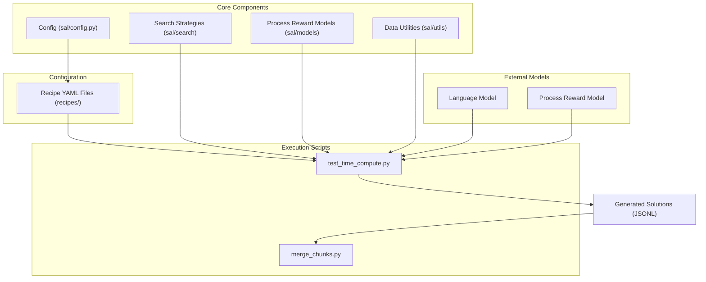
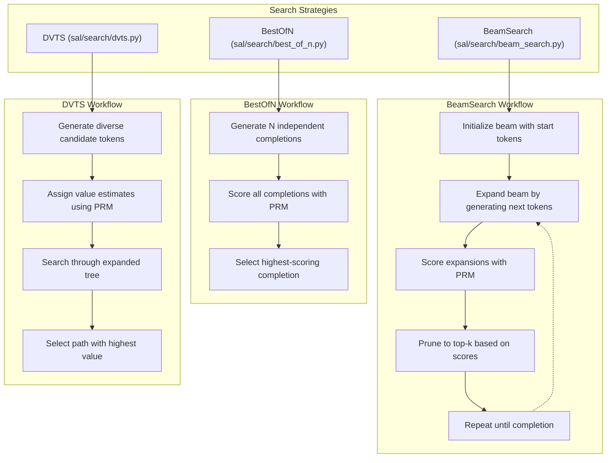
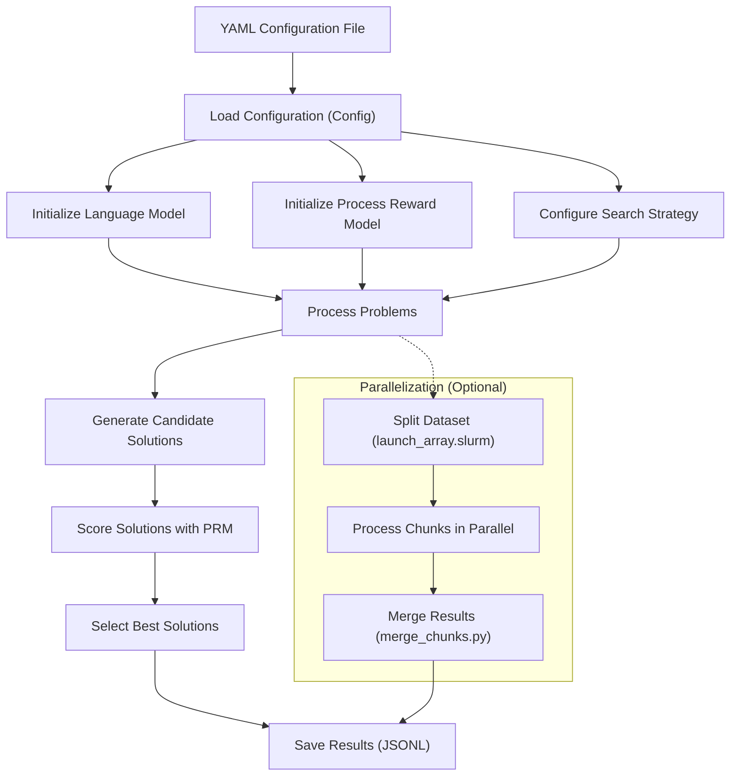
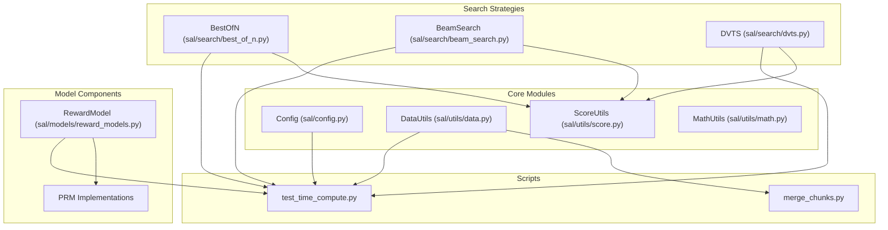

<!-- source: DeepWiki mcp.deepwiki.com · repo huggingface/search-and-learn · page 1 Overview · fetched 2026-10-26 -->

# Overview

<details>
<summary>Relevant source files</summary>

The following files were used as context for generating this wiki page:

- [README.md](README.md)
- [recipes/README.md](recipes/README.md)

</details>


Search and Learn is a repository that provides tools and infrastructure for enhancing Language Model capabilities through test-time compute scaling. Rather than relying solely on larger model sizes (which require expensive training), this approach allows models to "think longer" on harder problems by using search algorithms guided by Process Reward Models (PRMs).

For detailed installation instructions, see [Installation and Setup](#1.1). For an explanation of the theoretical underpinnings, see [Key Concepts](#1.2).

## Purpose and Scope

The Search and Learn repository implements techniques that allow open-source models to solve complex problems when given enough "time to think." The repository focuses on two main areas:

1. **Search against verifiers**: Guiding LLMs to search for solutions to "verifiable problems" (math, code) using Process Reward Models to score each step of the reasoning.

2. **Training process reward models**: Providing infrastructure to train reward models that evaluate each step of a reasoning process, offering fine-grained feedback for search methods.

As explained in the project's README, the name is inspired by Rich Sutton's Bitter Lesson: "the great power of general purpose methods, of methods that continue to scale with increased computation... are **search** and **learning**."

Sources: [README.md:10-15]()

## System Architecture

### High-Level System Diagram



Sources: [README.md:72-84](), [recipes/README.md:1-27]()

### Search Strategies Comparison

The repository implements three main search strategies:



Sources: [README.md:40-43](), [recipes/README.md:3-15]()

### Data Flow Pipeline



Sources: [recipes/README.md:159-192]()

## Supported Search Strategies

The repository implements three different search strategies, each with different characteristics:

### 1. Best-of-N

The simplest search strategy. It:
- Generates `n` independent solutions to a problem
- Scores each solution using the Process Reward Model
- Selects the highest-scoring solution

This approach is computationally efficient but lacks the guided search aspects of the other strategies.

### 2. Beam Search

A more guided approach that:
- Maintains a beam of the top-k most promising candidate solutions at each step
- Expands each candidate by generating the next token
- Scores all expansions and prunes to keep only the top-k
- Repeats until all candidates are complete

Beam search provides more guidance than Best-of-N but can suffer from lack of diversity.

### 3. Diverse Value Transformation Search (DVTS)

A sophisticated approach that:
- Generates diverse candidate tokens at each step
- Assigns value estimates using the Process Reward Model
- Searches through the expanded tree to find the highest-value path

DVTS combines the exploration benefits of diverse sampling with the exploitation benefits of value-guided search.

Sources: [README.md:40-43](), [recipes/README.md:3-15]()

## Component Relationships



Sources: [README.md:72-84]()

## Getting Started

To get started with Search and Learn:

1. Install the repository:
```bash
pip install -e '.[dev]'
```

2. Select a recipe configuration:
```bash
export CONFIG=recipes/Llama-3.2-1B-Instruct/best_of_n.yaml
```

3. Run test-time compute:
```bash
python scripts/test_time_compute.py $CONFIG
```

Each approach can be launched by specifying the associated YAML configuration file from the `recipes` directory. For more detailed instructions, see [Running Basic Experiments](#3.1).

The repository includes pre-configured recipes for three different base models:
- Llama-3.2-1B-Instruct
- Llama-3.2-3B-Instruct
- Qwen2.5-1.5B-Instruct

And for each of the three search strategies (Best-of-N, Beam Search, and DVTS).

Sources: [README.md:46-62](), [recipes/README.md:17-23](), [recipes/README.md:5-15]()

## Supported Process Reward Models

The system currently supports the following Process Reward Models:

| PRM | Description |
|-----|-------------|
| RLHFlow/Llama3.1-8B-PRM-Deepseek-Data | Default PRM used in the recipes |
| peiyi9979/math-shepherd-mistral-7b-prm | Alternative PRM for evaluation |
| Skywork/Skywork-o1-Open-PRM-Qwen-2.5-1.5B | Skywork PRM for Qwen models |
| Skywork/Skywork-o1-Open-PRM-Qwen-2.5-7B | Larger Skywork PRM variant |

The repository also includes infrastructure for training custom Process Reward Models. For more information, see [Training Process Reward Models](#4).

Sources: [recipes/README.md:86-91](), [recipes/README.md:201-203]()

---

