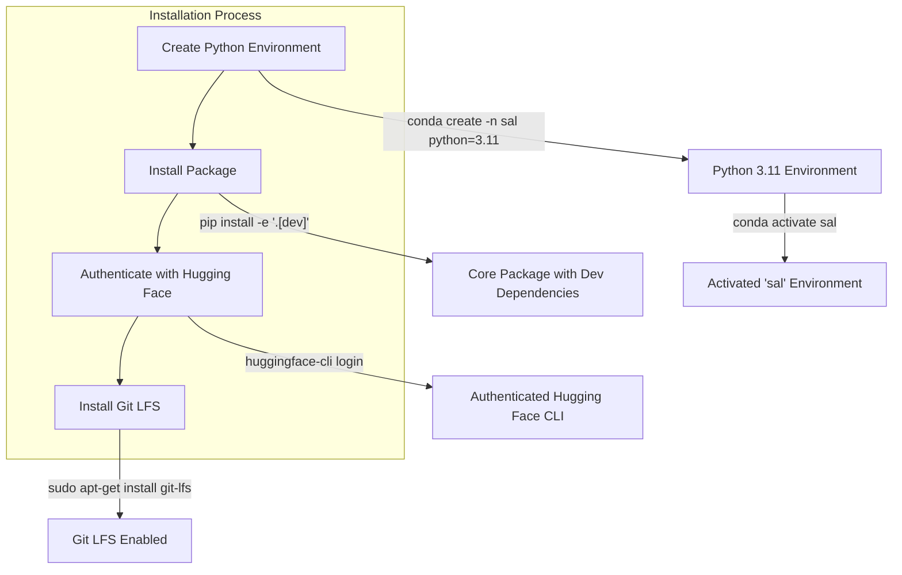
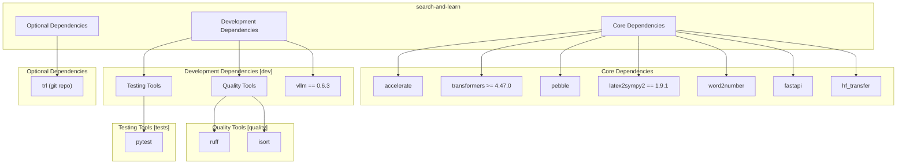
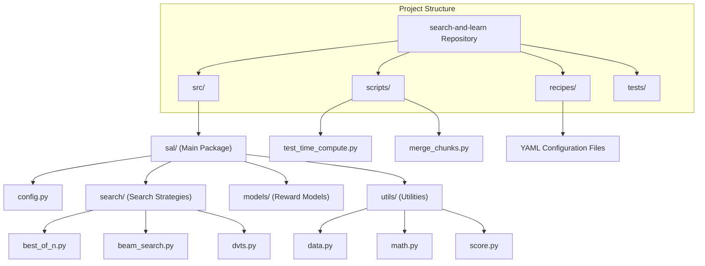

<!-- source: DeepWiki mcp.deepwiki.com · repo huggingface/search-and-learn · page 1.1 Installation and Setup · fetched 2026-10-26 -->

# Installation and Setup

<details>
<summary>Relevant source files</summary>

The following files were used as context for generating this wiki page:

- [.gitignore](.gitignore)
- [LICENSE](LICENSE)
- [README.md](README.md)
- [setup.py](setup.py)

</details>


This document provides comprehensive instructions for setting up the Search and Learn environment, which is required to run test-time compute scaling experiments. For information about key concepts and system architecture, see [Key Concepts](#1.2) and [System Architecture](#2).

## System Requirements

Before installing Search and Learn, ensure your system meets the following requirements:

- Python 3.10.9 or higher
- Git with Large File Storage (LFS) support
- Hugging Face account (for model access and uploading results)

Sources: [setup.py:61-61]()

## Installation Steps

The installation process consists of four main steps: creating a Python environment, installing the package, authenticating with Hugging Face, and setting up Git LFS.



### 1. Creating a Python Environment

First, create a dedicated Python virtual environment using Conda:

```bash
conda create -n sal python=3.11 && conda activate sal
```

This creates an environment named `sal` with Python 3.11 and activates it.

Sources: [README.md:50-52]()

### 2. Installing the Package

Install the Search and Learn package in development mode with optional dependencies:

```bash
pip install -e '.[dev]'
```

This command installs the package in editable mode (`-e`), allowing you to modify the code without reinstalling. The `[dev]` option installs additional development dependencies.

Sources: [README.md:55-55](), [setup.py:24-25]()

### 3. Authenticating with Hugging Face

To access models and push results to the Hugging Face Hub, log in to your Hugging Face account:

```bash
huggingface-cli login
```

This will prompt you for your Hugging Face authentication token, which you can find in your [Hugging Face account settings](https://huggingface.co/settings/tokens).

Sources: [README.md:59-61]()

### 4. Installing Git LFS

To handle large model files when pushing to the Hugging Face Hub, install Git Large File Storage (LFS):

```bash
sudo apt-get install git-lfs
```

Sources: [README.md:65-66]()

## Dependency Structure

Search and Learn relies on several dependencies to function properly. Understanding this structure helps when troubleshooting or extending the system.



The package is organized with several dependency groups:

- **Core dependencies**: Required for basic functionality
- **Development dependencies [dev]**: Tools for development, testing, and quality assurance
- **TRL dependency [trl]**: Optional transformer reinforcement learning library

Sources: [setup.py:21-34]()

## Package Structure

After installation, the Search and Learn package structure is organized as follows:



This structure shows where to find key components after installation. The main scripts for running experiments are in the `scripts/` directory, while configuration recipes are in the `recipes/` directory.

Sources: [README.md:74-84]()

## Verifying Installation

To verify your installation is working correctly, you can check the available commands and directory structure:

```bash
# Verify package installation
pip list | grep search-and-learn

# Check directory structure
ls -la recipes/
ls -la scripts/
```

After installation, you should proceed to [Running Basic Experiments](#3.1) to start using the system.

## Troubleshooting Common Issues

| Issue | Possible Cause | Solution |
|-------|---------------|----------|
| `ModuleNotFoundError` | Package not installed correctly | Ensure you're in the correct environment with `conda activate sal` and reinstall with `pip install -e '.[dev]'` |
| Authentication failures | Invalid Hugging Face token | Generate a new token at huggingface.co/settings/tokens and run `huggingface-cli login` again |
| Git LFS errors | Git LFS not properly installed | Run `git lfs install` after installing Git LFS |
| Version conflicts | Incompatible dependency versions | Create a fresh environment and reinstall with specific versions |

Sources: [README.md:46-70](), [setup.py:21-36]()

## Next Steps

After completing the installation and setup, you can:

1. Explore the [Available Recipes](#3.2) for different models and search strategies
2. Follow the [Running Basic Experiments](#3.1) guide to run your first test-time compute experiment
3. Learn about [Scaling with SLURM](#3.3) for larger experiments

Sources: [README.md:33-36]()

---

