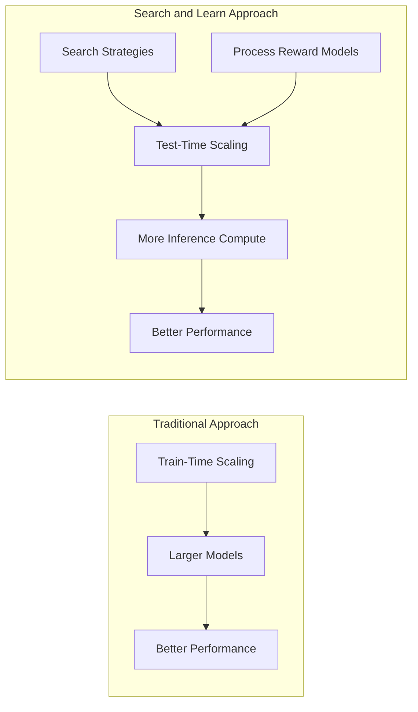
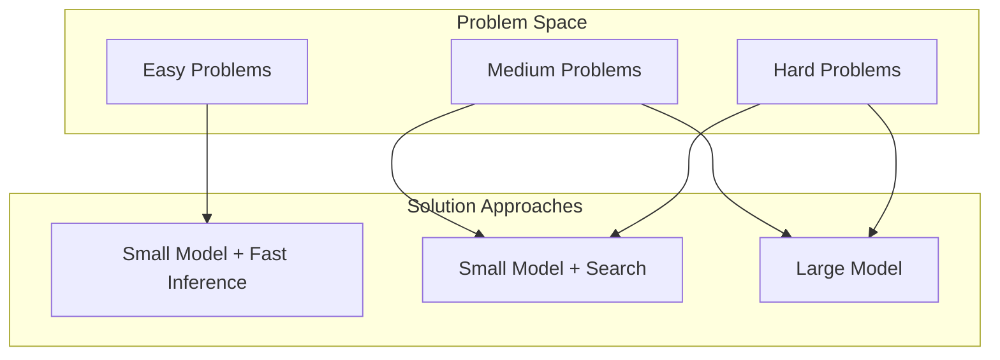
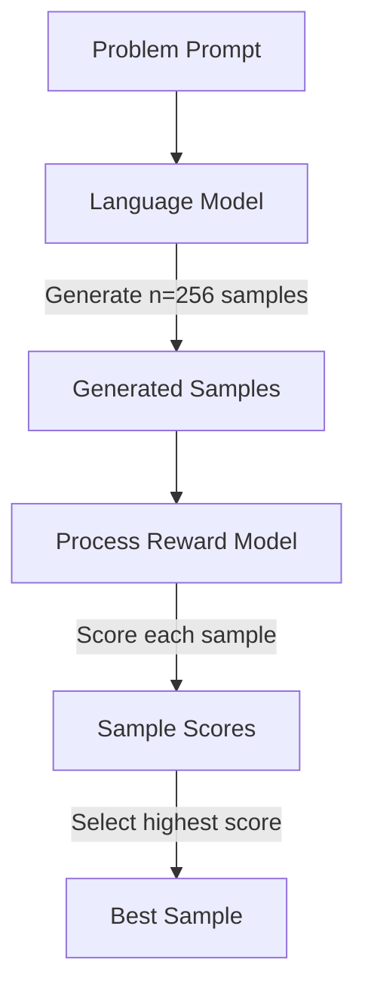
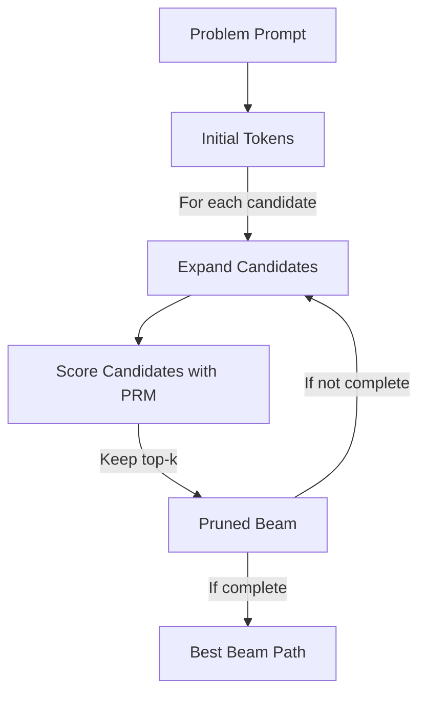
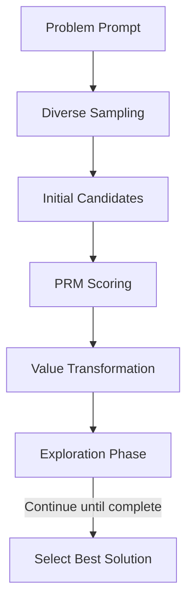
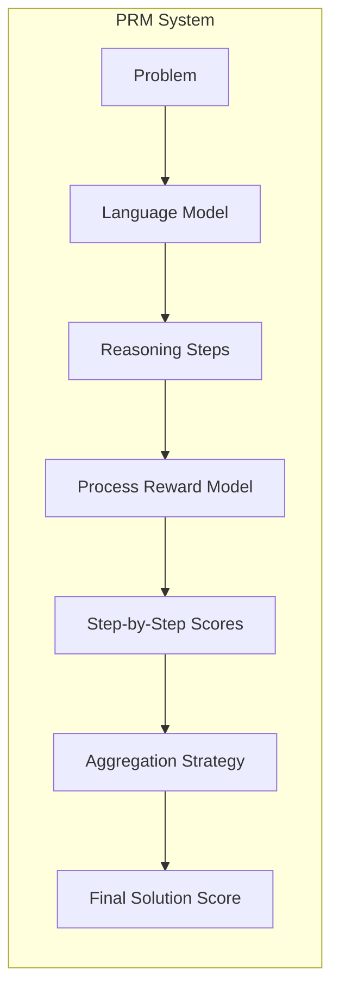
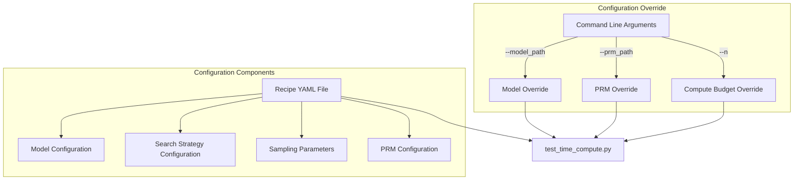
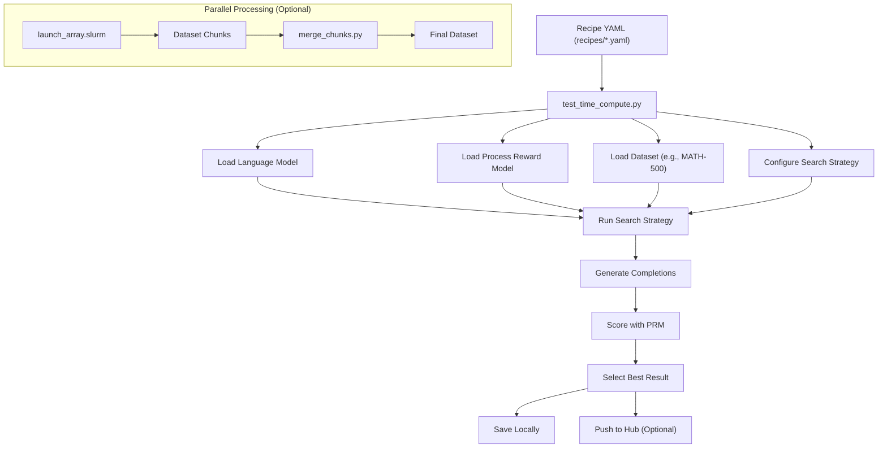
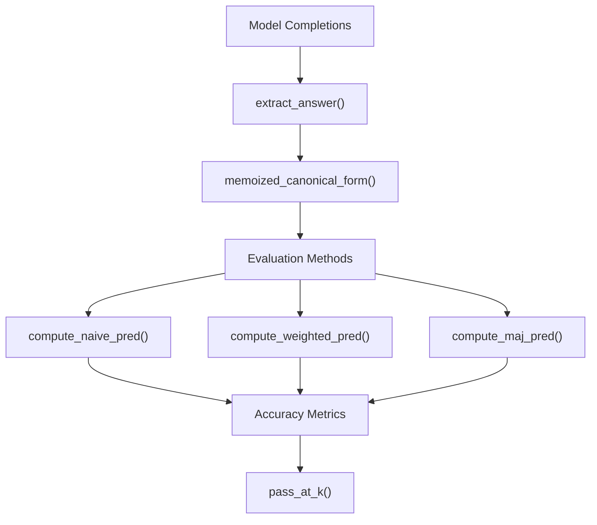

<!-- source: DeepWiki mcp.deepwiki.com · repo huggingface/search-and-learn · page 1.2 Key Concepts · fetched 2026-10-26 -->

# Key Concepts

Relevant source files

The following files were used as context for generating this wiki page:

- [README.md](README.md)
- [recipes/README.md](recipes/README.md)
- [src/sal/utils/math.py](src/sal/utils/math.py)

This page provides an overview of the core concepts in the Search and Learn repository, focusing on test-time compute scaling, search strategies, and process reward models. For information about the overall system architecture, see [System Architecture](#2).

## Test-Time Compute Scaling

Test-time compute scaling is an approach to improving language model performance by allocating more computational resources during inference rather than during training. While conventional approaches focus on creating larger models with more parameters (train-time scaling), test-time compute scaling allows smaller models to achieve better performance on complex tasks by giving them more "time to think" during inference.

The key insight is that for many complex problems (like math or coding), even smaller models can produce correct solutions if they are allowed to explore multiple solution paths and evaluate their quality.

Sources: [README.md:15-26]()/[recipes/README.md:3-15]()

## Test-Time Compute vs. Model Size Scaling

The Search and Learn repository demonstrates that scaling test-time compute can be more effective than scaling model size for certain tasks, especially for open-source models that don't have the parameter count of the largest proprietary models.

Key advantages of test-time compute scaling:

- **Resource Efficiency**: Increasing test-time compute is typically more affordable than training larger models
- **Accessibility**: Makes advanced capabilities accessible to users of open-source models
- **Problem Adaptability**: Allows dynamically allocating more compute for harder problems

Sources: [README.md:16-24]()

## Search Strategies

The repository implements three main search strategies for test-time compute scaling, each offering different trade-offs between exploration breadth and computational efficiency.

### Best-of-N

Best-of-N is the simplest search strategy, implemented in `sal/search/best_of_n.py`:

1. Generate N independent samples from the language model
2. Score each complete sample using a process reward model
3. Select the sample with the highest score

Sources: [recipes/README.md:7-108]()

### Beam Search

Beam Search maintains a "beam" of the most promising solution paths, implemented in `sal/search/beam_search.py`:

1. Start with an initial prompt
2. Generate multiple possible next tokens for each candidate in the beam
3. Score all potential new candidates
4. Keep only the top-k candidates (where k is the beam width)
5. Repeat until generation is complete

Sources: [recipes/README.md:8-134]()

### Diverse Value Transformation Search (DVTS)

DVTS, implemented in `sal/search/dvts.py`, combines elements of Best-of-N and Beam Search while promoting diversity in the solutions:

1. Generate an initial set of diverse samples
2. Score these samples using a process reward model
3. Use the scores to guide further exploration of promising solution paths
4. Balance exploration and exploitation to find optimal solutions

Sources: [recipes/README.md:9-158]()

## Process Reward Models (PRMs)

Process Reward Models (PRMs) are specialized models trained to evaluate the quality of solution paths, providing step-by-step feedback on the reasoning process rather than just scoring the final answer.

Key characteristics of PRMs:

- Provide fine-grained feedback on each step of the reasoning process
- Can identify promising solution approaches before the complete solution
- Enable effective search by prioritizing high-value solution paths

The repository supports several PRMs, including:
- `RLHFlow/Llama3.1-8B-PRM-Deepseek-Data` (default)
- `peiyi9979/math-shepherd-mistral-7b-prm`
- `Skywork/Skywork-o1-Open-PRM-Qwen-2.5-1.5B`
- `Skywork/Skywork-o1-Open-PRM-Qwen-2.5-7B`

The PRMs are critical components that enable effective search by providing quality signals that guide the exploration of the solution space.

Sources: [recipes/README.md:76-91]()

## Configuration System

The Search and Learn system uses YAML recipe files to configure experiments. These recipes define all aspects of a test-time compute experiment:

A typical recipe specifies:

1. **Model Selection**: Which language model and process reward model to use
2. **Search Strategy**: Which search algorithm to apply and its parameters
3. **Generation Parameters**: Temperature, top-p, and other sampling parameters
4. **Evaluation Settings**: How results should be evaluated and reported

Recipe files make experiments reproducible and allow easy sharing of specific configurations with the community. The repository provides ready-to-use recipes for different models (Llama-3.2, Qwen2.5) and search strategies.

Sources: [recipes/README.md:17-58]()

## System Workflow

The end-to-end workflow in the Search and Learn system follows these steps:

For large-scale experiments, the process can be parallelized using SLURM array jobs, with the dataset split into chunks and results later merged using `scripts/merge_chunks.py`.

Sources: [recipes/README.md:94-196]()

## Mathematical Utilities and Answer Processing

The Search and Learn system includes utilities for processing and evaluating mathematical answers, primarily in `sal/utils/math.py`:

| Utility | Purpose |
|---------|---------|
| `memoized_canonical_form` | Converts math expressions to canonical form using sympy |
| `extract_answer` | Extracts answers from model completions |
| `subsample_completions` | Creates subsets of completions for evaluation at different compute budgets |
| `compute_naive_pred` | Computes predictions based on highest score |
| `compute_weighted_pred` | Computes predictions using score-weighted answer aggregation |
| `compute_maj_pred` | Computes predictions based on majority voting |
| `pass_at_k` | Calculates pass@k metrics for evaluating model performance |

These utilities ensure accurate comparison and evaluation of mathematical solutions, which is crucial for the effectiveness of the search strategies.

The mathematical utilities handle edge cases like timeout during symbolic computation and provide fallback mechanisms to ensure robust evaluation.

Sources: [src/sal/utils/math.py:30-278]()

---

